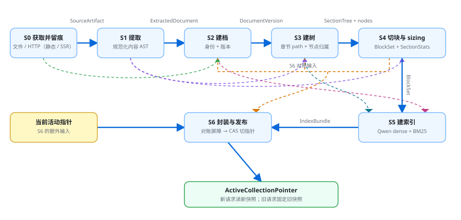

# 07 · 入库侧设计：HTML 来源、正文提取、切块与快照

上游：[05](05-storage-and-retrieval-strategy.md)（存储结构）、 [06](06-retrieval-pure-agent.md)（检索契约）、 [04](04-architecture-design-method.md)（质量属性）。

**状态：已审核（2026-10-20），作为当前实现基线。** 第一版只支持 HTML，来源同时支持本地文件和 URL；技术组件尚未选型。

[← 返回文档索引](../README.md)

## 0. 这一层解决什么

检索侧已经把“需要什么”写得很清楚：文档能被识别和消歧，章节能被唯一定位，块保留完整原文和顺序，文本同时支持语义与字面检索。入库侧要回答的是：

>  **HTML 原始内容怎样变成一份可检索、可引用、可复现的 collection 快照？**

这不是“HTML 转字符串再切块”。完整链路是：

```text
HTML 来源
  → 保存原始输入
  → 提取正文
  → 建立文档身份与版本
  → 重建章节树
  → 切分证据块
  → 固定 estimator 的近似大小提示
  → Qwen embedding 与索引
  → embedding + 关键词索引
  → 构建 manifest
  → 原子发布 collection 快照
```

每个阶段都要有可检查产物和失败状态，不能把全部逻辑塞进一次解析调用。

## 1. 先补需求缺口：Agent 学习者会导入哪些资料

0050 定义了“用户会问什么、什么算答得好”，但没有详细定义“文档”到底包含哪些载体。这个缺口必须由入库侧架构补上：格式决定了获取方式、解析器、结构恢复能力和后续切块策略。

这里的“文档”不应按文件后缀理解，而应按学习资料的来源与内容形态理解。

**为什么先按 Agent 技术学习资料分析。**这个产品不是只为 Agent 话题服务；它是通用的“文档学习问答”助手。但架构不能抽象地罗列“所有可能的格式”，必须选一个**首批真实学习域**做需求取样。当前已有用例、语料与评测都围绕 Agent／RAG 技术学习，所以先以这个域回答两个问题：

1. 这类学习者实际会读哪些成篇资料？
2. 这些资料主要通过什么载体出现？

这里得到的是**首版格式优先级**，不是产品永久的主题边界。以后扩展到其他学习领域时，可以重新采样资料类型和格式；HTML 首版只是“当前需求域里价值最高、风险最低”的起点。

### 1.1 主要学习资料来源

| 资料类型 | 典型内容 | 常见载体 | 对 Agent 学习的重要性 |
| --- | --- | --- | --- |
| **官方设计文／工程博客** | 模型厂商与云厂商如何设计 Agent、工具、上下文、权限和评测 | HTML、SSR 页面 | 最高：一手设计取舍 |
| **官方文档** | Agent SDK、函数调用、MCP、记忆、评测、部署 | HTML、Markdown | 最高：当前 API 与行为口径 |
| **研究论文／White Paper** | ReAct、Reflexion、RAG、GraphRAG、Agent 评测等 | PDF、arXiv HTML | 高：机制与方法的原始出处 |
| **开源项目文档** | README、docs、设计说明、examples、changelog | Markdown、GitHub HTML | 高：能对照真实实现 |
| **工程深度文章** | 架构复盘、故障分析、Trace、成本和评测经验 | HTML、技术平台文章 | 高：一手经验多，质量差异大 |
| **Benchmark／评测报告** | Agent 基准、RAG 对比、能力边界研究 | PDF、HTML、Notebook | 高：判断能力上限与失败类型 |
| **标准与协议** | MCP、OpenTelemetry、OpenInference、OpenAPI | HTML、Markdown | 中高：接口和生态基础 |
| **课程／讲义／演讲** | 系统课程、会议分享、视频文字稿 | HTML、slides、transcript | 中：体系化强，但获取和清洗成本更高 |

“成篇论述”是首版边界：单条社交媒体发言、零散 issue 回复和纯代码片段不作为独立文档；它们以后可以作为补充证据或代码资料，但不承担系统化学习的主资料角色。

### 1.2 格式优先级

格式优先级不由解析难易单独决定，而由“资料价值 × 出现频率 × 解析可控性”共同决定：

| 优先级 | 格式 | 理由 | 当前决策 |
| --- | --- | --- | --- |
| **P0** | **HTML 页面** | 覆盖官方博客、技术文章、在线文档和大量工程复盘；结构相对文本化 | **第一版实现** |
| **P1** | **Markdown** | 覆盖 GitHub 文档、README、设计说明和 changelog；结构比 HTML DOM 更干净 | 第二优先 |
| **P2** | **PDF** | 覆盖论文与技术白皮书，是 Agent 学习的高价值来源；版面、公式和表格复杂 | 第一版后尽快验证 |
| **P3** | Notebook、slides、视频 transcript | 对实验、课程和讲座有价值，但载体和清洗方式差异更大 | 后续扩展 |

### 1.3 第一版能力边界

| 项 | 第一版支持 | 暂不支持 |
| --- | --- | --- |
| **输入格式** | 单个 HTML 页面 | Markdown、PDF、Word、图片、音频、压缩包 |
| **本地来源** | 用户提供 `.html/.htm` 文件 | 任意目录递归扫描、压缩包导入 |
| **网络来源** | 用户提供一个公开 HTTP／HTTPS URL | 登录页、付费墙、Cookie 会话、必须人工交互的页面 |
| **页面执行** | 只接受初始 HTML 已含正文的静态／SSR 页面，不执行 JavaScript | JavaScript 空壳页面；后续如需支持，再单独引入隔离浏览器渲染 |
| **站点范围** | 一个 URL 对应一个 document | 自动抓取整站、sitemap 展开、文档集批量发现 |
| **正文元素** | 标题、段落、列表、引用、代码块、表格 | 视频、复杂交互组件 |
| **图片** | 保留 alt 与 caption 文本 | OCR、视觉理解 |

URL 失败必须分类：网络错误、非 HTML、登录／反爬拦截、无可提取正文、JavaScript 空壳等不能都变成“空文档”。首版不执行页面脚本，也不承诺获取懒加载内容与评论区。

## 2. 目标产出：一份可检索、可引用、可复现的 collection 快照

入库侧的目标不是“把 HTML 转成一段纯文本”，也不能只交付块列表。05 已经确定存储形态是增强向量块，06 又明确了文档、章节、块和索引契约，03 补充了快照状态、版本和构建完整性要求。因此目标产出已经可以先定下来。

>  **最终交付物是一份不可变 collection 快照。**<br> 快照内部同时包含文档、章节树、块、正文 artifact、向量索引、关键词索引、构建状态和版本 manifest。检索侧只读取已发布的完整快照。

| 目标产物 | 必须包含什么 | 供谁使用 |
| --- | --- | --- |
| **原始来源 artifact** | `raw_bytes`、`media_type`、`source_kind`、`source_key`、抓取／读取时间、原始内容 hash、最终 URL（若有）、实际 charset（文本格式） | 重新解析、引用核对、解析器升级后的重建与故障诊断 |
| **文档记录** | `doc_id`、标题、来源显示名、别名、语言、文档版本、原始内容 hash、章节数、块数 | `list_documents`、消歧、引用展示、版本与快照管理 |
| **章节树** | 唯一 `section_path`、parent path、ordinal、depth、原文顺序、first line、直属与子树块数／token | `get_outline`、章节范围选择、`list_blocks` 的完整范围语义 |
| **块记录** | `block_id`、`doc_id`、`section_path`、`block_index`、规范原文 `text`、字符偏移、内容 hash、语言、上下文 token、embedding token | 全文返回、精确扫描、原文顺序枚举、引用回查和预算计算 |
| **向量与关键词索引** | 块向量、embedding provider／model／版本／维度；基于原文的关键词索引；索引 schema 与检索常数 | `search_blocks` 的语义召回与字面路候选，以及检索重放 |
| **快照 manifest** | `collection_snapshot_id`、状态、完整性、文档清单、失败文档、解析／切块／tokenizer／索引版本、各阶段统计和 checksum | 请求固定快照、partial 缺口披露、复现、迁移、清理和运维 |
| **入库任务记录** | `job_id`、输入来源、阶段、进度、成功／失败文档、错误码、重试次数和最终快照 ID | 后台任务状态、暂停续跑、失败定位和用户反馈 |

章节记录里的直属／子树块数和 token 不是 S3 建树时就能得到的数据。块数由 S4 生成；token 数只是 S4 用固定 `ChunkSizingEstimator` 产生的近似大小，用于切块和范围规划，不是跨模型精确值。S3 只负责稳定的 `section_path` 和节点归属。

**产出边界已经由前序架构确定**：块不是独立文件，而是快照内与文档、章节和索引绑定的记录；单篇文档必须完成解析、切块、embedding 和索引后才算成功；批次可以产生 `ready_partial`，但不能发布残缺单篇。

下面的流程只解释这些目标产物怎样被构造出来。来源获取、正文提取、章节树、切块、建索引和发布，都是从目标契约反推出来的阶段。

## 3. 主流程：怎样把输入变成目标快照

入库不是一个大函数，而是一组有明确输入、输出和不变量（每一步都必须始终成立的条件）的阶段。阶段拆分的目的不是“代码好看”，而是让错误可以被定位、任务可以续跑、产物可以重建。

### 3.1 主流程总览

| 阶段 | 输入 | 输出 | 必须成立的条件 |
| --- | --- | --- | --- |
| **S0 获取并留痕** | 本地路径或 URL | 已原子写入的不可变 `SourceArtifact`：原始字节、媒体类型、来源元数据、获取状态和 artifact 引用 | 来源可读；编码、响应类型、重定向与体积在限制内；原始输入先落盘，后续变换不得覆盖 |
| **S1 提取** | `SourceArtifact` | 已原子写入的不可变 `ExtractedDocument`：候选标题、语言、按原文顺序排列的语义节点、提取告警和 `extraction_hash` | 媒体类型有对应适配器；首版仅 HTML；导航、脚本、页脚被去除；正文不足则失败 |
| **S2 建档** | `SourceArtifact` 元数据＋`ExtractedDocument` | `DocumentRecord`＋`DocumentVersionRecord`：稳定 `doc_id`、文档版本、标题、来源显示名、别名和语言 | `source_key` 稳定映射到 `doc_id`；同来源同提取内容幂等；内容变化递增版本；不生成章节或块 |
| **S3 建树** | `DocumentVersionRecord`＋`ExtractedDocument` | 不可变 `SectionTree`：唯一 `section_path`、父子关系、原文顺序、节点范围和告警；块／token 统计留到后续派生 | 文档标题不重复建节；每个正文节点归属唯一章节；重名 path 唯一化；无标题时生成根节 |
| **S4 切块与大小估算** | `SectionTree`＋直属语义节点＋`ChunkSizingPolicy` | 不可变 `BlockSet`：有序 block、偏移、块 hash、每个 block 的近似 token 提示和 `SectionStats` | 块不跨章节、无重叠、无遗漏；用固定 estimator 做 sizing；450 是默认目标，不是跨模型精确硬约束 |
| **S5 建索引** | `BlockSet`＋文档／章节上下文＋Qwen embedding 配置 | `IndexBundle`：dense 向量、关键词索引、embedding 输入 hash、实际 API usage 和构建错误 | embedding 输入由 block 派生且不改原文；按 Qwen 批大小调用；两路索引来自同一批 block |
| **S6 封装与发布** | 文档、章节、块、索引、版本、当前活动指针 | 候选 manifest、PublishRecord、原子切换后的 ActiveCollectionPointer | 先完成 manifest／artifact／索引对账，再 CAS 切指针；失败不动旧快照，只有 ready／ready_partial 可发布 |



**数据流重点**：S1 之后产出的对象不会只供紧邻阶段使用。例如 `ExtractedDocument` 同时流向 S2、S3、S4，`SectionTree` 同时流向 S4、S5、S6；S6 还接收当前活动指针并负责原子发布。

### 3.2 为什么顺序不能随意调整

- **原始输入必须在 S0 内先留痕。**获取结果如果没有原子落盘，就不算稳定阶段；先清洗再保存会导致解析器升级后无法用同一输入重建。
- **正文根必须早于章节树。**导航和侧栏里也有标题，如果先全 DOM 建树，会把站点导航误当成知识结构。
- **文档身份必须早于块 ID。**block_id 依赖 doc_id、切块版本和块位置；身份没稳定，块身份也无法稳定。
- **章节树必须早于切块。**块不能跨章节是完整性语义的前提；先切块再补章节会制造难处理的边界块。
- **上下文 sizing 必须发生在切块过程中，embedding 输入必须早于 Qwen 请求生成。**前者决定候选 block 是否还要继续合并／拆分；后者负责组装检索上下文并调用 API。Qwen3.7 的 128k 上限远高于块目标，因此不再单独做逐块 token 预检。
- **所有索引完成后才能发布。**只要向量或关键词索引缺一部分，检索就会给出不可解释的残缺结果。

### 3.3 阶段隔离与可恢复性

一个任务应在独立 job workspace 中构建候选快照，而不是直接修改当前活动快照。每个阶段至少记录：

- 阶段状态：queued／running／paused／succeeded／failed；
- 输入内容 hash、配置与版本；
- 输出数量与 artifact 引用；
- 错误码、是否可重试和重试次数；
- 耗时与 token 用量。

这样可以从失败阶段续跑，而不是整批重算。纯解析、结构化和切块阶段应保持幂等；embedding 和索引阶段也必须避免重复写入。

### 3.3.1 超时与重试默认策略

重试只在“可能恢复且不会改变业务语义”的失败上发生。每次尝试都记录开始时间、耗时、错误码、request ID 和实际 usage；用户取消后不再发起新尝试。

| 操作 | 默认超时 | 自动重试 | 明确不重试 |
| --- | --- | --- | --- |
| 本地文件读取 | 不设短墙钟超时，允许用户取消 | 1 次瞬时 I/O／锁冲突 | 文件不存在、无权限、编码无法判断、内容为空 |
| HTTP/HTTPS 获取 | 连接 10s，总请求 60s，最多 5 次重定向 | 网络中断、408、429、5xx：最多 2 次；优先遵守 `Retry-After`，否则约 1s／4s 退避并加抖动 | 其余 4xx、非 HTML、登录／反爬页面、目标地址违反 SSRF 规则 |
| Qwen embedding 单批 | 单次请求 60s | 网络错误、429、5xx：最多 2 次；优先遵守 `Retry-After`，否则约 1s／4s 退避并加抖动 | 400、401、403、422、请求内容非法或输入为空 |
| 本地索引与 manifest 写入 | 不设固定短超时，允许用户取消 | 瞬时锁冲突／I/O：最多 1 次 | schema 错误、checksum 不一致、确定性校验失败 |

**计费歧义**：网络在请求发出后超时，供应商可能已经处理并计费；重试无法保证不产生第二次费用。系统应保留每次 request ID 和 usage，并在成本诊断中标记“响应丢失后重试”；向量写入按 `block_id` upsert，避免重复记录，但不能承诺供应商侧零重复计费。

### 3.4 单篇失败与批次发布

单篇文档是发布的最小成功单位：只要解析、建树、切块、embedding 或索引任一必需阶段失败，该文档就不进入成功集合。

批次结束时：

- 全部成功 → `ready`；
- 部分成功、至少一篇可用 → `ready_partial`，失败文档必须进入清单；
- 无可用文档或关键索引失败 → `failed`；
- 尚未完成 → `building`，不可被检索请求选中。

>  **主流程的核心不变量**<br> 原始输入可追；文档身份稳定；章节 path 唯一；块不跨章节；块序不断裂；双索引来自同一批块；manifest 对账通过；旧快照在新快照发布前始终可用。

## 4. S0 获取并留痕：把本地文件或 URL 统一为 SourceArtifact

**输入**：一个本地 `.html/.htm` 路径，或一个公开的 HTTP／HTTPS URL。

**输出**：一份已原子写入的格式中立 `SourceArtifact`：原始字节、媒体类型、来源身份、内容 hash、读取／抓取时间、获取过程元数据和 artifact 引用。此时还没有标题、章节、块或 doc_id；那些属于后续解析与建档阶段。

**这一阶段最值得分析的问题是什么？**S0 看似只是“读文件／下载网页”，实际要解决三个边界：

1. **输入归一**：文件与 URL 的获取方式不同，但后续正文提取必须消费同一种对象；
2. **来源可追**：必须区分“用户从哪里得到它”“最终抓到了哪个地址”“用于判断是否同一来源的规范键”这三件事；
3. **失败归属**：网络失败、非 HTML、登录／反爬、JavaScript 空壳和正文不足是不同问题，不能都在后续变成一个空文档。

**分析结论**：S0 只负责把输入变成可信、可追溯且已经落盘的来源对象，不负责理解正文或推导结构。文件与 URL 是两种获取适配器；URL 只读取服务器返回的初始 HTML。首版不执行 JavaScript，也不引入浏览器渲染通道；页面正文不在初始 HTML 中时，应在后续提取阶段明确失败。

>  **阶段边界原则**<br> 获取层只负责拿到格式中立的原始来源；格式判断与解析属于下一层。当前首版只注册 HTML 适配器，未来增加 Markdown／PDF 时复用同一个 `SourceArtifact`、任务记录和快照骨架。

**最终设计方案**：两条来源通道统一输出已留痕的 `SourceArtifact`，后续 S1 直接按 `media_type` 分派格式适配器。下面分别定义本地文件、URL 和统一契约。

### 4.1 本地 HTML 文件

- 读取原始字节，按 BOM／HTTP 风格 charset／`<meta charset>`／UTF-8／常见中文编码顺序解码；
- 保存绝对路径或用户选择的来源标识；
- 文件内容 hash 为原始 HTML 字节的 hash；
- 单篇本地 HTML 原始内容上限为 20 MiB，超限明确失败；
- 文件移动后，若无法识别同一来源，可将它视为新文档。

### 4.2 URL

- 只允许 `http`／`https`；保存请求 URL、最终 URL、抓取时间和 HTTP 状态；
- 记录响应的 Content-Type；当前 HTML 适配器只接受 `text/html`，其他类型在格式分派阶段返回 `unsupported_media_type`；同域或跨域重定向都设最大次数；
- 不携带用户 Cookie、不提交表单、不执行页面 JavaScript；响应必须是可直接解析的 HTML；JavaScript 空壳页面进入失败清单，后续需要时再作为独立能力评估；
- 阻止 localhost、私网、链路本地地址和其他明显的 SSRF 目标；每次重定向后重新校验目标地址。当前实现记录 DNS rebinding 残余风险，公开发布前重新评估 IP pinning，见 BL-0002；
- 连接 10s、总请求 60s、最多 5 次重定向；超时与重试按 §3.3.1；单篇 URL 原始响应上限为 20 MiB，超限明确失败；
- 服务器返回非 2xx、空正文或明确登录页时，任务失败并记录原因。

### 4.3 统一后的输入契约

获取层最终都产出同一个格式中立对象，后续解析不关心它来自文件还是网络：

| 字段 | 含义 |
| --- | --- |
| `source_kind` | `file \| url` |
| `source_key` | 用于识别“同一来源”的规范键：URL 使用规范化最终地址，文件使用规范化绝对路径 |
| `source_uri` | 用户原始输入的 URL 或文件路径，用于溯源与诊断 |
| `media_type` | 例如 `text/html`、`text/markdown`、`application/pdf` |
| `raw_bytes` | 未经解析或改写的原始内容字节 |
| `raw_artifact_ref` | 原始内容不可变 artifact 的引用；S0 返回前必须成功写入 |
| `content_hash` | 原始字节的 SHA-256 |
| `fetched_at` | 读取／抓取时间 |
| `final_url` | URL 来源的最终地址；文件来源为 null |
| `http_status` | URL 来源的最终 HTTP 状态；文件来源为 null |
| `acquisition_mode` | `file \| http`：直接读文件或读取服务器响应；首版没有浏览器通道 |
| `charset` | 文本格式实际采用的编码；二进制格式为 null |

## 5. S1 提取：把 SourceArtifact 变成可检查的 ExtractedDocument

**输入**：一份已经原子写入的 `SourceArtifact`，以及其中的 `media_type`、获取方式和 `raw_artifact_ref`。S1 只读取服务器返回的原始 HTML，不执行页面脚本，也没有渲染后 artifact。

**输出**：一份已原子写入、不可变的 `ExtractedDocument`（提取后的文档中间表示）。它包含候选标题、语言、按原文顺序排列的语义节点、提取告警和 `extraction_hash`；此时还没有最终的 `doc_id`、章节树、块或索引。

**这一阶段最值得分析的问题是什么？**S1 不是把 HTML 简单地“去标签”，而是在不破坏证据语义的前提下，把不同格式统一成后续阶段能消费的文档结构。真正需要解决的是四个边界：

1. **正文边界**：网页里同时有正文、导航、侧栏、页脚、推荐阅读、评论和广告。如果直接遍历 DOM，导航标题会被误认为章节，推荐链接会被误认为正文。
2. **语义边界**：段落、标题、列表、引用、代码块、表格和图片说明不能全部压成一串纯文本。压平之后，S3 无法恢复章节，S4 无法稳定切块，引用也只能指向一段混合内容。
3. **证据边界**：提取可以清理展示噪声，但不能无提示地删除不确定内容。正文识别置信度低、标题缺失、表格降级或出现不支持元素时，必须留下告警，供用户和后续诊断判断。
4. **格式边界**：当前只有 HTML 适配器，但 Markdown、PDF 以后必须能接入同一条流水线。因此 S1 的输出不能带 HTML DOM 的专属形状，也不能要求 S2 之后重新理解媒体格式。

**分析结论**：S1 应输出“结构化语义节点”，而不是纯文本，也不应提前生成最终证据块。它负责回答“这份来源里有哪些可信的正文内容、它们按什么顺序出现、各自的语义类型是什么”；章节归类和可引用块分别留给 S3、S4。这样既保留结构，又不让单个格式适配器决定整个入库数据模型。

>  **阶段边界原则**<br> S1 产出的是格式中立的 `ExtractedDocument`。HTML DOM 只存在于适配器内部；S2 以后不再关心输入是 HTML、Markdown 还是 PDF，只消费同一套标题、语言和语义节点。

### 5.1 ExtractedDocument 契约

```text
ExtractedDocument
├─ source_artifact_ref       指向 S0 的来源对象
├─ effective_content_ref     实际用于提取的 artifact；当前 HTML 首版等于 raw_artifact_ref
├─ extractor                 {name, version, config_hash}
├─ extraction_hash           规范化语义内容的 hash
├─ title_candidate           候选标题，不是最终标题
├─ title_source              标题来源：heading／metadata／filename，可带 node ordinal
├─ site_name_candidate       候选站点名，可为空
├─ language                  文档语言
├─ nodes[]                   按原文顺序排列的语义节点
├─ warnings[]                非致命提取告警
└─ stats                     节点数、字符数、识别方式等统计
```

| 字段 | 含义与用途 |
| --- | --- |
| `source_artifact_ref` | 保留到原始来源的引用，保证提取结果可以追溯到 S0 artifact |
| `effective_content_ref` | 实际交给 HTML 适配器的内容引用；首版只允许指向原始 HTML artifact |
| `extractor` | 适配器名称、版本和配置 hash；用于解释提取结果为何变化，但不单独决定文档版本 |
| `extraction_hash` | 对规范化后的语义内容计算 hash；用于 S2 判断“正文是否真的发生变化”，不能用 S0 的原始字节 hash 替代 |
| `title_candidate` | 从正文标题或页面元数据得到的候选标题；正式标题、来源显示名和别名归 S2 决定 |
| `title_source` | 记录候选标题来自哪个标题节点、页面元数据还是文件名；S3 据此避免把文档标题节点重复建成章节 |
| `site_name_candidate` | 从 `og:site_name` 等可靠页面元数据得到的候选站点名；缺失时为空，S2 再回退到规范化域名 |
| `language` | 按版本化语言提示规则得到；声明缺失且文字信号不足时标记 `unknown`，不能静默猜成默认中文 |
| `nodes[]` | 有序语义节点；顺序和类型是后续章节树、切块和原文顺序枚举的基础 |
| `warnings[]` | 正文识别回退、多个标题、表格降级、空图片说明等非致命问题；告警不能变成静默丢失 |

#### 5.1.1 语言提示规则

首版只支持中文、英文的可靠判断，输出集合为 `zh`、`en`、`mixed`、`unknown`。规则按以下顺序执行：

1. **文档声明优先。**`html lang`、`meta[name=language]` 或 `meta[http-equiv=content-language]` 给出 `zh-*`／`en-*` 时，分别归为 `zh`／`en`；其他语言标签不进入首版语言集合。
2. **正文信号补足。**声明缺失或不受支持时，统计正文中的汉字与拉丁字母。有效文字信号少于 20 个时为 `unknown`；两种文字都至少占 20% 时为 `mixed`；单一文字达到 80% 时归为该语言；其余为 `unknown`。判定顺序不能调换。
3. **block 独立判断。**block 先按自身文本执行同一检测；因代码、符号或过短内容得到 `unknown` 时，才回退到已知的文档 `zh`／`en`。文档为 `mixed`／`unknown` 时，block 仍可为 `unknown`。
4. **不阻断入库。**语言只是检索与展示提示。`unknown` 不构成失败，也不能按文件名、目录名或“项目默认语言”补齐。

规则由版本化 `script-ratio-v1` 实现。改变字符类别、最低信号数或比例阈值时，必须提升检测器版本，并更新受影响的文档和 block 语言证据。

**它不是第二套最终文档。**`ExtractedDocument` 是 job workspace 中的规范化内容 AST（中间表示），不是活动快照里的第二份可检索正文。`SectionTree` 只引用其中节点，S4 再把“章节归属＋内容节点”转换成最终 `block`。保留这份中间 artifact 的目的，是让章节重建、解析器升级后的重跑和故障诊断不必重新抓取来源；检索侧仍只通过已发布的章节树、block 和索引读取内容。

`extraction_hash` 至少覆盖候选标题、候选站点名、语言、节点顺序、节点类型和节点内容；不覆盖 artifact 引用、抓取时间、`extractor` 版本或 `source_locator`。因此一次重新抓取如果只是脚本、广告或 DOM 包装变化，但提取出的正文和展示元数据完全相同，S2 仍可把它当作同一内容版本；反过来，解析器升级后如果产出了不同正文或标识，hash 必须变化。

### 5.2 语义节点怎么表达

| 节点 | 保留内容 | 后续用途 |
| --- | --- | --- |
| `heading` | 原始标题文本和级别 `heading_level`；保留重复标题，不在 S1 合并 | S3 恢复章节层级；重复标题在 S3 再按路径唯一化 |
| `paragraph` | 规范化后的段落文本；保留顺序，不在这里切块 | S4 按章节和段落生成可引用块 |
| `list` | 列表项文本、顺序和嵌套层级，区分有序／无序列表 | 保留步骤、条件和枚举关系，避免变成一串无边界句子 |
| `quote` | 引用文本及其原有边界 | 保留观点归属和引用语义 |
| `code` | 代码文本、语言标识（若页面提供）和保留的换行；不能按普通段落折叠空白 | 支持代码搜索、引用和后续技术问答 |
| `table` | 行、列和单元格文本；首版不承诺复杂合并单元格的版面还原 | 保留对照关系；无法可靠还原时记录告警 |
| `figure` | 图片 alt、caption 和相邻说明文本；不做 OCR | 保留可读说明；纯视觉内容的事实不擅自补全 |

每个节点至少包含 `ordinal`、`kind` 和可读内容，并按原文顺序排列；HTML 适配器可以额外保存 `source_locator`（例如元素路径或源片段位置），但它只用于诊断和回查，不作为后续稳定 ID。后续的 `section_path` 和 `block_id` 都由更晚的阶段生成，不能在这里提前伪造。

### 5.3 HTML 提取规则

- **先识别正文区域，再遍历语义节点。**优先使用页面的主内容容器；识别不可靠时回退到 `body` 并写入告警。导航、页脚、脚本、样式、广告、cookie 提示和明显重复的站点框架不进入正文。
- **保留结构而不是保留所有 DOM。**标题、段落、列表、引用、代码块、表格和图片说明进入 `nodes[]`；没有正文价值的容器、装饰性标签和纯布局节点不进入。
- **文本规范化要保持证据边界。**普通文本可以折叠多余空白，但代码块必须保留换行和缩进；列表项、表格单元格和引用不能被无条件拼成一个字符串。
- **标题只是候选。**HTML 可能同时有多个 `h1`、站点标题和文章标题。S1 保存候选标题及来源，最终展示标题由 S2 结合标题质量、来源和人工修正决定。
- **提取失败要能分层。**至少区分“媒体类型没有适配器”“正文区域为空／不足”“JavaScript 空壳页面”“适配器内部错误”。首版不渲染 JavaScript，空壳页面必须明确失败。

**JavaScript 空壳怎么处理？**首版不启动浏览器，也不尝试把空壳页面变相渲染。S1 识别到正文容器为空、页面主要由脚本占位时，返回 `javascript_rendering_unsupported`；该文档进入失败清单，并提示用户改用可直接获取正文的来源。以后若确有高频需求，再单独引入隔离浏览器渲染，并重新评估安全、安装体积和性能成本。

**登录页怎么识别？**只有页面正文不超过 800 字符、表单外说明文字不超过 200 字符、密码输入框位于表单内，且表单或相关控件文本包含登录、Sign in、Password、登录、密码等语义时，才返回 `login_required`。完整教程中的登录表单示例不能仅因出现密码框而被拒绝；不满足组合条件的低正文页面交给后续正文不足分类。

>  **本节结论**：S1 的目标不是得到一段看起来干净的字符串，而是得到一份**可检查、可重放、格式中立的语义文档**。它保留正文结构、候选标题和不确定信息，并通过 `extraction_hash` 把“内容是否变化”的判断交给 S2。

## 6. S2 建档：解析文档身份并登记版本

**输入**：S0 的 `SourceArtifact` 元数据（尤其是 `source_key`）和 S1 的 `ExtractedDocument`（候选标题、候选站点名、语言、语义节点、`extraction_hash`）。

**输出**：一对候选记录——`DocumentRecord` 和 `DocumentVersionRecord`。前者回答“这是哪一篇文档”，后者回答“这次登记的是这篇文档的哪一版内容”；它们先写入当前 job 的候选快照，不能直接修改已发布的 collection。

**这一阶段最值得分析的问题是什么？**“建档”听起来只是插入一条文档元数据，但它实际上要同时解决身份、版本和展示三层问题：

1. **同一来源**：同一个 URL 或同一个文件再次导入，不能生成两篇互不相关的文档。身份应由 `source_key` 决定，而不是由标题决定。
2. **内容变化**：同一 URL 可能只是广告、脚本或时间戳变化，也可能正文确实更新。必须用 S1 的语义 hash 判断，而不是用原始字节 hash。
3. **用户展示**：检索侧需要稳定的标题、来源显示名和别名来消歧与引用；但这些字段不能反过来改变文档身份。

**分析结论**：S2 的核心是**身份解析＋版本登记**，不是“重新解析正文”，也不是“生成章节”。`doc_id` 表示同一来源的稳定文档身份；`doc_version` 表示该文档随时间的第几个登记版本；`extraction_hash` 表示精确内容身份。三者职责不同，不能互相替代。

>  **为什么不能让 doc_id 等于内容 hash？**<br> 如果 `doc_id` 随内容变化而变化，文档一更新，`list_documents`、历史引用和快照内映射都会断裂。正确关系是：`doc_id` 保持不变，新增一个 `doc_version`，旧版本继续可追溯。

### 6.1 身份与版本判定

| 判定场景 | 结果 | 原因 |
| --- | --- | --- |
| `source_key` 不存在 | 创建新的 `doc_id`，登记 `doc_version = 1` | 这是系统第一次见到该来源 |
| 同一 `source_key`，最新版本的 `extraction_hash` 相同 | 复用当前文档和当前版本，不新增版本 | 语义正文没有变化；重新抓取只是幂等重试 |
| 同一 `source_key`，最新版本的 `extraction_hash` 不同 | 保持 `doc_id`，新增递增的 `doc_version` | 正文或候选标题发生变化，旧版本必须保留 |
| 不同 `source_key`，内容看起来相同 | 默认创建两篇文档；以后可提供重复内容提示或人工合并 | 转载、镜像和独立页面有不同来源与引用价值，自动合并会丢失 provenance |
| 文件移动或路径变化 | 默认视为新来源；用户显式重新关联时才合并 | S0 当前没有可靠的文件身份，不能凭内容静默覆盖用户已有的文档 |

版本比较针对“最新版本”即可：`A → B → A` 这种内容回退仍会登记第三版，因为它在时间线上是一次新的发布事实。版本号用于人能理解的顺序，`extraction_hash` 才是精确内容身份；历史版本不能因为当前版本 hash 相同而被删除。

### 6.2 建档输出契约

```text
DocumentRecord
├─ doc_id                 稳定文档身份
├─ source_key             S0 的规范来源键
├─ source_kind            file | url
├─ current_doc_version    当前候选版本
├─ title                  规范展示标题
├─ source_label          用户可读来源显示名
├─ aliases[]              辅助定位名称，不参与身份判断
├─ language               文档语言
└─ timestamps             创建／最近登记时间

DocumentVersionRecord
├─ doc_id
├─ doc_version
├─ extraction_hash
├─ source_artifact_ref
├─ extracted_document_ref
├─ title
├─ source_label
├─ aliases[]
├─ language
├─ extractor              {name, version}
└─ created_at
```

| 字段 | 确定规则 |
| --- | --- |
| `doc_id` | 首次建档时分配并持久化，不由标题、URL 或内容 hash 直接拼接；之后随来源更新保持不变 |
| `doc_version` | 同一 `doc_id` 内从 1 开始递增；历史版本不可覆盖，且必须能回指对应的 `ExtractedDocument` |
| `title` | 优先采用可靠的正文主标题；否则使用页面标题或文件名。标题规范化规则必须版本化，不能因一次解析器升级悄悄改变历史展示 |
| `source_label` | URL 优先使用页面站点名，缺失时回退到规范化域名；本地文件使用“本地文件”之类的稳定显示名 |
| `aliases[]` | 只生成可解释的候选，例如与主标题不同的页面标题、文件名或“来源＋标题”；不调用模型臆造同义词，也不允许别名改变 `doc_id` |
| `language` | 沿用 S1 的语言判断；不确定时记录未知，不在建档阶段用标题语言强行覆盖正文语言 |

**候选记录不等于已发布文档。**S2 在 job workspace 中登记后，文档还要经过 S3 建树、S4 切块与大小估算、S5 建索引、S6 完整性对账与原子发布。建档成功只说明“身份和版本已经确定”，不能提前让检索侧看到半成品。

### 6.3 幂等与并发边界

- 对同一 `source_key` 的登记使用单机数据库事务，先查身份再决定创建或追加版本，避免重复点击产生两篇同源文档。
- 同一 job 的重试优先复用已登记且 hash 相同的 `doc_version`；任务记录保留输入 hash、阶段结果和错误码，使中断后可以从 S2 继续。
- 版本号、标题、来源显示名和别名在写入快照时冻结。后续人工修正标题不能改写旧快照中的引用展示；需要新行为时创建新的版本或新的快照。
- 如果后续某一步失败，当前文档版本可以留在候选工作区供诊断和续跑，但不会被活动快照选中，也不会让检索请求看到“已建档但未完成”的文档。
- 从交互式预览进入正式保存时必须执行一致性屏障：复用同一 job artifact，比较 extractor／section builder／chunker／sizing estimator 版本、`extraction_hash`、`tree_hash` 和 `block_set_hash`；任一不一致都返回 `preview_consistency_failed`，不能保存一份与用户刚才看到的内容不同的文档。
- 同一 `extraction_hash` 的候选版本可以补齐空的派生 artifact ref，但已有 ref 必须可解析且身份、版本和语义 hash 一致；损坏时显式返回 `document_version_artifact_invalid`，不能静默覆盖历史。

>  **本节结论**：S2 用 `source_key` 识别同一来源，用 `extraction_hash` 判断内容是否变化，用稳定的 `doc_id` 保留历史连续性，再生成用户可读的标题、来源显示名和别名。章节树和块仍然留给后续阶段。

## 7. S3 建树：把有序语义节点恢复成稳定章节结构

**输入**：S2 已确定身份的 `DocumentVersionRecord`，以及对应的 `ExtractedDocument`。S3 使用其中的候选正文标题节点、`title_source`、语言和按原文顺序排列的 `nodes[]`；不再读取 HTML DOM。

**输出**：一份已原子写入、不可变的 `SectionTree`。它给出唯一的 `section_path`、父子关系、原文顺序、标题层级、每个正文节点归属的章节，以及建树告警。S3 不生成块，也不计算块数或 token；这些统计在 S4 生成 block 并用固定 estimator 估算后派生。

**这一阶段最值得分析的问题是什么？**S3 看起来只是“按标题级别缩进”，实际却决定了检索侧能否稳定做章节范围选择、取全和引用。最值得处理的边界有五个：

1. **文档标题与章节标题不是一回事。**页面常把文章标题放在第一个 `h1`，下面才是真正的章节。如果把文档标题也建成顶层章节，`get_outline` 会多出一层，`section_path` 也会普遍多一个无意义的前缀。
2. **标题级别可能跳级或重复。**真实网页常见“文档标题 h1 → 章节 h2 → 小节 h4”，也会出现多个同级同名标题。S3 不能靠补造缺失标题来假装结构完整。
3. **第一个章节标题之前的正文不能丢。**文章摘要、导语和前置说明经常位于第一个章节标题之前。它们必须被明确归入某个范围，而不是静默从章节树和范围枚举中消失。
4. **`section_path` 必须唯一且可再次传入工具。**模型会拿 `get_outline` 返回的 path 去调用 `list_blocks`。重名标题必须稳定消歧，空标题不能产生不可调用的路径。
5. **最终统计依赖后续阶段。**06 的 `get_outline` 需要章节直属／子树的块数和 token，但 S3 时还没有块、tokenizer 和 embedding 信息。提前填这些字段只能造假，正确做法是把结构树与后置统计拆开。

**分析结论**：S3 应是一个确定性的结构映射器。它只根据 S1 已识别出的标题节点、标题来源和原文顺序建树，不调用模型猜章节，也不从加粗段落中“推断”标题。真实结构不完整时保留原层级并记录告警；无法形成任何章节时生成根节，而不是让文档变成不可检索。

>  **阶段边界原则**<br> S3 回答“正文节点在文档结构中的位置是什么”，不回答“这一段应该切成多大的块”。`section_path` 是后续块归属和范围选择的稳定语义坐标；块身份、块数和上下文 token 计量属于 S4。

### 7.1 SectionTree 契约

```text
SectionTree
├─ doc_id
├─ doc_version
├─ builder                   {name, version}
├─ tree_hash                 完整章节语义与节点归属的规范 hash
├─ sections[]                按原文先序排列的扁平章节记录
│  ├─ path[]                 唯一、可回传的 section_path
│  ├─ parent_path[]
│  ├─ title                   原始章节标题文本
│  ├─ heading_level           S1 中的原始标题级别
│  ├─ depth                    tree depth；顶层为 1
│  ├─ ordinal                 按树位置生成的展示序号，如 1／1.2／1.2.3
│  ├─ order_index              全文先序位置
│  ├─ heading_node_ordinal    对应标题节点；根节为 null
│  ├─ own_node_ordinals[]     直属正文节点
│  └─ first_line              基于语义节点得到的首行预览 seed
└─ warnings[]
```

| 字段 | 确定规则 |
| --- | --- |
| `path[]` | 从顶层章节标题到当前章节标题的完整路径；路径段使用章节标题文本，重名时追加稳定序号；同一文档内唯一 |
| `parent_path[]` | 父章节的 `path[]`；顶层父路径为 `[]`，无章节根节的 parent 也为 `[]` |
| `title` | 保留 S1 的标题文本，不把用于消歧的路径序号写回标题；标题文本为空时不建节并记录告警 |
| `heading_level` | 保留原始 `h1–h6` 的相对级别；用于解释跳级，不直接等于树深度 |
| `depth` | 由实际父子关系决定；顶层章节为 1，根节为 0。跳级不会凭空补出虚拟父节 |
| `ordinal` | 按树位置计算，不解析标题里作者手写的编号；这样标题编号缺失、重复或写法不一致时仍能稳定展示层级 |
| `order_index` | 全文先序顺序，用于保持 `get_outline` 和范围枚举的原文顺序；不能按标题字母排序 |
| `own_node_ordinals[]` | 直接属于该节、尚不属于任何子节的正文节点；它是 S4 切块的输入，不把子节正文混入父节 |
| `first_line` | 优先取该节第一个直属正文节点的首行；没有直属正文时取第一个后代节点的首行；这里只是预览 seed，S4 用最终 block 生成 `SectionStats.first_line` |

`tree_hash` 对 builder 名称／版本、章节顺序、路径、标题、标题级别、depth、ordinal、节点归属、first line 和 warnings 做规范序列化后计算，不包含 `doc_id`／`doc_version`。因此同一输入和同一 builder 版本下，预览树和正式树可以得到相同 hash；builder 语义变化必须提升版本。

### 7.2 建树规则

1. **先识别文档标题节点。**若 `title_source.kind = heading` 并指向某个标题节点，该节点作为文档标题消费，不再生成章节。若标题来自 metadata 或文件名，则所有标题节点都按正文结构处理。
2. **按原文顺序扫描标题和正文节点。**维护一个章节栈：遇到新标题时，弹出所有级别不低于它的活动章节；最近的更低级别标题成为父节。找不到更低级别标题时，新章节位于顶层。
3. **保留跳级，不补虚拟章节。**例如文档标题之后直接出现 `h4`，则该节作为顶层章节，同时记录 `heading_level_jump` 告警。后续若再出现 `h2`，按实际顺序开始新的顶层章节。
4. **决定前置正文归属。**第一个章节标题之前存在正文时，将这段节点归入第一个顶层章节，并记录 `preamble_attached` 告警；这样不会丢内容，也不引入无法用 `section_path` 单独选择、又和“整篇”语义冲突的根节。
5. **处理无标题文档。**如果除文档标题外没有任何章节标题，生成唯一根节：`path: []`、`title = doc.title`、`depth = 0`，全部正文节点归该根节。这符合 06 的无章节文档契约。
6. **重名只消歧 path，不改 title。**同一父节下第二次出现同名标题时，path 段追加 `(2)`，第三次追加 `(3)`；`title` 仍保留原文。这样既唯一，又不偷偷改写正文标题。
7. **最后做完整性对账。**每个正文节点必须正好归属一个章节；每条 parent path 必须存在；所有 path 必须唯一；先序序号必须连续。任一条件不成立时，S3 失败，不能发布缺节点或路径不可回传的章节树。

**为什么不在这里调用模型补章节？**标题节点和顺序已经是可检查的确定性证据。让模型“猜哪段看起来像标题”会把结构变成不可复现的模型输出，而且普通段落中的加粗句、表格首行和代码注释很容易被误判。首版宁可承认“没有可识别章节”，也不伪造一棵看起来更完整的树。

### 7.3 后置统计与失败边界

`get_outline` 最终需要的 `own_blocks`、`own_context_tokens`、`subtree_blocks` 和 `subtree_context_tokens` 不属于 S3 输出。块数在 S4 生成 block 后确定；token 字段来自固定 estimator 的近似值，由 S4 按 `section_path` 聚合为 **SectionStats**，不能冒充当前对话模型的精确预算。S6 再核对章节、块和统计是否一一对得上。

| 问题 | 处理 | 原因 |
| --- | --- | --- |
| 没有章节标题 | 生成根节 `path: []`，不算失败 | 文档仍然可整篇检索和枚举；06 已定义根节语义 |
| 标题级别跳级 | 按最近可用的父节挂载，记录告警 | 不能为了好看补造不存在的 h2／h3 |
| 同级重名 | 只对 path 段追加序号 | 保证工具路径唯一，同时保留原始标题 |
| 章节前置正文 | 归入第一个顶层章节并告警 | 避免丢内容，也不让 `[]` 同时表示“根节”和“整篇” |
| 正文节点未归属或重复归属 | S3 失败 | 完整性对账失败；后续块和范围选择都可能漏内容 |
| path 重复或 parent path 不存在 | S3 失败 | 模型无法可靠把 path 回传给范围工具，发布后会产生歧义 |

>  **本节结论**：S3 用确定性规则把语义节点恢复为唯一、可回传的章节树，并明确处理文档标题、跳级、重名、前置正文和无章节文档。它只输出结构与节点归属；块、近似 token 提示与 SectionStats 统一在 S4 产生，避免阶段职责倒置。

## 8. S4 切块与大小估算：把章节节点变成可引用的证据块

**输入**：S3 的 `SectionTree`、S1 的 `ExtractedDocument.nodes[]` 和切块策略 `ChunkSizingPolicy`。首版使用一个固定、版本化的 `ChunkSizingEstimator`，默认以约 450 token 为切块目标，并使用固定的文本拼接／分隔规则；embedding 供应商限制在 S5 检查。

**输出**：不可变 `BlockSet`，包含规范正文、有序 block、字符偏移、块 hash、来源节点映射、每个 block 的近似 token 提示和切块告警；同时生成基于这些提示的 `SectionStats`。此时还没有 embedding 输入、向量或关键词索引。

**这一阶段最值得分析的问题是什么？**块不是“把每个段落各存一条”，也不是“每 450 token 机械切一刀”。S4 的核心是找到一个同时满足检索、引用和完整性的最小证据单位：

1. **语义边界**：段落、列表、代码、表格和图片说明的边界不能被固定字符窗口无视。引用一段被切断的代码或表格，比少召回一个块更难排查。
2. **检索粒度**：一个段落一个块会产生大量短块，Top-5 被碎片占满；一个整节一个块又会超过模型上下文。需要把相邻的小节点合并，把过大的节点在安全边界拆分。
3. **初切之后仍要二次拆分**：按语义单元初切只能保证“不跨边界”，不能保证单个语义单元就满足目标大小。段落、列表、代码和表格的超限处理必须分别设计；其中大表格尤其不能按固定字符窗口切，否则表头、行列关系和引用位置都会失真。
4. **完整性**：`list_blocks` 和 `scan_term` 依赖块集合完整。块不能跨章节、不能重叠、不能遗漏；否则工具返回的“全部”是假全集。
5. **可溯源**：检索结果最终要变成“哪篇文档、哪一节、哪一段”。块必须能回到章节和规范正文中的字符范围，不能只剩一段没有位置信息的字符串。
6. **大小口径**：450 token 是固定 sizing estimator 的默认切块目标，不是 embedding 模型上限，也不是任何模型的精确上下文计数。S4 在合并／拆分的每一步调用这个 estimator；S5 只负责生成 Qwen 输入和发起 API 调用。

**分析结论**：block 是**最小可检索、可引用、可枚举的证据单位**，不是排版节点，也不是固定长度窗口。S4 分三步：先按章节和语义单元初切；再合并相邻的小单元；最后只对超过目标的单元执行受限拆分。块之间不做重叠，保证同一份文档的块集合可以完整对账。块上的 `context_token_estimate` 只是排序和范围规划提示，不承担运行时预算的精确判定。

>  **阶段边界原则**<br> S4 负责 block 边界、文本、位置、固定 estimator 的近似大小与 `SectionStats`；S5 负责把 block 组装成 Qwen embedding 输入并生成两路索引。块文本一旦生成，后续阶段不得为了 embedding 前缀、摘要或预算悄悄改写它。

### 8.1 BlockSet 契约

```text
BlockSet
├─ doc_id
├─ doc_version
├─ block_set_hash            排除文档身份与 block ID 的完整语义 hash
├─ chunker                   {name, version, config_hash}
├─ chunk_sizing               estimator 名称／版本／450 默认目标／TableAtomicMax／拼接规则
├─ canonical_body_text_ref   所有 block 可覆盖的规范正文文本
├─ blocks[]                  按 block_index 升序
└─ warnings[]

block
├─ block_id                  同一切块配置下稳定、可复现
├─ section_path[]             直接所属章节，不继承后代
├─ block_index                文档内 1-based 连续顺序
├─ text                       规范正文；不含 embedding 前缀
├─ char_start / char_end      canonical_body_text 中的半开区间
├─ content_hash               text 的 hash，用于去重与版本核对
├─ source_node_ordinals[]     来自哪些 S1 语义节点
├─ table_context             拆分表格的 caption／表头／行组序号；普通块为 null
└─ embedding_hints           仅供 embedding 输入使用的代码语言等确定性提示

block 上的计量提示
├─ context_token_estimate    近似大小，不是模型精确 token 数
└─ estimator_version         产生该提示的固定 estimator 版本

SectionStats
├─ own_blocks / subtree_blocks
├─ own_context_tokens / subtree_context_tokens（估算值）
└─ first_line
```

| 字段 | 确定规则 |
| --- | --- |
| `block_set_hash` | 对 chunker／estimator 配置、extraction hash、规范正文、全部 block 语义、warnings 和 SectionStats 做规范序列化后计算；排除 `doc_id`、`doc_version` 和 `block_id`，用于预览与正式结果对账 |
| `block_id` | 由 `doc_id`、`doc_version`、chunker 版本和块位置确定性生成；不能只用正文 hash，因为相同正文可能在不同位置重复出现 |
| `section_path[]` | 必须来自 S3 已存在的路径；block 不跨章节，子章节的块只携带子章节自己的 path，由范围查询通过路径前缀包含后代 |
| `block_index` | 整篇文档从 1 开始连续递增，不是每节重新编号；`list_blocks` 和全文重放都按它返回 |
| `text` | 规范化正文片段，保留代码换行、列表项和表格单元格的可读分隔；不得写入 embedding 前缀、摘要或模型生成内容 |
| `char_start`／`char_end` | 相对 `canonical_body_text` 的 Unicode code point 偏移，半开区间；不是相对原始 HTML 的 UTF-8 字节偏移 |
| `source_node_ordinals[]` | 保留块到 S1 语义节点的映射；多个小节点合并成一个块时可包含多个值 |
| `table_context` | 表格被拆成多个行组时保存 caption、可靠表头、table group 序号；供 embedding 输入和最终 block 展示使用，不写入 `text`，也不改变字符偏移 |
| `embedding_hints` | 代码语言等检索辅助信息；只进入 S5 的 embedding 输入，不写入 `text`，也不改变字符偏移 |
| `context_token_estimate` | 固定 sizing estimator 产生的近似 token 提示，用于 SectionStats 和范围规划；不承诺与任何模型 tokenizer 完全一致，也不作为运行时预算的唯一依据 |
| `estimator_version` | 产生该近似值所用的 estimator 名称和版本；estimator 改变时必须提升 chunker／snapshot 版本并重算提示 |

`canonical_body_text` 是由 S1 节点按原文顺序生成的规范正文 artifact，文本先做 Unicode NFC 规范化，不包含文档标题和章节标题。章节标题通过 `section_path` 提供，embedding 文本由 S5 建索引时基于 path 和 block text 组合，避免在块正文里重复标题。块与 canonical text 的分隔符属于切块配置的一部分，必须版本化；同一配置下，块区间必须可重建。

### 8.2 初次语义切分与相邻合并

第一遍不追求最终大小，而是把章节内部的节点先变成“语义上完整”的候选单元。随后只合并相邻的小单元；单个候选单元仍然过大时，交给下一小节的超限拆分规则。每一步尝试合并都要重新计算完整候选文本的大小。

| 初切单元 | 默认处理 | 边界 |
| --- | --- | --- |
| 段落、短引用 | 可作为小单元，与相邻文本单元合并到接近目标大小 | 不把不同章节的节点合并 |
| 列表 | 一个完整列表优先成为一个候选块；短列表可与相邻说明段落合并 | 不先拆列表项；列表项内部的语义边界留给超限拆分 |
| 代码块 | 完整代码块优先成为一个候选块 | 保留代码换行和缩进；不把代码与普通段落无提示地拼成同一种文本 |
| 表格 | 完整表格优先成为一个候选块；语义连续的中等表格不按 450 拆分 | 保留行列结构；只有超过单独的 `TableAtomicMax` 才进入二次拆分 |
| 图片说明 | alt 与 caption 作为一个候选说明单元；有相邻正文时可合并 | 不做 OCR，不凭空补图片内容 |
| 标题节点 | 不进入 block 正文 | 章节边界已由 S3 固定，标题上下文由 section_path 提供 |

**关键区别：初切不等于最终块。**初切只需要保证语义边界；如果候选单元超过目标大小，必须进入下一节的二次拆分，而不是把它当成一个“大块”直接发布。

### 8.3 超限语义单元的二次拆分

普通语义单元超过约 450 token 目标时进入这一层；表格使用更宽松的 `TableAtomicMax`（首版暂定 4,000 context token），只有超过该值才拆分。拆分顺序是“保留语义边界优先，必要时降级并告警”，不能直接按固定字符数切。

| 超限单元 | 安全拆分方式 | 降级与告警 |
| --- | --- | --- |
| 段落、引用 | 先在句子／分句边界切；再退到空白或标点边界 | 按语义或标点边界成功拆分时记录 `text_semantic_split`；中文无空白且单句仍超限、只能按字符边界切时记录 `text_boundary_split` |
| 列表 | 只在列表项之间切，保持项的顺序和嵌套关系 | 单个列表项仍超限时按句子／行边界处理，记录 `list_item_split` |
| 代码块 | 只在换行处切，保留缩进和代码顺序 | 单行仍超限时才按字符边界切，记录 `code_line_split` |
| 表格 | 整表不超过 `TableAtomicMax` 时保持为一个 block；超过后按逻辑行组分块，不拆单元格 | 拆分 block 携带 `table_context`；单行仍超限时保留为 oversized 原子块并告警 |
| 图片说明 | 按 caption 句子边界拆分 alt／caption 文本 | 不做 OCR，不把视觉内容猜成正文 |

**8.3.1 大表格的专门规则**

1. **整表优先。**表格总大小不超过 `TableAtomicMax` 时直接作为一个语义 block，不因为超过 450 token 而拆分。
2. **超过上限才拆。**先识别表头和数据行，再按连续数据行组成语义行组；不按固定字符窗口切，也不把一个单元格切成两个 block。
3. **拆分块保留 table_context。**每个行组 block 的 `text` 只包含该行组；caption、可靠表头和 table group 序号写入 `table_context`，既用于 S5 的 embedding 输入，也随 block 返回给模型，避免模型拿到没有表头的裸数据。
4. **单个数据行仍然过大时保留为原子块。**`TableAtomicMax` 是上下文成本阈值，不为了满足数字强行拆单元格；记录 `oversized_atomic_table_row`。如果该块超过 Qwen embedding 的硬上限，再明确失败或进入人工处理。
5. **行组必须连续且不重叠。**同一表格拆出的 block 保持原表顺序；每个 block 通过 `source_node_ordinals` 仍能回到同一个表格节点。

**默认不做 overlap。**重叠块会让同一段正文出现在多个 block 中，导致 `list_blocks` 的 `total`、`scan_term` 的命中计数和上下文成本失真，也让“完整取全”无法对账。若未来检索实测证明相邻块缺少上下文，优先在 embedding 输入中加入轻量章节前缀，再评估小范围 overlap，而不是一开始复制正文。

### 8.4 完整性与失败边界

- **章节隔离**：一个 block 只能有一个 `section_path`，不能跨越章节边界；跨章节内容由多个 block 表达。
- **无损覆盖**：每个直属语义节点至少落入一个 block；所有 block 覆盖的 canonical text 区间不能重叠、不能出现空洞。分隔符归属由 chunker 配置固定。
- **顺序稳定**：`block_index` 从 1 连续递增；`list_blocks`、`scan_term` 和引用排序都以它为准。
- **身份可复现**：同一 `doc_id`、文档版本、chunker 配置、固定 sizing estimator 和节点内容必须得到相同 block 边界与 block_id；改变切块规则或 estimator 版本必须提升 chunker／snapshot 版本。
- **不静默降级**：表格拆行、代码拆行、超大段落拆句、超大表格行保留和无法识别语义边界都要写入 `warnings[]`；如果无法形成完整 block 集合，文档阶段失败，不能只发布“看起来有块”的残缺结果。
- **网络与模型隔离**：S4 不调用模型，不请求 embedding 服务，不生成摘要。因此切块结果完全由输入内容和 chunker 配置决定，可离线重跑。

>  **本节结论**：S4 产出的是可引用、可枚举、无重叠的语义证据块集合，以及固定 estimator 产生的近似大小提示和 SectionStats。450 token 是默认切块目标，不是运行时精确预算；块的真实边界首先由章节和语义单元决定。

### 8.5 为什么不再维护模型级 token profile

块级 token 提示只服务于切块、范围规划和粗略成本判断；真正约束运行时上下文的是 Harness 对本次实际工具 payload 的计数。两者目标不同，不需要为每个块保存多套模型专属计数：

- **切块目标是软约束**：450 token 允许估算误差和模型差异；真正超预算时由 Harness 拒绝或终止本次上下文，不靠修改历史 block 解决。
- **固定 estimator 保持内容稳定**：模型切换、同系列升级或 tokenizer 变化不会改变 block 边界，也不需要重新计算每个历史 block 的 profile。
- **少量误差不影响范围规划**：`get_outline` 的 token 提示用于判断“这一节大概多大”，本来就不适合被当作精确计费或精确窗口判据。
- **确需精确值时就地计算**：运行时可对当前工具实际 payload 使用当前模型的 tokenizer／估算器；这类计数按请求计算，写入 trace，不进入 block 内容契约。

如果未来出现“必须预知多模型精确成本”或“所有模型都必须严格小于同一硬阈值”的明确需求，再把模型级 profile 加回来；当前单机个人版没有足够收益支撑这层复杂度。

## 9. S5 建索引：Qwen embedding、向量与关键词

**输入**：S4 的 `BlockSet`、S3 的 `SectionTree`、S2 的文档标题／来源元数据，以及固定的 Qwen embedding 配置。首版固定使用阿里云百炼的 `qwen3.7-text-embedding`，默认 1024 维、dense 输出；模型单条文本上限 128,000 token、单批最多 20 条。入库调用使用 `text_type=document`，查询时使用 `text_type=query`。

**输出**：不可变 `IndexBundle`：每个 block 的 dense 向量、关键词索引、embedding 输入 hash、embedding 模型／维度／版本、实际 API usage 和构建错误。embedding 输入构造是本阶段的内部步骤，不再作为独立 S5 产物或独立 token 预检阶段。

**这一阶段最值得分析的问题是什么？**S5 不再只是“组装 embedding 输入”，而是把同一批 block 变成可供检索的两路索引。需要解决四个边界：

1. **上下文补充**：孤立 block 可能只写“它限制为 83%”，模型需要文档标题和章节路径才能理解“它是谁”。这些上下文应加入 embedding 输入，但不能污染原始 block。
2. **调用边界**：Qwen3.7 的单条 128k token 上限远高于 450 token 块，不需要逐块做 token 预检；真正需要处理的是单批最多 20 条、空输入、超时、限流和实际 usage。
3. **查询／文档类型**：入库和查询必须使用不同的 `text_type`，否则同一个模型的两侧输入分布不一致。查询侧由检索工具负责，入库侧固定使用 `document`。
4. **两路索引一致性**：dense 向量与关键词索引必须来自同一批 block 和同一版本文本；任一路缺失都不能宣称索引完整。

**分析结论**：S5 直接负责 embedding 输入构造、Qwen API 调用和两路索引写入。由于 Qwen3.7 的输入上限远大于我们的切块目标，不再单独维护逐块 embedding token 预检；只做必要的输入非空检查、批处理错误处理、usage 记录和索引对账。

>  **上下文 token 与 embedding token 的边界**<br> S4 的 `context_token_estimate` 只是切块目标和范围规划的近似提示；Harness 在运行时对实际工具 payload 计算 `result_tokens`。S5 不再重复计算上下文 token，只记录 Qwen API 的实际 usage；三者不可互相替代。

### 9.1 IndexBundle 契约

```text
IndexBundle
├─ doc_id
├─ doc_version
├─ embedding_profile          {provider, model_id, model_version, dimension, output_type}
├─ embedding_input_policy     {version, template_hash}
├─ block_indexes[]
│  ├─ block_id
│  ├─ embedding_input_hash
│  └─ dense_vector
├─ keyword_index_ref
├─ keyword_profile             {analyzer, analyzer_version, bm25_k1, bm25_b}
├─ usage_preview              {block_count, batch_count}
├─ usage                      {request_count, input_tokens, ambiguous_retry_count}
└─ errors[]
```

| 字段 | 确定规则 |
| --- | --- |
| `embedding_profile` | 记录 Qwen 供应商、实际 model ID、模型版本、1024 维和 dense 输出；换 embedding 模型必须形成新的 profile 和新的 collection 快照 |
| `embedding_input_hash` | 对实际送入 Qwen 的输入文本计算 hash，用于缓存和复现；输入文本本身可作为构建 artifact 保留，但不需要逐块 token 计数 |
| `dense_vector` | Qwen 返回的向量；必须与 block_id、embedding_input_hash 和模型 profile 绑定 |
| `keyword_index_ref` | 关键词索引必须由同一批 block 构建，不能使用另一版文本或另一组过滤规则 |
| `keyword_profile` | 记录搜索文本组装规则、分析器版本和 BM25 参数；任一变化都必须让关键词索引版本变化 |
| `usage_preview` | 调用前展示待向量化 block 数和预计 batch 数，不假装能给出精确金额；用户在开始前能看到本次大致调用规模 |
| `usage` | 记录 API 实际返回的请求数和 input token usage；这是计费与构建诊断的权威值，优先于本地估算 |

**成本提示**：入库开始前，状态页显示“待向量化 block 数／预计 batch 数”；完成后显示实际 requests、input tokens 和响应丢失后的重试次数。首版不设置自动硬停，用户可暂停或取消任务；usage 必须进入 job／trace，不能只留在临时日志里。

因为 `qwen3.7-text-embedding` 的单条输入上限是 128,000 token，而 S4 的块目标是约 450 token，所以不再做逐块 embedding token 预检。S5 只检查空输入、批大小和 API 响应；本地 `context_token_estimate` 不参与 embedding 输入判断。

### 9.2 Embedding 输入怎么构造

首版采用版本化的确定性模板，建议按以下顺序拼接，并明确分隔符：

```text
文档标题
章节：A > B > C
提示：table_context（表格 caption／表头）／embedding_hints（代码语言等）
正文 block.text
```

模板的精确标点、换行和字段顺序属于 `embedding_input_policy`，必须写入版本和 hash。文档标题提供跨章节主题，`section_path` 提供局部结构，`table_context` 为拆分行组补充 caption／表头，`embedding_hints` 补充代码语言等确定性信息；模板不调用模型改写正文，也不因某次查询动态变化。默认不把 `source_label` 拼入 embedding 文本，来源范围应通过检索过滤和结果元数据表达，避免来源名本身制造语义偏置。

| 情况 | 处理 |
| --- | --- |
| 正常一批 block | 按 Qwen 单批最多 20 条分组，使用 `text_type=document` 调用 dense embedding，记录实际 usage 和向量 |
| embedding 输入为空或只有不可见字符 | 返回明确错误；空 block 不送入 API，也不能伪装成零向量 |
| Qwen 超时、限流或服务错误 | 按 §3.3.1 的 60s 超时、最多 2 次重试和退避策略处理；重试耗尽后文档失败，不能用空向量或截断输入继续 |
| 同一 block 的 embedding 输入 hash 重复 | 允许复用相同 embedding 结果；复用是 S5 的缓存优化，不改变 block 身份或检索结果 |
| block.text 被任何阶段改写 | 视为契约破坏；S5 必须失败，不能继续生成 embedding 向量 |
| 关键词索引入库 | 与 dense 向量使用同一批 block 构建；数量不对账或索引写入失败则文档失败 |

### 9.3 关键词索引：从 block 文本到 BM25 倒排索引

关键词索引服务于 `search_blocks` 的混合召回，不替代 `scan_term`。前者允许分词、排序和候选裁剪；后者必须对原文做确定性的字面扫描。两者共用 block，但语义和实现路径不同。

| 环节 | 规则 |
| --- | --- |
| **搜索文本** | 由 `doc_title`、`section_path`、`table_context`（若有）和 `block.text` 组成。路径和表头只帮助召回，不进入 `text`、字符偏移或引用证据 |
| **规范化** | Unicode NFC；拉丁字母大小写折叠；数字和版本号保留。规范化规则必须进入 analyzer 版本 |
| **英文与代码标识符** | 按空白和标点切分，保留技术标识符；同时生成去掉下划线／连字符／驼峰边界后的子词，提升混合检索召回。不做词干化或同义词扩展 |
| **中文** | 使用 CJK 单字与相邻双字 token，避免依赖单一词典分词；单字与双字都进入倒排，既支持中英混排，也避免专有名词被词典误切。具体分析器在技术选型时替换，但版本必须固定 |
| **倒排结构** | `term → [(block_id, term_frequency)]`，另存 block 长度、文档数、平均长度和 analyzer／BM25 参数；支持按 `doc_ids` 范围和 block 删除过滤 |
| **排序** | 关键词路径先按 BM25 排序；`search_blocks` 再把关键词排名与 dense 排名做 RRF。BM25 参数、候选深度和 RRF 常数都进入索引／快照 manifest |
| **精确证否** | `scan_term` 不使用 BM25，也不使用 analyzer；只对 `block.text`（含固定原文规范化）做字面匹配，返回范围内全部命中。关键词索引的零结果不能代替 `scan_term` 的证否 |

建索引时逐个 block 生成 `search_text`，分析出 term、term frequency 和 block length，写入倒排表；同一批 block 的 dense 向量和关键词索引必须共享同一 `block_id`。大表格拆出的行组把 `table_context` 纳入搜索文本，因此按表头词也能召回该行组；但返回给模型的证据仍只有 `block.text`，`table_context` 只作为阅读上下文。

**为什么不直接用 Qwen sparse 代替本地关键词索引？**Qwen 的 sparse 向量适合语义加词项混合召回，但它的输出不是可审计的原文倒排表，不能承担“某个字符串是否出现”的确定性证否；`scan_term` 仍需要原文扫描，BM25 也需要可控的 term 统计。首版固定用 Qwen dense＋本地关键词索引，sparse 作为以后实测候选。

### 9.4 索引一致性与失败边界

- 每个 block 必须且只能有一个 embedding input hash 和一个 dense 向量；数量与 block 集合严格对账。
- embedding 模板、model ID、model 版本或 block.text 任一变化，都必须让对应 embedding 输入 hash 与向量缓存失效。
- Qwen API 的实际 usage 写入构建 job／trace；调用前的 usage_preview、实际 requests／tokens、重试次数和错误类别必须可见，不能把网络失败伪装成索引成功。
- 关键词索引与 dense 索引必须来自同一批 block、同一版本文本和同一份 section tree。
- 切换**对话模型**不重跑 S4 或 S5；只在运行时按当前模型计算实际工具 payload 的 `result_tokens`。
- 切换**embedding 模型**必须重跑 S5 并生成新的 `IndexBundle`，随后重新 embedding 和发布新 collection 快照。
- 正式发布前，S6 核对 block、embedding input、向量、关键词索引和对应模型 profile 的数量、版本、hash 与引用范围。

>  **本节结论**：S5 直接生成 embedding 输入、调用 Qwen API，并构建同一批 block 的 dense 向量和关键词索引。由于 Qwen3.7 的单条上限为 128k token，不再保留独立 embedding token 预检阶段；对话模型切换不影响索引，embedding 模型或输入模板变化才需要重建。

## 10. S6 封装与发布：manifest 对账后原子切换快照

**输入**：当前 job workspace 中的 `DocumentRecord`／`DocumentVersionRecord`、`SectionTree`、`BlockSet`、`IndexBundle`、各阶段 artifact 引用、版本信息、错误记录和当前活动快照指针。

**输出**：不可变的 `CandidateSnapshotManifest`、`PublishRecord`，以及校验通过后原子切换的 `ActiveCollectionPointer`。候选 manifest 是构建证书，活动指针单独表示哪个快照正在服务；两者不会在同一个文件中混写。

**这一阶段最值得分析的问题是什么？**S6 先证明候选快照能发布，再立即执行自动发布。最值得处理的是：

1. **校验屏障**：manifest 必须冻结并通过逐项对账，之后才允许 CAS 切换活动指针；不能边构建边让新请求看到半成品。
2. **跨索引一致性**：候选文档、dense 向量和关键词索引必须通过同一个 snapshot_id 一起可见，不能让请求读到新旧混合。
3. **进行中请求**：请求开始时固定的旧快照不能在处理中途被替换；新请求才读取新活动指针。
4. **崩溃恢复**：进程可能在指针切换前、中、后崩溃；恢复时必须看到完整旧快照或完整新快照。
5. **partial 与回滚**：`ready_partial` 可以自动发布，但必须显式携带 failed_documents；失败时旧指针不变，回滚只切回仍有效的旧快照。

**分析结论**：S6 应把“候选验证”和“自动发布”作为一个内部序列：先生成并冻结候选 manifest，完成集合闭合、版本和 checksum 校验；全部通过后，才通过一个受事务保护的 generation 指针把完整候选一次性暴露给新请求。任一步失败都保持旧活动快照。

>  **阶段内部屏障**<br> 候选 manifest 完成并通过校验是发布切换前必须跨过的屏障；`ActiveCollectionPointer` 是活动快照的唯一事实源。S6 是同一个阶段，但内部明确分为“验证”和“提交”两个不可打乱的步骤。

### 10.1 CandidateSnapshotManifest 契约

```text
CandidateSnapshotManifest
├─ manifest_version
├─ snapshot_id
├─ parent_snapshot_id
├─ status                    building | ready | ready_partial | failed
├─ completeness              complete | partial
├─ created_at
├─ versions
│  ├─ parser／extractor
│  ├─ section_builder
│  ├─ chunker／sizing_estimator
│  ├─ embedding_profile（qwen3.7-text-embedding／1024／dense）
│  ├─ embedding_input_policy
│  ├─ keyword_profile（analyzer／BM25）
│  └─ index_schema／RRF／top_k
├─ documents[]
│  ├─ doc_id／doc_version
│  ├─ status
│  ├─ section_count／block_count／table_block_count
│  ├─ embedded_block_count／keyword_indexed_block_count
│  ├─ artifact_refs／checksums
│  └─ error（若有）
├─ failed_documents[]
├─ totals                    documents／sections／blocks／embedding_requests／embedding_input_tokens
└─ manifest_hash
```

| 对账项 | 必须成立的条件 | 不成立时 |
| --- | --- | --- |
| 文档与 artifact | 每个成功文档版本的 source artifact、ExtractedDocument、SectionTree、BlockSet、IndexBundle 都能解析且 checksum 一致 | 文档失败，不进入成功集合 |
| 章节树 | 每个 path 唯一、parent path 存在、顺序连续，且所有直属节点归属明确 | S6 失败，不生成可发布候选 |
| block | `block_index` 连续；每个 block 的 doc_id／doc_version／section_path／text／hash 自洽；单个 block 不跨章节 | 文档失败 |
| embedding 与向量 | 每个 block 有且只有一个 embedding input hash 和一个 dense 向量；向量维度与 Qwen profile 一致 | 文档失败；不能只发布关键词索引 |
| 关键词索引 | 每个 block 都被索引；analyzer／BM25 参数与 manifest 一致；posting 能回指有效 block | 文档失败；不能把关键词路径变成静默缺失 |
| SectionStats | own／subtree 的 block 数与 `context_token_estimate` 聚合可复核；`first_line` 能回指有效 block | 文档失败或统计标记无效，不能当完整章节返回 |
| 快照状态 | 所有成功文档完整才 `ready`；至少一篇成功且有失败文档才 `ready_partial`；零成功为 `failed` | S6 不生成可发布候选，不得切换指针 |
| checksum／manifest | manifest 的规范序列化 hash 可通过复核，所有引用都指向实际 artifact | 整个候选失败，不能靠“数量看起来对”继续 |

`manifest_hash` 对 manifest 的规范序列化内容计算，计算时排除 `manifest_hash` 自身，避免自引用；其余已固定的版本、状态、文档清单、数量和 artifact checksum 都纳入。manifest 关闭后不可原地修改，后续发布动作另写 `PublishRecord`。

### 10.2 失败与 partial 的语义

- **单篇全流程失败**：该 `doc_id` 进入 `failed_documents`，其失败阶段和可重试性写入 manifest；它不能贡献任何可检索 block。
- **批次部分成功**：至少一篇文档完整成功，且存在失败文档时，候选状态为 `ready_partial`；检索请求必须能从 manifest 注入 failed_documents，执行遗漏透明。
- **零成功**：候选状态为 `failed`，不进入发布；旧活动快照继续可用。
- **索引缺一部分**：视为该文档失败，不能把“只有 dense、没有 keyword”或“只有 keyword、没有 dense”当作成功文档。
- **checksum 不一致**：视为快照构建完整性失败，即使所有计数相等也不能发布。
- **候选已 ready 但指针切换失败**：manifest 可审计、可诊断，但检索侧仍固定旧活动快照；同一 S6 可以重试发布而不重建候选。

>  **验证屏障结论**：文档、章节、block、Qwen embedding、dense 向量、关键词索引、SectionStats 与 artifact 必须逐项对账，失败必须进入清单；通过后才允许进入同一 S6 的发布步骤。

**验证通过后，S6 立即执行内部发布步骤。**发布不复制、不重写候选数据，只把“哪个快照是活动快照”这一条元数据切换到新值；旧快照保持只读，直到已启动请求完成并进入后续清理流程。

**发布步骤最值得分析的问题是什么？**“原子”不能只理解为一个目录改名，因为一个 snapshot 同时涉及文档元数据、dense 向量和关键词索引等多个存区：

1. **跨索引一致性**：不能让新请求读到新 dense 索引却仍然读旧关键词索引。活动指针必须是唯一的可见性开关。
2. **进行中请求**：请求开始时已经固定了旧快照，不能在处理中途因全局指针变化而读到新快照；旧快照必须继续可供该请求完成。
3. **崩溃恢复**：进程可能在指针写入前、写入中或写入后崩溃。任何时刻都只能看到完整旧快照或完整新快照，不能出现半切换状态。
4. **回滚**：回滚应只是把活动指针切回仍有效的旧快照，而不是重新解析、重嵌入或重建索引。
5. **partial 发布**：`ready_partial` 可以成为活动快照，但新请求必须从 manifest 读到 `completeness=partial` 与 `failed_documents`；单个残缺文档不能混入成功集合。

**分析结论**：S6 把所有快照组件当作一个逻辑版本，通过一个受事务保护的活动指针统一可见。候选数据先完成并冻结，最后只提交一次指针更新；任何一步失败都应保持旧指针不变，或多组件切换失败时明确回滚。

>  **发布边界的唯一事实源**<br> `ActiveCollectionPointer` 是“当前活动快照”的唯一事实源。检索工具不得分别读取“最新 dense 索引”和“最新关键词索引”；所有组件都必须通过同一个 `snapshot_id` 解析。

### 10.3 活动指针与发布记录

```text
ActiveCollectionPointer
├─ snapshot_id
├─ manifest_hash
├─ generation              单调递增的发布代号
├─ previous_snapshot_id
└─ published_at

PublishRecord
├─ publish_id
├─ from_snapshot_id
├─ to_snapshot_id
├─ expected_generation
├─ result                    committed | aborted
├─ reason                    失败阶段／错误码
├─ started_at／finished_at
└─ verification             manifest／artifact／index checks
```

| 字段 | 确定规则 |
| --- | --- |
| `snapshot_id` | 必须指向 `ready`／`ready_partial` 的不可变 manifest；一旦提交不得复用给另一份候选 |
| `manifest_hash` | 与 S6 候选 manifest 的 hash 完全相同；指针不能指向被修改过的 manifest |
| `generation` | 每次成功发布单调递增；发布前用旧 generation 做 compare-and-swap，防止并发后台任务覆盖更新的指针 |
| `previous_snapshot_id` | 保留上一个活动快照，供回滚和旧请求完成；首次发布为 null |
| `PublishRecord` | 记录提交意图、结果、校验项和失败原因；它不是活动指针本身，不能靠 PublishRecord 猜当前快照 |

### 10.4 发布协议

1. **获取单写者发布锁。**同一时刻只允许一个任务改变活动指针；单机个人版也保留这条约束，避免两个后台任务互相覆盖。
2. **重新验证候选。**读取 manifest，检查状态为 `ready`／`ready_partial`、manifest hash 一致、所有 artifact 可解析、dense／关键词索引都有完整覆盖。验证失败直接 aborted，旧指针不变。
3. **固定并持久化候选。**确保候选 manifest 和索引写入已完成、缓存已 flush 或 checkpoint；在切换前不允许任何后台任务继续写该候选。
4. **执行 compare-and-swap。**读取当前 `generation`，构造新指针，将 generation 加一；在一个原子事务或等价的原子元数据写入中更新 `ActiveCollectionPointer`。如果旧 generation 不匹配，发布 aborted 并重新评估。
5. **提交后确认。**重新解析新指针和 manifest，确认 snapshot_id、manifest hash、索引引用都可打开。成功后记录 `PublishRecord(result=committed)`。
6. **保留旧快照。**S6 不删除旧快照；进行中的请求继续持有旧句柄，清理由保留策略在确认无引用后进行。

发布过程应先写 `publish_intent`，再切换指针，最后写提交记录。若进程在指针切换前崩溃，旧指针仍是活动指针；若在切换后、提交记录前崩溃，启动时以活动指针为准补写或对账发布记录，不能反过来用一条不完整记录覆盖活动指针。

### 10.5 请求可见性与失败恢复

| 场景 | 处理 |
| --- | --- |
| 候选 `ready` | 允许提交；新请求读到 new snapshot，旧请求继续读旧 snapshot |
| 候选 `ready_partial` | 允许提交；manifest 的 completeness／failed_documents 随请求注入，新请求必须执行遗漏透明 |
| 候选 `building`／`failed` | 拒绝发布，旧指针保持不变 |
| manifest／artifact checksum 不一致 | 拒绝发布；不能通过“大部分文件存在”降级成 partial |
| generation 不匹配 | abort，重新读取当前指针；不能覆盖更晚的发布 |
| 指针写入失败 | 旧快照继续活动；候选保留在 job workspace 供诊断／重试 |
| 指针提交后自检失败 | 若旧快照仍通过校验，原子切回旧指针并记录 rollback；若旧快照不可用，标记 collection_unavailable，不伪装成空库 |
| 首次发布无旧快照 | 成功则建立第一个活动指针；失败则保持 collection_unavailable |

**回滚不是重新构建。**回滚只要求目标旧快照仍存在、manifest checksum 可验证、索引仍可加载。若旧快照已被清理或损坏，必须如实报告无法回滚，不能把“应用代码回滚”误当成“语料和索引也能回滚”。

>  **本节结论**：S6 在同一阶段内先完成 manifest／artifact／索引校验，再通过带 generation 的活动快照指针，把候选快照的全部组件一次性暴露给新请求。发布用 compare-and-swap 保证单写者原子切换，发布后保留旧快照供进行中请求和回滚；失败时旧活动指针不变，partial 只能用 manifest 明示缺口。

## 11. 质量属性复核：入库侧还必须守住什么

前面的 S0–S6 已经定义了功能链路。这一章沿用 04／06 已经定义的质量属性名称，不再创造新分类；只回答这些属性在入库侧意味着什么、由哪一层承接，以及哪些改善项属于后续非核心工作。

| 质量属性 | 在本产品中的含义 | 当前承接方式 | 状态与剩余缺口 |
| --- | --- | --- | --- |
| **Q1 正确性** | 用户看到的内容应来自原文，不被摘要、改写或模型补全污染 | 入库不使用生成式摘要；S1 只做结构提取；标题、段落、列表、代码、表格和图片说明保留边界；明确不支持的内容失败或告警 | **设计闭合，验证待实现**：需要以真实 HTML 样本验证正文识别、表格和代码边界 |
| **Q2 可信（可核对）** | 回答引用的内容能回到具体来源、章节和 block | 保留 `SourceArtifact`、`source_key`、`doc_id`、`section_path`、`block_id`、字符偏移和内容 hash | **已设计**：引用展示和历史快照映射需在实现中核对 |
| **Q3 完整性（覆盖）＋ 遗漏透明** | 不能静默漏正文、漏块或让单篇残缺文档冒充成功 | block 无重叠、无遗漏；表格超限按行组拆分并带 `table_context`；单篇全流程成功才算成功；批次失败文档进入 manifest | **设计闭合**：实现时需要对账每个 block 和每个 artifact，不能用汇总数字代替 |
| **Q4 诚实性（不编造）** | 看不清、解析不了或没有识别到内容时，不能编造一份干净文档 | S1 区分空正文、格式不支持、JavaScript 空壳和解析器错误；S4/S5 对拆表和 API 失败留下告警；不能生成零向量或静默截断 | **设计闭合**：错误码和告警文案待实现统一 |
| **Q5 一致性（稳定）** | 同一输入、同一版本重复处理不能产生随机不同的结构或重复文档 | S2 用 `source_key`＋`extraction_hash` 判断身份和版本；S3/S4 使用确定性规则；同一配置可重跑；embedding 输入 hash 可复用 | **设计闭合**：键规范化、缓存和并发写入的事务边界需要实现验证 |
| **Q6 表达合适** | 用户最终看到清晰、贴合问题的答案 | 不由入库侧生成答案；入库只保证正文、章节和块边界不被破坏，表达由检索提示词与最终回答负责 | **不在本层**：入库设计不新增表达策略 |
| **Q7 边界合规** | 不理解或越界的请求要被正确识别和处理 | 业务边界与拒答由 Agent 层负责；入库侧只把网页视为不可信输入并守住获取和内容展示的安全边界 | **不在本层**：入库不重复定义问答边界 |
| **可靠性／降级** | 网络、解析、Qwen 或索引失败时，系统不能假装成功，也不能毁掉当前活动库 | 阶段可暂停／续跑；网络和解析错误分层；候选快照在 job workspace 构建；S6 校验通过前不切换活动指针；旧快照继续服务 | **默认策略已补**：HTTP 与 Qwen 的具体超时、2 次重试、退避和不可重试错误见 §3.3.1；数值仍可按实测校准，但不再缺设计 |
| **成本** | 用户自己承担 Qwen API 费用，不能因重复入库悄悄放大成本 | embedding 按单批 20 条调用；相同 `embedding_input_hash` 可复用；调用前展示 block／batch 数，完成后记录 requests、input tokens 和响应丢失后的重试次数 | **成本提示已补**：不设自动硬停，用户自己持有 API Key，可暂停／取消；预计规模和实际 usage 进入任务状态与 trace，避免隐性成本 |
| **Q8 响应速度** | 大文档和批量导入不能阻塞问答，用户要能看见进度 | 入库作为后台任务；按批处理 Qwen 请求；各阶段可显示状态；问答继续读取旧活动快照 | **方向已定**：并发度、批大小和界面刷新频率待实测；单用户产品不设多用户吞吐目标 |
| **安全** | 网页和 HTML 是不可信输入，不能借入库执行代码、读取本机文件或访问内网 | URL 禁止 localhost／私网／链路本地地址并防 SSRF；不携带 Cookie、不登录、不提交表单、不执行页面 JavaScript；展示层按文本转义，不执行原文脚本 | **设计闭合**：首版没有浏览器渲染通道，因此不承担浏览器沙箱和页面脚本执行面；未来加入时重新评估 |
| **隐私／数据主权** | 用户需要知道文档正文会发送给谁，不能把外发做成隐式行为 | 产品定位不是隐私优先；首启和入库前明确告知正文／块会发送给 Qwen embedding API；API Key、原始正文和 trace 中的敏感内容不进普通日志 | **边界已明确**：这是接受的产品权衡，不是“保证本地处理” |
| **可观测性** | 失败时能定位是获取、解析、切块、embedding、索引还是发布出了问题 | 每篇文档和每个阶段记录状态、耗时、输入／输出 hash、数量、错误码、重试和 API usage；manifest 提供快照级汇总；完整正文放 artifact | **核心可见性已设计，高级能力后置**：job／document／stage 状态、错误码和 usage 必须可见；完整 trace 查看器、保留期和导出后续再做，不阻塞核心流程 |
| **可复现性** | 同一来源、同一版本、同一配置能重建相同结构 | 保留原始 artifact；固定 extractor／section builder／chunker／sizing estimator／keyword analyzer／Qwen model／input policy 版本；所有版本进入 manifest 或 job trace | **设计闭合**：旧的快照是否仍可检索重放，取决于后续保留策略 |
| **可测试／可评估** | 结构错误和内容错误能被发现，而不是只看“处理完成” | 设计固定对账不变量；HTML 正文、空白页、表格、代码、重名标题、解析失败、Qwen 限流和 SSRF 都应能作为确定性测试样本；本轮不新增检索探针 | **测试骨架已明确**：具体测试集和阈值在实现阶段补 |
| **可维护／可演进** | 新增 Markdown／PDF、升级解析器或更换 embedding 模型时，不需要重写全链路 | 格式适配器、SectionTree、BlockSet、IndexBundle 和 snapshot schema 分层；模型／分析器／切块器版本化；候选快照 copy-on-write | **设计闭合**：schema 迁移和旧快照兼容需在实现阶段落地 |
| **可安装性／可运维性／资源占用** | 普通 Windows 用户不应为了入库安装 Docker 或维护数据库 | 桌面应用内置本地存储和后台任务；Qwen 是唯一必需的外部 API；统一数据根；支持进度、暂停／续跑和状态页 | **产品约束已继承，治理后置**：不要求 Docker／外部数据库；磁盘占用、旧快照清理、备份和恢复放到后续运维增强，不阻塞核心检索链路 |
| **易用性** | 用户只需要导入材料，不需要理解 collection、manifest 或发布指针 | 导入即启动后台处理；校验通过后自动发布；进度和失败文档可见；不要求手动点“发布” | **交互方向已定**：“暂停自动更新”只能作为高级设置，不作为默认流程 |
| **性能（吞吐／并发）** | 当前是单机单用户学习工具，不承担多租户吞吐承诺 | 后台串行或有限并发；重点是问答不被入库拖死，而不是服务大量用户 | **显式忽略**：未来多用户部署时重新评估 |

### 11.1 后续再做：非核心运维项

1. **完整入库 trace 的查看与保留**：当前只要求 job／document／stage 状态、错误码、耗时和 usage 可见，足以支撑核心开发；完整事件流、本地 viewer、导出、保留期和清理放到后续。等真实失败需要深挖时再提高优先级。
2. **磁盘生命周期**：原始 artifact、ExtractedDocument、旧快照和两套索引会持续增长；首版先保留并显示占用，不在核心链路完成前自动清理。等长期使用暴露空间压力后，再设计引用检查、快照保留数量和用户可控清理。

>  **本节结论**：入库侧的核心质量目标不是“尽量快把字符串塞进索引”，而是**不丢、不编、可追溯、失败透明、可重建**。成本提示与超时／重试默认策略已经补入前面的阶段设计；完整 trace 查看／保留和磁盘生命周期明确作为后续非核心项，不阻塞当前“先把检索做对、做快”的主线。首版取消 JavaScript 渲染，也相应移除了浏览器沙箱质量面。

---

* 07 · HTML 入库侧设计 · 2026-10-19 · 状态：已审核（2026-10-20），作为当前实现基线 *
