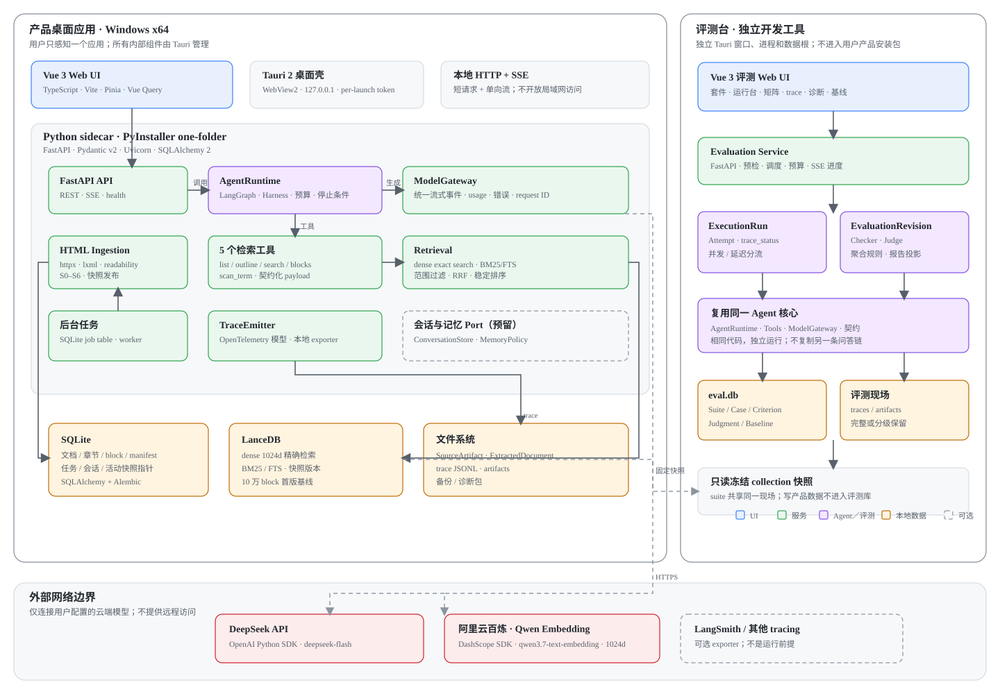

# 09 · 技术选型 v0.4：Windows 单机桌面、混合检索与评测闭环

上游：[01](01-product-requirements.md)（产品需求）、 [03](03-cases-and-gold-standard.md)（用例与金标准）、 [04](04-architecture-design-method.md)（架构方法）、 [05](05-storage-and-retrieval-strategy.md)（存储策略）、 [06](06-retrieval-pure-agent.md)（检索、trace、部署）、 [07](07-html-ingestion-design.md)（HTML 入库）、 [08](08-evaluation-console-design.md)（评测台）。

**状态：技术选型 v0.4，已审核（2026-10-20），作为当前实现基线。** 只依据 01–08 的产品与架构设计，不把项目中已有实现当作选型依据；记录关键技术判断的变化过程，而不只保留最终结论。v0.4 依据 [ADR 0004](../decisions/0004-lightweight-language-detection.md) 将语言识别从 Lingua 改为版本化确定性文字体系检测。

[← 返回文档索引](../README.md)

## 0. 这篇解决什么

前八篇已经回答了产品做什么、问题空间是什么、存储与检索如何组织、入库如何分阶段、Agent 如何循环，以及评测台如何固定现场并形成回归闭环。本文把那些设计翻译成一套可以实现和打包的软件组合。

>  **选型目标：在 Windows x64 上，把一个可安装、可更新、无需 Docker／外部数据库／本地模型的产品交付给普通用户；同时给开发者提供独立的本地评测台。**

本稿给的是**首版候选基线与验证顺序**，不是只看流行度拍板。版本号在开工时统一锁定；凡依赖 Windows 原生库、进程生命周期或大语料性能的选择，都附明确验证门槛。

## 1. 从 01–08 抽出的技术约束

| 来源 | 已确定要求 | 对选型的含义 |
| --- | --- | --- |
| [01](01-product-requirements.md) | 单轮、单用户、单知识库；回答结合用户文档与模型内置知识；正确性、可信、完整、稳定、表达、边界和首字延迟共同构成质量属性。 | 先做单体本地应用；不引入多租户、分布式检索和大数据平台。接口必须保留引用、来源、预算和停止原因。 |
| [03](03-cases-and-gold-standard.md) | 18 条首轮用例；默认 N＝10、K＝9；程序、LLM 判官和人工分工；质量抖动与首字延迟需要可观测。 | 评测台需要有稳定的执行适配器、批量调度、版本化判定、流式时间戳和可重建报告。 |
| [05](05-storage-and-retrieval-strategy.md) | 存储采用“增强向量块”：块、元数据、向量和关键词索引；需要可溯源、范围过滤、语义召回、精确锚点和按范围取全。 | 可以使用一套文档／块主数据，加一套可重建的 dense＋BM25 派生索引；不能只选一个向量库就结束。 |
| [06](06-retrieval-pure-agent.md) | 纯 Agent 循环；5 个显式工具；Harness 负责 Action／Observation、History 与预算；trace 本地优先、OpenTelemetry 兼容；请求固定 collection 快照；Windows 桌面、仅回环网络、DeepSeek＋Qwen 双 Key。 | Agent 框架必须允许完全控制协议和预算；桌面壳要能监管内部后端；trace 不能依赖外部 SaaS。 |
| [07](07-html-ingestion-design.md) | HTML 本地文件与静态／SSR URL；不执行 JavaScript；S0–S6 分阶段；来源 artifact、语义节点、章节树、block、dense＋BM25、manifest、原子发布；Qwen embedding。 | 需要成熟 HTTP、HTML DOM、Unicode、哈希、文件和事务能力；后台任务要可暂停续跑。 |
| [08](08-evaluation-console-design.md) | 独立开发工具；独立本地服务＋Web UI；仅 127.0.0.1；数据库为事实源；ExecutionRun 与 EvaluationRevision 分离；质量评测并发、延迟评测串行。 | 评测端必须复用 Agent 核心但使用独立数据根与评测 DB；不引入服务器型任务队列。 |

### 1.1 选型优先级

1. **可安装性优先：**普通用户不能安装 Python、Node、Docker、数据库或向量服务。
2. **行为可控优先：**Agent 循环、预算、重试、prompt 和工具契约必须显式，不能被框架的隐藏默认值接管。
3. **可复现优先：**版本、hash、快照、trace 和评测 revision 都要能落到本地文件或数据库。
4. **单一用户够用优先：**不为多租户和水平扩展提前引入分布式组件。
5. **可替换优先：**模型供应商、HTML 解析器、向量引擎通过内部 Port 隔离，换实现不改业务对象。

## 2. 总体技术基线

```text
┌──────────────────────── Windows x64 ────────────────────────┐
│                                                             │
│  产品桌面壳（Tauri）            评测桌面壳（Tauri，独立构建） │
│         │                                  │                │
│         ├── Vue Web UI                     ├── Vue Web UI    │
│         │   127.0.0.1 + SSE                │   127.0.0.1     │
│         ▼                                  ▼                │
│  产品 Python sidecar             评测 Python sidecar          │
│  Agent／入库／检索服务            复用 Agent 核心＋评测调度    │
│         │                                  │                │
│         ├── SQLite：主数据            ├── SQLite：评测事实源  │
│         ├── LanceDB：派生双索引       ├── traces：独立目录    │
│         └── files：artifact／trace    └── 只读 collection     │
│                                                             │
└─────────────────────────────────────────────────────────────┘
             │                                   │
             └──────── HTTPS ────────┐  ┌────────┘
                                      ▼  ▼
                            DeepSeek API   Qwen embedding API
```

| 层 | 首版建议 | 状态 |
| --- | --- | --- |
| **桌面外壳** | Tauri 2 | 推荐 |
| **前端** | Vue 3＋TypeScript＋Vite | 推荐 |
| **后端** | Python＋FastAPI＋Pydantic v2＋Uvicorn | 采用 |
| **主数据** | SQLite＋SQLAlchemy 2＋Alembic | 推荐 |
| **检索索引** | LanceDB 嵌入式索引（dense＋FTS／BM25） | 推荐＋Windows 验证门槛 |
| **HTML 解析** | httpx＋lxml＋readability-lxml＋自有结构遍历 | 推荐 |
| **Agent** | LangGraph 编排＋自有领域对象／工具／预算／trace | 推荐 |
| **模型接入** | OpenAI SDK（DeepSeek）＋DashScope SDK（Qwen）＋薄 ModelGateway | 采用 |
| **观测** | OpenTelemetry 数据模型＋本地 JSONL/SQLite exporter | 推荐 |
| **评测** | 独立 Python sidecar＋独立 SQLite＋Vue Web UI | 推荐 |
| **打包** | PyInstaller one-folder sidecar＋Tauri NSIS 安装器＋WebView2 bootstrapper | 需安装链验证 |

### 2.1 模块与技术架构图

下图是逻辑架构和首版技术归属，不是代码目录。产品与评测台共享同一套 Python 核心契约和前端组件，但作为两个独立进程、两个数据根运行；外部网络只连接用户配置的模型 API，trace 本地优先。



**读图顺序：**UI 只通过本地 API 进入；所有问答由 AgentRuntime 驱动工具和 ModelGateway；写入先落 SQLite／artifact，再由 manifest 对账得到可检索的 LanceDB 派生索引；评测台通过同一核心执行用例，但使用独立数据库、trace 和固定快照。外部 SaaS 观察平台只接收可选导出，不参与主链路。

## 3. 桌面壳与内部进程

### 3.1 候选比较

| 候选项 | 优点 | 首版风险 | 结论 |
| --- | --- | --- | --- |
| **Tauri 2** | 安装体积小；Windows 使用系统 WebView2；sidecar、签名更新、窗口和进程生命周期能力完整；Rust 只承担壳层。 | Python sidecar 与 Tauri 的联合打包、进程回收和升级需要做 Windows 验证。 | 采用 |
| **Electron** | 生态成熟；桌面能力与打包方案稳定。 | 内置 Chromium 和 Node，体积与内存更高；若后端仍用 Python，会同时维护两套运行时。 | 首版不采用；作为 Tauri 验证失败后的备选 |
| **pywebview** | Python 单运行时；与后端同语言；窗口壳简单。 | 更新、安装、诊断、进程隔离和桌面集成能力不如前两者；复杂生命周期容易散落在 Python 和前端。 | 首版不采用 |

### 3.2 进程模型

- Tauri 启动时拉起隐藏的 Python sidecar，随机分配回环端口和本次启动令牌，健康检查通过后再显示主界面。
- 所有 local HTTP／SSE 只绑定 `127.0.0.1`；除健康检查外的请求都要校验启动令牌。浏览器 CORS 默认关闭。
- 本地 HTML 文件由 Tauri 原生文件选择器取得路径，再把用户明确选择的路径交给 sidecar。Web 前端不能任意读取磁盘；后端仍要校验路径存在、只读打开、扩展名和体积上限。
- Tauri 负责捕获 sidecar 退出、有限次重启、退出时优雅关闭和残留进程清理；用户始终只感知一个产品。
- 开发阶段可单独启动后端，但那是开发辅助，不是用户体验的一部分，也不形成 CLI 产品。

### 3.3 产品与评测的关系

产品与评测台共享 Python 核心包、Vue 设计系统和 API 契约，但构建为两个入口、两个数据根、两个 sidecar 进程。评测台不把评分写进产品运行库，也不读取产品当前会话；它只读引用冻结 collection。

评测台也使用独立 Tauri 窗口承载 Web UI，开发者从快捷方式或开发构建启动，不接触命令行。这样“全部 Web UI、无 CLI、独立服务”三个约束可以同时成立。

## 4. 前端与接口契约

前端需要在同一套技术里承载聊天流、文档管理、长任务进度、检索证据、trace 树和评测结果矩阵。React 与 Vue 都能完成这些界面，不存在必须选 React 的能力缺口；本项目明确选择 Vue 3，以减少前端心智负担并与团队的长期维护偏好一致。

| 项 | 选择 | 理由 |
| --- | --- | --- |
| **UI 框架** | Vue 3＋TypeScript | 流式会话、结果矩阵、trace 树、版本 diff 和表格均无能力缺口；模板与响应式状态模型更轻，和 Tauri WebView 兼容。 |
| **构建** | Vite | 启动快；产物简单；适合 Tauri 静态资源。 |
| **服务端状态** | Vue Query（TanStack Query for Vue） | 缓存、刷新、错误和并发失效模型清楚；避免把服务器事实复制进全局 store。 |
| **本地 UI 状态** | Pinia | 只存放窗口、面板、筛选和临时选择，不承担业务事实。 |
| **路由** | Vue Router | 产品与开发工具均可按页面组织；不引入服务器端渲染。 |
| **接口** | REST＋SSE | 普通命令走短请求；回答 token、工具事件、进度用单向流。无需 WebSocket 的双向复杂度。 |
| **契约生成** | FastAPI OpenAPI → TypeScript client／schema | Pydantic 是后端唯一契约源，前端类型由生成器落地，减少手写重复。 |

**SSE 事件至少包括：**`run_started`、`answer_delta`、`tool_started`、`tool_finished`、`budget_warning`、`answer_completed`、`error`。每条事件带 `trace_id`、事件序号和 schema 版本；断线后按事件索引恢复，不能重复渲染正文。

前端只渲染结构化事件和纯文本内容；来自文档的 HTML 不直接注入 DOM。若未来需要富文本渲染，必须经过明确白名单清洗。

## 5. 后端语言、运行时与业务分层

初稿漏掉了 Java，这是一处真实的选型缺口。更重要的是，之前的论证把 **LangGraph** 和 **后端语言** 绑得太紧：LangGraph 可以影响框架选择，但不能反过来成为排除 .NET 或 Java 的理由。正确的顺序是先比较语言／运行时能否承载完整产品，再决定在这个运行时上使用哪个 Agent 编排框架。

| 候选 | HTML／文本与评测生态 | Agent／图编排 | Windows 交付 | 主要风险 |
| --- | --- | --- | --- | --- |
| **Python** | lxml、readability、语言识别、tokenizer、实验与数据处理库最丰富 | LangGraph 原生；eval 与模型 SDK 生态完整 | PyInstaller sidecar；非 Windows 原生但可完全随包分发 | 运行时体积、类型约束需要额外纪律；与 Rust 桌面壳形成双运行时 |
| **Java** | HTTP、并发、Unicode、SQLite 很成熟；HTML 可用 jsoup，但正文提纯和中文文本实验需自建或验证等价组件 | LangChain4j／Spring AI 等可承载工具与 RAG；多 Agent 图、checkpoint 语义需单独验证 | JVM 稳定、运行时可 jlink／jpackage 随包；企业级签名与运维实践成熟 | 启动与内存通常更重；模型／评测生态不如 Python；框架抽象变化快 |
| **.NET／C#** | AngleSharp／HtmlAgilityPack、SQLite、JSON、HTTP 均成熟；中文文本与评测实验需验证替代库 | Semantic Kernel／Microsoft Agent Framework 等可做工具与多 Agent；具体状态图、checkpoint 与本地恢复需 PoC | Windows 原生优势最强；若采用 .NET 桌面宿主，有机会减少 Tauri＋Python 双运行时 | 若仍使用 Vue 资源，需确认宿主选型；模型／评测生态与 Python 不完全等价 |
| **Node／TypeScript** | HTML DOM 工具成熟；中文文本、评测实验和数据处理库相对弱 | LangGraph.js 可复用相似图模型；前后端同语言 | 仍需 Node sidecar；原生依赖和进程生命周期需验证 | 文本与评测生态、原生依赖维护；需要更深的自建文本处理 |

>  **修正后的判断：没有一种语言被 LangGraph 一票否决。**如果“必须使用 LangGraph 原实现”是硬要求，Python／Node 优先；如果“Windows 单运行时和原生交付”更重要，.NET 更值得做完整候选；如果团队更看重 JVM 的并发、类型与运维，Java 也成立。真正决定胜负的是完整纵向切片的工程验证与团队维护能力。

### 5.1 选定 Python：先承担已知成本，遇到具体问题再重开选型

Java、.NET 和 Node 都能实现这个产品，没有能力上的绝对壁垒。选择 Python 的决定性理由是组合优势：HTML 正文提纯与中文文本工具、LangGraph 的原生多 Agent／checkpoint 能力、评测实验生态，以及 DeepSeek／Qwen SDK 的接入密度。它让当前设计能最快形成一个可运行、可观测、可评测的闭环。

**这项选择现在确定，不再为它预先建设多语言 PoC。**已知代价是 Python sidecar 的打包、冷启动和运行时体积，需要靠 Windows 安装链验证和工程纪律控制。只有实际遇到明确阻塞时才重新选型，例如 Python 无法稳定打包、关键文本库在 Windows 不可用、LangGraph 的状态恢复不能满足可复现要求，或性能明显突破 4 核／8GB 的验收基线。

### 5.2 Python 候选方案的具体组件

| 组件 | 选择 | 职责 |
| --- | --- | --- |
| 语言运行时 | Python 3.13.x，随应用打包 | 产品不依赖用户机器上的 Python；版本随构建固定。 |
| Web／SSE | FastAPI＋Uvicorn | 本地 API、流式事件、健康检查和 OpenAPI。 |
| 数据模型 | Pydantic v2 | Action／Observation、工具参数、API 请求和跨层对象校验。 |
| 持久化 | SQLAlchemy 2＋Alembic | 显式事务、schema 和可测试迁移。 |
| HTTP 客户端 | httpx | 对话、embedding、URL 获取和超时／重试；异步与同步接口一致。 |
| 后台任务 | SQLite 任务表＋进程内 worker | 入库和评测任务可暂停、续跑和恢复；首版不引入 Redis／Celery。 |
| 日志 | 标准 logging＋JSON formatter | 结构化应用日志，不保存完整正文与密钥。 |

### 5.3 模块边界

```text
api/           本地 HTTP／SSE，只做协议与用例编排
agent/         AgentRuntime、LangGraph 图、Action 解析、History、预算
tools/         5 个检索工具，返回契约化 payload
ingest/        S0–S6，从 SourceArtifact 到 collection 快照
retrieval/     dense＋BM25 查询、RRF、范围过滤
storage/       SQLite Port、artifact Port、索引 Port
providers/     ModelGateway 契约、DeepSeek／Qwen SDK 适配与 fake
observability/ TraceEmitter、JSONL writer、索引投影
evaluation/    独立 ExecutionRun／EvaluationRevision 服务
shared/        纯领域模型、错误码、hash 与版本工具
```

依赖方向固定为 `api → agent／ingest／evaluation → tools／storage／providers`；领域对象不反向依赖 FastAPI 或数据库 ORM。Provider、索引和文件系统通过 Port 注入，便于评测时替换为 fake 或记录回放。

**SQLite 运行口径：**开启 WAL、foreign keys 和 busy timeout；所有 schema 变更走 Alembic；长耗时 AI 调用不得持有数据库事务；写入按短事务串行化，后台任务状态与业务结果分别提交。这样单机也可以同时接收问答、执行入库和记录 trace 投影。

## 6. 主数据、索引与快照

### 6.1 三层存储

| 存储 | 放什么 | 不放什么 |
| --- | --- | --- |
| **SQLite** | 配置、文档／版本、章节树、block 正文与稳定顺序、manifest、活动快照指针、任务状态、产品会话、评测 revision、判定和基线关系。 | 不存大向量矩阵；不承担大 artifact 正文文件。 |
| **LanceDB** | 每个快照的 dense 向量、BM25／全文索引、检索所需派生字段和版本。 | 不作为文档身份、章节或判定关系的唯一事实源。 |
| **文件系统** | 原始 HTML artifact、抽取中间产物、trace JSONL、诊断包、备份和导出文件。 | 不使用散落 JSON 文件替代事务性主数据。 |

### 6.2 为什么是 SQLite＋LanceDB

| 候选 | 优势 | 缺口 | 结论 |
| --- | --- | --- | --- |
| **SQLite＋LanceDB** | SQLite 提供强事务和稳定主数据；LanceDB 嵌入式运行，同时提供向量与全文检索，并为每个快照保留不可变版本。 | 跨 SQLite 与 LanceDB 不能共享一个事务，必须靠 manifest＋原子指针补偿。 | 首版基线 |
| **SQLite＋Qdrant local** | Qdrant 向量能力成熟，local mode 无需外部服务。 | 关键词索引仍需另建 SQLite FTS 或稀疏向量；多一个引擎和一致性面，local mode 的并发边界也需额外验证。 | 备选 |
| **只用 SQLite＋sqlite-vec** | 单文件、事务一致、备份简单。 | Windows 扩展分发、索引能力与规模边界风险集中在一个较新的组件上；仍需 FTS 中文策略。 | 技术验证候选 |
| **服务器型向量库** | 成熟、可扩展。 | 违背普通用户不装额外服务的部署约束。 | 首版排除 |

LanceDB 的硬验证门槛：

Windows x64 官方 wheel 可离线打包；单进程稳定读写；产品与评测两个进程能安全读取同一不可变快照；中文预分词后的 FTS／BM25 排序可复现；10 万 block 级查询和冷启动满足基线。任一失败则切换到 SQLite＋Qdrant local，业务接口不变。

### 6.3 快照发布协议

1. 在独立 staging 目录写 SQLite 候选行、block 正文、LanceDB 候选索引和 artifact。
2. 执行数量、主外键、hash、block 顺序、dense 维度、FTS 文档数、manifest checksum 对账。
3. 对账通过后写不可变 CandidateSnapshotManifest，并在 SQLite 事务中 CAS 更新 ActivityPointer。
4. 新请求只读新指针；进行中的请求继续固定旧 `collection_snapshot_id`。旧快照在无引用且过保留期后再清理。

**唯一事实源仍是 SQLite＋artifact＋manifest；LanceDB 是可重建的派生索引。**如果 LanceDB 损坏，可以用 block 数据重新构建，不应影响文档和引用身份。

### 6.4 首版容量基线：约 10 万 block

结合单机 4 核／8GB／SSD 的产品基线和首版学习资料规模，暂定**约 10 万 block、约 1,000 篇文档**作为容量设计与验收基线（按每篇约 100 block 估算）。这只是首版目标，不是系统永久上限。

| 规模 | 产品侧判断 | 索引策略 |
| --- | --- | --- |
| **≤10 万 block** | 首版舒适区 | LanceDB dense 精确扫描＋BM25/FTS；**首版不建 ANN 向量索引**。 |
| **10 万–100 万 block** | 仍可工作，但需实测 | 建立 ANN 向量索引，验收查询延迟、建索引时间、冷启动和磁盘占用。 |
| **>100 万 block** | 超出首版性能承诺 | 不直接拒绝，但必须单独立项验证；按官方定位仍属 OSS 单机可处理区间，不是无限容量。 |
| **数亿向量／TB 级** | 不属于本地桌面版范围 | 官方推荐 LanceDB Enterprise。 |

10 万条 1024 维 float32 向量约占 **410MB**，加上 SQLite 正文、FTS、manifest、artifact 和多份快照后仍处于 8GB 机器的可控范围。首版因此**明确不建 ANN 向量索引**，dense 使用精确扫描，避免 ANN 的构建、召回参数和增量维护复杂度；只有 block 数超过基线或真实查询延迟不满足 Q8 时，才启用 ANN。

官方依据：[LanceDB OSS FAQ](https://docs.lancedb.com/faq/faq-oss)（2026-10-20 核对）说明，约 10 万条数据可不建向量索引；OSS 单节点可较舒适地处理百万级向量；数亿级／TB 级建议使用 Enterprise。

## 7. HTML 入库技术

| 环节 | 选择 | 说明 |
| --- | --- | --- |
| S0 文件读取 | pathlib＋SHA-256＋charset-normalizer | 先落盘原始字节；编码只影响文本读取，不覆盖源 artifact。 |
| S0 URL 获取 | httpx＋自定义 SSRF guard | 显式超时、重定向上限、响应体积、Content-Type 和 DNS／IP 私网检查；禁 Cookie 和执行脚本。 |
| S1 DOM 解析 | lxml＋readability-lxml＋自定义语义遍历 | Readability 负责正文候选，lxml 负责保真遍历标题、段落、列表、引用、代码、表格和图片说明。 |
| 语言识别 | 自有 `script-ratio-v1` 确定性检测 | 优先使用可靠 `lang`／语言元数据；缺失时比较汉字与拉丁字母信号，输出 zh／en／mixed／unknown。只生成文档／block 语言提示，不确定时不能阻断入库。 |
| S3 建树 | 确定性 Python 映射 | 不调用模型猜章节；按 heading 层级和稳定消歧规则生成 section_path。 |
| S4 切块 | 自有 splitter＋版本化 ChunkSizingEstimator | 以段落和结构为主要边界；表格优先整体；只对超限单元做确定性二次拆分。 |
| S5 embedding | Qwen API adapter，固定 1024 维 | 单批最多 20 条、默认最多 3 个批次在途；重试和 usage 显式记录；输入 hash 与索引同版本。 |
| S5 关键词 | LanceDB FTS／BM25，固定 analyzer | Unicode 归一、英文词、中文相邻二元组；同一 analyzer 处理索引和查询。 |
| 精确扫描 | SQLite block 表上的 NFC＋大小写折叠 | `scan_term` 不经过分词，不能拿 BM25 零命中替代字面证否。 |

**为什么不用浏览器引擎首版？**产品范围只接受初始 HTML 已含正文的静态／SSR 页面。引入 Chromium 或 Playwright 作为运行时会把安装体积、隔离、防 SSRF 和资源占用成倍放大，而当前需求明确不需要 JS 空壳页面。

### 7.1 Token 估算

- 入库切块的 `ChunkSizingEstimator` 与具体对话模型解耦：固定版本、可用 Unicode 字符类别和保守系数实现，输出只作范围提示。
- 请求上下文预算优先使用 Hugging Face `tokenizers` 加载随包固定版本的 DeepSeek tokenizer artifact；若供应商 tokenizer 无法稳定离线分发，则使用标定过的保守估算器，并通过 provider usage 回写偏差。
- 不使用 OpenAI 的 `tiktoken` 冒充 DeepSeek 精确 tokenizer；它只能作为近似，且必须明确版本和误差。

### 7.2 语言提示

- 文档语言优先读取且只信任首版支持范围内的可靠声明：`html lang`、`meta[name=language]` 或 `meta[http-equiv=content-language]` 中的 `zh-*`／`en-*`。
- 声明缺失或不受支持时，对正文中的汉字与拉丁字母计算比例；信号不足、无法达到确定性阈值时输出 `unknown`，不能默认成中文。
- block 语言优先根据 block 自身文本判断；样本不足时才回退到已知的文档 `zh`／`en` 语言，仍无法判断则保持 `unknown`。
- 检测器名称和阈值随版本固定；本版为 `script-ratio-v1`。调整阈值或判定顺序必须提升版本并重新验证文档与 block 语言。

## 8. Agent 与云模型接入

### 8.1 编排框架：从“自研优先”到 LangGraph 的判断变化

#### 第一轮判断：单 Agent、单循环时，自研更简单

06 定义了唯一的 Thought／Action 协议、五个工具、Observation、History、预算和停止语义。如果系统长期只有一个 Agent，路径只有“调模型 → 工具 → 再调模型 → Finish”，引入完整 Agent 框架会增加 prompt、memory、retry、tool calling 和 tracing 的另一套控制权，容易形成双重事实源。因此初稿当时选择自研小循环，核心复杂度集中在领域契约，而不是执行图。

那个判断的隐含前提是：**单轮、单 Agent、没有复杂分支和长任务恢复**。它不是“永远不用框架”的结论。

#### 新增前提：下一版确定多轮，且多 Agent 很可能出现

01 已把多轮对话列为下一迭代。如果多 Agent 也很可能成为产品方向，系统的复杂度会从“一个循环”变成：职责节点、条件路由、证据不足回退、不同 Agent 的交接、长任务 checkpoint、暂停恢复、人工介入，以及按图路径诊断失败。此时再坚持自研，实际是在逐步重写一套能力更弱的状态图运行时。

| 新增需求 | 自研 Harness | LangGraph |
| --- | --- | --- |
| 单轮单循环、五个工具 | 代码量最小，契约完全可控 | 能力有余，引入额外依赖 |
| 条件路由、循环、回退 | 需要自己定义状态、边和终止条件 | 显式状态图与条件边 |
| 多 Agent 交接与子图 | 容易演化成自制框架 | 节点、子图和共享状态是核心能力 |
| 长任务 checkpoint、暂停恢复 | 要自己设计持久化与版本兼容 | checkpointer 与中断恢复直接覆盖 |
| 按执行路径做 trace／评测 | 字段完全自定义 | 需要把图事件映射到自己的 trace |
| 工具契约、预算、引用和领域对象 | 天然归自己所有 | 仍应由我们自己实现，不交给框架 |

#### 结论：采用 LangGraph 做编排层，但不把领域交给它

>  **把“很可能多 Agent”作为可确认的架构前提后，结论从“自研优先”改为：LangGraph 作为 Agent 编排层，自有代码继续掌握模型接入、工具、预算、记忆事实源、trace 和评测契约。**

- **LangGraph 管什么：**节点、状态图、条件边、子图、图内循环、checkpoint、暂停恢复、节点级流式事件和未来的人工介入。
- **我们管什么：**工具真实实现、Action／Observation 领域协议、上下文准入、token 预算、模型错误语义、collection 快照、引用校验、ConversationStore、MemoryPolicy 和 trace 落盘。
- **首版怎么用：**即使是单轮，也可以由一个小图承载；图必须先简单、可读。多轮和多 Agent 到来时增加节点与边，而不是重写整个运行框架。
- **06 是否作废：**不作废。Thought／Action、五个工具、预算和停止语义仍是图节点内部及跨节点必须遵守的领域契约；LangGraph 只负责推进状态。

**第一版不直接上“自主 Agent 群聊”。**多 Agent 必须按职责、证据和收益拆：例如 Router、Retrieval、Evidence Check、Synthesis、Citation Check。每个节点都要记录路径、预算和 handoff 原因；如果单 Agent 已能完成且质量相同，就不应先拆成多 Agent。

### 8.2 Provider 接入：SDK 负责传输，ModelGateway 负责领域契约

“适配”不等于自己重写 HTTP 协议。根据 [DeepSeek 官方“首次调用 API”文档](https://api-docs.deepseek.com/zh-cn/)（2026-10-20 核对），DeepSeek 没有提供一套以“DeepSeek SDK”命名的独立官方客户端；官方明确说明 API 兼容 OpenAI／Anthropic，并给出使用 OpenAI／Anthropic SDK 的调用示例。因此本项目选择 **OpenAI Python SDK** 连接 DeepSeek。

根据阿里云百炼 [“向量化（Embedding）”](https://help.aliyun.com/zh/model-studio/embedding)与 [“同步接口 API 详情”](https://help.aliyun.com/zh/model-studio/text-embedding-synchronous-api)（2026-10-20 核对），千问文本向量同时支持 **DashScope SDK** 和 OpenAI 兼容接口；DashScope API 提供更多独有能力，且阿里云发布并维护官方 Python SDK。本项目选择 **DashScope Python SDK** 调用 `qwen3.7-text-embedding`，不使用 compatible endpoint 作为主路径。底层连接、鉴权、流式分帧和协议解析复用供应商 SDK，不重复造客户端。

| 层 | 首版选择 | 边界与记录 |
| --- | --- | --- |
| 对话传输 | **OpenAI Python SDK**，`base_url=https://api.deepseek.com` | 这是 DeepSeek 官方文档给出的兼容调用方式；SDK 自动重试默认关闭，首 token、usage、request ID 和实际 model ID 必须回到领域事件。 |
| DeepSeek 模型名 | `deepseek-flash` | 官方当前文档说明该名称由 `DeepSeek-V4.1-Flash-1017` 提供服务；产品别名与实际模型标识都进 trace，后续升级不能静默改变评测语义。 |
| Embedding 传输 | **DashScope Python SDK**：`dashscope.TextEmbedding.call` | 固定 `qwen3.7-text-embedding`、1024 维、单批最多 20 条、单行上限 128k token；记录 output type、usage、request ID 与输入 hash。 |
| 领域接口 | 自有薄 `ModelGateway` | `chat_stream()`／`embed()` 只暴露产品需要的统一请求、事件和错误，不暴露 SDK 原始对象。 |
| 判官 | 默认复用 DeepSeek Key 和固定 judge model ID | 与 Agent 模型分开配置和记录；若后续证明同模型盲点不可接受，再引入独立判官模型。 |
| 重试与计费 | SDK 只做传输；重试、预算和退避由 Gateway／Harness 决定 | 每次真实请求都进 trace 和 usage，不允许 SDK 隐藏重试后把多笔费用表现为一笔。 |
| 凭证 | Windows Credential Manager（通过 keyring） | 只存两个 Key；配置文件、trace、备份、日志和诊断包均不包含密钥。 |

```text
class ModelGateway(Protocol):
    async def chat_stream(self, request: ChatRequest) -> AsyncIterator[ChatEvent]: ...
    async def embed(self, request: EmbedRequest) -> EmbedResponse: ...
```

**不允许静默换模型。**主模型调用失败时，attempt 记录明确错误；切换模型必须是新 ExecutionPlan 的实验变量，否则评测与用户答复都无法解释。DeepSeek 官方的 OpenAI 兼容调用方式也意味着：这里采用 OpenAI SDK 并不代表把产品绑定到 OpenAI 模型，实际 provider、base URL 和 model ID 都由 `ModelGateway` 显式固定。Qwen embedding 同样通过 Provider Config 固定区域、API Host／Workspace、模型名与维度；这些配置随 run 固化，不能因切换区域悄悄改变向量空间。

### 8.3 LangChain 的角色：只取需要的公共件

LangChain 主要解决不同模型、embedding、文档、Retriever、工具和向量库之间的接入与组合重复。它可以提供统一消息、工具 schema、流式回调和大量第三方集成；但它不定义本产品什么算正确、什么算完整证据、预算在哪里扣、引用是否有效，也不构成评测事实源。

| 能力 | 是否使用 | 原因 |
| --- | --- | --- |
| LangGraph 图编排 | 采用 | 多轮＋多 Agent 很可能出现，图状态、分支、checkpoint 是核心需求。 |
| LangChain Core 消息／工具 schema | 按需使用 | 可作为 LangGraph 的公共类型，但进入领域层前必须映射成我们的 Pydantic 对象。 |
| LangChain 高层 Chain／AgentExecutor | 不使用 | 会与我们的显式 ReAct 协议、预算和停止语义形成双重控制。 |
| LangChain Retriever／VectorStore 抽象 | 不作为主路径 | 我们已有 block、范围、双索引、RRF 和 collection 快照契约，另接一层只会隐藏检索行为。 |
| LangChain Memory | 不作为事实源 | 对话、摘要和长期记忆必须版本化并可由产品查看／删除，归属 ConversationStore／MemoryPolicy。 |
| LangSmith／厂商 tracing | 不作为运行前提 | 产品不要求注册或连接外部 tracing 平台；先写本地 OpenTelemetry 兼容 trace，后续可把同一份事件转发给外部平台。 |

**这里“硬依赖”指“没有它产品就无法启动或无法完成核心流程”。**我们不会把 LangSmith 或任何厂商 tracing 服务设成硬依赖：断网、没有 SaaS 账号或外部平台故障时，问答、入库和本地 trace 仍然必须正常工作。外部平台只能是开发者主动开启的可选 exporter／查看器，不能成为内部 trace 的唯一事实源。

### 8.4 Prompt bundle

系统 Prompt、工具描述和判官模板采用“模板文件＋manifest”管理：模板使用固定版本 Jinja2，manifest 记录内容 hash、适用 schema、版本和发布日期。产品 Prompt 随应用包发布；评测 Judge Prompt 存评测数据库并按 08 的 revision 规则复核。

### 8.5 下一版多轮对话与记忆：现在就留边界

01 已明确多轮对话属于下一迭代计划。因此首版虽然只做单轮，也不能把 AgentRuntime、存储和 trace 设计成只能接收一个孤立问题。多轮对话是确定要来的需求，应从现在起按“单轮只是多轮会话的一个特例”预留接口。

| 记忆层 | 首版状态 | 下一版用途 | 存储与边界 |
| --- | --- | --- | --- |
| **工作记忆** | 单次请求内已有 History | 保存本轮用户问题、模型 Thought、工具 Observation、预算状态和最终回答 | 运行时内存；结束后按 trace 和会话记录持久化，不直接进入长期记忆。 |
| **会话历史** | 预留 `session_id`／`turn_id` | 让后续问题能解析“它”“这两篇”“刚才那个结论”等指代 | SQLite 保存会话与 turn 索引；完整正文按 artifact 策略保留；每轮 trace 带会话和轮次关联。 |
| **压缩记忆** | 首版不启用 | 上下文超过预算时，把早期对话压缩成版本化 checkpoint | 只压缩对话，不覆盖原始 turn；摘要保存来源 turn ID，可追溯并重新生成。 |
| **长期记忆** | 首版不实现 | 保存用户明确要求记住的偏好、背景或常用文档范围 | 必须是独立、可查看、可修改、可删除的 MemoryItem；不能把普通聊天片段偷偷向量化后无限累积。 |

**记忆不是知识库。**用户文档经入库形成不可变 collection；会话记忆是另一类数据，不能混进 collection block，也不能被检索工具当成“原文证据”。回答仍然要区分文档事实与用户历史上下文。

**运行时契约从首版预留：**`AgentRuntime.run(session_id, turn_id, user_input, snapshot_context)`，返回结构化事件。单轮时 session 只有一轮；多轮时由 `ConversationStore` 和 `MemoryPolicy` 组装本轮可见上下文。对话历史、摘要和长期记忆均应通过 Port 读取，不写死在 Agent 框架或模型消息列表里。

>  **记忆与图状态分离：**LangGraph 的 checkpointer 只保存一次执行进行到哪个节点以及恢复所需状态；ConversationStore／MemoryPolicy 保存产品可见的会话、摘要和长期记忆。两者可以落在同一个 SQLite 文件中，但不能把 LangGraph checkpoint 当成用户记忆的唯一副本。

- LangGraph checkpoint 可重建执行，但不能替代产品对“用户说过什么”的可查询、可删除存储。
- ConversationStore 保存原始 turn；MemoryPolicy 决定可见范围；摘要 checkpoint 只引用来源 turn，不覆盖原文。
- 无论采用哪个框架，SQLite 中的会话、记忆和版本记录仍是产品事实源；不能只存在于框架内存或厂商 tracing 中。

**评测影响：**多轮版到来后，一条 EvalCase 要允许定义为“多 turn 脚本”，并为每一轮保留输入、历史可见范围、期望引用和失败判定；不能把整段对话压成一个问题来测。会话隔离、跨轮记忆污染和摘要丢失将新增为回归项。

## 9. Trace、日志与诊断

| 项 | 选择 | 理由 |
| --- | --- | --- |
| 数据模型 | OpenTelemetry Trace／Span 语义＋`app.*` 扩展 | 06 已确定 W3C Trace Context 与 OpenTelemetry／OpenInference 方向。 |
| SDK | OpenTelemetry Python API／SDK | 业务按标准 span 打点；不把 Langfuse 或任一 SaaS 字段当内部契约。 |
| 本地 exporter | 自定义 JSONL exporter＋异步有界队列 | 单机可读、append-only、易压缩和导出；不依赖 collector。 |
| 查询索引 | SQLite trace summary／event index | 列表和筛选快；索引丢失可从 JSONL 重建。 |
| 应用日志 | JSON logging，只带 trace_id／错误码 | 不重复写完整 prompt、正文和 Key。 |
| 正文 artifacts | 内容 hash 寻址文件 | 诊断时回看，默认 metadata 模式可关闭正文留存。 |

trace writer 与主循环解耦：队列满或写盘失败只把 trace 标成 partial／dropped，不阻塞回答；评测中的 attempt 单独记录 `trace_status`，缺失 trace 时禁止给出确定性根因。

## 10. 评测台技术

评测台是独立构建和独立数据根的开发工具；它不是在产品里加一个管理员页面。核心实现仍用 Python，因为要直接复用 Agent 执行核心、工具、Pydantic 契约和 trace adapter。

| 模块 | 选择 | 边界 |
| --- | --- | --- |
| 数据库 | 独立 SQLite（`eval.db`）＋SQLAlchemy／Alembic | suite、case、criterion revision、ExecutionRun、EvaluationRevision、判定、诊断和基线。 |
| 执行调度 | asyncio＋有界 semaphore＋SQLite 任务状态 | 质量 run 可并发；延迟 run 强制串行；预算与暂停由调度器控制。 |
| 持久任务 | SQLite job／attempt 状态机 | 进程重启后恢复；不在内存里假装任务仍存在。 |
| Checker | Python 受控注册表 | 数据库只存 checker ID／参数／版本，不存动态代码。 |
| Judge | DeepSeek adapter＋白名单 JudgeInput | 每次语义判定一次；历史判定、基线和自动诊断不可见。 |
| Web UI | Vue 独立入口＋独立 Tauri 开发壳 | 运行台、矩阵、trace、诊断、基线比较；不做 CLI。 |
| 报告 | 由执行、判定和聚合 revision 计算，可缓存 | 报告不是事实源；重判后生成新的 EvaluationRevision。 |

评测台不引入 LangSmith、Langfuse、promptfoo 之类的外部平台作为首版硬依赖。它们可以以后作为可视化或对比参考，但当前设计要求本地、离线可启动、数据不出机，且 trace 已能用标准模型落到本地。

## 11. 打包、安装、更新与密钥

| 项 | 首版建议 | 验证点 |
| --- | --- | --- |
| Python 打包 | PyInstaller one-folder 模式 | 冷启动、原生库、资源路径、升级后残留和错误诊断；比 one-file 更容易定位问题。 |
| 桌面安装器 | Tauri NSIS，按用户安装 | 普通用户权限即可安装；开始菜单与卸载入口完整；卸载默认保留数据。 |
| WebView2 | Windows 系统运行时＋安装器 bootstrapper | Windows 10／11 干净环境可启动；缺失时给出可理解修复，不要求用户手工装开发组件。 |
| 代码签名 | 正式发布必须签名 | 减少 SmartScreen 拦截；证书与构建密钥不进入仓库。 |
| 更新 | Tauri signed update，用户确认后安装 | 非静默；更新前备份；失败可回到上一版本。 |
| Key 存储 | Windows Credential Manager | 两个 Key 独立保存；更新、卸载、备份和日志均不泄漏。 |
| 崩溃恢复 | 本地日志＋下次启动检查任务状态 | 不自动重发结果未知的云端请求；用户可看到未完成任务。 |

**数据根沿用 06 的逻辑分层：**`config/`、`db/`、`collections/`、`prompts/experiments/`、`traces/`、`logs/`、`backups/`。评测工具使用另一套 `eval-data/` 根，至少分开 `eval.db`、`collections/` 只读引用、`traces/` 和 `artifacts/`，防止评测写入正常产品状态。分发版 trace 默认 `metadata`，开发与评测默认 `full`。

## 12. 测试与交付工具

| 层 | 工具 | 重点 |
| --- | --- | --- |
| Python 单元／集成 | pytest | 入库阶段、快照事务、工具契约、预算、Action 解析、checker 与评测聚合。 |
| 属性／边界 | Hypothesis | 章节 path、block 顺序、hash、Unicode、范围空集等不变量。 |
| 契约 | Pydantic schema tests＋生成式 TS 类型检查 | API、SSE 事件、工具 payload 和版本兼容。 |
| 前端单元 | Vitest＋Vue Test Utils | 流式渲染、失败状态、预算提示、结果矩阵和 revision diff。 |
| 端到端 | Playwright | 浏览器层流程；另加 Windows 打包产物冒烟。 |
| 静态检查 | Ruff＋Pyright＋TypeScript 编译检查 | 统一错误码、类型和未使用依赖。 |
| 构建 | uv＋pnpm＋Windows CI runner | 锁定依赖、复现 sidecar 和安装器构建。 |

测试不能只覆盖函数：发布前必须在干净 Windows x64 上验证安装、首次配置、sidecar 启动、断网、错误 Key、入库暂停恢复、更新前备份、卸载保留数据和评测台独立启动。

## 13. 选型风险与技术验证顺序

| 优先级 | 验证题 | 通过标准 | 失败后的替代 |
| --- | --- | --- | --- |
| P0-1 | Tauri 能否可靠管理 PyInstaller one-folder Python sidecar？ | 无控制台窗口；健康检查；崩溃有限重启；应用退出无残留；更新后旧 sidecar 不残留。 | Electron＋Python sidecar；桌面外壳变，Python 核心不变。 |
| P0-2 | LanceDB 在 Windows x64 能否离线打包并稳定承载 dense＋FTS？ | 10 万 block 级构建／冷启动／查询可接受；并发只读安全；索引损坏可重建。 | SQLite＋Qdrant local＋SQLite FTS；保持 IndexPort 契约。 |
| P0-3 | HTML 提取在首批学习资料上是否足够保真？ | 标题／章节／表格／代码块样本可核对；导航和页脚不混入；失败可分类。 | 保留 lxml 管线，替换正文候选器为定制的 readability 规则，不引入浏览器。 |
| P1-1 | DeepSeek tokenizer 能否随包固定并校准？ | 估算偏保守；不出现预算超界后再由 provider 报错；记录偏差。 | 使用固定版本的保守字符／字节估算器，并把 provider usage 回写。 |
| P1-2 | 中文 FTS analyzer 是否满足精确专名＋宽问法召回？ | 中英混排词、数字、代码标识符、重复标题都能稳定召回；同分排序确定。 | 把中文二元组改为受控 jieba 词典＋二元组回退，但 analyzer 必须版本化。 |
| P1-3 | 安装、更新、Key 存储和备份链是否适合非技术用户？ | 干净 Windows 无需命令行；错误可解释；旧数据可读；Key 不出现在任何外发文件。 | 先缩小安装链路，再修正安装器／更新器；不能把问题推给用户。 |

## 14. 初稿结论与仍需确认的点

>  **已选技术基线：**Tauri 2＋Vue 3／TypeScript＋Python／FastAPI；SQLite 作为主数据，LanceDB 作为可重建的 dense＋BM25 派生索引；HTML 使用 httpx＋lxml＋readability-lxml 自有管线；Agent 采用 LangGraph 编排，但工具、预算、记忆事实源、trace 和评测契约仍由自有领域层掌握；模型通过官方／compatible SDK 传输，并由薄 ModelGateway 统一领域接口；评测台是独立 Tauri＋Python＋SQLite 开发工具。

这套组合的核心优势是：用户只需要安装一个应用，不安装 Python／Node／Docker／数据库服务；检索、入库和评测共用一套 Python 领域契约；向量与关键词共用 LanceDB 派生索引；trace、快照和评测 revision 全部保留在本地且可导出。

| 待确认项 | 为什么还不能直接定死 |
| --- | --- |
| Tauri＋PyInstaller 打包链 | 必须在干净 Windows 环境做一次真实安装／升级／卸载验证后才能成为硬承诺。 |
| 重新评估 Python 的条件 | 不预先做多语言竞品实验。只有出现可复现的具体阻塞才重开：Windows 打包失败、关键文本能力缺失、LangGraph 恢复语义不满足要求，或性能突破硬件基线。 |
| LanceDB Windows 稳定性 | 需要用真实 HTML 入库产物和双进程只读场景验证；不能只靠 demo。 |
| DeepSeek tokenizer artifact | 供应商是否提供可稳定分发的 tokenizer 仍需核对；若不能，保守估算器是正式路径而非临时替代。 |
| 判官是否与 Agent 共用 DeepSeek | 首版从双 Key 约束出发建议共用 provider Key，但要在评测里记录同模型盲点；是否另配判官模型需后续实验决定。 |
| LanceDB 首版容量 | 以约 10 万 block／1,000 篇文档为验收基线，dense 先做精确扫描；超过 10 万或真实 Q8 不达标时再建 ANN，不能用 10 万当作系统永久上限。 |
| LangGraph 打包与状态迁移 | 必须在 Windows sidecar 中验证依赖打包、checkpointer 迁移、图 revision 升级和旧 run 恢复；图状态不能与产品会话表混成一份无版本快照。 |
| 多 Agent 拆分阈值 | “多 Agent 很可能出现”是架构前提，不等于第一版立即把每个步骤都拆成 Agent；仍需用评测证明节点拆分带来的质量收益高于延迟、成本和失败面。 |

本稿没有把项目中已有的代码、框架或目录结构作为输入；所有选择都回指 01–08 的产品与架构约束。版本号、依赖清单和构建脚本应在选型评审通过后单独锁定。

---

* 09 · 技术选型 v0.4 · 2026-10-20 · 状态：已审核，作为当前实现基线 *
