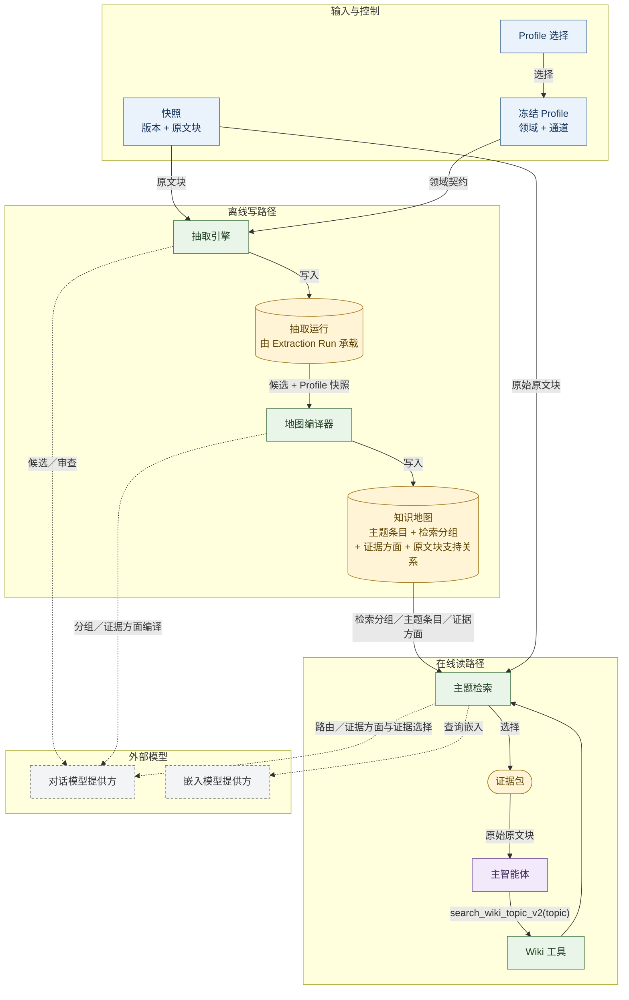

# 13 Profile-Driven（Profile／领域配置驱动）LLM Wiki（大语言模型知识库）：开放主题证据检索总体设计

## 英文术语约定

正文以中文为主。只有核心对象名、代码标识符、协议值、缩写和产品名保留英文；普通动作、
关系、状态和评测概念直接使用中文。下表只列出仍会保留英文的术语，首次出现后沿用英文。

| 英文术语 | 中文翻译 |
| --- | --- |
| Profile-Driven | Profile（领域配置）驱动 |
| LLM | 大语言模型 |
| Wiki | 知识库 |
| Profile | 领域配置 |
| Agent | 智能体 |
| Main Agent | 主智能体 |
| Candidate | 候选知识条目 |
| Topic | 主题条目 |
| TopicAspect | 主题证据方面 |
| Aspect | 证据方面 |
| Block | 原文块 |
| BlockAspectSupport | 原文块对证据方面的支持关系 |
| Evidence Bundle | 证据包 |
| Group | 检索分组 |
| Knowledge Map | 知识地图 |
| Map Envelope | 地图封装清单 |
| Manifest | 清单文件 |
| Artifact | 产物 |
| Schema | 模式 |
| Contract | 契约 |
| Snapshot | 快照 |
| Collection | 文档集合 |
| Document | 文档 |
| Source | 来源 |
| Provenance | 来源追踪信息 |
| Revision | 修订版 |
| Lineage | 谱系 |
| Ledger | 账本 |
| Delta | 增量 |
| Journal | 操作日志 |
| Prompt | 提示词 |
| Token | 词元 |
| Embedding | 嵌入 |
| Vector | 向量 |
| Query | 查询 |
| Retrieval | 检索 |
| Routing | 路由 |
| ID | 标识符 |
| Hash | 哈希值 |
| RAG | 检索增强生成 |
| Top-k | 前 k 个结果 |
| Dense | 稠密向量 |
| Lexical | 词面 |
| Semantic | 语义 |
| Cosine | 余弦相似度 |
| Jaccard | Jaccard 相似度 |
| Bigram | 二元词组 |
| BM25 | BM25 词频检索算法 |
| FTS | 全文检索 |
| ANN | 近似最近邻检索 |
| NFKC | Unicode NFKC 规范化 |
| MMR | 最大边际相关性 |
| Prompt Injection | 提示注入 |
| Sandbox | 沙箱 |
| VM | 虚拟机 |
| Egress | 出口控制 |
| Guardrail | 护栏 |
| Tool Call | 工具调用 |
| MCP | 模型上下文协议 |
| Hook | 钩子 |
| CUA | 计算机使用智能体 |
| Worktree | 工作树 |
| Checkpoint | 检查点 |
| Resume | 恢复续跑 |
| Rollback | 回滚 |
| Harness | 智能体运行框架 |
| Direct | 直接相关 |
| Partial | 部分相关／局部证据 |
| Irrelevant | 不相关 |
| Coverage | 覆盖 |
| Fallback | 回退补选 |
| Precision | 精确率 |
| Noise | 噪声 |
| Judge | 判官 |
| Gate | 门禁 |
| Fixture | 固定测试数据 |
| Qrels | 相关性标注集 |
| Held-out | 留出未参与调参的 |
| Frozen | 冻结的 |
| Selected | 已选的 |
| Active | 生效的 |
| Retired | 已退役的 |
| Ready Partial | 部分就绪 |
| Draft | 草稿 |
| P0 / P1 / P2 | 优先级 0／1／2 |
| ADR | 架构决策记录 |
| API | 应用编程接口 |
| UI | 用户界面 |
| JSON | JavaScript 对象表示法 |
| Markdown | Markdown 标记格式 |

普通动作统一使用中文，例如“合并、拆分、挂接、解除挂接、创建、退役、重命名”。需要对应
代码标识符时写成“合并（`merge_groups`）”，不把英文操作名单独作为正文术语。
以下标识或名称不翻译：`profile-knowledge-map-v6`、`parallel_work_state`、`ready_partial`、
`search_wiki_topic_v2`、`base_map_id`、`snapshot_id`、`group_id`、`topic_id`、`block_id`、
JSON 字段名、文件路径、命令、模型名、数据库名和产品名。

- 状态：目标设计；第 7 节是知识地图编译的唯一有效基线。
- 日期：2026-11-05；统一 Ledger 设计修订：2026-11-09
- 适用范围：以 c13-003 为代表的开放主题、跨文档、证据找全与噪声控制问题
- 关联设计：[01 产品需求](01-product-requirements.md)、[02 Agent 开发方法](02-how-to-build-an-agent.md)、[05 存储与检索策略](05-storage-and-retrieval-strategy.md)、[06 检索、工具与 Agent](06-retrieval-pure-agent.md)

本文是 Profile-Driven LLM Wiki 的总体设计入口，独立描述目标架构、数据流、核心契约、
失败语义与验收原则。

本文使用以下状态词：

- **必须**：工程红线，违反时不能视为可用实现；
- **应该**：稳定方向，若改变需要说明理由并重新验证；
- **可以**：实现可选，允许在后续版本中调整。

## 0. 结论与阅读导航

### 0.1 一句话设计

系统先用领域 Profile 从文档中高精度选择值得成为知识入口的候选对象，并保留支持它们的
原始证据；再通过增量 Topic／Group Ledger 将文档局部候选持续合并成跨文档主题地图、
Topic 证据方面和 Block 支持关系；
在线查询时先定位主题区域，再选择证据方面和代表原文块，最后把少量、可回源、覆盖面和
噪声受控的证据交给主 Agent。

```text
冻结 snapshot + 冻结 Profile
            │
            ▼
Extraction Run（Extraction Run）
  通道发现 → 候选累积 → 标题消歧
            │
            ▼
 Local Candidate + original evidence blocks
            │
            ▼
 Topic Ledger → Group Ledger
  topics → TopicAspects → BlockAspectSupport
            │
            ▼
 Immutable Knowledge Map version
 (base_map_id + input delta + ledger revision)
            │
            ▼
 search_wiki_topic_v2(topic)
            │
            ▼
    bounded original evidence bundle
            │
            ▼
          主 Agent
```

### 0.2 核心设计主张

1. **Profile 是领域抽取契约。** 不同领域不能用同一个“万能提示词”决定什么值得成为
   知识入口。
2. **Wiki 的核心产物首先是检索地图，不是自由生成的页面正文。** Wiki 的价值是帮助
   系统组织和定位证据，而不是生成另一套事实源；地图同时保存可复用的 Topic Aspect
   和 Block 支持关系。
3. **知识地图是增量状态，不是一次性快照生成器。** 候选→Topic 和 Topic→Group
   都是基于已有 Ledger 的局部增量解析；全量构建只是空 Ledger 的特例。
4. **入口高精度，证据高完整度。** 不值得独立检索的内容不升格为入口；已有入口涉及的
   不同方面则要尽量保留原文证据。
5. **查询先窄后宽再筛选。** 先找相关主题区域，再展开候选 topic 和 block，最后由证据
   选择器收敛，不能在查询时扫描整个知识库。
6. **原始 block 是唯一事实源。** 标题、别名和摘要用于检索与解释，不能替代
   原文证据。
7. **覆盖与噪声必须同时控制。** 只追求找齐而返回大量无关块，最终等价于把知识库塞进
   模型上下文。
8. **验收最终检索行为。** 候选、标题、地图和 group 看起来合理，都不能单独证明 Wiki
   对最终检索有用。
9. **检索契约反推编译产物。** 在线需要稳定使用的证据方面，不应每次临时发现；应由
   Profile 和知识地图在离线阶段形成可复用的 Aspect 元数据。

### 0.3 读完本文应能回答的问题

- c13-003 代表的是一类什么问题？
- 为什么普通 top-k 与现场智能体式 RAG 不能稳定解决这类问题？
- Profile 在系统中承担什么职责？
- 候选、topic、group、知识地图和 block 分别是什么？
- TopicAspect、BlockAspectSupport 和 Profile Aspect 模式分别承担什么职责？
- 一个 topic 查询如何最终变成证据包？
- 为什么验证要先做单篇，再做全库？
- 为什么选择自适应两级检索，而不是固定容量漏斗？
- 哪些失败条件会使方案停止或被推翻？

## 1. c13-003 代表的问题类型

### 1.1 问题现象

普通块检索和现场智能体式查询都把“相关问题”近似成“与当前查询措辞接近的 block”。
这类方法对局部事实问句通常有效，但对开放主题会遇到结构性缺口：

- 用户查询的是一个主题，不是可由单个 block 回答的事实；
- 回答需要来自多篇文档的多个不同方面；
- 有些必要方面在查询中没有出现相应词语；
- 查询改写只能扩大词面邻域，不能可靠发现知识库中的另一个有效方面；
- 直接提高 top-k 会同时引入大量无关块，稀释注意力并增加成本。

以 c13-003 为例，用户要理解“AI Agent 的隔离与控制边界”，系统需要同时覆盖文件与
工作区、凭证与身份、工具能力、外部内容信任、并行状态、上下文生命周期、子 Agent 委派
等多类证据。这些内容分散在相关文档中，而且不一定在第一次查询中被显式说出。

### 1.2 为什么普通 RAG 不够

| 路径 | 能做什么 | 不能保证什么 |
| --- | --- | --- |
| 稠密／BM25 top-k | 找回与查询措辞接近的局部证据 | 找齐未以查询词表达的其他方面 |
| Agent 多次改写查询 | 扩大词面和表达邻域 | 知道知识库中还存在哪些合理方面 |
| 增大 top-k 或返回全库 | 提高偶然命中的机会 | 控制噪声、成本与注意力稀释 |
| 直接让 LLM 扫描全部候选 | 在一次调用内做语义判断 | 在真实规模下保持有界、可解释和可负担 |

问题不在于 Agent 不够聪明，而在于在线查询阶段没有一张稳定表达“知识库里有哪些主题
区域、这些区域如何相互接近”的检索地图。每次从原始 block 和当前措辞重新发现知识面，
结果必然依赖查询措辞和当次模型行为。

### 1.3 本设计中的“找全”

本文所说的“找全”不是数学意义上的主题全集，也不是要求系统列出知识库中所有可能相关
的内容。它指：

> 在明确的 topic、知识库快照和评测目标下，系统返回足以支持后续回答的主要证据，
> 同时把无关证据限制在可接受范围内。

因此，“找全”必须同时满足覆盖和噪声约束。只有前者会让系统退化为全库过滤；只有后者
会让系统稳定地漏掉不显眼但必要的方面。

## 2. 目标、成功标准与非目标

### 2.1 用户可观察目标

用户给出一个开放主题后，系统应该：

1. 从一个有界、可追溯的 Wiki 地图中定位相关主题区域；
2. 返回当前知识库中支持该主题的主要原始证据 blocks；
3. 不要求用户先把主题拆成多个子问题；
4. 不把大量无关 block 交给后续回答模型；
5. 能解释每批证据来自哪些地图 group 和 topic；
6. 所有返回证据都可回到当前 snapshot 的原始 block。

### 2.2 系统目标

- **质量目标**：对固定主题提高证据覆盖，并保持可接受噪声；
- **可解释目标**：从 group 路由、topic 展开到 block 选择都有结构化诊断；
- **可追溯目标**：Profile、snapshot、候选流水线、地图和提示词版本一致；
- **成本目标**：地图规模和单次查询规模都有固定上限；
- **失败目标**：任何超限、范围不一致或证据悬空都显式失败，不伪造部分成功。

### 2.3 本设计的非目标

- 不承诺数学意义上的主题全集；
- 不构建带类型关系的事实知识图谱；
- 不把 Wiki 摘要或页面正文当作事实；
- 不证明所有领域都能使用同一个 Profile；
- 不在在线查询时重新发现整个知识库主题空间；
- 本设计不生成最终答案，也不使用答案判官代替证据检索验收；
- 当前切片不要求直接完成 1,000 篇规模验收；目标架构仍必须支持约 1,000 篇文档和
  100,000 Block，并通过逐级规模验证证明。

## 3. 核心设计原则

### 3.1 确定性的工程外壳＋概率性的语义内核

候选选择、标题消歧、分组和证据筛选都由大模型参与，因此语义输出可能浮动。系统不能
承诺每次逐字一致，但必须保证：

- 使用的 snapshot、文档版本和 Profile 固定；
- 提示词、模型、流水线和编译版本可追溯；
- 来源 block 的合法性可检查；
- 失败、超限和截断不会被伪装成成功；
- 同一输入和版本产生新的不可变产物，而不是覆盖旧结果。

### 3.2 Profile 表达领域抽取契约

同一段技术正文在法律、医疗、产品运营和软件工程中“什么值得成为知识入口”并不相同。
通用提示词可以抽取术语，却无法稳定表达领域内的入口粒度、包含条件和排除条件。

Profile 的作用不是让用户直接编写提示词，而是让用户用受控结构表达：

- 当前知识库面向什么领域；
- 用户准备怎样使用这些知识；
- 哪些对象值得成为独立入口；
- 什么条件下触发发现；
- 什么内容必须排除；
- 一个入口的合理粒度是什么。

### 3.3 入口高精度，证据高完整度

Wiki 不应把每个知识点都升格成入口。入口过多会造成：

- 地图规模膨胀；
- 同义入口和粒度冲突增加；
- 在线查询候选过多；
- 后续规范主题条目合并更困难。

但一旦某个对象被认定为入口，就不应只保留最像定义的一段。定义、作用、限制、风险、
条件和失败模式可以是同一入口的不同证据方面，应尽量保留并回到原文。

入口资格也不能以“当前文档是否已经给出完整定义”为硬门槛。单篇文档抽取无法预知未来
文档是否会补足定义、机制或用途；稳定名称加上真实成员、结构或使用关系，已经足以形成
一个可继续积累证据的入口。

### 3.4 Wiki 是检索投影，不是事实源

topic、group 和摘要都服务于定位和组织。最终事实引用必须来自当前 snapshot 的
原始 block。这个边界不能因为页面、摘要或模型归纳看起来更整洁而被打破。

### 3.5 离线编译发现结构，在线查询收敛范围

地图编译负责在用户愿意等待的离线成本内发现知识入口并形成稳定检索结构。在线查询只做
有限范围内的 group 定位、topic 展开和 block 筛选。

如果把主要发现工作留给在线查询，系统会重新退化为现场智能体式 RAG；如果每次查询
返回整张地图，系统又会退化为全库上下文。

### 3.6 覆盖与噪声同时约束

没有覆盖，后续回答无法完整；没有噪声控制，模型上下文被稀释，成本和错误率同时上升。
因此一个成功结果至少要同时满足：

- 必需主题方面有认可证据；
- 相关证据占结果主体；
- 结果数量和词元规模受控。

### 3.7 用最终行为反向验收上游语义组件

候选列表、标题和地图都只是中间结构。一个候选列表看起来干净，不代表：

- 新主题的真实方面能被找到；
- 一个候选的多个证据块能一起返回；
- 返回结果没有大量无关块；
- Agent 最终拿到的是可引用原文。

因此第一阶段语义质量由下游证据检索行为反向检验，而不是只维护一套独立的候选打分。

### 3.8 在线检索契约反推离线编译产物

在线查询不应反复执行高成本、可预计算的语义发现。凡是会频繁用于检索、覆盖判断和证据
选择的信息，都应在 Profile 或知识地图编译阶段形成受控、版本化、可回源的检索
元数据；在线查询只使用这些元数据做有界选择。

这条原则扩展了 3.5 和 3.7：

```text
在线需要快速判断“缺什么证据”
→ 离线编译期建立 Aspect 和 Block 支持关系
→ 在线只选择 Aspect 和代表 Block
```

### 3.9 Topic 身份有效性与知识充实度分离

知识库会持续扩充，一个 Topic 在不同地图版本中的知识充实度可以不同。Topic 当前只有
名称和父机制成员关系、尚未获得定义、机制或用途时，仍然可以是有效的**空壳 Topic**：

- 单篇抽取只能依据当前文档，不能因为未来证据尚未出现而删除稳定名称和既有关系；
- 空壳 Topic 是未来候选挂接、跨文档合并和检索的稳定身份锚点；
- 多条候选共享同一父级列表摘要时，不应伪造互不相同的摘要，也不应仅凭摘要相同合并对象；
- 后续文档补足知识时，只能扩展现有 Topic 的摘要和来源，不能替换其身份；
- 父机制、成员列表或结构位置等上下文关联不能被后来的 Group 归类覆盖。Group 负责默认
  检索区域；上下文关联仍必须能从不可变来源证据或独立关系记录中恢复。

这里区分两个状态：**身份有效**回答“这个对象是否值得作为稳定入口并继续积累证据”；
**知识充实度**回答“目前已经知道它多少内容”。二者不能互相替代。

## 4. 核心概念、对象与职责边界

| 概念 | 定义 | 不能混淆为 |
| --- | --- | --- |
| 文档集合快照 | 一组固定文档版本及其 block 的不可变集合 | 当前正在进行中的数据库状态 |
| 原始 block | snapshot 中可以定位和引用的原文单元 | 模型生成的摘要 |
| Profile | 领域、用途和受控抽取规则组成的语义契约 | 任意自由提示词 |
| 抽取通道 | Profile 中一个职责明确的发现规则 | 独立知识对象 |
| 抽取运行 | 固定 Profile 与 snapshot 上的一次不可变抽取 | 永久 Wiki 构建 |
| 局部候选 | 某篇文档中被发现、并绑定原文证据的局部知识对象 | 跨文档规范主题条目 |
| Topic | 当前 Profile＋snapshot 范围内形成的跨文档知识身份，聚合一个或多个绑定文档的候选 | 文档局部候选或事实证据本身 |
| 空壳 Topic | 身份和来源关系已成立，但当前文档只支持名称、成员、结构位置或简短提及，尚未提供定义、机制或用途的 Topic | 无效候选或应从地图删除的噪声 |
| Topic 上下文关联 | 候选被抽取时所处的父机制、成员列表或结构位置等可回源关系 | Group 成员关系或独立事实 |
| Group | 若干 topic 的检索相关性分组，可跨文档、多对多 | 严格父子分类或有类型的图 |
| Aspect 类别 | 系统维护的受控证据角色，例如定义、机制、边界、风险 | Topic 或事实证据 |
| Profile Aspect 模式 | Profile 定义的 Aspect 类别集合、领域 Aspect 和重要度配置 | 每个 Topic 的实际证据清单 |
| TopicAspect | 某个 Topic 上实际存在的具体证据方面 | 新的知识入口或原文证据 |
| BlockAspectSupport | 一个原始 Block 对某个 TopicAspect 的支持关系、强度和来源追踪 | 用支持关系替代原文 |
| 知识地图 | topics、groups、aspects、block 支持和来源范围组成的不可变检索产物 | 可读 Wiki 页面集合 |
| 证据包 | 工具最终返回的原始 blocks | 摘要、目录或生成答案 |

对象关系如下：

```text
snapshot
  ├─ document versions
  └─ original blocks

Profile
  ├─ extraction channels / criteria / domain context
  └─ Aspect Schema

Extraction Run
  └─ local candidates
       └─ source_block_ids

Knowledge Map
  ├─ topics
  ├─ groups
  │    └─ GroupMembership → topics
  ├─ TopicAspect
  └─ BlockAspectSupport
       ├─ aspect_id
       └─ block_id

search_wiki_topic_v2
  └─ original evidence blocks
```

候选是文档局部观察，Topic 是跨文档知识身份，Group 是检索区域，TopicAspect 是
Topic 内部的证据方面，BlockAspectSupport 把证据方面连接回原始 Block。Aspect 不是新的
知识入口，也不是事实来源。

## 5. 总体数据流

### 5.1 数据流全景

系统采用“离线写路径＋在线读路径”的数据流，而不是一条从文档直通回答的同步流水线：



图中实线表示数据流、写入或读取；虚线表示对模型能力的调用依赖，箭头指向外部依赖。
调用轨迹、用量和诊断信息属于旁路观测，不在主图中展开。

`Wiki Tool Adapter` 到 `Topic Retrieval Service` 的调用默认使用一个已经解析、且与当前
snapshot 兼容的地图 ID。地图的选择属于控制信息，见 5.7 节。

Profile 调校不是另一条处理链路，而是在同一条
`extraction → knowledge map → retrieval` 链路外增加一个评测回路：

```text
Profile 参数
→ extraction
→ knowledge map
→ retrieval
→ evidence bundle
→ 与固定 representative topic 的 evidence 目标比较
→ 根据漏项和噪声调整 Profile / 抽取 / 地图 / 检索
```

调校时，每一轮都要固定当时的 Profile 配置快照和输入；运行期使用已选冻结 Profile
执行同一条链路，只是不再用证据目标做在线判定。

数据流中只有三类语义对象：

1. **事实输入**：snapshot 中的文档版本和原始 blocks；
2. **配置输入**：冻结 Profile 及其领域抽取规则；
3. **派生产物**：抽取运行、知识地图和查询时形成的
   证据包。TopicAspects 和 BlockAspectSupport 属于知识地图的派生产物。

LLM 和嵌入提供方是编译与检索步骤调用的外部能力，不是事实来源：

- 抽取引擎调用对话提供方发现候选和审查语义；
- 知识地图编译器调用对话提供方构建 groups，并编译 TopicAspects 与
  BlockAspectSupport；
- Topic 检索服务调用嵌入提供方排序 groups 和 Aspects，并调用对话
  提供方路由 group、审核 aspect 覆盖和筛选证据。

Profile 的领域上下文和代表性检索问题会写入地图清单。在线检索读取
的是地图中的冻结副本，而不是回头读取一个可能已经变化的 Profile。

### 5.2 数据节点与转换职责

| 节点 | 输入 | 输出 | 关键职责 |
| --- | --- | --- | --- |
| Snapshot | 已完成入库的文档版本 | 固定 blocks 与清单 | 提供唯一事实源 |
| Profile 选择 | 用户选择 | 已选 Profile 指针 | 决定当前领域抽取契约 |
| 抽取引擎 | 冻结 Profile、snapshot blocks | 抽取运行 | 发现候选、绑定证据、消歧和审查 |
| 抽取运行存储 | 已完成抽取运行 | 可读取候选产物 | 保存不可变抽取结果 |
| 知识地图编译器 | 基础地图账本、抽取运行增量、Profile 领域上下文、Profile Aspect 模式 | 新的不可变知识地图版本 | 增量更新 Topic／Group Ledger，编译受影响 TopicAspects 和 BlockAspectSupport |
| 知识地图存储 | 不可变地图版本和生效指针 | 可读取 topic/group/aspect 地图 | 保存 Ledger 修订版、增量来源追踪和在线检索结构 |
| Wiki 工具适配器 | Agent topic 请求 | 工具调用与公共错误 | 校验参数、解析当前地图、隔离公共载荷 |
| Topic 检索服务 | topic、地图、snapshot blocks | 证据包 | Group 路由、Aspect 选择、代表 Block 选择和证据审核 |
| 主智能体 | 证据包 | 后续规划或回答 | 使用证据，不读取内部地图结构 |

`Extraction Run Store` 和 `Knowledge Map Store` 可以是同一持久化基础设施中的不同产物
类型；这里按数据语义分开，而不是强行定义新的部署组件。

### 5.3 离线写路径

离线写路径先固定输入，再完成四件核心工作：**发现候选、收敛候选、冻结抽取结果、
编译知识地图**。

```text
冻结输入
→ 发现候选
→ 收敛候选
→ 冻结 Extraction Run
→ 编译 Knowledge Map
```

| 阶段 | 核心问题 | 主要动作 | 输出 |
| --- | --- | --- | --- |
| 1. 冻结输入 | 这次处理的是哪些事实和哪套领域契约？ | 固定 snapshot、文档版本、Profile、窗口和流水线版本 | 可追溯的抽取现场 |
| 2. 发现候选 | 原文中什么值得成为知识入口？ | 文档窗口切分、各通道发现、可选通道内遗漏补抽 | 草稿候选与原文证据 |
| 3. 收敛候选 | 同一文档内的结果如何形成一份账本？ | 跨通道累积、精确去重、文档级标题消歧、别名和可选语义审查 | 文档级候选账本 |
| 4. 冻结抽取运行 | 哪些结果可以作为后续可信输入？ | 校验来源、别名、模式、全部文档和通道状态，原子写入结果与诊断 | 不可变抽取运行 |
| 5. 编译知识地图 | 如何把新的抽取结果并入已有检索结构？ | 读取基础 Ledger，增量更新 topics/groups 与受影响 Aspects，执行局部固定点和全局审计 | 新的不可变知识地图版本 |

阶段 2 内部的发现单位是“文档窗口＋通道”，但窗口和通道不是并列的主阶段。某个通道的
遗漏补抽也只是发现阶段的内部机制。阶段 3 必须按“通道累积 → 精确去重 → 文档级标题
消歧 → 审查”的顺序完成，不能把标题审查结果直接写回某个窗口候选。

阶段 4 采用全有或全无语义：任一文档、任一启用通道或任一必需校验失败时，整次
抽取运行不能作为已完成结果参与地图编译。阶段 5 不是重新生成一张地图，
而是把本次抽取运行增量应用到基础地图的 Topic／Group Ledger，并产生新的
不可变地图版本。首次全量构建使用空基础 Ledger，与本路径共用状态机。

这条数据流可以接收一篇或 N 篇文档。地图编译不需要知道上游是“单篇验证”还是“全库运行”；
它只要求输入抽取运行的 snapshot、Profile、流水线和文档范围彼此一致。

“单篇地图”和“全库地图”只是同一知识地图产物类型的不同文档范围，不是两个
不同架构组件，也不是两个不同运行时。

### 5.4 在线读路径

在线读路径包含五个连续阶段：**准备查询、定位主题区域、展开候选 topic 和 block、
筛选原始证据、返回 Agent**。

```text
准备查询
→ 定位主题区域
→ 展开候选证据
→ 筛选证据
→ 返回 Agent
```

| 阶段 | 核心问题 | 主要动作 | 输出 |
| --- | --- | --- | --- |
| 1. 准备查询 | 这个 topic 在当前知识库领域里如何理解？ | 接收 topic，加入地图清单中冻结的 Profile 背景和代表问题 | 有界的内部检索查询 |
| 2. 定位主题区域 | 应该检查地图中的哪些 groups？ | 持久化 group 向量混合排序、LLM Group 路由 | 已选 groups |
| 3. 展开候选证据 | 哪些 topics、aspects 和 blocks 值得继续检查？ | 展开已选 group 的全部 topics，读取 TopicAspect 与 BlockAspectSupport | 候选 topics、aspects 和 blocks |
| 4. 筛选证据 | 哪些 aspects 需要覆盖，哪些原始 blocks 最合适？ | 选择查询相关 Aspect，用重要度补足；每个 Aspect 选代表 Block；LLM 集合级审核 | 证据包 |
| 5. 返回 Agent | 主 Agent 最终能看到什么？ | 只返回 topic、原始 blocks 和空理由；内部路径与理由进入调用轨迹 | 公共工具结果 |

阶段 2 使用持久化 Group 向量做排序，并通过增量覆盖选择形成有界候选，再由 LLM 选择
相关 Groups。阶段 3 展开全部 Topics，并读取编译时生成的 Aspects 和 Block 支持。
阶段 4 先选择查询相关 Aspects，再在每个 Aspect 内选择代表 Block；LLM 只做集合级证据
审核，最终预算负责保证结果有界。

在线路径只读取已校验的知识地图和当前 snapshot 的原始 blocks。它可以在有限候选
空间内判断哪些 group、topic 和 block 与查询相关，但不重新执行候选发现、地图分组或主题
全集生成。

### 5.5 不可变产物的数据边界

两类核心产物的数据语义是：

```text
Extraction Run
  = frozen snapshot + frozen Profile/config snapshot + extraction output

Knowledge Map
  = base map identity
  + input document delta
  + Topic Ledger snapshot
  + Group Ledger snapshot
  + TopicAspects / BlockAspectSupport
  + immutable manifest and diagnostics
```

生命周期遵循相同原则：

- 抽取运行绑定 snapshot、文档版本、Profile/config snapshot 和抽取版本；
- 知识地图绑定 snapshot、Profile、抽取运行集合、基础地图、增量、Ledger 策略
  和清单哈希值；
- 产物完成后不可原地修改；
- 任何输入、提示词、流水线或范围变化都生成新产物；
- 读取时必须重新校验身份、哈希值和引用范围；
- 旧产物不因新运行、新地图或已选 Profile 变化而删除。

在线检索必须同时读取地图产物和当前 snapshot 的 block 存储，不能只根据 topic
摘要或地图中保存的引用字符串直接生成事实。地图中保存 block ID，最终正文仍从
snapshot 读取并校验。

### 5.6 离线与在线路径的分界原因

两条路径必须分离，因为优化目标不同：

| 离线写路径 | 在线读路径 |
| --- | --- |
| 允许有界模型调用、局部增量重算和必要的全局维护 | 要求受控延迟和固定预算 |
| 可更新 Topic／Group Ledger 并发布新地图版本 | 只能在当前生效地图上有界检索 |
| 产出候选和可复用地图 | 消费地图并返回证据 |
| 失败时整次产物不发布 | 失败时整次工具调用显式失败 |
| 变化通过新产物表达 | 不修改地图、不改写原文 |

这条边界防止在线请求重新退化为全库主题发现，也防止离线错误被当成一次查询问题而被临时
修补。

### 5.7 控制信息与观测数据

控制信息不沿主数据流传递，而是决定某个转换读取哪个固定输入：

- `selected Profile` 决定后续使用哪个冻结 Profile；
- snapshot 与地图的清单必须匹配；
- 产品化阶段还应由一个生效地图解析器决定当前使用哪张地图；
- 任何控制信息变化都通过新产物或新调用现场表达，不修改旧数据。

调用轨迹、用量和诊断信息是旁路观测数据。抽取引擎、地图编译器、Wiki Tool
和检索服务在运行时写入观测记录，但这些记录不进入最终证据包。

### 5.8 范围与验证顺序不属于数据流

以下内容不是运行时阶段：

- 先选择一篇锚点文档；
- 先通过单篇证据门禁；
- 再编译全库；
- 连续运行多次检查稳定性。

它们属于实施和评测策略，帮助团队在较小范围归因问题、控制成本并决定是否扩大验证规模。
具体验证阶梯见本文 11.2 节。

## 6. Profile 驱动的领域抽取

### 6.1 Profile 的职责

Profile 是“领域 + 用途 + 受控抽取规则”的配置记录。它至少包含：

- `domain_context`；
- `primary_uses`；
- `representative_questions`；
- `extraction_channels`；
- 全局 `exclude_criteria`；
- 粒度、语言和附加指导；
- 冻结后的 `profile_hash`。

用户拥有语义边界，但不能直接编辑最终系统提示词、代码、输出模式或关系合成规则。
系统拥有固定执行管线、证据校验、别名约束、失败语义和防提示注入边界。

### 6.2 通道表达什么

每个抽取通道应说明：

- `purpose`：该通道寻找什么；
- `activation`：正文出现什么条件时启用；
- `include_criteria`：必须满足哪些条件；
- `exclude_criteria`：哪些表面相似内容必须排除；
- `granularity_rule`：什么对象可以独立成为入口；
- 是否在初次发现后启用同一通道内的遗漏补抽。

通道不需要用户保证完全正交。实际执行时，后一个通道会读取当前文档已经建立的候选账本，
可以补充已有候选的摘要、别名、证据和通道来源追踪，但不得修改既有
主名称，也不得把不同对象或不同粒度强行合并。

### 6.3 单文档抽取流程

```text
冻结 snapshot + frozen Profile
→ 文档按固定窗口切分
→ 按 Profile 顺序执行通道 discovery
→ 可选：同一通道内遗漏补抽
→ 后续通道读取已有候选账本并增量补充
→ normalized primary name 精确去重
→ 文档级标题消歧
→ 确定性别名审查
→ 可选 LLM 候选审查
→ immutable Extraction Run；Extraction Run
```

这一机制统一称为**通道内遗漏补抽**，对应配置字段
`omission_retry_enabled`。它的实际职责是：

- 范围限定在当前文档的当前窗口和同一个抽取通道；
- 输入是当前窗口的原始证据 blocks、该通道的完整发现规则，以及当前已累积
  的候选账本；
- 任务是检查在该通道自己的边界内，初次发现是否漏掉了候选；
- 只能追加此前没有发现的缺失候选，不能改写、移动、删除已有候选；
- 不能越过本通道去补其他通道负责的对象；
- 默认关闭，由通道的 `omission_retry_enabled` 控制。

因此它属于发现阶段的召回保险，不是 Profile 质量判断。一个通道即使没有开启该机制，
文档中的原文块没有被关联候选，也不能自动判成漏提；是否应该提取仍由 Profile 规则和
后续检索证据门禁共同判断。

系统默认使用固定窗口和受控并发。任何文档、通道或必需步骤失败时，整次运行不进入
已完成；失败运行可以保留候选和用量供诊断，但不能作为正式候选集参与地图构建。

### 6.4 候选契约

候选至少包含：

- 名称和规范化名称；
- 文档级消歧后的最终标题；
- 别名；
- 本文档中的一组摘要；
- 来源 block IDs；
- 来源通道 IDs；
- 通道和窗口级的选择理由；
- 标题类型、消歧理由和锚点来源；
- 审查状态与疑点。

硬约束：

- 所有来源 block IDs 必须属于当前 snapshot 和当前文档版本；
- 别名必须是同一对象的其他名称，并真实出现在该候选自己的证据中；
- 成员、组成项、类型实例、子类或分类项不得作为别名；
- 摘要是对文档内证据的归纳，不是事实源；
- 摘要必须忠实覆盖当前证据，但允许只说明对象属于某个父机制、成员列表或结构位置；
  不能为了满足摘要深度而补充当前证据没有的定义、机制或用途；
- Topic 身份由稳定名称、别名、区分性锚点、来源证据和选择理由共同支撑，不要求当前摘要
  已经包含完整定义；同一父级命题支持多个候选时，这些候选可以共享摘要原文；
- 选择理由用于解释规则命中和证据支持，不能替代证据；
- 候选 ID 只要求在一次运行内稳定，不是跨文档最终身份。

### 6.5 入口选择与证据保留

Profile 抽取追求的是：

- 对“不值得独立检索”的内容保持高精度排除；
- 对“值得成为入口”的对象提供稳定名称和独立事实；
- 对同一入口在不同窗口、通道中出现的方面保留多条证据和摘要。

因此，“某段原文没有关联候选”不能自动判成漏提；它可能按当前 Profile 本来就不应成为
入口。反过来，候选数量也不代表覆盖完整度。

### 6.6 Profile 选择与冻结

Profile 草稿可以反复修改。确定使用后：

- 冻结 Profile 和哈希值；
- 知识库通过选择指针记录当前 Profile；
- 不自动覆盖旧 Profile、抽取运行或比较结果；
- Profile 的任何实质变化都产生新的抽取现场。

Profile 是 Wiki 编译的参数，不是固定金标准。它是否合适，最终仍由下游证据检索和在明确
质量问题上的重复验证来判断。

### 6.7 Profile Aspect 模式

Profile 除了定义“什么值得成为入口”，还定义“解释一个入口时哪些证据方面重要”。

Aspect 分为两层：

```text
Aspect Kind：系统维护的稳定认知角色
Profile Aspect：当前 Profile 选择或派生的领域方面
```

系统提供的 Aspect 类别至少覆盖：

- 定义；
- 用途；
- 机制；
- 结构；
- 前置条件；
- 边界；
- 权限；
- 生命周期／状态；
- failure_mode；
- 风险；
- 缓解；
- 取舍；
- 限制；
- 示例；
- 适用性。

这些类别的稳定标识为：

```text
definition
purpose
mechanism
structure
precondition
boundary
permission
lifecycle
failure_mode
risk
mitigation
tradeoff
limitation
example
applicability
```

这些类别不是领域事实，只是 Block 在解释 Topic 时承担的语义角色。

Profile Aspect 模式是一份显式、版本化并冻结的独立产物：

```text
ProfileAspectSchema
  profile_aspect_schema_id
  profile_aspect_schema_hash
  schema_version
  profile_id
  profile_hash
  aspects[
    kind
    domain_label
    description
    importance
  ]
  aspect_policy_version
  generation_prompt_version
```

它在地图编译契约创建时生成一次，流程为：

```text
冻结 Profile
+ 系统 AspectKind 目录
→ 生成建议的 ProfileAspectSchema
→ 用户可选调整
→ 校验并冻结
→ 计算 profile_aspect_schema_hash
→ 写入 MapCompileContract
```

系统使用以下 Profile 字段生成建议：

```text
domain_context
+ primary_uses
+ representative_questions
+ extraction_channels
+ granularity
```

例如技术学习 Profile 可以自动得到：

```text
kind=definition      domain_label=核心定义   importance=0.9
kind=mechanism       domain_label=作用机制   importance=0.9
kind=boundary        domain_label=能力边界   importance=0.8
kind=failure_mode    domain_label=失败模式   importance=0.8
kind=limitation      domain_label=适用限制   importance=0.7
kind=risk            domain_label=安全风险   importance=0.8
```

生成可以使用 LLM，但输出必须受 AspectKind 枚举和结构模式约束。默认不要求普通用户从
空表维护 Aspect。系统生成建议后：

- 默认使用系统建议；
- 高级用户可以合并、拆分、停用或新增 Profile Aspect；
- 用户可以调整 Aspect 的 Profile 级重要度；
- 用户不能把 Aspect 当作新的知识入口或事实。

用户调整或重新生成后必须形成新的 `profile_aspect_schema_id` 和哈希。地图编译只读取
冻结的 ProfileAspectSchema，不能在每次编译时临时重新生成。Schema 生成失败、结构非法
或哈希不匹配时必须显式失败，不能静默回退到另一套默认 Aspect 后继续发布地图。

Aspect 模式不修改冻结 Profile，也不进入 `profile_hash`。Aspect 类别、领域 Aspect、
重要度、描述或策略版本变化构成新的**地图编译契约**：

```text
selected Profile identity = profile_id + profile_hash
map Aspect contract = profile_aspect_schema_hash + aspect_policy_version
active map compatibility = snapshot + Profile identity + Aspect contract
```

生效地图指针同时保存 `profile_hash`、`profile_aspect_schema_id`、
`profile_aspect_schema_hash` 和 `aspect_policy_version`。任一不匹配时，旧地图不能作为
当前已选 Profile 的生效地图。
这样 Profile 保持冻结语义，Aspect 编译契约仍可独立演进和失效。

`profile_aspect_schema_hash` 绑定实际保存的完整冻结 Profile 配置快照、Aspect 模式和
Aspect 策略版本。校验时不得把当前代码新增的默认字段展开后再计算哈希值，否则历史
冻结快照会被误判为变化。冻结 Profile 不允许原地修改，任何 Profile 版本变化都形成新的
地图编译契约。

`extraction_channels` 仍然只表达候选发现规则，不能直接替代 Aspect。通道的
名称、用途和判据可以作为生成 Aspect 模式的输入，但不能把 `channel_id`
直接当作证据 aspect。

## 7. 知识地图编译：增量 Ledger 设计

> 状态：目标设计，是知识地图编译的唯一有效基线。

### 7.1 核心判断

知识地图不是每次从候选重建的产物，而是由两个相互依赖的语义 Ledger 持续演进形成：

```text
Candidate → Topic Ledger → Group Ledger
```

- 候选是文档局部观察，不属于规范 knowledge 身份。
- Topic 是跨文档知识身份，一个候选最终只能属于一个 Topic。
- Group 是 Topic 的检索区域，一个 Topic 可以有一个主 Group 和受控的额外 Group。
- TopicAspect 和 BlockAspectSupport 是 Topic 修订版的派生产物。
- 地图是一个不可变的、绑定 snapshot、Profile 和编译契约的版本。

全量构建定义为：

```text
base_ledger = empty
delta = all candidates
```

增量构建定义为：

```text
base_ledger = previous map version
delta = added / updated / deleted candidates 和 documents
```

两者必须使用同一套状态模型、操作语义、验证门禁和发布流程。不能存在“全量一套算法、
增量另一套算法”。

### 7.2 设计原则

1. **批次只是模型输入窗口，不是 Topic 归属。** Topic 不永久属于某个语义批次。
2. **状态变更必须显式。** 新对象不能靠模型重新输出一个完整列表间接产生；必须记录
   创建、挂接、合并、拆分、解除挂接或退役操作。
3. **未变化状态直接复用。** 未变更且编译契约兼容的 Topic、Aspect、Group 和向量
   不重新调用模型。
4. **局部变更优先，但按闭包传播。** 从变化对象形成初始 dirty frontier；每轮只处理当前
   frontier，并把已应用变化产生的直接邻居加入下一轮。传播不限于总一跳，而是持续扩展
   受影响闭包直到固定点；不能因为一篇新文档在开始时重新分组整个知识库。
5. **全局构建只是空基线。** 全量构建使用 `base_map_id=null`，不得维护另一套平行的
   全量代码路径。
6. **语义浮动通过状态连续性收敛。** 单次 LLM 判断仍可能不同，但已有稳定 Ledger 会缩小
   后续变更空间。
7. **旧地图不原地修改。** 每次成功编译产生新的不可变地图版本；只有完整验证后
   才切换生效指针。
8. **证据始终回源。** Topic、Aspect、Group 和成员关系都不能替代 snapshot 原始 Block。
9. **Topic 身份使用当前 revision 锚点。** 候选归属必须来自候选与当前 Topic revision 的
   直接判断；局部 `same` 不能沿相似度路径或历史 revision 传递。
10. **身份有效不等于知识充实。** 空壳 Topic 不能被过滤、合并或重新创建；后续证据必须
    追加到既有身份，并保留最初形成该入口的上下文关联证据。

### 7.3 Ledger 数据模型

所有 Topic／Group 状态变更使用统一操作外壳：

```text
LedgerOperation
  operation_id
  ledger_kind = topic | group
  kind
  input_refs[]
  output_refs[]
  expected_revisions[]
  payload
  reason
  provenance
```

- `input_refs`／`output_refs` 使用对应 Ledger 的稳定谱系 ID，以及操作必须引用的候选、成员
  或关系引用；
- `expected_revisions` 声明操作执行前必须匹配的对象修订版；
- `payload` 只承载当前 `kind` 需要的专用字段；
- `reason` 和 `provenance` 解释语义裁决和输入证据；
- 操作记录不可修改，只能由新的操作继续演进状态。

#### 7.3.1 Topic Ledger

Topic 记录必须同时包含稳定身份和内容版本：

```text
TopicRecord
  topic_lineage_id
  revision_id
  canonical_title
  aliases
  summaries[]
  state = active | retired
  created_revision
  last_changed_revision
```

Topic／CandidateNode 的摘要集合使用同一种结构：

```text
SummaryItem
  text
  source_candidate_refs[]
```

全部 SummaryItem 在身份判断、Topic 向量和 Group 构建中同级，不存在 primary summary 或
summary variant 的语义层级。规范化文本完全相同时可以合并为一项，并合并来源 CandidateRefs。

界面如果必须显示单行摘要，可以另外派生 `display_summary`，但该字段只用于展示，不能进入
身份判断、Topic 向量、Group 构建或 Aspect 编译。

`topic_lineage_id` 在对象创建时确定并持久化；新增来源、修改标题／摘要或改变
内容版本时保持不变。`revision_id` 表示当前内容版本。

active Topic 可以是空壳 Topic。Ledger 校验只能要求它有合法身份、至少一个
TopicCandidateMembership 和可回源证据，不能额外要求当前摘要已经包含定义、机制或用途。
后续候选挂接到该 Topic 后，物化过程合并全部同级摘要和来源；最初用于建立父机制、成员
列表或结构位置的证据必须继续作为来源保留。Group 重新划分不能删除或覆盖这些来源证据。

不能继续用可变组成的哈希值同时充当对象 ID 和内容版本。否则一个 Topic 增加
来源后 ID 就会变化，无法判断它是同一 Topic 的新版本，也无法稳定重定向 Group 成员关系。

`TopicCandidateMembership` 是 Topic 候选成员关系的唯一事实源。Topic 的候选知识条目列表、
文档版本、来源 Block 和通道集合都是对当前 memberships 及其对应候选记录的派生投影，
不能在 TopicRecord 中独立保存或写入。

Topic 的操作至少包括：

```text
create_topic
attach_candidate
detach_candidate
merge_topics
retire_topic
```

Topic 内容不是独立操作。`attach_candidate`、`detach_candidate` 和 `merge_topics`
应用后，编译器根据当前来源成员关系重新物化标题、别名和摘要集合，并生成新的
Topic revision。模型不能绕过来源关系单独修改 Topic 内容。

Topic 合并、拆分和退役的谱系关系只记录在 `LedgerOperation(ledger_kind=topic)`，不回写到
TopicRecord。Topic 操作的 `payload` 至少表达：

- `create_topic`：至少一个 `initial_candidate_refs[]`；
- `attach_candidate`／`detach_candidate`：`CandidateRef(extraction_run_id, candidate_id)`；
- `merge_topics`：输入 Topic 谱系、新 Topic 谱系和候选迁移关系；
- `retire_topic`：目标 Topic 谱系和退役原因。

合并和拆分操作必须完整记录输入谱系、输出谱系、决策理由和来源重定向关系。TopicRecord
只表示当前对象，不保存父谱系副本。

`create_topic` 必须原子完成：

1. 创建新的 `topic_lineage_id`；
2. 为 `initial_candidate_refs` 创建 TopicCandidateMembership；
3. 根据这些候选物化 Topic 内容和首个 revision；
4. 写入创建操作日志。

`initial_candidate_refs` 必须非空、无重复，并且全部来自当前输入范围。系统不能创建没有
候选成员的 active Topic。后续额外候选通过 `attach_candidate` 加入。

#### 7.3.2 Topic 候选成员关系

候选知识条目的身份由 Extraction Run 和运行内 candidate ID 共同组成：

```text
CandidateRef
  extraction_run_id
  candidate_id
```

不能只使用 `candidate_id`，因为它只保证在一次 Extraction Run 内唯一。

Topic 候选成员关系是持久化关系，不只是 Topic 内嵌的数组：

```text
TopicCandidateMembership
  topic_lineage_id
  extraction_run_id
  candidate_id
```

Topic 当前候选知识条目列表定义为：

```text
TopicCandidates(topic_lineage_id)
= {
    candidate
    | membership.topic_lineage_id = topic_lineage_id
      AND candidate.extraction_run_id = membership.extraction_run_id
      AND candidate.candidate_id = membership.candidate_id
  }
```

当前 Ledger 只保存仍然生效的成员关系。`detach_candidate` 只从当前编译事务的暂存
Ledger 副本中移除 TopicCandidateMembership；发布后表示该关系在**新地图版本**中不存在，
不会修改基础地图或任何 sibling map。

例如：

```text
M1：Topic A → Candidate C

M2 基于 M1，执行 detach_candidate：
M1：Topic A → Candidate C
M2：关系不存在

M3 再次基于 M1：
M3：Topic A → Candidate C
```

新分支继承哪张地图，就继承那张地图的完整 Ledger 状态。若从 M2 分支并需要恢复该关系，
必须显式执行 `attach_candidate`。

当前关系由地图快照表示；关系的创建、修改和解除由
`LedgerOperation(ledger_kind=topic)` 表示。知识地图历史是以 `base_map_id` 构成的有向
无环图；沿选定地图版本的父节点路径并结合对应操作日志，可以恢复该分支的状态变化历史。

增量规则：

1. 目标文档继续使用同一个 Extraction Run 时，候选知识条目集合保持不变；
2. Extraction Run 变化时，旧 candidate 全部 detach，新 candidate 全部 added；
3. 新 candidate 随后统一进入 Topic 解析器，由 Topic 层判断语义连续性；
4. 系统不比较 candidate 内容指纹，也不做来源级结构匹配；
5. 不建立候选级额外身份、内容指纹、候选谱系或来源匹配记录。

候选知识条目的文档版本、通道、来源 Block 和内容字段必须从对应 Extraction Run 的
不可变候选记录读取，不在 TopicCandidateMembership 中重复保存。

#### 7.3.3 Group Ledger

Group 记录同样区分稳定身份和内容版本：

```text
GroupRecord
  group_lineage_id
  revision_id
  label
  aliases
  summary
  retrieval_questions
  state = active | retired
  created_revision
  last_changed_revision
```

Group 成员关系是一等对象：

```text
GroupMembership
  group_lineage_id
  topic_lineage_id
  role = primary | secondary
  retrieval_duties[]
  reason
  confidence
  provenance
```

以下字段和集合全部是派生投影，不作为 TopicRecord／GroupRecord 的独立事实：

```text
TopicCandidateIds(topic_lineage_id)
TopicSourceDocIds(topic_lineage_id)
TopicSourceBlockIds(topic_lineage_id)

GroupTopicIds(group_lineage_id)
GroupPrimaryTopicIds(group_lineage_id)
GroupSourceDocIds(group_lineage_id)
GroupSourceBlockIds(group_lineage_id)
GroupAspectLabels(group_lineage_id)
```

Topic／Group／Aspect 向量只保存在 `vector_bundle` 中，并按对应 revision／aspect ID 建立
索引；对象记录不保存向量副本。

规则：

- 当前 Ledger 只保存仍然生效的 GroupMembership；`detach_topic` 直接删除当前关系。
- 同一对 `(group_lineage_id, topic_lineage_id)` 只能有一条成员关系。
- 每个生效 Topic 恰好有一个主 Group 成员关系；
- secondary 成员关系必须至少有一个非空检索职责，职责去重后保存在 `retrieval_duties[]`；
- 同一 Topic 在同一 Group 中出现无法共存的检索职责时，应拆分 Group，不能为同一关系建立
  多条 membership；
- 成员关系不能只因为词面相似而重复；
- Group 的标签、摘要和检索问题必须覆盖全部主要成员及其边界；
- Group 不形成事实断言，也不能替代原始证据。

Group 操作至少包括：

```text
create_group
set_primary_group
attach_topic
detach_topic
merge_groups
split_group
relabel_group
retire_group
```

`create_group` 只创建 Group 本身，不在创建动作中隐式决定成员角色。成员关系通过以下规则建立：

- `set_primary_group(topic_lineage_id, target_group_lineage_id)` 设置 Topic 的唯一主 Group；
- Topic 已有其他主 Group 时，同一操作原子移除旧主成员关系；
- `attach_topic` 只创建 secondary membership，并必须给出独立检索职责；
- 如果旧 Group 仍承担独立检索职责，需要另一次 `attach_topic` 显式保留为次成员关系；
- `detach_topic` 可以删除任意当前成员关系，不区分 primary 或 secondary；
- 删除 primary 后允许暂存 Ledger 暂时没有主归属；若轮次结束时 Topic 仍 active 且没有新的
  primary membership，整轮校验失败；
- Topic 退役、Group 合并／拆分和主归属迁移可以使用同一个 `detach_topic` 清理旧关系。

Group 身份和结构操作规则：

- `create_group` 创建新的 `group_lineage_id` 和首个 revision，初始可以没有成员；
- `relabel_group` 保留原 Group 谱系，只更新 label、aliases、summary 和 retrieval
  questions，并生成新 revision；
- `merge_groups` 退役全部输入 Group，创建一个新的 `group_lineage_id`；
- `split_group` 退役原 Group，为每个输出创建新的 `group_lineage_id`；
- `retire_group` 保留原 Group 身份并标记 retired，只能用于没有当前成员关系的 Group。

`merge_groups` 的成员迁移规则：

1. Topic 来源取所有输入 Group 当前成员的并集；
2. Topic 在某个输入 Group 中是 primary 时，合并后的新 Group 继续作为该 Topic 的 primary；
3. 同一 Topic 的多个 secondary 关系合并为一条 membership，`retrieval_duties[]` 取去重
   并集；
4. 新 Group 的 label、aliases、summary 和 retrieval questions 必须覆盖全部主要成员；
5. 发布校验必须保证每个 Topic 仍恰好有一个 primary。

`split_group` 的成员迁移规则：

1. 操作必须明确每个输出 Group 的 Topics 和角色；
2. 原 Group 为某 Topic 的 primary 时，至少一个输出 Group 必须接管该 Topic 的 primary；
3. 无法明确 primary 归属时拆分操作非法；
4. secondary 职责可以分配到多个输出 Group，但每条次成员关系都必须保留独立职责；
5. 拆分后不能出现无主 Topic、悬空成员关系或未分配的原成员。

`retire_group` 不允许自动删除仍有成员的 Group。必须先将成员迁移或解除挂接；只有空 Group
才能退役。

Group 谱系关系只记录在 `LedgerOperation(ledger_kind=group)`。Group 操作的 `payload`
至少表达：

- `create_group`：新 Group 的首个物化内容；
- `set_primary_group`：Topic 谱系和目标 Group 谱系；
- `attach_topic`／`detach_topic`：Topic 谱系、Group 谱系和成员职责；
- `merge_groups`：输入／输出 Group 谱系和成员迁移关系；
- `split_group`：原 Group 谱系、输出 Group 谱系和成员角色分配；
- `relabel_group`：目标 Group 谱系和新元数据；
- `retire_group`：目标 Group 谱系和退役原因。

合并、拆分和退役必须记录输入／输出谱系关系，不能在 GroupRecord 中重复保存父谱系。

### 7.4 统一编译状态机

知识地图编译只有一套状态机。候选→Topic 解析器和 Topic→Group 解析器共享同一套
增量处理骨架，差异只在实体类型、候选特征、业务裁决和操作校验：

```text
加载并校验基础账本
→ 分类输入增量
→ 识别待更新对象
→ 构建有界候选邻域
→ 确定性候选分桶和精确合并
→ LLM 只裁决模糊候选
→ 生成有类型的账本操作
→ 事务性应用操作
→ 计算受影响闭包
→ 局部固定点收敛
→ 校验不变量和质量
→ 发布新的不可变地图版本
```

“全量构建”不是第二种编译算法，而是同一状态机在空基础账本上的执行：

```text
base_ledger = empty
input_delta = all target candidates
```

增量构建使用同一个状态机：

```text
base_ledger = previous immutable map ledger
input_delta = explicit document / candidate additions, updates and deletions
```

因此 `compilation_mode=full|incremental` 只描述输入状态和诊断口径，不能改变解析器、
操作语义、固定点规则、校验器或发布协议。代码中不得保留绕过统一状态机的全量回退路径。

这段不是一次流程同时修改 Topic 和 Group，而是两层解析器按依赖顺序执行：

```text
候选增量
→ Topic 解析器
→ 已提交的 Topic 账本增量
→ 证据方面失效／重新编译
→ Group 解析器
→ 已提交的 Group 账本增量
→ 地图级校验与发布
```

同一条状态机骨架在两个层级分别执行：

| 步骤 | 候选→Topic 解析器 | Topic→Group 解析器 |
| --- | --- | --- |
| 读取基础 | Topic Ledger | 更新后的 Topic Ledger + 旧 Group Ledger |
| 分类增量 | 新增／修改／删除的候选 | 新增／已修改／已退役 Topics |
| 待更新对象 | 受文档变化影响的候选和 Topics | 变化 Topics、其旧成员关系和候选邻近 Groups |
| 有界邻域 | 候选与当前 Topic revision 锚点、Topic 锚点之间 | Topic 卡片、现有 Groups 和检索问题邻居 |
| 候选信号生成 | 精确名称／别名、候选引用、向量邻居 | Group 向量、标签／问题、Topic 重叠、来源重叠 |
| LLM 裁决 | 候选是否进入当前 Topic 锚点；Topic 锚点之间是否合并 | 主归属设置、次成员挂接、创建、合并、解除挂接、重命名或退役 |
| 有类型操作 | LedgerOperation(ledger_kind=topic) | LedgerOperation(ledger_kind=group) |
| 事务 | 先形成稳定的 Topic 修订版 | 只基于该修订版修改 Group Ledger |
| 受影响闭包 | 来源、别名、摘要、Aspect 失效范围 | 成员关系、Group 摘要／向量、邻近 Group |
| 固定点 | 没有待归属候选和待处理 Topic 邻域 | Group 成员关系／合并不再变化 |
| 校验 | 候选全覆盖、来源完整 | 主覆盖、Group 边界、检索质量 |

Topic 必须先稳定，Group 才能消费 Topic Ledger 增量。不能在 Topic 还未确定时直接修改
Group，否则 Group 成员关系可能引用一个即将被合并或拆分的旧身份。

两层解析器的逻辑提交顺序固定，但新地图版本只有一个物理事务。它们都在暂存 Ledger
副本上执行；Topic 子事务结束后，只有编译器内部可见，不能发布为生效地图。Aspect
重编译和 Group 子事务完成、全部地图级校验通过后，Topic 操作、Aspect 产物、Group
操作、向量产物和增量日志才一起发布。

每一轮 Ledger 操作计划都基于同一个暂存 Ledger 副本校验，并按依赖 DAG 执行：

1. `create_topic` 原子创建 Topic 和初始候选成员；`create_topic`／`create_group` 是后续
   额外成员操作的前置；
2. Topic merge 或 Group merge／split 先确定输出谱系，再允许对输出对象设置成员；
3. `attach_candidate`／`attach_topic` 依赖目标 Topic／Group 存在；
4. `detach_candidate`／`detach_topic` 依赖当前成员关系存在；
5. `retire_topic` 依赖全部候选已迁移或解除；
6. `retire_group` 依赖 Group 已无当前成员。

不存在依赖关系的操作按 `kind` 固定优先级和稳定对象 ID 排序。任一前置条件、预期 revision
或引用校验失败时，整个编译轮次失败，不能部分应用。该轮全部操作应用完成后，才统一执行
结构不变量和质量校验。操作日志只有在地图最终发布成功时才成为该地图版本的不可变产物。

两个层级共享：

- 稳定谱系与修订版；
- 待更新边界；
- 向量／词面／别名／候选知识条目分桶；
- 有界模型窗口；
- 结构化操作；
- 判断缓存（Topic pair cache 与 Group edge cache）；
- 不确定保守策略；
- 受影响闭包和固定点；
- 诊断信息、事务和发布门禁。

两个层级使用不同的业务校验器：

- Topic 解析器验证“是否同一知识身份”；
- Group 解析器验证“是否属于同一检索区域”。

#### 7.4.1 编译请求与输入身份

编译器接收一个明确的基础状态和目标增量：

```text
compile_map(
  base_map_id: optional,
  target_extraction_run_ids,
  compile_contract_id,
  compile_attempt_id: optional,
)
```

- `target_extraction_run_ids` 是目标地图的完整权威范围，每个文档恰好绑定一个 Extraction Run。
- `base_map_id=null` 表示空基础账本，全部目标候选进入 added。
- `base_map_id` 非空时，编译器必须加载该不可变地图及其 Ledger 修订版。
- 编译器从 Extraction Run 派生文档 ID、文档版本、snapshot、snapshot 清单哈希和 Profile 身份。
- 同一个文档只能出现一次；所有运行必须绑定同一 snapshot、同一 Profile 身份、同一候选流水线和同一编译器契约。
- 目标运行集合不能为空。
- target 中存在而 base 中没有的文档是新增；base 中存在而 target 中没有的文档是从该地图范围删除。
- dirty 文档、dirty 候选和 dirty Ledger 边界由 base map 与目标运行集合比较后派生，不作为外部输入。
- 任一输入身份不一致时，编译失败；只有在契约明确判定旧 Ledger 不可兼容时，才从空 Ledger
  开始新的地图谱系。

`compile_contract_id` 指向一份不可变、可注册的 `MapCompileContract`。调用方只传稳定 ID，
编译器负责加载、校验并把完整契约及哈希写入地图清单：

```text
MapCompileContract
  compile_contract_id
  contract_hash
  schema_version
  profile_id
  profile_hash
  profile_aspect_schema_id
  profile_aspect_schema
  profile_aspect_schema_hash
  aspect_policy_version
  compiler_version
  prompt_versions
  name_normalization_version
  tokenizer_version
  topic_embedding_input_contract
  aspect_embedding_input_contract
  group_embedding_input_contract
  algorithm_policy_versions
  topic_identity_judge_contract_id
  topic_identity_judge_contract_hash
  topic_identity_judge_config_ref
  topic_identity_judge_config_hash
  compiler_threshold_parameters
    topic_identity_similarity_threshold: float[0, 1]
    topic_identity_max_target_pairs_per_work_item: 200
    topic_identity_max_judge_total_tokens_per_work_item: 200000
    topic_identity_judge_max_pairs_per_request: 20
    topic_identity_judge_max_input_tokens_per_request: 32000
    topic_identity_judge_max_output_tokens_per_request: 8192
    topic_identity_judge_output_tokens_per_pair_reserve: 256
```

- `target_extraction_run_ids` 推导出的 Profile 身份必须与契约中的 `profile_id`、
  `profile_hash` 完全一致。
- 契约中的任一字段变化都必须生成新的 `compile_contract_id` 和 `contract_hash`。
- `topic_identity_judge_contract_hash` 必须由不可变的判官配置快照计算，至少覆盖 provider、
  model ID、模型语义参数、prompt template hash、input／output schema version、
  relation enum version 和 Profile 身份。
- compile attempt 开始时必须校验运行时判官配置与
  `topic_identity_judge_contract_id`、`topic_identity_judge_contract_hash`、
  `topic_identity_judge_config_ref`、`topic_identity_judge_config_hash` 完全一致。
- 编译过程中不得重新读取全局设置替换判官契约。
- 在线检索的排序权重、候选阈值和输出预算属于查询策略，不进入地图编译契约。
- 未注册、哈希不匹配或无法证明不可变的契约不能用于编译。

编译器根据稳定输入派生幂等键：

```text
compile_input_key = hash(
  schema_version,
  base_map_id,
  sorted(target_extraction_run_ids),
  compile_contract_id
)
```

- 未提供 `compile_attempt_id` 时，相同 `compile_input_key` 已有成功地图就返回该地图，不重新
  调用模型；
- 失败或中断的编译不进入成功缓存；
- 显式重新生成时必须提供新的 `compile_attempt_id`，并形成新地图版本；
- 新 attempt 可以产生不同的语义结果，但不能覆盖历史成功地图。

#### 7.4.2 待更新边界

初始待更新集合：

```text
changed candidates
+ their current Topic lineages
+ Topics affected by deleted candidates
```

从 Topic Ledger 应用变更后，扩展到：

```text
新增或已修改的 Topics
+ 它们旧的和新的 Group 成员关系
+ 成员关系或候选覆盖发生变化的 Groups
+ 局部语义邻域中的候选 Groups
```

每轮只允许修改当前 dirty frontier 及其直接候选邻居。操作改变对象后，新增直接邻居进入
下一轮 frontier；跨轮累积形成完整的受影响闭包。闭包之外的未变更对象保持原 ID、修订版
和向量。

#### 7.4.3 候选分桶

候选→Topic 身份关系只使用：

- Topic 与 Candidate 的 summary 向量近邻；
- 规范化标题／别名精确匹配。

Topic→Group 关系可以使用 Group 向量、标签、检索问题、Topic 重叠、来源覆盖和当前成员关系。
两层都不能只凭模糊词面重合或共享来源 Block 自动合并对象。

Topic 身份的 target proposal 只产生待比较节点对，不直接产生合并或成员关系。

Topic↔Topic 判断缓存只以完整 Topic NodeRef 对和判官契约哈希为键。NodeRef 已包含
revision；任一 Topic 端点版本或裁决策略变化时，已有判断不能复用。Candidate→Topic
判断在同一 WorkItem 内本来就不会重复，不做跨工作项缓存。Group 解析如果使用候选边，其
缓存规则由“7.7 Topic → Group”单独定义。

#### 7.4.4 Topic 变化如何传到 Group Ledger

Topic 解析器完成后，Group 解析器收到的是有类型的 Topic 增量，而不是“Topic 总数变了”
这一条模糊信号：

```text
created_topics
revised_topics
merged_topic_pairs
retired_topics
```

每一类变化按以下方式进入 Group Ledger：

| Topic 变化 | Group 解析器的第一步 | 可能的 Group 操作 |
| --- | --- | --- |
| 新 Topic | 查找内容相近、来源相邻或检索问题相近的现有 Groups | set_primary_group；必要时 attach_topic；若现有 Groups 都不适合，则 create_group |
| Topic 修订版变化但身份不变 | 找它当前的主／次 Groups，重新检查边界和检索职责 | 保留成员关系；必要时解除挂接／重命名 |
| 两个 Topics 合并 | 收集两个旧谱系的全部成员关系，合并为新的候选成员范围 | merge_groups、set_primary_group、解除挂接冗余成员关系 |
| Topic 拆分 | 找到旧 Topic 的全部 Groups，分别判断每个结果 Topic 是否仍属于这些 Groups | detach_topic、attach_topic、set_primary_group、create_group |
| Topic 退役 | 找到全部生效成员关系并移除 | detach_topic；空 Group 则 retire_group |
| Topic 的来源／Aspect 变化 | 标记当前 Groups 为待更新，但默认保留成员关系 | relabel_group、重算向量；只有语义改变才解除挂接 |

具体执行顺序是：

1. 把变化 Topics 作为种子；
2. 收集它们当前所属 Groups 和旧成员关系；
3. 通过 Group 向量、Topic 重叠、来源文档和检索问题扩展有界
   邻居 Groups；
4. 将 Topic 卡片和候选 Group 卡片送给 Group 解析器；
5. Group 解析器只能产生有类型操作；
6. 操作应用到 Group Ledger 的副本；
7. 重算被修改 Groups 的成员关系、摘要和向量；
8. 把与这些 Groups 相邻的 Groups加入下一轮边界；
9. 没有新操作且所有候选边已审阅时达到局部固定点；
10. 通过主成员关系、来源、Group 一致性和检索质量校验后发布新地图版本。

#### 7.4.5 一个完整的增量例子

假设新文档加入一个 Topic：

```text
T_new = “并行任务的结果协调”
```

已有 Group Ledger：

```text
G_multi_agent = “多 Agent 同步与异步执行”
G_long_run    = “长时运行智能体状态恢复”
G_subagent    = “子 Agent 委派”
```

处理过程是：

1. 候选→Topic 产生 `TopicDelta(created=[T_new])`；
2. Group 解析器找到 `G_multi_agent`、`G_long_run`、`G_subagent` 作为候选；
3. 同时找出现有 Topics 中与 `T_new` 近邻但尚未进入这些 Groups 的 Topics；
4. LLM 判断现有单个 Group 都不能覆盖“并行任务状态协调”这个检索职责；
5. 产生操作：

```text
create_group(
  label = “并行任务与工作状态边界”,
  retrieval_duties = [“并发执行中的状态协调”, “结果合并与隔离”]
)

set_primary_group(
  topic = T_new,
  target_group = G_new
)

attach_topic(
  topic = ...related existing topic,
  target_group = G_new,
  role = secondary,
  retrieval_duties = [“共享并行任务状态边界”]
)
```

6. 新 Group 建立子事务：先创建空 Group，再通过 `set_primary_group` 设置 `T_new` 的主归属，
   并通过 `attach_topic` 为已有 Topics 建立带独立职责的次成员关系；
7. `G_multi_agent`、`G_long_run` 等由于成员邻近和新 Group 出现进入下一轮待更新边界；
8. 下一轮检查新 Group 是否与现有 Group 重叠：
   - 若只是补充不同检索职责：保留；
   - 若两个 Group 实际是同一区域：merge_groups；
   - 若新 Group 过宽：split_group；
9. 没有新操作后，执行重叠、覆盖和 c13 检查；
10. 写出新地图版本，`base_map_id` 指向旧地图。

如果对应文档后来被删除：

```text
T_new 已退役
→ 从“并行任务与工作状态边界”解除挂接 T_new
→ 若 Group 仍覆盖其它并行状态 Topics，则保留并重算摘要／向量
→ 若 Group 已无成员，则退役该 Group
→ 相邻 Group 进入检查，因为删除可能改变原先的合并／拆分边界
```

这就是“Topic 变化如何修改 Group Ledger”的完整语义：Topic 解析器只产生 Topic 增量，
Group 解析器不重建全图，而是围绕这个增量、已有成员关系和当前受影响 frontier
执行可追溯的 Group 操作。

### 7.5 地图版本、增量与复用契约

#### 7.5.1 编译请求

编译请求的身份和增量语义按第 7.4.1 节执行。本节只定义返回与复用规则。

返回值必须是新的不可变地图版本。若本次输入与基础地图没有变化，返回无变化／可复用
结果，不重新发布内容相同的地图。

#### 7.5.2 可复用条件

一个 Ledger 对象只有同时满足以下条件才能复用：

- 生成该对象时使用的编译子契约与当前 `compile_contract_id` 兼容；
- 候选引用、来源文档版本和来源 Block 未变化；
- Profile 身份／哈希值未变化；
- Topic 嵌入契约未变化；
- Aspect 模式和策略未变化；
- Group 嵌入契约未变化；
- 生成该对象所需的提示词／策略与当前编译器契约兼容。

无法证明等价时必须重新计算，不能静默复用。

#### 7.5.3 地图清单

每个不可变地图清单只做索引，不内嵌完整 Topic、Membership、Aspect、Support 或 Block
数据集合：

```text
map_id
schema_version = profile-knowledge-map-v6
snapshot_id / snapshot_manifest_hash
base_map_id
compile_input_key
compile_attempt_id
compilation_mode = full | incremental
compile_contract_id
compile_contract_hash
topic_identity_judge_contract_id / topic_identity_judge_contract_hash
topic_identity_judge_config_ref / topic_identity_judge_config_hash
topic_embedding_contract
aspect_contract
group_embedding_contract
topic_ledger_revision
group_ledger_revision
target_extraction_runs_ref / target_extraction_runs_hash
document_scope_ref / document_scope_hash
document_delta_ref / document_delta_hash
topic_records_ref / topic_records_hash
topic_candidate_memberships_ref / topic_candidate_memberships_hash
group_records_ref / group_records_hash
group_memberships_ref / group_memberships_hash
topic_aspects_ref / topic_aspects_hash
block_aspect_supports_ref / block_aspect_supports_hash
block_aspect_exclusions_ref / block_aspect_exclusions_hash
topic_work_item_decisions_ref / topic_work_item_decisions_hash
topic_identity_judgements_ref / topic_identity_judgements_hash
topic_operation_log_ref / topic_operation_log_hash
group_operation_log_ref / group_operation_log_hash
topic_operation_summary
group_operation_summary
candidate_vector_bundle_ref / candidate_vector_bundle_hash
vector_bundle_ref / vector_bundle_hash
usage_ref / usage_hash
convergence_report_ref / convergence_report_hash
quality_audit_ref / quality_audit_hash
object_counts
manifest_hash
created_at
```

所有 `*_ref` 必须指向同一地图版本的不可变分区产物，读取时必须校验对应哈希。清单只保存
索引、哈希、对象计数和必要摘要，避免大图清单无限膨胀。每个新增、修订、合并、拆分、
挂接、解除挂接、重命名和退役都必须能从操作日志追溯到输入增量、裁决证据和受影响对象。

旧地图继续绑定旧 snapshot。增量编译不能把旧地图原地推进到新 snapshot，而是从旧地图
派生下一版本。

### 7.6 候选 → Topic Ledger

#### 7.6.1 算法步骤

Topic 解析使用一个随临时 Ledger 演进的工作集合 `WorkSet`。主流程如下：

1. 从基础地图复制临时 Topic Ledger，并准备空 `WorkSet`。
2. 按 `CandidateRef = (extraction_run_id, candidate_id)` 计算候选的
   `unchanged／added／removed`，见“7.6.3 候选差分与初始 WorkSet”。
3. 在临时 Ledger 中解除 removed candidate 的成员关系；受影响且仍有成员的 Topic 生成
   新 revision，失去全部成员的 Topic 立即退役，见
   “7.6.3 候选差分与初始 WorkSet”。
4. 为每个 added candidate 建立独立 CandidateNode，并与受影响且生成新 revision 的 Topic
   一起加入 `WorkSet`，见“7.6.2 核心对象与状态”和“7.6.4 CandidateNode 构造”。
5. 从 `WorkSet` 取最高优先级工作项。Topic 优先于 Candidate，同类按稳定顺序处理，见
   “7.6.6 WorkSet 处理与 LLM 分批”。
6. 基于当前最新临时 Topic Ledger，为当前节点查找 target Topic：
   - summary 向量相似度达到阈值；
   - 或规范化标题／别名精确匹配；
   - Topic 节点排除自身。

   target proposal 和比较身份定义见“7.6.5 目标 Topic 召回与比较身份”。
7. 将当前节点与全部 target Topic 组成的节点对交给 LLM，逐个得到
   `same／different／uncertain + reason`，见“7.6.7 LLM 决策”。
8. 根据判断更新临时 Ledger，见“7.6.8 操作转换与 Topic 物化”：
   - 存在 `same`：用 embedding similarity 选择最高的 target；
     Candidate 执行挂接，Topic 执行合并；
   - 没有 `same`：Topic 保持独立；Candidate 创建新 Topic。
9. 挂接或合并产生的 Topic revision 重新加入 `WorkSet`；删除其中所有旧 revision／旧
   lineage 和已归属候选的失效工作项。
10. 重复步骤 5 至 9，直到 `WorkSet` 为空。编译 Aspect，并执行完整 Ledger 校验，见
    “7.6.9 WorkSet 收敛、终止与不变量”和
    “7.6.10 TopicAspect 派生”。

#### 7.6.2 核心对象与状态

Topic 编译接收：

```text
base_topic_ledger
target_extraction_run_ids
compile_contract
```

CandidateNode 的节点引用由其不可变 CandidateRef 派生，并在整个 compile attempt 内保持稳定。

整个 Topic 编译的最终输出为：

```text
new_topic_ledger
topic_operations
candidate_memberships
candidate_vector_bundle
topic_vector_bundle
work_item_decisions
topic_identity_judgements
topic_aspects
block_aspect_supports
block_aspect_exclusions
convergence_report
```

`WorkSet` 是 Topic 解析的工作队列：

```text
TopicRef
  topic_lineage_id
  revision_id

CandidateRef
  extraction_run_id
  candidate_id

WorkItem
  node_type = topic | candidate
  node_ref
  enqueued_reason
```

`WorkSet` 是逻辑集合，可以按优先级出队；同一节点的旧版本不能与新版本同时作为有效工作项。
Topic 项优先于 Candidate 项，同类项使用稳定 `work_key`。出队后必须重新校验引用版本，
已经失效或被替换的项直接丢弃。

实现中使用以下对象：

| 对象 | 是否持久化 | 作用 |
| --- | --- | --- |
| `CandidateRef` | 是，由 Extraction Run 保存 | 指向一次抽取中的候选知识条目 |
| `Topic` | 是 | 跨文档规范知识身份 |
| `TopicCandidateMembership` | 是 | Topic 当前使用哪些 CandidateRef |
| `TopicAnchor` | 否 | 当前 Topic revision 的标题、别名和摘要视图，用作本轮身份判断的稳定输入 |
| `CandidateNode` | 否 | 本轮待判定的单个新增候选节点 |
| `TargetProposal` | 否 | 当前工作项的一个候选 target 及召回分数 |
| `PairJudgement` | 否 | LLM 对两个 NodeRef 的 same／different／uncertain 判断 |
| `TopicPairDecisionCacheEntry` | 否 | 当前 compile attempt 内仅用于 Topic↔Topic 反向比较的已校验判断 |
| `CandidateVectorCache` | 否 | 当前 compile attempt 内按 CandidateRef 缓存的候选 summary 向量 |
| `CandidateVectorBundleEntry` | 是，作为 Extraction Run 的派生缓存发布 | 绑定 CandidateRef 与 embedding 契约的持久候选向量 |
| `TopicVectorCacheEntry` | 是，随 `topic_vector_bundle` 发布 | 绑定 Topic revision 与 embedding 契约的持久向量 |
| `WorkItem` | 否 | `WorkSet` 中待处理的 CandidateNode 或 Topic revision |
| `ActiveTopicVectorIndex` | 否 | 编译期内由当前 active Topic revision 构建的向量索引 |
| `WorkItemDecisionRecord` | 是，随地图版本发布 | 记录一个 WorkItem 的目标判断摘要、结果和 trace 引用 |
| `IdentityJudgeAuditRecord` | 是，随地图版本发布 | 保存实际 LLM 判断、reason、契约和调用用量，供地图自包含审计 |
| `LedgerOperation` | 是，随地图版本发布 | 实际状态变更 |

节点引用必须包含版本：

```text
TopicNodeRef = topic:{topic_lineage_id}:{revision_id}
CandidateNodeRef = candidate:{extraction_run_id}:{candidate_id}
```

`CandidateNode` 定义为：

```text
CandidateNode
  node_ref
  candidate_ref
  title
  aliases[]
  summaries[]
  source_block_ids[]
```

每个 added candidate 对应且只对应一个 CandidateNode。它表示“这一个候选正在参与
Topic 身份判定”，不表示候选之间已经完成任何合并。它：

- 不是 TopicRecord；
- 没有 `topic_lineage_id`；
- 没有持久化身份，节点引用由不可变 CandidateRef 派生；
- 不写入 Topic Ledger；
- 不进入地图；
- 不能被查询；
- 只存在于 Topic 解析轮次及其诊断数据中。

每个 active Topic 的当前 revision 同时就是本轮身份锚点：

```text
TopicAnchor(TopicRef)
= {canonical_title} ∪ aliases ∪ summaries[]
```

锚点不是额外持久化对象，也不独立于 Topic 演进。`attach_candidate`、`detach_candidate`
或 `merge_topics` 改变 Topic 内容后，Topic 生成新的 revision；新的 revision 立即成为后续
身份判断的锚点，所有引用旧 NodeRef 的待处理比较和缓存判断失效。

因此 Topic 身份证据是“候选与 Topic revision 的直接关系”，不是候选之间沿相似度图传播
出来的路径。`same` 不构成跨候选、跨 revision 的可传递闭包。

Topic 失去最后一个候选时立即执行 `retire_topic`，不再作为 active Topic、候选 target 或
索引对象参与比较。最后 revision 只作为不可变历史保留供审计，不能用于后续候选复活。

#### 7.6.3 候选差分与初始 WorkSet

候选知识条目的身份为：

```text
CandidateRef(extraction_run_id, candidate_id)
```

把目标 Extraction Run 的全部 CandidateRef 与基础 Ledger 当前 membership 引用的
CandidateRef 比较：

```text
unchanged = target ∩ base
added     = target - base
removed   = base - target
```

- 两个字段都相同才是同一候选；
- candidate_id 相同但 run_id 不同，按 removed＋added 处理；
- run_id 相同但 candidate_id 不同，同样按 removed＋added 处理；
- 不比较名称、摘要或内容指纹。

初始化只执行一次：

1. 从基础地图复制暂存 Topic Ledger。
2. 解除 removed candidate 的 TopicCandidateMembership。
3. 受影响 Topic 若仍有候选成员，重新物化并生成新 revision。
4. 受影响 Topic 若失去全部成员，立即生成 `retire_topic` 并退出 active Ledger。
5. 根据全部 active Topic 当前 revision 建立 `ActiveTopicVectorIndex` 和精确名称索引；
   可兼容复用的向量直接读取缓存，否则计算。
6. 每个 added candidate 建立独立 CandidateNode，并批量预计算 candidate summary 向量，
   写入 `CandidateVectorCache`。
7. `WorkSet` 初始化为：

```text
受影响且仍有成员的 Topic revision
∪ 全部 added CandidateNode
```

空基础地图时，初始化后的 `WorkSet` 只包含全部 added CandidateNode。

#### 7.6.4 CandidateNode 构造

每个 added candidate 独立形成 CandidateNode：

1. 对候选最终标题和别名执行统一规范化；
2. 为每个 added candidate 创建一个 CandidateNode；
3. CandidateNode 的 `candidate_ref` 就是该候选不可变身份；
4. 任一 CandidateNode 都不得包含另一个候选；
5. CandidateNode 之间不直接做身份比较。

CandidateNode 的 `summaries[]` 直接来自它对应的单个候选。规范化文本相同的摘要在同一候选
内合并；不同摘要全部同级保留，不指定主摘要。

每个 CandidateNode 进入 `WorkSet`。同名候选先由其中一个成为 Topic，另一个再与 Topic
比较。候选最终归属只由它与 target Topic 的 LLM 判断产生。

在消费 `WorkSet` 前，编译器必须批量预计算全部 added candidate 的 summary 向量，并写入
当前 compile attempt 的候选向量缓存：

```text
CandidateVectorCache
  CandidateRef -> float32[1024]
```

- 按 embedding provider 契约批量请求；当前基线为单批最多 20 条、最多 3 批在途；
- 所有候选使用同一 `embedding_contract_hash`；
- 候选摘要为空或最终 embedding 失败时，整个 compile attempt 失败，不进入 WorkSet；
- 最终失败或中断的批次不能留下可复用缓存；
- 候选完成 attach／create 后，可以释放对应内存向量；
- 诊断记录候选数、批次数、缓存命中、API 调用、失败数和总耗时。

候选向量还使用可跨 compile attempt 复用的不可变派生缓存：

```text
CandidateVectorBundleEntry
  candidate_ref
  embedding_contract_hash
  vector_dimension
  summary_input_hash
  vector_hash
  vector
```

缓存身份为：

```text
(extraction_run_id, candidate_id, embedding_contract_hash)
```

复用前必须同时校验：

1. CandidateRef 与当前候选完全一致；
2. `embedding_contract_hash` 与当前编译契约一致；
3. `vector_dimension = 1024`；
4. 向量全部为有限 float32，并已完成 L2 归一化；
5. `summary_input_hash` 与候选当前规范化 `summaries[]` 输入一致；
6. `vector_hash` 与加载到的向量内容一致；
7. 缓存来自当前 Extraction Run 对应的 bundle，不能只凭 candidate_id 跨 Run 复用。

缓存命中时直接写入 `CandidateVectorCache`；缺失或任一校验失败时重新调用 embedding。
只有全部候选向量成功且通过校验后才发布完整的不可变 `candidate_vector_bundle`。任一批次
失败或中断时不发布部分 bundle。地图 manifest 记录实际使用的 bundle ref 和 hash。

#### 7.6.5 目标 Topic 召回与比较身份

不单独定义边对象。当前 WorkItem 从最新 active Topic Ledger 中生成临时
`TargetProposal`：

```text
TargetProposal
  target_node_ref
  embedding_similarity
  has_exact_name_match
```

`target_node_ref` 已包含 Topic revision。TargetProposal 只存在于当前工作项。

**Summary embedding 契约**

CandidateNode 与 Topic revision 使用同一套 summary embedding：

- 只使用同级 `summaries[]` 生成语义向量，标题和别名不参与向量计算；
- 摘要先做统一规范化，再按稳定顺序拼接，并使用编译契约固定的分隔模板；
- 模型、模型版本、1024 维输出、输入模板和归一化规则全部记入
  `embedding_contract_hash`；
- 向量使用 float32 和 L2 归一化，相似度通过点积计算余弦相似度；
- `summaries[]` 为空时整次编译失败，不能使用空向量或退回标题向量。

Candidate 和 Topic 的向量缓存身份分别为：

```text
Candidate: (CandidateRef, embedding_contract_hash)
Topic:     (TopicNodeRef, embedding_contract_hash)
```

TopicNodeRef 已包含 revision，因此 Topic 挂接、解除挂接或合并生成新 revision 后，旧向量
自然失效并重新计算。

Topic 向量 bundle 的记录至少包含：

```text
TopicVectorCacheEntry
  topic_node_ref
  embedding_contract_hash
  vector_dimension
  summary_input_hash
  vector_hash
  vector
```

复用基础地图中的 Topic 向量前，必须同时验证：

1. `topic_node_ref` 与当前 active Topic revision 完全一致；
2. `embedding_contract_hash` 与当前编译契约一致；
3. embedding 模型、模型版本、输入模板和归一化版本一致；
4. `vector_dimension = 1024`；
5. 向量全部为有限浮点数，并已完成 L2 归一化；
6. `summary_input_hash` 与当前 `summaries[]` 的规范化输入一致；
7. `vector_hash` 与加载到的向量内容一致；
8. 向量来自当前 `base_map_id` 的不可变 vector bundle，不能混用其它地图版本。

任一条件不满足时必须重新生成 Topic 向量，不能静默使用旧值。新生成或重算后的向量在
当前编译期间同步写入 `ActiveTopicVectorIndex`；历史 revision 的向量不进入本次 active
索引。

**编译期向量索引**

Topic 编译使用 `ActiveTopicVectorIndex` 承载当前 active Topic 向量：

```text
ActiveTopicVectorIndex
  vectors[N, 1024] float32
  row_by_lineage: topic_lineage_id -> row
  node_ref_by_row: row -> TopicNodeRef
  free_rows
```

索引只包含当前 active revision，不加载历史 revision。接口语义为：

```text
upsert(topic_node_ref, vector)
remove(topic_lineage_id)
search_at_or_above(query_vector, threshold) -> TargetProposal[]
```

Topic 新 revision 覆盖原 lineage 对应的 row；Topic 合并更新 lineage／row 映射；Topic 退役
释放 row。查询返回所有达到阈值的 Topic，不取固定 top-k。

精确名称使用独立的 active Topic 名称索引：

```text
normalized_title_or_alias -> TopicNodeRef[]
```

它与向量索引在每次 Topic revision、合并和退役后同步更新；旧 revision 的标题和别名必须
立即移除。

编译器不能构造完整的 `candidate × topic` 相似度矩阵，也不能把每个操作都同步写进
LanceDB。当前目标规模下，只保留 active Topic 向量矩阵；候选向量按当前工作项计算或从
`CandidateVectorCache` 读取；候选向量本身已在 WorkSet 消费前批量计算。按 1,000 篇、
约 50,000 个 Topic、1024 维 float32 估算，active Topic 向量原始占用约 200MB，适合常驻
内存。

Topic Ledger 收敛并完成地图级校验后，才把最终 Topic revision 向量写入不可变
`topic_vector_bundle`。LanceDB 作为发布后检索索引，不承担编译期高频可变 Ledger。
如果后续真实规模验证证明内存或扫描性能不可接受，可以为同一接口增加 LanceDB 实现，但
该实现必须支持阈值范围检索，不能用固定 top-k 改变语义。

target 来源：

- Topic↔Topic、Topic↔CandidateNode 的 summary 向量近邻；
- Topic↔Topic、Topic↔CandidateNode 的规范化标题或别名精确匹配。

不使用模糊词面重合。候选之间不直接比较；必须先有一方成为 Topic，再由候选与 Topic 比较。
精确名称命中时仍然计算 `embedding_similarity`，用于多个 `same` 目标之间的稳定选择。

TargetProposal 以 `target_node_ref` 为唯一键构造：

```text
proposals_by_target = group_by(target_node_ref,
  向量阈值命中 ∪ 精确名称命中
)
```

- 同一个 Topic 被多个别名或两种召回方式同时命中时，只保留一个 TargetProposal；
- 向量命中写入 `embedding_similarity`；
- 精确名称命中设置 `has_exact_name_match=true`；
- 两种方式同时命中时合并信号，不能向 LLM 重复提供同一节点对；
- 仅精确名称命中时也必须计算并保存 `embedding_similarity`；
- 当前 Topic 节点排除自身；
- 已退役、stale 或不在当前 active Ledger 中的 Topic 不得出现在 proposal 中；
- 最终发送给 LLM 的每个节点对按 `target_node_ref` 唯一。

向量目标使用 `MapCompileContract` 中的
`topic_identity_similarity_threshold`：

- 所有 `embedding_similarity >= threshold` 的 active Topic 都必须进入 TargetProposal；
- 精确标题／别名命中的 Topic 无条件进入 TargetProposal，不受阈值限制；
- 不从阈值命中结果中再做固定 top-k 截断；
- 不得为了控制数量而动态提高阈值或静默丢弃低分目标；
- 没有任何向量目标且没有精确名称目标时，跳过 LLM；
- 阈值变化必须产生新的 `compile_contract_id` 和 `contract_hash`。

当前 Candidate→Topic 与 Topic→Topic 共用同一个阈值。只有真实实验证明两类比较需要不同
召回行为时，才拆成两个参数。

单个 WorkItem 还要检查两个异常护栏：

```text
topic_identity_max_target_pairs_per_work_item = 200
topic_identity_max_judge_total_tokens_per_work_item = 200000
```

- 两个值都是整个工作项所有 LLM 批次的合计，不是单次请求限制；
- 先完整构造 TargetProposal 并估算总 token，再决定是否调用 LLM；
- 任一护栏超过时，整个 compile attempt 以 `identity_target_budget_exceeded` 失败；
- 不允许截取前 200 个、丢弃低分目标、动态提高阈值或发布 partial 地图；
- 护栏值进入 `MapCompileContract` 和 `contract_hash`；
- 当前值是初始保护值。后续根据 15、50、100、300、1,000 篇的实际 TargetProposal 数量与
  token 分布重新校准，保持正常最大值至少 2～3 倍余量。

LLM 输入顺序使用：

```text
target_priority_key = (
  has_exact_name_match  descending,
  embedding_similarity  descending,
  target_node_ref       ascending
)
```

编译器只为 Topic↔Topic 比较保留轻量判断缓存。Candidate→Topic 在当前 WorkItem 内本来就
只判断一次，且候选随后会 attach／create 并消失，因此不缓存。缓存键不是领域对象：

```text
judge_contract_hash = hash(
  input_schema_version,
  output_schema_version,
  prompt_template_hash,
  relation_enum_version,
  provider_id,
  model_id,
  model_parameters_hash,
  profile_id,
  profile_hash
)

pair_key = hash(
  "topic-topic-identity-pair-v1",
  min(left_topic_node_ref, right_topic_node_ref),
  max(left_topic_node_ref, right_topic_node_ref),
  judge_contract_hash
)
```

`pair_key` 只用于避免同一 Topic↔Topic 节点对反向出现时重复调用 LLM 并产生相反结论。
Topic NodeRef 已包含 revision，所以任一端生成新版本时自然得到新的 pair_key。
TargetProposal 的分数、命中信号和判断结果不进入该哈希。

判官契约在 compile attempt 开始时冻结：

- 提示词、输出 schema、relation 枚举、provider、model 或语义模型参数变化时，必须形成新的
  `judge_contract_hash`；
- 运行中的 compile attempt 继续使用开始时冻结的契约，不允许中途换提示词或模型；
- 提示词保存为新版本后，下一次 compile attempt 使用新契约并创建新的空 Topic pair cache；
- 切换提示词不要求重启进程，也不需要手工清理旧缓存；
- 成功产生 LedgerOperation 的 same judgement 把 NodeRef 对和 reason 写入操作 provenance；
- Topic pair cache、different 和 uncertain 的逐对判断不跨 compile attempt 持久化；
- `judge_contract_hash` 和精简判官配置快照只在地图 manifest、编译诊断和 trace 中记录一次。

缓存记录定义为：

```text
TopicPairDecisionCacheEntry
  pair_key
  left_topic_node_ref
  right_topic_node_ref
  relation = same | different | uncertain
  judge_contract_hash
  judgement_id
```

缓存规则：

1. 缓存只存在于当前 compile attempt，默认不跨地图编译持久化；
2. 只缓存 Topic↔Topic judgement；Candidate→Topic 不缓存；
3. 只有输入输出协议校验通过的 judgement 才能写入；
4. 读取时必须同时校验 `pair_key`、完整的两端 Topic NodeRef 和 `judge_contract_hash`，
   不能只相信哈希值，避免碰撞；
5. Topic NodeRef 已包含 revision，任一端内容变化会自然生成不同 pair_key；
6. `same／different／uncertain` 都可以在本次 compile attempt 内复用；
7. 同一 Topic 对以相反方向再次出现时，规范化为同一个 pair_key；
8. 缓存不保存 reason 正文，通过 `judgement_id` 关联地图判断审计和 trace；
9. embedding similarity 和精确名称命中信号不参与缓存键，也不阻止复用；
10. 网络错误、超时、格式错误和未完成 judgement 不进入缓存。

缓存生命周期由 `CompileAttemptContext` 独占管理：

- compile attempt 开始时创建空缓存，并固定一个 `judge_contract_hash`；
- 同一 attempt 内不得出现第二个判官契约；
- 任一 Topic revision 变化后，指向旧 Topic NodeRef 的缓存记录立即失效并清理；
- compile attempt 成功、失败或取消时，销毁整个缓存，不进入地图或跨 attempt 缓存；
- 保存新提示词版本时，不修改正在运行的 attempt；当前 attempt 继续使用已冻结契约；
- 新提示词只在下一次 compile attempt 生效，并自然获得新的空缓存；
- 如果用户希望新提示词立即生效，必须先取消当前 attempt，再启动新的 attempt；
- 不存在进程级全局 pair 缓存，因此提示词切换不需要依赖重启或手工清理。

`CompileAttemptContext` 与该缓存的关系固定为：

```text
一个 compile attempt
= 一个冻结的 judge_contract_hash
= 一个独占的 Topic↔Topic pair cache
```

同一 attempt 中途更换提示词、模型、模型参数、输入 schema、输出 schema 或 relation 枚举
都是非法状态，必须使当前 attempt 失败；不能保留部分旧判断后再用新契约继续。

#### 7.6.6 WorkSet 处理与 LLM 分批

工作项唯一键为：

```text
work_key = (node_type, node_ref)
```

`node_ref` 已包含 revision，因此同一 lineage 的旧 revision 和新 revision 是不同的
`work_key`。相同 `work_key` 重复入队时合并为一项，不能重复处理。

`WorkSet` 按以下顺序出队：

```text
1. Topic 节点优先于 Candidate 节点
2. Topic 按 (topic_lineage_id, revision_id) 升序
3. Candidate 按 (doc_id, doc_version, ordinal, extraction_run_id, candidate_id) 升序
```

每次只处理一个工作项。处理前重新校验：

- CandidateNode 尚未归属；
- Topic revision 仍是当前 active revision；
- Topic 尚未被合并或退役。

失效项直接丢弃，不能继续基于旧对象产生操作。

状态迁移规则固定为：

| 事件 | WorkSet 变更 |
| --- | --- |
| 初始化 affected Topic | 将最新 Topic revision 入队 |
| 初始化 added Candidate | 将 CandidateNode 入队 |
| Candidate → Topic `same`，执行挂接 | 删除该候选；删除旧 Topic 项；将新 Topic revision 入队 |
| Topic → Topic `same`，执行合并 | 删除两个旧 Topic 项；删除两个旧 lineage 的其它工作项；将新 Topic revision 入队 |
| Candidate 没有 `same`，执行创建 | 删除该候选；新 Topic 不入队 |
| Topic 没有 `same` | 删除当前 Topic 工作项，不重新入队 |
| 出队时 NodeRef 已失效 | 直接删除，不产生操作 |
| Topic revision 因挂接／解除挂接／合并改变 | 旧 revision 工作项立即视为 stale |
| Topic 退役 | 删除该 Topic 的全部工作项 |

对当前工作项，从最新暂存 Topic Ledger 中选择 target Topic：

- 当前是 Topic 时排除自身；
- target 池只包含 active Topic；
- 使用 `ActiveTopicVectorIndex.search_at_or_above` 返回全部达到阈值的 Topic；
- 精确标题或别名索引命中的 Topic 无条件加入候选目标；
- 不再做模糊词面匹配或固定 top-k 截断。

当前节点与所有 TargetProposal 对应的节点对必须全部得到判断。Candidate→Topic 每次都实际
判断；Topic↔Topic 可复用当前 Topic pair cache 中 pair_key 和判官契约均未变化的结果。
未判断目标数量超过一次 LLM 输入预算时，可以按 `target_priority_key` 拆成多个请求批次，
但批次只限制传输大小；在全部判断返回并统一校验前，不能修改 Topic Ledger，也不能根据
前一批提前结束。

LLM 请求批次按以下规则稳定切分：

1. TargetProposal 先按 `target_priority_key` 排序，再顺序装入当前批次；
2. 达到 20 对、32,000 input tokens 或批次可容纳的输出预算时立即封批；
3. profile context、prompt 模板、input schema 和固定说明全部计入 input token；
4. 每个 pair 预留最多 256 output tokens，并计入 8,192 output token 批次预算；
5. 同一个节点对只能进入一个请求；
6. 所有批次读取相同的当前节点卡、目标卡、NodeRef 和 judge contract；
7. 单个 pair 自身超过 32,000 input tokens 时，整个 compile attempt 以
   `identity_pair_input_too_large` 失败，不能截断摘要或节点卡；
8. 相同输入和契约必须产生相同的批次划分。

决策规则：

```text
有 same:
  按 embedding_similarity 选择最高的 target Topic
  平局按 TopicRef 升序
  Candidate → attach_candidate
  Topic     → merge_topics
  结果 Topic revision 重新加入 WorkSet

无 same:
  Topic     → 保持独立并结束
  Candidate → create_topic 并结束
```

挂接或合并后，从 `WorkSet` 删除被替换的旧 Topic revision、旧 lineage 和已归属候选。
Candidate 创建的新 Topic 不重新入队：该候选已经对当时全部 target Topic 完成判断，新
Topic 没有引入新的语义信息；后续发生变化的其它 Topic 会在自己的处理中发现它。

#### 7.6.7 LLM 决策

LLM 输入是一组独立节点对。每个 pair 直接包含两个完整 NodeRef 和结构化摘要卡：

```json
{
  "schema_version": "topic-identity-input-v1",
  "profile_context": "当前知识库领域和使用场景",
  "pairs": [
    {
      "left_node_ref": "topic:T_A:r3",
      "right_node_ref": "candidate:run_01:candidate_02",
      "left": {
        "node_type": "topic",
        "title": "工作树隔离",
        "aliases": ["Worktrees"],
        "summaries": ["隔离不同 Git 工作树中的文件修改、会话上下文和执行状态。"]
      },
      "right": {
        "node_type": "candidate",
        "title": "并行会话隔离",
        "aliases": [],
        "summaries": ["为并行开发会话分别维护工作目录、上下文和任务状态。"]
      }
    }
  ]
}
```

字段语义：

```text
node_type
  topic              当前 Topic revision，也就是本轮身份锚点
  candidate          尚未确定 Topic 身份的单个新增候选

title                当前节点的规范标题
aliases              可能指向同一对象的其他名称
summaries            端点当前 revision 的同级规范化摘要集合，不区分主摘要和变体
```

LLM 输出为 `PairJudgement`：

```json
{
  "judgements": [
    {
      "left_node_ref": "topic:T_A:r3",
      "right_node_ref": "candidate:run_01:candidate_02",
      "relation": "same",
      "reason": "两个摘要描述相同对象、相同粒度。"
    }
  ]
}
```

输出关系只允许：

| relation | 语义 |
| --- | --- |
| `same` | 两端表示同一个可复用 Topic |
| `different` | 两端明确不是同一个 Topic |
| `uncertain` | 摘要不足以确认关系，保持分开 |

校验规则：

- judgement 返回的两个 NodeRef 必须与输入中的某一对完全一致，且每对只能出现一次；
- 未知 NodeRef、遗漏节点对、重复 judgement、非法 relation 使当前节点判断事务失败；
- LLM 不返回相似度数值、Ledger 操作、Topic ID、完整节点集合或修改后的摘要；
- 每条 judgement 只对其返回的两个 NodeRef 有效，不能迁移到后续 revision；
- `same` 只表示当前两端语义身份相同，后续如何 attach／create／merge 由编译器决定；
- 摘要不足时输出 `uncertain`，并在 reason 中指出缺少对象类型、范围、机制或粒度；
- 结构化输出非法允许一次有界修复，仍失败则整个 compile attempt 失败。

一个 WorkSet 节点因 token 预算拆成多个 LLM 请求时，这些请求共同组成一次**节点判断事务**：

1. 全部请求成功并逐对校验前，不产生任何 Topic Ledger 操作；
2. 某个请求格式非法时，只重试该请求，不重跑其它已经成功的请求；
3. 重试后仍失败，整个 compile attempt 失败，不发布半成品地图；
4. 不允许只应用成功批次的 same，也不允许把工作项标记为 partial 后继续；
5. 网络超时、限流和供应商不可用使用同一有界重试策略，最终失败语义相同；
6. 已成功请求的 Topic↔Topic 判断可以在当前 compile attempt 内按 pair_key 缓存复用；
   Candidate→Topic 判断不复用，也不能绕过成功后才能提交的操作屏障；
7. 缺少节点对、返回未知 NodeRef、重复判断或非法 relation 都属于协议失败；
8. 单个 pair 超过请求输入预算时，在调用前以 `identity_pair_input_too_large` 失败，不能
   截断节点卡或摘要。

层级关系固定为：**LLM 请求批次是传输单位，WorkSet 节点判断是提交单位，compile attempt
是地图发布单位。**

#### 7.6.8 操作转换与 Topic 物化

编译器不构造 `same` 连通分量。每条 judgement 只影响其端点当前代表的对象：

| 已校验判断 | 编译器操作 |
| --- | --- |
| CandidateNode 与 Topic revision 为 `same` | 为该候选生成 `attach_candidate` |
| CandidateNode 完成全部 target 判断后没有 `same` | 生成 `create_topic(initial_candidate_refs=[该候选])` |
| 两个 Topic revision 为 `same` | 生成 `merge_topics` |
| `different` | 本轮不生成身份操作 |
| `uncertain` | 本轮不生成身份操作，保留当前版本的审阅状态 |

当前阶段不支持 `split_topic`。候选图只包含 Topic 节点和 CandidateNode 节点，看不到
已有 Topic 内部候选分布，因此不能用成对判断推导拆分。Topic split 留给后续独立设计，不进入
当前阶段的操作集。

`attach_candidate`：保留原 Topic lineage，增加 CandidateMembership，并生成新的 Topic
revision。

`create_topic`：创建新 lineage、初始成员关系和首个 revision。

Topic 内容在操作应用后统一物化：

| 字段 | 规则 |
| --- | --- |
| canonical title | 按文档 ID、Extraction Run ID、candidate ID 稳定排序后的首个候选标题 |
| aliases | 全部成员标题和别名的去重并集，排除 canonical title |
| summaries | 全部成员摘要的规范化去重并集，保留来源 CandidateRefs，不区分主摘要和变体 |
| source docs／blocks／channels | 从成员 CandidateRef 对应记录派生 |
| revision ID | 由 lineage、规范化内容和当前 CandidateRef 集合计算 |

挂接、解除挂接和内容变化都生成新的 Topic revision。下一轮身份判断读取新的
`canonical_title`、`aliases` 和 `summaries[]`，不能继续使用旧 revision 的语义卡。
Topic 合并创建新 lineage，新 lineage 的首个 revision 是后续唯一有效锚点。

每个完成的工作项必须生成一条不可变 `WorkItemDecisionRecord`：

```text
WorkItemDecisionRecord
  decision_id
  work_item_node_ref
  judge_contract_id
  judge_contract_hash
  target_count
  same_target_refs[]
  selected_same_target_ref
  different_count
  uncertain_count
  outcome = attach | create | merge | keep
  result_topic_ref
  operation_ids[]
  judgement_ids[]
  trace_ids[]
```

- `decision_id` 由 compile attempt 身份和 `work_item_node_ref` 稳定生成；
- 所有输入 pair 的完整关系、reason 和契约身份写入 `topic_identity_judgements`，由
  `judgement_ids` 关联；
- 原始请求和响应仍保存在 trace，由 `trace_ids` 关联；
- Topic↔Topic 使用 cache 命中时，沿用原 judgement 的 `judgement_id`；
- `attach_candidate`、`create_topic` 和 `merge_topics` 的 provenance 必须引用对应
  `decision_id`；
- Topic 没有 `same` 而保持独立时没有 LedgerOperation，但仍必须有 `outcome=keep` 的记录；
- 每个 WorkItem 恰好产生一条 decision record，失败的工作项不产生成功记录；
- decision records 写入地图的不可变 `topic_work_item_decisions` 分区，不写入运行时 pair cache。

实际调用 LLM 得到并校验通过的结果写入地图自带的不可变判断审计：

```text
IdentityJudgeAuditRecord
  judgement_id
  pair_key
  left_node_ref
  right_node_ref
  relation = same | different | uncertain
  reason
  judge_contract_id
  judge_contract_hash
  request_trace_id
  estimated_input_tokens
  estimated_output_tokens
```

- `different` 和 `uncertain` 也必须写入；
- Topic pair cache 命中时复用原 `judgement_id`，不重复写审计记录；
- 单条 judgement 的 token 数量使用现有 token 估算器计算；
- `estimated_input_tokens` 只估算该 pair 的规范化输入，不要求跨 pair 求和后等于请求实际
  input tokens；
- `estimated_output_tokens` 根据该 judgement 返回的 relation 和 reason 估算；
- provider 返回的实际请求 usage 继续记录在现有 usage 和 trace 中，不向单条 judgement 分摊；
- 审计记录写入独立不可变分区 `topic_identity_judgements`；
- 该分区不进入查询热路径，只用于审核、诊断和解释；
- 它不是运行时缓存，不能跨 compile attempt 复用判断。

#### 7.6.9 WorkSet 收敛、终止与不变量

每次挂接或合并应用后：

1. 生成新的 Topic revision 或 lineage；
2. 按新的 `summaries[]` 计算或复用 Topic 向量；
3. 更新 `ActiveTopicVectorIndex`、精确名称索引和 lineage／row 映射；
4. 清理 `WorkSet` 中已失效的 Topic revision、lineage 和候选工作项；
5. 把新的 Topic revision 加入 `WorkSet`；
6. 失效所有引用旧 NodeRef 的待处理比较和缓存判断；
7. 下一项继续从最新 Ledger 和向量索引查询 target Topic。

所有 Topic 收敛后，才把当前 active revision 的向量写入最终不可变
`topic_vector_bundle`；编译期 `ActiveTopicVectorIndex` 不发布。

停止条件：

- `WorkSet` 为空；
- 所有新增候选都有唯一 Topic；
- 所有失去成员关系的 Topic 已完成退役。

终止性：

- Candidate→Topic 的 `same` 消费一个候选，并让 Topic 因内容变化重新入队；
- Topic→Topic 的 `same` 让 active Topic 数量减少一个；
- `different／uncertain` 结束当前工作项；
- Candidate 没有 `same` 时创建新 Topic 并消费该候选；
- 同一候选数量有限、Topic 合并次数有限，且失效工作项会被删除，因此处理过程必然结束。

状态定义：

- `converged`：全部处理完成；
- `converged_with_uncertain`：全部处理完成，但存在保持不合并的 uncertain pair；
- `ready_partial`：安全上限到达时仍有待处理工作项或比较；
- `failed`：引用、不变量或操作执行失败。

最终不变量：

- 每个生效 CandidateRef 恰好属于一个生效 Topic；
- 每个生效 Topic 至少有一个 TopicCandidateMembership；
- 没有候选丢失、重复归属或悬空引用；
- 每个 Topic 来源都能回到当前 Extraction Run 和原始 Block；
- CandidateNode 不得出现在已发布地图中；
- 每条候选归属都由该候选与当时 Topic revision 锚点的直接判断支持；
- 不通过 CandidateNode 之间的 `same` 路径推导 Topic 身份；
- `WorkSet` 中不得残留已退役或旧 revision 的 Topic 引用；
- 合并、拆分和退役必须具有完整操作日志。

#### 7.6.10 TopicAspect 派生

Topic 身份和 revision 稳定后才编译 Aspect。`TopicAspect`、`BlockAspectSupport` 和
`BlockAspectExclusion` 都是 Topic revision 的不可变派生结果，不独立维护状态、谱系或增量。

```text
TopicAspect
  aspect_id
  topic_revision_id
  kind
  label
  description
  importance

BlockAspectSupport
  support_id
  topic_revision_id
  aspect_id
  block_id
  support_kind = direct | partial
  support_strength
  reason

BlockAspectExclusion
  exclusion_id
  topic_revision_id
  block_id
  reason_code
  reason
```

`direct` 表示 Block 自身明确表达 Aspect 核心事实；`partial` 表示 Block 提供具体事实、
条件、例子或边界，但不足以单独完整支撑 Aspect。

`support_strength` 衡量 Block 对 Aspect 的覆盖完整度，范围 `[0, 1]`，不是模型置信度。

`reason_code` 固定为：

```text
weak_background
duplicate
outside_topic
non_evidence
```

不能用 `missing_aspect` 作为排除原因；目录遗漏必须进入受控扩展流程。

采用目录优先算法：

1. 使用 Topic 标题、别名、摘要、CandidateRef 摘要、代表 Blocks 和冻结的
   `ProfileAspectSchema` 生成小型 TopicAspect 目录；
2. 将全部来源 Block 映射到现有 Aspect；
3. 对未分类 Block 进行复核：
   - 补映射到已有 Aspect；
   - 弱背景、重复、越界或非知识内容显式排除；
   - 确实属于新方面时扩展或拆分 Aspect；
4. 目录扩展后重新映射受影响 Block；
5. 完成覆盖和引用校验后发布。

约束：

- `aspect_id` 由 `topic_revision_id + normalized kind + normalized label` 确定性生成；
- `kind` 必须来自地图编译契约中的 ProfileAspectSchema；
- 每个 TopicAspect 至少有一个 BlockAspectSupport；
- 每个来源 Block 必须被至少一个支持关系覆盖，或恰好有一个 BlockAspectExclusion；
- 同一 Block 可以支持多个 Aspect，但不能同时存在支持关系和排除项；
- `support_id` 由 `topic_revision_id + aspect_id + block_id` 确定性生成；
- `exclusion_id` 由 `topic_revision_id + block_id` 确定性生成。

Topic revision 不变时，整体复用 Aspect、Support 和 Exclusion；Topic revision 变化时，
旧结果全部失效并整体重编译。旧地图版本继续保留旧 revision 对应的结果。

### 7.7 Topic → Group

这一节回答的问题是：**Topic 已经稳定后，系统怎样形成用于检索的 Group。**

Group 是围绕独立检索职责形成的 Topic 区域，不是严格的 Topic 父子分类，也不是知识图谱
中的类型节点。它包含：

- 稳定的 `group_lineage_id` 和当前 `revision_id`；
- 名称、别名、摘要；
- 若干检索问题；
- 一组带角色的 Topic 成员关系；
- 由子 Topic 推导出的来源文档；
- 由子 Topic 的 Aspect 推导出的类别和标签。

同一 Topic 可以有一个主 Group 和受控的次 Group。主 Group 负责该 Topic 的默认检索区域；
次 Group 只有在提供独立检索职责时才允许存在，并必须保存该职责、理由和裁决来源。

Group Ledger 的语义成员关系只能由有类型操作改变。向量、词面、来源重叠和 Aspect 重叠
只能生成“需要裁决”的候选边，不能直接产生挂接、合并或拆分。

确定性代码只能消除完全相同的操作、成员记录和结构违规，不能把相似度阈值解释为语义等价。

#### 7.7.1 Group 输入与有类型增量

Group 解析器不直接读取文档候选。它消费 Topic 解析器提交的已稳定 Topic 增量：

```text
created_topics
revised_topics
merged_topics
retired_topics
```

每个增量都携带旧谱系、新修订版、来源变化、Aspect 变化和受影响闭包。Group 解析器加载
基础 Group Ledger 后，只允许修改当前 dirty frontier 及其直接邻居；迭代轮次可继续把
新受影响对象加入 frontier，直到受影响闭包达到固定点。

空 Group Ledger 不是特殊算法：全部目标 Topic 都进入 `created_topics` 增量并成为 dirty
Topic，Group 解析器直接从空基础状态产生 `create_group`、`set_primary_group` 和
`attach_topic` 等统一 Ledger 操作。

#### 7.7.2 Group 解析器状态机

Group 解析器与 Topic 解析器共享第 7.4 节的状态机骨架：

```text
加载并校验 Group Ledger
→ 分类 Topic 增量
→ 计算 dirty Topic 和 dirty Group
→ 构造有界候选邻域
→ 生成关系候选
→ LLM 返回 GroupResolutionDecision
→ 生成 LedgerOperation(ledger_kind=group)
→ 应用于暂存 Group Ledger
→ 重算受影响成员、摘要、向量和邻居
→ 局部固定点
→ 校验 Group 结构与检索质量
→ 提交给地图发布事务
```

每一轮必须先完整消费当前 dirty 边界和候选边，再扩展下一轮边界。不能只处理本批新增
Topic 的最高分 Group，也不能把语义批次当成最终 Group 身份边界。

#### 7.7.3 候选邻域

Group 候选邻域至少组合以下信号：

- Topic 当前的主／次 Group 成员关系；
- Group 标签、别名、摘要和检索问题的向量近邻；
- Topic 标题、别名、同级 `summaries[]` 和 Aspect 标签的向量近邻；
- 子 Topic 集合重叠；
- 来源文档和来源 Block 重叠；
- 共享 TopicAspect 类别和标签；
- 上一版已审阅但保留的候选边。

候选生成必须覆盖所有 dirty Topic 和 dirty Group，并能跨语义批次相遇。候选边记录
`edge_id`、两端对象、信号分数、生成策略版本和审阅状态；已审阅边不能在未变化时重复
送审。

#### 7.7.4 Group 裁决与操作

LLM 接收有界 Group 邻域中的 Topic 卡片、现有 Group 卡片、Profile 领域背景、当前成员
角色和待审候选边，返回统一的 Group 语义决策：

```text
GroupResolutionDecision
  decisions[
    kind = create_group | set_primary_group | attach_topic |
           detach_topic | merge_groups | split_group |
           relabel_group | retire_group | keep_group | uncertain
    input_refs[]
    output_aliases[]
    payload
    reason
    evidence_edge_ids[]
  ]
  uncertain_edges[]
```

- `output_aliases` 只在本轮次内唯一，最终 `group_lineage_id` 由编译器生成；
- `keep_group` 只表示保留当前 Group，不产生 Ledger 操作；
- 每个输入 Topic、Group 和候选边必须被 decision 或 `uncertain_edges` 完整覆盖；
- LLM 不能返回完整 Group Ledger，也不能直接指定最终 Group ID。

实际写 Ledger 的操作固定为：

```text
create_group
set_primary_group
attach_topic
detach_topic
merge_groups
split_group
relabel_group
retire_group
```

成员操作语义是：

- `set_primary_group` 设置或替换 Topic 的唯一主 Group；
- `attach_topic` 只能创建 `role=secondary` 的成员关系；
- 次成员关系必须说明它提供的独立检索职责；
- 主成员关系只有在设置新主 Group、Topic 退役或 Group 合并／拆分重分配时才能移除；
- 只是名称、上下文或来源相似，不足以产生成员关系；
- 两个 Group 只有在回答同一检索职责时才合并；
- 一个 Group 实际包含多个可独立路由的检索职责时才拆分；
- 无法确认时保持现结构，并把候选边标记为 uncertain。

程序必须校验每个输入 Topic 和候选边都被消费或显式保留，不能漏项、重复消费或引用
输入范围外的对象。模型不能直接返回新的完整成员数组来绕过操作日志。

#### 7.7.5 应用操作与局部固定点

有类型操作先应用到暂存 Group Ledger：

1. 校验操作引用、角色、职责、谱系和预期修订版。
2. 按稳定顺序应用操作，直接更新当前 GroupMembership 集合；Group 内容或成员关系变化时
   生成新的 Group revision。
3. 重算受影响 Group 的成员集合、来源文档、Aspect 摘要、检索问题、检索文本和向量。
4. 记录新旧成员关系、操作理由、裁决证据和受影响对象。
5. 把成员变化对象的直接语义邻居和新候选边加入下一轮 dirty frontier。单轮只扩展一跳，
   但跨轮可以持续扩展到完整受影响闭包。
6. 当没有新操作、所有候选边已审阅或只剩显式 uncertain 时达到局部固定点。

固定点条件不是“Group 数量不再变化”。挂接、解除挂接、角色变化、重命名、拆分或边界
变化都可能保持 Group 数量不变，但仍属于未收敛变化。

安全检查轮次上限只用于防止无限循环。达到上限但仍有未审阅边或待应用操作时，地图状态
必须是 `failed` 或显式 `ready_partial`，不能自动成为生效地图。

#### 7.7.6 冷启动 Group 解析

冷启动不是独立阶段，而是空 Group Ledger 上的统一解析过程：

1. 用 Topic 向量、别名、同级 `summaries[]`、来源和 Aspect 关系构造全局有界候选图；
2. 全部 Topic 进入 dirty frontier；
3. 候选图按语义邻域切成只限制模型输入大小的审查窗口；
4. 每个窗口直接返回统一的 `GroupResolutionDecision`；
5. 新 Group 只使用窗口局部临时别名，编译器生成临时 Group Ledger 和最终谱系 ID；
6. 多窗口产生的重复、重叠或冲突 Group 进入同一 dirty frontier 和固定点循环；
7. 后续轮次通过 `merge_groups`、`split_group`、`set_primary_group`、`attach_topic`
   等正常操作收敛；
8. 通过固定点、结构和质量校验后才发布初始 Group Ledger。

窗口只是 LLM 输入边界，不是 Group 生命周期阶段，也不存在独立的 GroupProposal 数据对象。
某个 Topic 没有出现在某个窗口中，只表示该窗口没有覆盖它，不表示它不属于相应 Group。

#### 7.7.7 Group 质量校验

Group 收敛后，发布前至少验证：

- 每个 active Topic 恰好有一个主成员关系；
- 每个 active Group 至少有一个 Topic；
- 所有次成员关系都有非空 `retrieval_duties[]`、理由和裁决来源；
- Group 不引用 retired 或未知 Topic；
- Group 来源文档和 Block 能从当前成员重新推导；
- Group 标签、摘要和检索问题覆盖全部主要成员及边界；
- 同一检索职责没有保留多个应合并的 Group；
- 同一 Group 不混合无法被同一检索问题命中的独立职责；
- 每个候选 Group、Topic 和候选边都已完成、保留、拒绝或有显式 uncertain 记录。

结构质量诊断至少记录候选边数、审阅数、操作数、合并／拆分次数、主／次成员数、
同职责重复 Group 数、跨职责混合 Group 数和 uncertain 数。诊断阈值用于阻止明显坏图，
不能用单一余弦阈值替代语义裁决。

#### 7.7.8 增量 Group 解析

已有基础 Group Ledger 时，解析器使用同一个状态机和操作集合：

- 新 Topic：先查找内容、来源、Aspect 和检索职责邻域；LLM 决定设置主 Group、添加次成员、
  创建新 Group，或与相邻 Topic 共同产生跨机制 Group 操作。
- Topic 内容或 Aspect 修订但身份不变：保留主成员关系，按变化重算 Group 检索文本和
  向量；只有当检索职责改变时才重新裁决成员关系。
- Topic 合并：把两个旧谱系的成员关系转换为候选集合，执行重命名、解除冗余挂接、
  合并 Group 或重建边界。
- Topic 拆分：分别裁决每个结果 Topic 的主／次归属，必要时创建新的检索区域。
- Topic 退役：移除全部成员关系；空 Group 退役；相邻 Group 进入下一轮边界。
- 新 Group 出现：它与其语义邻居进入同一固定点循环，检查是否需要合并、拆分或重新
  分配主成员关系。

不允许将“最高向量分达到阈值”直接作为新增 Topic 的最终挂接决定，也不允许把新 Topic
无条件创建为单成员 Group。两者都会绕开 Group 的检索职责语义。

#### 7.7.9 Group 检索文本与向量

Group 修订完成后生成检索文本：

```text
Group 名称
+ 别名
+ 摘要
+ 检索问题
+ Aspect 标签
```

检索文本只用于生成 Group 向量和在线召回，不是事实证据。Aspect 标签按重要度选择，
但不得因为截断而让 Group 失去其检索职责；截断策略和重要度版本进入地图编译契约。

### 7.8 冷启动、全量重建与全局维护

#### 7.8.1 冷启动

冷启动是：

```text
base_map_id = null
待更新集合 = 全部候选
```

冷启动使用与增量完全相同的编译状态机。它可以采用适配空账本的覆盖窗口和批量模型调用，
但窗口只影响候选覆盖，所有输出必须转换成同样的 Topic 日志和 Group 日志：

1. 全局候选图产生覆盖窗口；
2. 窗口输出直接形成 PairJudgement 和 GroupResolutionDecision；
3. 同一候选／Topic 在多个窗口中的决策转成共同操作证据；
4. 决策进入 Topic／Group 解析器，按谱系、修订版和有类型操作生成初始 Ledger；
5. Ledger 通过结构、来源和检索行为校验后才成为地图 v1。

窗口临时别名不能直接成为最终谱系 ID；编译器应用操作后才分配稳定 ID。某个 Topic 没有
出现在某个窗口中，不代表它属于不同身份。

#### 7.8.2 全量重建

以下变化必须使旧 Ledger 失效并触发全量重建：

- Profile 身份／哈希值变化；
- snapshot 或 block 身份不可兼容；
- 嵌入模型／输入契约变化；
- Aspect 模式／策略不兼容变化；
- Topic／Group 身份规则不兼容变化；
- 无法建立旧来源到新来源的可信映射。

全量重建仍使用同一个编译器状态机，只是 `base_map_id=null`，全部目标候选进入 added。

#### 7.8.3 周期性全局维护

局部增量可能把早期错误长期固化，因此必须有全局维护，而不是永远局部打补丁。

触发条件至少包括：

- 增量 Topic 比例超过配置阈值；
- 待更新边界接近总图规模；
- Group 重叠／单成员／多归属分布持续恶化；
- 多轮增量后未解决的不确定或孤立项风险上升；
- Profile 调校或关键提示词／策略版本变化；
- 用户显式执行全库重建。

全局维护可以处理更大的边界，但仍应复用可证明未变化的 Ledger 修订版，而不是
无条件清空所有结果。

### 7.9 事务、失败与恢复

一次地图版本的发布具有地图级事务语义：

```text
Topic operations
→ Aspect invalidation / rebuild
→ Group operations
→ all validations
→ write map + vectors + delta journal
→ activate only after success
```

发布失败时：

- 旧生效地图保持不变；
- 未完成的新地图版本不能作为查询来源；
- 保留完整诊断信息和增量日志；
- 可以从同一个基础地图重试，不修改旧产物。

删除只接受显式文档／候选增量。不能通过“这次没有出现在输入中”推断删除。

### 7.10 诊断与可追溯性

每次编译必须能回答：

- 本次基于哪个 `base_map_id`？
- 哪些文档、候选、block 被新增、修改或删除？
- 哪些 Topic／Group 被复用、创建、合并、拆分、重标或退役？
- 每个成员关系新增／移除的依据是什么？
- 哪些批次／窗口被模型看过？
- 哪些候选边已经审阅，哪些仍未处理？
- 哪些关系是 uncertain，以及为什么不能形成确定归属？
- 是否有未变化的对象被意外重算？
- 最终地图与基础地图的结构差异是什么？

这些信息进入不可变地图清单或独立增量日志，不依赖对话上下文。

每次 Topic revision 还要记录相对上一 revision 的身份变化摘要：新增／移除的
CandidateRef、前后语义卡向量相似度、成员数、来源文档数和触发操作。该诊断用于观察 Topic
是否在连续挂接中发生明显语义漂移；诊断结果不能绕过身份判断直接合并或拆分 Topic。

Topic 解析还要记录初始 `WorkSet` 大小、峰值大小、Topic／Candidate 处理次数、种子 Topic
数、Topic 合并数、Topic pair cache 命中／未命中／复用数和每项触发的工作项变更。这样可以区分
“正常增量”、“反复合并”和“同一节点对被重复判断”。

同时记录 `topic_identity_similarity_threshold`、active Topic 向量数、向量矩阵估算字节数、
Topic 向量缓存命中／重算数及重算原因、候选数、候选 embedding 批次数／调用数／缓存命中数
／持久缓存命中／重算数／重算原因／失败数／总耗时、每个工作项的向量命中数、精确名称
新增数、最终 TargetProposal 数、因 NodeRef 变化产生的判断缓存失效数、估算判官 token、
两个目标护栏的余量比例、超限失败数和单次向量检索耗时，用于验证内存、复用完整性、
扫描成本与异常护栏。

判官调用另记录每个 WorkItem 的 LLM 请求批次数、最大单批 pair 数、最大单批 input／output
tokens、`identity_pair_input_too_large` 数、批次重试数，以及 `same／different／uncertain`
的 judgement 数量和审计分区对象数。

### 7.11 核心不变量

1. 每个生效候选恰好属于一个生效 Topic。
2. Topic 的来源并集与生效来源成员关系全等。
3. 每个生效 Topic 至少属于一个生效 Group，且恰好有一个主成员关系。
4. 所有 Group 成员关系引用生效 Topic；同一 Group／Topic 只能有一条成员关系；次成员关系
   必须有非空检索职责列表。
5. 所有 TopicAspect／BlockAspectSupport 只引用当前 Topic 修订版的合法来源。
6. 所有 Group 来源文档和 Blocks 都能从子主题重新推导。
7. 未变更且契约未变化的对象，ID、修订版和向量必须保持。
8. 任何合并／拆分／挂接／解除挂接都必须有 ledger 来源追踪。
9. 任何来源删除必须显式传播到 Topic、Aspect 和 Group。
10. 失败的新地图不能修改旧生效地图。
11. active Topic 允许是空壳 Topic；不得把“当前摘要尚无定义”作为删除、过滤或拒绝挂接的
    条件，且后续挂接不能丢失既有上下文关联证据。

### 7.12 验收顺序

在进入实现前，至少需要确认以下行为设计：

| ID | 场景 | 必须证明 |
| --- | --- | --- |
| I0 | 空账本编译 | 全量冷启动从空 Ledger 进入统一解析器，不存在旁路全量算法 |
| I1 | 空 Ledger + 全部文档 | 生成首张完整地图，所有候选有唯一 Topic |
| I2 | 原有文档不变 + 新增文档 | 未变化对象无 LLM 重算；新 Topic 正确挂接或创建 Group |
| I3 | 文档更新 | 旧来源正式脱离，受影响 Topic／Aspect／Group 更新 |
| I4 | 文档删除 | 不留下悬挂来源、Topic、Aspect 或成员关系 |
| I5 | 重复提交相同增量 | 返回 no-op／reused，不产生结构漂移 |
| I6 | Profile／嵌入／Aspect 契约改变 | 明确触发全量重建，不混用旧状态 |
| I7 | 连续增量后全局维护 | 能定位并修正局部累积误差 |
| I8 | c13 与留出检索 | 覆盖、噪声和路由稳定性不因增量而退化 |
| I9 | 冷启动单候选链 | 首个候选创建 Topic；后续候选只与当前 Topic revision 比较；不建立候选间身份链 |
| I10 | 多 target 去重 | 同一 Topic 同时被向量和精确名称命中时只产生一个 TargetProposal |
| I11 | Candidate 挂接 | 命中最高 `same` 后执行挂接；候选离开 WorkSet；新 Topic revision 重新入队 |
| I12 | Candidate 创建 | 全部 target 均非 `same` 时创建 Topic，且该新 Topic 不重新入队 |
| I13 | Topic 合并 | 两个 Topic 合并成新 lineage；旧 revision 工作项与旧 Topic pair 缓存全部失效 |
| I14 | Stale WorkItem | 旧 revision 工作项出队时直接丢弃，不产生任何 LedgerOperation |
| I15 | Topic 立即退役 | Topic 失去最后候选时立即退役，不再进入 source、target 或索引 |
| I16 | Topic pair cache | 仅 Topic↔Topic 可跨方向复用；Candidate→Topic 每次重新判断 |
| I17 | Prompt 版本切换 | 运行中的 attempt 使用冻结契约；新 attempt 使用新契约和空缓存 |
| I18 | 向量与名称索引更新 | Topic revision、合并、退役后两个索引同步更新，旧 NodeRef 不残留 |
| I19 | 目标预算 | 超过 200 对或 200,000 tokens 时以 `identity_target_budget_exceeded` 失败，不截断 |
| I20 | LLM 批次失败 | 任一最终失败批次使整个 attempt 失败，不提交该 WorkItem 的任何操作 |
| I21 | 判断审计 | trace 关闭或清理后，仍可通过 `IdentityJudgeAuditRecord` 解释 same／different／uncertain |
| I22 | Topic 向量缓存 | 任一一致性校验失败时重新生成，不能混用旧 vector bundle 中的向量 |
| I23 | Candidate 向量缓存 | 同一 Run／契约可复用；summary 输入或契约变化时重算；不能跨 Extraction Run 按 candidate_id 复用 |
| I24 | 空壳 Topic 持续积累 | 首篇文档只提供成员关系时保留空壳 Topic；后续文档提供定义时挂接到同一谱系，并继续保留首篇的来源 Block 和上下文关联 |

实现顺序建议：

1. 先建立 v5 Ledger 模式、谱系、日志和地图版本发布语义；
2. 再实现候选→Topic 增量解析器；
3. 再实现 Aspect 修订版复用与失效；
4. 再实现 Topic→Group 增量解析器；
5. 最后接入全量初始化引导、周期维护和 c13 回归。

### 7.13 已固定的编译边界

以下边界已经由本设计和前述讨论确定，不再作为临时方案或待选路线：

1. 新地图只使用完整 Ledger 语义；旧地图只能作为历史不可变产物，不能冒充等价 Ledger。
2. `target_extraction_run_ids` 是目标地图的完整权威范围；文档、版本、snapshot、dirty 和删除
   全部由编译器派生。
3. `compile_contract_id` 指向不可变的地图编译契约，至少固定 Profile Aspect、Prompt、模型输入、
   归一化和编译算法参数。
4. Topic／Group 使用持久化谱系 ID、内容修订版和有类型操作日志。
5. 候选知识条目身份为 `(extraction_run_id, candidate_id)`；不建立内容指纹、候选谱系
   或来源级匹配记录。
6. 冷启动使用覆盖导向、允许对象重复出现的窗口；窗口不是身份边界。
7. Group 可以受控创建、挂接、解除挂接、合并、拆分、重命名和退役。
8. 周期性全局维护扩大待更新边界，但仍复用可证明未变化的 Ledger 修订版。
9. 全量、增量、冷启动和周期维护共用第 7.4 节状态机、操作类型、固定点和发布门禁。
10. Topic 身份有效性与知识充实度分离；空壳 Topic 保留并持续积累，Group 不是父机制或
    成员上下文关联的唯一载体。

若后续实现需要改变以上任一边界，必须先修改本设计并明确记录取舍，不能在代码中引入平行
流程。

## 8. `search_wiki_topic_v2` 证据检索

### 8.1 对外契约

输入只有主题短语：

```json
{"topic":"AI Agent 隔离与控制边界"}
```

输出只有：

```json
{
  "topic": "AI Agent 隔离与控制边界",
  "blocks": [],
  "empty_reason": null
}
```

工具不向主 Agent 返回 topic 目录、摘要、分数、group 列表、规划理由或最终答案。
这些信息只进入调用轨迹和内部诊断，用于解释结果，不污染主 Agent 的判断空间。

公开 Block 结构固定为：

```text
EvidenceBlock
  block_id
  text
  document_id
  document_title
  document_version
  heading_path[]
```

- `text` 必须直接来自地图绑定的当前 snapshot；
- Block 必须去重；
- Block 按内部相关性优先级排序，优先级相同时按 `block_id` 稳定排序；
- 不返回 TopicAspect、BlockAspectSupport、Group、分数、覆盖状态或审核理由；
- 内部检索路径和审核信息只写入调用轨迹。

`empty_reason` 只允许：

```text
null
no_match
no_selected_evidence
```

### 8.2 内部检索上下文

这一节只解决一个问题：**对外仍然只让 Agent 传 topic，但检索服务内部需要知道当前知识库
属于什么领域。**

例如 topic 是“AI Agent 隔离与控制边界”。仅凭这个词组，部分 group 名称可能不够容易
判断相关性；加入当前 Profile 的领域背景后，检索服务更容易知道这里的“边界”指 Agent
权限、运行环境、工具能力和外部内容，而不是普通地理边界。

检索服务从地图清单的冻结副本中读取：

- Profile `domain_context`；
- `representative_questions`。

这些内容有两种具体用法。

**Group 向量和词法排序：**

```text
retrieval_query
= topic
+ domain_context
+ representative_questions
```

该字符串用于计算查询嵌入、词面重叠和混合 group 分数。它没有调用模型
改写问题，只是补充领域上下文。

**LLM Group 路由：**

group 路由器的输入同时包含：

```text
topic
profile_context
representative_questions
candidate_groups
```

路由提示词明确要求这些 Profile 信息只用于理解主题和知识库领域，不能替代候选 groups，
也不能据此直接陈述事实。

这些内容不会用于：

- 证据 block 选择；
- 最终证据包；
- 返回给主 Agent；
- 作为候选、topic 或事实证据；
- 作为 c13 相关性标注集或评测答案。

在线工具仍只接收：

```json
{"topic":"..."}
```

因此 8.2 不是额外的模型理解阶段，而是检索前对“topic＋冻结领域背景”的内部上下文组装。
这些信息会进入 Group 路由和证据选择，用领域范围解释开放 topic。

#### 8.2.1 RetrievalPolicy

全部查询权重、准入阈值、输入模板、分词器、嵌入查询契约和安全上限必须收敛到一份不可变、
版本化的检索策略：

```text
RetrievalPolicy
  retrieval_policy_id
  retrieval_policy_hash
  schema_version
  query_text_template_version
  tokenizer_version
  embedding_query_contract
  group_score_weights
  group_marginal_weights
  group_thresholds
  aspect_score_weights
  aspect_thresholds
  block_score_weights
  safety_limits
```

规则：

- 查询启动时必须解析出一个唯一的 `retrieval_policy_id`；
- 查询嵌入模型、维度、输入模板和归一化规则必须与 `embedding_query_contract` 一致；
- 所有权重、`τ_*` 阈值和异常护栏只能从该策略读取；
- 策略变化产生新的 `retrieval_policy_id` 和哈希，不修改已有知识地图；
- 同一地图使用不同 RetrievalPolicy 的结果不能视为同条件样本；
- 每次查询必须在 trace 中记录策略 ID 和哈希；
- 不允许代码中存在未登记、未版本化的临时权重、阈值或查询模板。

### 8.3 查询漏斗

```text
topic
→ 与 Profile 背景组合成内部检索查询
→ query embedding＋全部持久化 group vectors＋lexical 排序
→ adaptive group candidate selection
→ LLM group routing
→ 展开全部已选 group 的 child topics
→ 选择编译期 TopicAspects
→ 读取 BlockAspectSupport 并选择每个 Aspect 的代表 Block
→ LLM setwise aspect／evidence audit
→ 对明确 missing Aspect 执行有界 coverage repair
→ 原始 evidence bundle
```

本节描述 `search_wiki_topic_v2` 的目标路径；具体算法和停止语义见 8.4。

### 8.4 Group→Topic→Aspect→Block 选择

#### 8.4.1 层级职责

```text
Candidate：文档局部观察和来源视角，不强制成为查询选择单位
Topic：跨文档知识身份
Group：相关 Topic 的检索区域
TopicAspect：Topic 内部可复用的证据方面
BlockAspectSupport：Block 对 Aspect 的支持关系
Block：最终可引用证据
```

不为 Group 再增加 Group 聚类。若 Group 或 Topic 数量随文档数近似线性增长，应优先检查
构图归并质量，而不是在查询时增加新的聚类层。

#### 8.4.2 地图存储与加载

知识地图使用不可变清单、分区元数据、独立向量产物和 snapshot 绑定的 Block 存储：

- 地图清单保存身份、输入契约、Ledger 修订版、对象索引、哈希值和产物引用；
- Group、Topic 和 Aspect 向量存入版本化向量产物，构图时完成规范化；
- TopicAspect、BlockAspectSupport 和成员关系按地图版本持久化；
- Block 正文和 Block 向量始终从地图绑定的 snapshot 索引读取；
- Group 选择阶段必须读取全部 Group 的轻量索引、向量、词面信息和子 Topic 引用；词面信息
  由版本化 Group 文本和固定分词器在加载时派生；
- Topic 详情、Membership、Aspect、Support 和 Exclusion 只加载当前已选 Group 所需的分区；
- Block 正文和详细信息只为最终候选 Block 读取；
- 生效地图指针同时校验 snapshot、已选 Profile、Aspect 契约、地图 ID 和清单哈希值。

目标架构规模预算：

```text
地图冷启动和身份校验：1～2 秒
热查询的本地 Group 排序：< 100 ms
10,000 Groups：继续精确扫描，不提前引入 ANN
ANN：只有实测超过延迟目标后再引入
```

#### 8.4.3 Group 候选选择

先用查询对全部 Groups 做一次相关性排序，并把最相关 Group 作为起点；之后逐个加入 Group。每一轮都根据当前已经覆盖的 Topics 重新计算尚未加入 Groups 的边际价值，只加入“整体仍然高度相关”或“相关性稍低但能补足尚未覆盖的高相关 Topic”的 Group。每次加入后更新覆盖并重新计算，直到没有任何剩余 Group 满足准入条件。最终数量就是增量过程得到的集合大小，不预先指定；确定候选后再交给 LLM 做最终 Group 路由。

固定前 64 不能承担语义截断。64 可以作为模型输入的异常护栏，但不能成为相关性选择策略。

查询端固定为：

```text
retrieval_query
= topic
+ profile.domain_context
+ profile.representative_questions

Q = embed_query(retrieval_query)
QTerms = normalize_and_tokenize(retrieval_query)
```

每个 Group 的候选端是构图时持久化的 `profile-knowledge-map-group-text-v1` 向量：

```text
G_i = normalized_embedding(
    group.label
    + group.aliases
    + group.summary
    + group.retrieval_questions
    + GroupAspectLabels(group_lineage_id)
)

DenseNorm(Q, G_i) = (cosine(Q, G_i) + 1) / 2
GroupLexical_i
= |QTerms ∩ persisted_group_terms_i| / |QTerms|

GroupScore_i
= retrieval_policy.group_score_weights.dense × DenseNorm(Q, G_i)
+ retrieval_policy.group_score_weights.lexical × GroupLexical_i
```

`profile-knowledge-map-group-text-v1` 的输入包含上面五项，其中最后一项来自派生函数
`GroupAspectLabels(group_lineage_id)`。任何增删这些字段的改动都必须提升 group 嵌入输入版本，
不能让同一版本号对应不同输入契约。

每个 Topic 也使用同一 `Q` 与构图时持久化的 Topic 向量计算：

```text
T_j = normalized_embedding(
    topic.title
    + topic.aliases
    + "\n".join(summary.text for summary in topic.summaries)
)

DenseNorm(Q, T_j) = (cosine(Q, T_j) + 1) / 2
TopicLexical_j
= |QTerms ∩ persisted_topic_terms_j| / |QTerms|

TopicScore_j
= retrieval_policy.group_score_weights.dense × DenseNorm(Q, T_j)
+ retrieval_policy.group_score_weights.lexical × TopicLexical_j
```

Group 候选不再只看 GroupScore，而是检查它是否增加尚未覆盖的知识区域：

```text
SelectedTopics(S)
= union(GroupTopicIds(group))
  for every Group already selected in set S

UncoveredTopicGain(g, S)
= max(TopicScore_j)
  for t_j in GroupTopicIds(g)
  where t_j not in SelectedTopics(S)

GroupMarginal_i
= retrieval_policy.group_marginal_weights.group × GroupScore_i
+ retrieval_policy.group_marginal_weights.uncovered_topic × UncoveredTopicGain_i
```

候选数量不是一个预设常数，而是在增量加入过程中自然确定：

```text
S_0 = empty
g_0 = argmax(GroupScore)
S_1 = {g_0}

for step = 2, 3, ...:
    for every remaining g_i:
        TopicGain_i
        = UncoveredTopicGain(g_i, SelectedTopics(S))

        GroupMarginal_i
        = retrieval_policy.group_marginal_weights.group × GroupScore_i
        + retrieval_policy.group_marginal_weights.uncovered_topic × TopicGain_i

    Eligible(g_i, S)
    = GroupScore_i >= τ_group_high
      OR (
          GroupScore_i >= τ_group_rescue
          AND TopicGain_i >= τ_topic
      )

    g_step = the highest-GroupMarginal remaining Group
             satisfying Eligible(g_i, S)

    if no such Group exists:
        stop

    S = S ∪ {g_step}
    update SelectedTopics(S)

final candidate set = S
final candidate count = |S|
```

其中：

- `τ_group_high`：Group 可以仅凭整体相关性进入候选集合的阈值；
- `τ_group_rescue`：Group 自身相关性较弱，但可以凭新增 Topic 覆盖被补入的较低阈值；
- `τ_topic`：用于判断被补入 Group 的 Topic 是否仍然与查询足够相关；
- 三个阈值是按嵌入模型、嵌入输入版本和 Profile 领域版本校准的版本化参数，不是固定 Group 数量，也不能针对 c13 单独调参。

执行要点：

1. 对全部 Groups 计算 `GroupScore`，这是 `O(|Groups| × d)` 的线性扫描；
2. 第一个 Group 始终选择 GroupScore 最高者，避免阈值配置错误导致无候选；
3. 从第二个 Group 开始，每轮只加入一个 Group；
4. 每轮加入后必须更新 `SelectedTopics(S)`，后续 Group 的 TopicGain 基于更新后的集合计算；
5. `GroupScore >= τ_group_high` 的 Group 可以仅凭整体相关性进入；
6. `GroupScore < τ_group_high` 的 Group 必须以新增高相关 Topic 作为补位理由；
7. 一个已经只覆盖旧 Topic 的 Group，即使排名靠前，也不能在低于高相关阈值后继续加入；
8. 当所有剩余 Group 都不满足 `Eligible` 时停止；
9. 最终 `S` 交给 LLM Group 路由；
10. `|S|` 就是进入下一步的 Group 数量；
11. `|S|` 触达异常护栏时整次诊断失败，不静默截断。

Topic 不先做全局过滤。Topic 只用于判断“新增 Group 是否扩大了覆盖范围”。Group 仍是
查询第一层，避免绕过 Group 的降复杂度作用。

`GroupScore`、`TopicScore` 和 `UncoveredTopicGain` 都已归一化到 `[0, 1]`。
`τ_group_high`、`τ_group_rescue` 和 `τ_topic` 必须来自 RetrievalPolicy 的
`group_thresholds`，具体数值通过固定地图和留出主题校准，不能写死在查询代码中。

每轮候选 Group 集合交给 LLM 后，固定输出：

```text
GroupRoutingDecision
  decisions[
    group_id
    relevance = direct | partial | irrelevant
    supported_topic_ids[]
    reason
  ]
  uncertain_group_ids[]
```

校验规则：

- 每个输入候选 Group 必须且只能出现在一条 decision 或 `uncertain_group_ids` 中；
- `direct` 和 `partial` 进入后续 Topic 展开；
- `irrelevant` 不展开；
- `direct` 必须有非空 `supported_topic_ids`；
- `partial` 必须说明新增了哪些尚未覆盖的 Topic 或检索职责；
- `supported_topic_ids` 必须逐字来自该 Group 的当前成员 Topic；
- LLM 不能添加候选外 Group、修改候选或直接返回证据 Block；
- 所有候选均为 irrelevant 时返回 no-match；
- 输出非法时允许一次有界修复重试，仍失败则整次查询失败。

#### 8.4.4 Topic 展开

Group 被选中只代表“这个检索区域与查询相关”，还没有得到具体知识条目。Topic 展开的作用是把已选 Group 从 `GroupTopicIds(group_lineage_id)` 转换成具体 Topic 记录，再由这些 Topic 读取编译期 Aspects 和候选原文 Blocks。这里故意不再按 Topic 与查询的相似度做第二次 top-k，因为低相似 Topic 可能正是同一相关区域里的补充机制、边界或失败模式；真正保留哪条原文由 Aspect 选择和 Block 代表选择决定。

一旦 Group 被选中，展开 `GroupTopicIds(group_lineage_id)` 的全部结果：

- 不再使用固定数量的 Topic 输出；
- 不再使用 `top topic × 相对分数` 裁剪；
- Topic 数量超护栏时，视为 Group 过宽或构图异常，而不是静默删除低分 Topic；
- Topic／Aspect 数量超过护栏时进入异常诊断，不静默删除低分 Topic 或 Aspect。

#### 8.4.5 Aspect 选择

在线查询不再从全部 Blocks 中临时发现证据 aspects，而是从当前选中 Topics 的
编译期 `TopicAspect` 中选择。

Aspect 查询端继续使用 8.4.3 的 `Q` 和 `QTerms`。每个 Aspect 的候选端是构图时持久化的
Aspect 向量：

```text
AspectVector(a) = normalized_embedding(
    aspect.kind
    + aspect.label
    + aspect.description
)

AspectDense(a) = DenseNorm(Q, AspectVector(a))

AspectLexical(a)
= |QTerms ∩ persisted_aspect_terms(a)| / |QTerms|

QueryAspectScore(a)
= retrieval_policy.aspect_score_weights.dense × AspectDense(a)
+ retrieval_policy.aspect_score_weights.lexical × AspectLexical(a)

AspectPriority(a)
= retrieval_policy.aspect_score_weights.query × QueryAspectScore(a)
+ retrieval_policy.aspect_score_weights.importance × topic_aspect_importance(a)
```

`profile-knowledge-map-aspect-text-v1` 不包含 `topic.title`。Aspect 与所属 Topic revision
的关联通过 `TopicAspect.topic_revision_id` 和检索路径表达，而不是重复拼入嵌入输入。

`AspectPriority` 用查询相关性决定“用户现在问了什么”，用 Topic 内静态重要度
补足“完整解释这个 Topic 还缺什么”。

候选 Aspect 的生成规则：

1. 对全部已选 Topic 的全部 TopicAspects 计算 `QueryAspectScore` 和 `AspectPriority`；
2. 对每个 Topic 先选一个 `AspectPriority` 最高的 Aspect 作为 Topic 种子；
3. 其余 Aspect 只有在 `QueryAspectScore >= τ_aspect_query`，或
   `AspectPriority >= τ_aspect_importance_rescue` 时加入；
4. 同一 Aspect 被多个 Topic references 时只计算一次；
5. 当没有剩余 Aspect 满足准入条件时停止；
6. 最终 Aspect 集合大小 `|A|` 就是进入 Block 代表选择的 Aspect 数量；
7. `|A|` 触达异常护栏时显式失败，不静默截断。

`τ_aspect_query` 和 `τ_aspect_importance_rescue` 按嵌入模型、Profile Aspect
模式和 topic scoring 策略版本校准。它们不是固定 Aspect 数量。

#### 8.4.6 每个 Aspect 的 Block 代表选择

Aspect 已经在构图期保存 `BlockAspectSupport`：

```text
BlockAspectSupport
  support_id
  topic_revision_id
  aspect_id
  block_id
  support_kind = direct | partial
  support_strength
  reason
```

对选中的 Aspect `a`，默认只选一个代表 Block。候选 Block 的排序输入是：

```text
B_b = normalized(snapshot_index.block_vector[b])

DenseNorm(Q, B_b) = (cosine(Q, B_b) + 1) / 2

BlockLexical(b)
= |QTerms ∩ snapshot_index.block_terms_b| / |QTerms|

BlockRepresentativeScore(b, a)
= retrieval_policy.block_score_weights.support × support_strength(b, a)
+ retrieval_policy.block_score_weights.dense × DenseNorm(Q, B_b)
+ retrieval_policy.block_score_weights.lexical × BlockLexical(b)
+ retrieval_policy.block_score_weights.provenance × provenance_completeness(b)
```

- `support_strength` 来自编译期，表示该 Block 对该 Aspect 的直接和完整程度；
- `DenseNorm(Q, B_b)` 的候选端是当前 snapshot 已持久化 Block 向量；
- `provenance_completeness` 只衡量文档、版本、章节和 block 路径是否完整，不衡量内容质量；
- 权重是拟议初值，需通过留出主题校准。

每个 Aspect 默认保留：

1. `BlockRepresentativeScore` 最高的一条；
2. 当前查询中若已选择的多个代表 Block 互相冲突，保留双方并在诊断信息标记冲突；
3. 如第二条 Block 提供新的具体事实，应重新评估它是否应属于更细的 TopicAspect；
4. 只有质量几乎相同的重复 Block 才使用由 `support_id` 派生的稳定哈希值做平局判定；
5. 不使用每次查询变化的随机选择。

集合审核默认接收每个 Aspect 的一个代表 Block。若需要发现同一 Aspect 未送审支持之间的
跨支持冲突，必须显式增加定向支持扩展，不能退回全量 Block 扫描。

最终返回的 Block 集合按 block ID 去重。同一 Block 支持多个 Aspects 时只返回一次，但在
内部诊断信息保留全部 aspect 路径。

#### 8.4.7 LLM 集合级证据审核

Aspect 选择和代表 Block 已在确定性阶段完成。LLM 不重新发现 Aspect，也不扫描全部 Blocks，
只审核一组有界结果。审核输入为：

```text
EvidenceAuditInput
  selected_aspects[]
    aspect_id
    topic_revision_id
    kind
    label

  candidate_blocks[]
    block_id
    text
    retrieval_paths[]
```

审核输出固定为：

```text
EvidenceAuditDecision
  blocks[]
    block_id
    status = keep | drop
    relevance = direct | partial
    supported_aspect_ids[]
    reason
    duplicate_of
    conflicts_with[]

  aspect_coverage[]
    aspect_id
    status = covered | partial | missing
    reason
```

输出校验规则：

- 每个输入候选 Block 必须且只能出现在一条 Block decision 中；
- `keep` 必须至少支持一个输入 Aspect，并且只引用输入范围内的 Aspect ID；
- `drop` 必须说明具体原因；
- `duplicate_of` 如存在，必须引用输入中的另一个 Block；
- `conflicts_with[]` 中的每个 Block 也必须来自输入；
- 每个输入 Aspect 必须且只能出现一条 coverage；
- LLM 不能新增 Block、Aspect，不能修改原文，也不能生成新的事实；
- 输出非法时允许一次有界修复重试，仍失败则整次查询失败。

LLM 负责：

- 删除与查询或 Topic 弱相关的 Block；
- 判断多个 Block 是否表达同一事实；
- 标记来源冲突；
- 判断预先选中的 Aspects 是否真的得到原文支持；
- 报告仍缺失的高重要度 Aspect。

LLM 不能创建新 Aspect 后直接写入当前结果。若报告 `missing`，只能触发一个小范围覆盖修复：
从已有 TopicAspect 或预编译候选 Aspect 中重新选择，不允许现场自由生成新的知识方面。

覆盖修复规则：

1. `missing` 的 Aspect 仍必须存在编译期 BlockAspectSupport；
2. 选择一个尚未返回、且不是已被审核拒绝代表 Block 的支持；
3. 修复后同步更新该 Aspect 的最终覆盖状态；
4. 若没有第二个可用支持，则保留 `missing`，不能用同一个被拒绝 Block 伪装修复。

`selected_evidence` 在内部诊断信息中保留 `duplicate_of`、`conflicts_with` 和
`aspect_coverage`；主 Agent 的公共载荷仍只包含 topic、原始 blocks 和空理由。

默认产品路径最多：

```text
1 次 Group routing
1 次 setwise aspect/evidence audit
```

只有在确定性检查和 LLM 覆盖输出发现明确缺口时，才执行一次缺失 Aspect 的覆盖修复。
不得按 Topic 或 Aspect 分别发起 LLM 调用。

#### 8.4.8 验收要求

除 c13 代表场景外，还必须使用留出主题验证：

- 每个高重要度 TopicAspect 在有候选时能得到代表证据；
- 明确询问某一类别（如风险）时，对应 Aspects 优先于泛定义的静态高重要度 Aspect；
- 同一事实在相似文章中的重复 Block 不按来源数量线性增加；
- 不同来源的冲突、版本差异和新增机制可以被保留；
- Aspect 分类和重要度在不同运行间保持稳定；
- Topic／Group 全局收敛状态、重复残留和不确定关系符合发布门禁；
- `ready_partial` 不会被自动激活为正式检索地图；
- Group 候选、Aspect 集合和 Block 输出不长期贴住安全护栏；
- 记录候选 Group 数、候选 Aspect 数、被选 Aspect、Block 代表分数、覆盖缺失、冲突、
  词元和延迟；
- 先用相似文章重复语料验证，再扩大到 50／100／300／1,000 篇。

### 8.5 输出与失败

- 无匹配 group 时返回 `empty_reason=no_match`；
- 有匹配但证据选择为空时返回 `empty_reason=no_selected_evidence`；
- 证据 Block 不属于当前 snapshot 时整次失败；
- 候选 Blocks 或最终 Blocks 超预算时显式返回预算错误；
- 不返回未声明的部分结果，不静默截断；
- 返回块必须去重且保持可回源。

正常结果只包含 `topic`、`blocks` 和 `empty_reason`。以下情况不能伪装成空结果，必须返回
独立工具错误：

```text
SearchWikiTopicError
  code
  message
```

固定错误码至少包括：

```text
invalid_topic
knowledge_map_not_ready
snapshot_mismatch
candidate_budget_exceeded
output_budget_exceeded
knowledge_map_invalid
internal_error
```

- `message` 必须是可操作的精简说明，不包含内部 Prompt、模型思维过程或大段诊断；
- 完整诊断只进入 trace；
- 工具错误不得同时返回 `blocks` 或 `empty_reason`；
- 调用方不得把 `empty_reason=no_match` 解释为系统错误。

## 9. Agent 接入与运行边界

主 Agent 只需要理解 `search_wiki_topic_v2` 是一个按主题返回原始证据的只读工具。它不
依赖知识地图内部结构，也不接收 group/topic 目录。

运行边界必须满足：

- 当 snapshot 存在可用 Profile 知识地图时，可以注册 Wiki 工具；
- 工具执行错误向主 Agent 返回精简公共错误；
- 完整诊断保留在 tool execution 与调用轨迹；
- tool activity 可以选择用户可读的运行提示；
- 调用轨迹记录地图 ID、group/topic 候选、选择理由、候选 block、最终证据和用量。

生效地图通过“已选 Profile + snapshot + Aspect 契约”唯一解析，不能按 snapshot
猜测最新地图。`WikiToolAdapter` 只在地图可用时暴露 `search_wiki_topic_v2`。

## 10. 关键设计决策与替代方案

| 决策 | 要解决的问题 | 原因 | 主要替代方案 | 代价或已知边界 |
| --- | --- | --- | --- | --- |
| 用最终证据检索反向验收抽取 | 候选看起来合理不等于 Wiki 可用 | 下游行为能同时暴露覆盖、噪声和引用问题 | 单独维护候选质量分 | 需要可执行证据固定测试数据 |
| 用 Profile 表达领域抽取契约 | 通用提示词无法适配所有领域 | 领域决定入口边界和粒度 | 一个通用万能提示词 | Profile 仍需真实样本调校 |
| 用户配置通道，系统固定管线 | 普通用户不应编写执行代码和模式 | 语义与工程责任分离 | 用户直接编辑提示词 | 通道仍可能重叠，需要累积机制 |
| 先单篇、后全库 | 全库失败难归因且成本高 | 单篇先证明抽取与地图投影 | 直接全库编译 | 单篇不能验证跨文档完整性 |
| 候选与规范主题条目分层 | 错误身份合并会污染证据 | 局部观察应先保留 | 抽取时立即跨文档合并 | 地图仍可能包含重复 Topic |
| 使用 topic＋group 检索地图 | 全量候选目录无法在线使用 | 先缩小主题区域 | topic ledger、知识图谱、全 block 过滤 | Group 只能表示检索区域，质量仍可能带来噪声 |
| 外部只接收 topic | 完整问题会把规划责任混入工具 | 工具职责为证据检索 | 接收完整问题和答案计划 | Agent 需要先形成合适 topic |
| 内部加入 Profile 领域背景 | 表面名称可能依赖知识库领域才能理解 | 领域决定消歧范围 | 只使用 topic 字面 | 背景不能成为事实或相关性标注集 |
| 两级 group/topic 检索 | 直接 block 检索缺少主题面覆盖 | 先做主题区域发现，再做证据收敛 | 只做 block top-k | group 归并可引入结构误差 |
| LLM 路由（嵌入预留已否决） | 单一路由可能漏掉隐晦方面 | 保留有界排序窗口，由模型按新 aspect 判断是否选择 | 固定嵌入预留、仅嵌入 | 预留会稳定带入弱相关 group，并掩盖路由质量问题 |
| 选中 Group 展开全部 Topics | 单一热门 Topic 会垄断结果 | Group 已承担区域归并；Topic 层不再做第二次 top-k | 每 group Topic top-k、全局 Topic top-k | 要求 Group 粒度可靠；异常 Topic 数必须作为构图质量问题暴露 |
| Profile Aspect 模式＋TopicAspect | Block 数量无法归并，查询时临时发现语义方面成本高 | 把可复用方面和重要度在编译期固化，在线只选 Aspect 和代表 Block | 在线临时 MMR、用户从零维护 Aspect | Aspect 模式和 Block 映射需要额外编译成本与稳定性验证 |
| LLM 证据选择＋覆盖修复 | 证据模型可能漏掉整个已路由区域 | 保留语义筛选，并只用已编译支持做一次缺口修复 | 纯 LLM、固定每 group 返回、现场生成新 Aspect | 修复仍可能带入弱证据，需要诊断和回归 |
| 只返回原始 block | 摘要和页面不是事实源 | 保证引用可核验 | 返回 Wiki 页面或摘要 | 后续 Agent 需自己综合 |
| 不生成答案、不运行判官 | 回答与检索职责必须可归因 | 本设计目标是验证证据检索 | 以最终答案通过作为验收 | 尚未证明答案质量提升 |
| 地图编译改成增量 Topic／Group Ledger | 每次从零重建会造成 group 划分漂移，且批次成为隐含语义边界 | 未变化状态复用，只处理增量和局部边界；全量构建是空 Ledger 特例 | 一次性全量重新分组、只缓存最终地图文件 | Ledger 生命周期、删除传播和周期维护更复杂 |

### 10.1 已推翻或暂不采用的路线

- 一次返回完整 topic 目录并让主 Agent 自行筛选；
- 在线查询时从全库 block 现场发现主题空间；
- 每次输入变化都从零重跑语义批次和完整 Group 分解；
- 每个候选都生成完整叙述文本页面；
- 把覆盖覆盖槽位／facet 作为稳定知识身份；
- 用全部候选的名称列表让 LLM 自由合并；
- 把所有 blocks 交给一次 LLM 调用粗筛；
- 把摘要、页面正文或模型规划文字当作证据；
- 用答案判官替代证据覆盖和噪声验收。

这些路线并非没有价值，它们提供了失败证据和取舍依据；但当前总体方案不以其作为实现基线。

## 11. 质量、评测与概率性治理

### 11.1 结果指标与验证层级

功能结果主报告只包含：

| 结果指标 | 说明 |
| --- | --- |
| Core evidence coverage | 必需核心证据命中数，例如 `6/7` |
| Extended evidence coverage | 扩展证据命中数，例如 `3/4` |
| Required block recall | 指定证据 Block 命中数；金标准未指定具体 Block 时不报告 |
| Precision | 返回 Block 中相关 Block 的比例 |
| Irrelevant token ratio | 无关 Block 词元 / 返回 Block 总词元 |
| Final evidence size | 最终 Block 数和估算词元数 |
| Hard failure | 预算超限、悬空引用、结构化输出非法等阻断错误 |

单次运行报告上述原始结果。多次运行汇总报告：

- Core evidence coverage 的通过次数，例如 `3/5`；
- Required block recall 的 min／median／max；
- Precision 的 min／median／max；
- Irrelevant token ratio 的 min／median／max；
- Final Block 数和词元数的 min／median／max；
- Hard failure 次数，例如 `0/5`。

不要求每次运行都覆盖全部 core evidence 才算功能成立；功能可行性和稳定性通过上述次数与
分布分别表达。Hard failure 仍需逐次列出，不能用总体通过率掩盖。

Group 候选数、路由数、Topic 数、Aspect 数、Block 候选数、模型调用数、各阶段耗时和缺失
发生在哪一层属于诊断数据，不进入结果主表。

规模边界分为两部分：

- 目标架构规模为约 `1,000` 篇文档、`100,000` Block；
- `10,000 Groups` 是容量、延迟和成本预算，不是必须达到的产出数量，也不是质量目标。

功能验收按 `15 → 50 → 100 → 300 → 1,000` 篇逐级扩大。当前切片不要求一次完成全部规模，
但任何实现都不能依赖“对象数量永远很少”。每一级验证都使用同一组结果指标和诊断指标，
固定 Group／Topic／Block 数量只作为资源护栏，不能用于证明规模能力。

验证层级如下：

| 层级 | 验证内容 | 不能证明什么 |
| --- | --- | --- |
| 确定性契约 | ID、哈希值、snapshot、来源、模式、失败语义 | 候选语义是否正确 |
| 单文档证据门禁 | 当前文档应有证据是否返回、噪声是否受控 | 跨文档覆盖 |
| 跨文档证据门禁 | 核心组、扩展组、噪声和规模 | 最终答案质量 |
| 重复稳定性 | 相同输入的多次运行分布 | 稳定不等于正确 |

### 11.2 Profile 调校与验证闭环

Profile 调校使用端到端证据目标，而不是要求用户为候选抽取结果建立独立质量基准。
评测对象是抽取、地图和检索的共同结果，反馈依据是代表性 Topic 下必需证据是否返回、
无关证据是否受控。

评测回路位于同一条端到端流程之外：

```text
Profile 参数
→ extraction
→ knowledge map
→ retrieval
→ evidence bundle
→ 对照 representative topic evidence targets
→ 调整 Profile 或链路参数
→ 重新运行
```

评测中使用的证据目标只存在于测试现场，不能进入通用 Profile、提示词、地图或
在线查询。候选列表可以用于定位漏项和噪声来源，但不再是 Profile 是否成立的独立最终判据。

在这个评测回路上，验证按以下阶梯扩大范围。验证顺序是实施策略，不是运行时架构：

```text
确定性契约测试
→ 单篇证据门禁
→ 全库证据门禁
→ 重复稳定性
→ 后续答案链路
```

先做单篇门禁的原因是：

- 用最小范围验证候选、证据绑定、topic 投影和查询链路；
- 失败时能直接区分抽取、地图还是检索问题；
- 防止单篇尚未成立时用全库编译和偶然命中掩盖基础机制无效；
- 在承担全库模型成本和复杂归因之前建立明确的停止条件。

单篇门禁不要求覆盖跨文档问题的全部证据组。它只检查锚点文档本来应提供的主题证据。
只有单篇通过后，才扩大同一 Profile、同一 snapshot 和同一代码路径到全库，验证跨文档
覆盖、噪声和规模。

### 11.3 评测闭环

```text
固定代表性主题和知识库现场
→ 标注必要证据组与无关证据
→ 记录当前基线
→ 修改 Profile、Prompt、地图或查询
→ 在等价条件下重复运行
→ 比较覆盖、精度、噪声、规模和成本
→ 决定采用、回退或继续拆分
```

通用抽取、地图和查询提示词不得包含 c13 组名、文档 ID、证据相关性标注集或目标 block。
固定固定测试数据只能用于验收，不能成为运行时提示。

### 11.4 Aspect 编译与选择的评测

Aspect 方案进入实现前，除既有 Topic 覆盖和无关词元指标外，还必须验证：

- Aspect 类别和 TopicAspect 的分类稳定性；
- 同一 Topic 下不同来源是否被错误合并到过粗的 Aspect；
- 每个 TopicAspect 是否至少有一个合法 Block 支持；
- 高重要度 Aspect 在宽泛查询中的覆盖率；
- 明确询问某一类别时，查询相关性是否能够覆盖静态重要度；
- 同一 Aspect 内是否稳定选择信息最完整的代表 Block；
- 相似文章重复语料中，最终 Block 数是否与文档数解耦；
- Profile Aspect 模式或重要度变化是否只影响新地图，而不改变旧产物。

固定 c13 样本只能验证该方案是否可行，不能证明 Aspect 分类的跨领域泛化。

## 12. 失败语义、安全边界与可观测性

### 12.1 工程不变量

- 地图只能引用当前 snapshot 中存在、且属于对应文档版本的 block；
- 地图输入的抽取运行必须使用同一 Profile、snapshot 和候选流水线；
- 文档范围不能重叠；
- 结构化模型输出必须完成模式校验；
- 超过候选或输出预算时必须显式失败；
- 构建失败不能留下可被误认为成功的半成品地图；
- 摘要、topic、group、TopicAspect 和 BlockAspectSupport 不得冒充原文证据；
- 每个 BlockAspectSupport 必须能回到同一 Topic 的合法来源 block；
- public tool 载荷不包含内部规划和诊断字段。

### 12.2 失败分类

| 失败 | 行为 |
| --- | --- |
| Profile／snapshot／运行范围不一致 | 不构建或查询地图 |
| 抽取运行未完成 | 不进入地图编译 |
| 地图缺失 | 返回 not-ready，不暗查其他地图 |
| snapshot 清单不匹配 | 整次地图查询失败 |
| Topic／Group 在安全上限后仍有待处理高相似候选 | 不自动激活；地图状态 `ready_partial` |
| 只剩不确定且全部保守分开 | 状态 `converged_with_uncertain`，记录关系 |
| 候选缺少直接身份判断、悬空引用、操作前置条件或结构不变量失败 | 地图状态 `failed`，不发布 |
| topic 无匹配 group | 返回 no-match |
| 证据 block 悬空或越界 | 整次失败 |
| Aspect 引用悬空或支持 block 不属于 Topic | 不发布地图或整次查询失败 |
| 结构化输出非法 | 有界修复重试一次，仍失败则整次显式失败 |
| 候选或最终输出超预算 | 返回预算错误，不静默截断 |

### 12.3 可观测性

每次地图构建和查询至少保留：

- 地图、snapshot、Profile 和抽取运行身份；
- `retrieval_policy_id` 和 `retrieval_policy_hash`；
- 提示词、流水线和策略版本；
- Topic／Group 收敛状态、已接受／已拒绝／不确定边和终止原因；
- eligible/selected group 数量；
- group 和 topic 排序分数；
- group 路由理由；
- 候选 block IDs；
- TopicAspect、BlockAspectSupport、被选 Aspect 及重要度；
- Aspect 查询分数、重要度补位、Block representative 分数；
- Aspect 覆盖、冲突和缺失；
- 证据选择理由；
- 所有候选 Topic 的查询分数、所有已选 Aspect 的查询／priority 分数；
- 代表 Block 的支持 strength、稠密／词面／来源追踪分量；
- 集合级证据审查的重复／冲突／覆盖修复明细；
- 各阶段 input/output 词元、attempt 和 request ID；
- 最终已选 block IDs 和词元估算。

诊断用于解释系统行为，不进入主 Agent 的公共证据包。

### 12.4 停止或推翻条件

出现以下任一情况时，应停止当前方案或回到根因分析，不能继续堆叠提示词和阈值：

- 单篇必需的明确证据无法通过地图和查询返回；
- 全库必须把所有 Topic 或所有 Block 交给 LLM 才能取齐；
- 返回规模随知识库规模线性增长；
- 查询只能靠人工挑 Topic 或人工补目标 Block 才能成立；
- 不断引入单个主题的专属规则却无法在其他主题上解释行为；
- 为通过门禁而让摘要、页面文字或评测相关性标注集进入证据链；
- 增量构建必须频繁退化成全量重建才能达到同等质量；
- 未变化对象在增量后大面积改变 ID、成员关系或向量；
- 删除文档后仍保留生效来源、Aspect 或 Group 成员关系。
