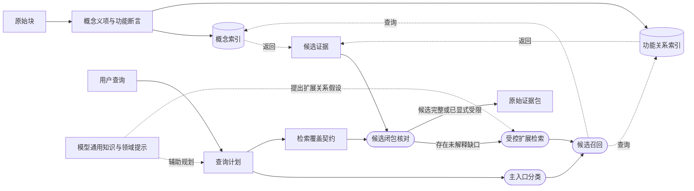
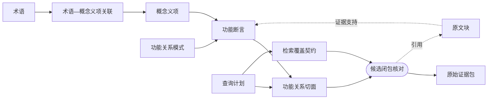
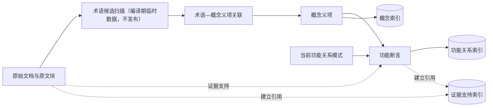
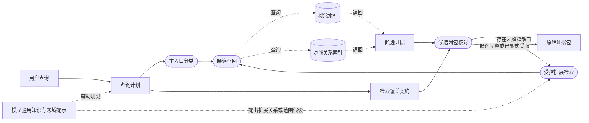

# 14 双入口概念—功能知识索引：开放视角证据检索设计

- 状态：候选设计，待审核；暂不替换 13 号当前基线
- 日期：2026-11-11
- 适用范围：以 c13-003 为代表的开放主题、跨文档、隐含概念和证据覆盖问题
- 关联设计：
  [01 产品需求](01-product-requirements.md)、
  [02 Agent 开发方法](02-how-to-build-an-agent.md)、
  [03 用例与金标准](03-cases-and-gold-standard.md)、
  [05 存储与检索策略](05-storage-and-retrieval-strategy.md)、
  [06 检索、工具与 Agent](06-retrieval-pure-agent.md)、
  [13 领域配置驱动的 LLM Wiki](13-profile-driven-wiki-evidence-retrieval.md)
- 讨论来源：
  [功能关系优先讨论稿](../development/function-relation-first-llm-wiki.md)
- 外部概念来源：
  [Andrej Karpathy · llm-wiki Gist](https://gist.github.com/karpathy/442a6bf555914893e9891c11519de94f)
- 固定验证输入：
  [c13-003 目标](../../backend/tests/fixtures/c13_003_wiki_topic_v2_targets.json)

本文提出一条不同于 13 号检索分组优先路线的新候选方案。13 号仍是当前有效设计基线；
14 号只有在设计审核、固定样本验证和留出主题验证通过后，才可能成为后续基线。

本文使用以下状态词：

- **必须**：候选设计的工程红线；
- **应该**：稳定方向；
- **可以**：实现可选；
- **待确认**：尚未形成设计决定。

## 术语约定

正文优先使用中文概念名。只有外部产品或研究名称、正式代码标识符、协议字段或没有可接受
中文表达的术语保留英文。

| 中文术语 | 含义 |
| --- | --- |
| 术语 | 稳定名称、标题或词面检索锚点 |
| 概念义项 | 在特定知识库上下文中可区分的一个概念含义，可由一个或多个术语表达 |
| 术语—概念义项关联 | 术语与概念义项之间带原文依据的多对多关系 |
| 功能关系模式 | 有版本、领域无关的通用功能关系标签及其语义和抽取边界 |
| 功能断言 | 功能关系模式的一个有原文证据的自然语言命题实例，是列出相关概念义项的最小功能语义检索单元 |
| 功能关系切面 | 查询时由多个功能断言组合出的视图 |
| 能力切面 | 功能关系切面中只表达启用或允许能力的子类 |
| 概念入口 | 以术语、术语—概念义项关联和概念义项为主入口的查询 |
| 关系入口 | 以通用谓词和功能断言为主入口的查询 |
| 混合入口 | 用目标概念限定范围，再按功能关系求全的查询 |
| 检索覆盖契约 | 一次查询要求匹配的功能关系集合、相关概念条件和范围闭包 |
| 覆盖审计 | 离线验收时用金标准检查是否漏证据，不进入运行时检索契约 |

必须严格区分：

```text
功能关系模式 = 受控的功能关系标签，例如“约束”，不规定参与者和元数
功能断言     = 有原文证据的功能关系模式命题实例
             = 单一功能关系模式语义版本 + 自然语言命题 + 相关概念义项[] + 原文证据
切面         = 查询时对多条功能断言的组合
```

## 0. 文档目标与快速导读

### 0.1 一句话设计

系统先把原文编译成术语、概念义项、领域无关的功能断言和证据回源关系；在线查询时先判断
概念入口、关系入口或混合入口，再由 LLM 把领域意图晚绑定为概念义项或功能关系组合，并按
检索覆盖契约枚举可回源的匹配原文块；预算允许时返回完整候选闭包，否则显式标记受限结果。

### 0.2 本文与 13 号的区别

13 号主要使用：

```text
领域配置
→ 候选知识条目
→ 主题条目
→ 检索分组
→ 主题证据方面
→ 原文块
```

检索分组既缩小在线范围，也承担主题区域和完整性边界。

14 号尝试改为：

```text
术语与概念义项
+
领域无关功能断言
+
双索引
+
查询时领域语义晚绑定
+
匹配证据闭包核对
```

14 号不再以主题条目或检索分组作为检索层，也不把它们作为知识身份、路由或完整性机制。

### 0.3 阅读完本文应能回答

- 这套方法为什么存在？
- 离线到底编译什么？
- 概念入口、关系入口和混合入口分别是什么？
- 功能关系模式、功能断言和功能关系切面有什么区别？
- `c13-003` 如何从问题走到证据包？
- 原文、模型通用知识和功能断言各自是什么地位？
- 这套方法能保证什么，不能保证什么？
- 如何验证它比 13 号路径更好？

## 1. 方法总述

这一章是全文总纲。后面各章只展开这里的方法和契约。

### 1.1 要解决的问题

本设计主要聚焦开放视角的求全类问题；单点事实、概念解释和一般多跳问题已有基本可用的
处理路径，当前真正未解决的是跨文档、跨角度地把回答所需的证据找全。

用户提问可能有两种主要形态。

第一种是领域概念问题：

> 长期记忆是什么？

这类问题需要一个概念入口，从术语和概念义项出发。

第二种是功能关系求全问题：

> 哪些机制会恢复 Agent 的执行状态？

这类问题需要一个关系入口，从“恢复”这一通用功能关系出发。

真实问题通常是混合的：

> AI Agent 中有哪些隔离和控制边界？

这里：

```text
范围术语 = AI Agent
功能意图 = 隔离、控制
答案形态 = 列举
```

它不是简单地查“隔离”这个词，而是查所有在 Agent 范围内至少支持一条“分离”或“约束”断言的
机制；保护、恢复、观察等关系只有在同时承载分离或约束语义时才进入这道直接关系入口。

单一预编译检索分组划分无法覆盖这种任意角度的功能提问，普通词面检索又会因为原文没有“隔离／边界”
而漏掉实现证据。

检索分组优先还存在不可逆的第一层路由损失：正确证据可能分散在多个单独看只弱相关的分组中，
或位于没有被问题语义直接命中的分组里。后续主题展开和证据选择只能处理已经进入上下文的内容，
无法恢复第一层未召回的证据。因此问题不是后续排序不够好，而是有限预编译区域无法表示任意
在线功能切面。

### 1.2 核心思想

这套方法建立在三个观察和一个能力前提之上。

第一，原文和问题使用不同的表达体系。原文通常按具体实现组织，例如 worktree、checkpoint、
permission、MCP；用户则可能按功能目的、风险、状态或控制边界提问。问题需要的证据通常
分散在多个主题中，而且原文不一定出现问题中的词。

固定 `c13-003` 的七组核心目标去重后有 48 个原文块，其中 47 个能找到原文。只有 13 个
出现 `isolation`、`isolated`、`isolating` 或 `boundary/boundaries`；即使加入
`sandbox`、`control`、`bound` 等相关词，也只有 19 个出现直接相关词，剩余 28 个没有。
英文原文也不会出现中文“隔离／边界／限制”。因此，“隔离和控制边界”不是原文的共同词项，
而是查询者施加在多种实现机制上的功能关系切面。

第二，跨领域稳定复用的不是词语或领域谓词，而是功能语义结构。不同实现可以使用完全不同
的术语，却都表达“某机制对某对象、状态、行动或范围施加某种功能作用，在某种条件下产生
某种结果”。worktree、permission 和 checkpoint 不是同义词，也可以使用不同谓词，但都可以
在更高层组成“隔离与控制边界”这个功能切面。因此，稳定层是可复用、可证据回源的功能语义，
而不是词面相似度。

在这种抽象层次上，可以事先维护一组有限的通用功能关系模式；每个模式说明一种功能语义和
抽取边界，但不用角色表规定关系必须包含几个参与者。功能断言使用自然语言保留机制、对象、
条件、目的、极性和模态等完整语义，并列出可供检索连接的概念义项。不能事先枚举的是领域
谓词、具体实现和实例、用户问题以及问题特有的切面组合。

第三，预编译时无法穷举用户未来可能采用的提问角度。任何固定的主题分类或检索分组，都是
有限组织方式，无法天然覆盖责任、风险、生命周期、控制边界等横切视角。

第四个基础是大模型第一次让可用的通用自然语言推理成为系统能力。在此之前，要让检索支持
开放提问，通常必须预先建立领域本体、领域谓词、同义词规则和问题分类；现在可以把“领域
谓词如何表达、问题需要哪些功能面、跨机制语义如何对应”等工作推迟到在线查询时完成。
离线阶段只需要编译稳定、可回源的概念与通用功能语义。

由此得到核心设计判断：

> 不在离线阶段猜测用户可能怎样提问并预先把知识切成有限主题；离线只保存可组合、可回源
> 的概念锚点和功能断言，在线利用大模型的通用自然语言推理，把具体问题晚绑定成功能关系
> 切面，再按检索覆盖契约召回全部匹配证据。

这里大模型的价值不只是让抽取更快，而是改变了系统的职责边界：

- 过去：领域分类、问题结构和关系模式必须尽量在编译前想全；
- 现在：离线保存查询中立的语义基础，把开放问题结构留到查询时生成；
- 模型推理只负责解释、拆解和映射，不能替代原文证据，也不能证明知识库覆盖。

可以用一句话概括：

> **通用自然语言推理使问题组织可以推迟到在线；离线因此只需保存可回源的概念与功能语义，
> 而不必预先枚举所有可能的问题角度。**

功能关系模式不是每次从单篇原文推导出来的。它是一组跨文档复用、带版本的关系类型和语义
边界；单篇原文负责产生有证据支持的功能断言，不负责重新定义关系模式的含义。新关系模式
如果需要从语料中归纳，应经过独立的候选发现、审核和版本发布流程，不混入单篇文档编译。

这也不要求建立完整知识图谱。本设计需要概念锚点、少量通用功能关系、自然语言功能命题和
原文证据回源；不需要全部实体和实体类型、完整领域本体、所有可能的领域关系、固定关系元数
或为全局推理服务的图闭包。功能断言只负责形成可检索、可回源的浅层功能语义，不承担完整
知识图谱的推理职责。

### 1.3 端到端方法图

图的读法：

- 普通矩形表示数据、规则或中间产物；
- 圆角框表示处理过程；
- 圆柱表示索引；
- 实线箭头表示生成、转换或数据流；
- 虚线箭头表示查询、引用或辅助规划。



| 阶段 | 主要职责 | 不负责 |
| --- | --- | --- |
| 离线编译 | 发现术语、归纳义项、抽取功能断言、建立双索引 | 猜测用户会怎么问 |
| 在线检索 | 判定入口、晚绑定关系、确定检索覆盖契约、召回并核对匹配断言、选择证据 | 重新发现整个知识空间或猜测必备功能面清单 |
| 回答生成 | 使用证据和模型通用知识组织答案 | 把模型知识冒充知识库事实 |

### 1.4 核心对象关系



各对象职责：

- 术语负责“从哪里进入”；
- 术语—概念义项关联负责“这个术语在当前原文语境中表达哪个含义”；
- 概念义项负责承载可被一个或多个术语表达的概念含义；
- 功能关系模式负责“允许表达哪类功能语义”；
- 功能断言负责“哪条原文支持哪条具体功能关系”；
- 功能关系切面负责“当前问题组合了哪些关系”；
- 检索覆盖契约负责“哪些功能断言属于本次检索范围”；
- 原文证据负责最终事实与引用。

### 1.5 两种主入口与一种混合入口

| 入口 | 用户主要在问什么 | 首层候选来源 |
| --- | --- | --- |
| 概念入口 | 一个概念、对象或机制 | 术语词面 → 术语—概念义项关联 → 概念义项 |
| 关系入口 | 满足某种功能关系的对象集合 | 通用谓词＋相关概念义项 → 功能断言 |
| 混合入口 | 在某个概念范围内按功能关系求全 | 范围约束＋概念候选＋关系候选 |

三个入口不是互斥系统。

- 概念查询可以使用功能断言补全作用、限制和生命周期；
- 关系查询仍需使用术语限定领域、对象或状态范围；
- 混合查询需要把概念候选与关系候选合并，并按检索覆盖契约做范围过滤和候选闭包核对。

`c13-003` 属于：

> **带领域范围限定的功能关系求全查询。**

其主入口是关系入口，`AI Agent` 是范围限定，不是目标概念。

### 1.6 `c13-003` 方法走查

本走查只论证一条语义链是否闭合：

```text
c13-003 的 11 类要求
  → 能否从原文抽取为通用功能关系实例
  → 题面能否自然找到这些通用关系
  → AI Agent 概念义项能否限定关系实例的范围
  → 能否回到支持上述断言的原文证据块
```

c13 的类别名称和目标原文块只用于离线覆盖审计，不进入查询解析、关系选择、概念扩展或候选
过滤。原文块可以同时支持多条功能断言；一个块因此可以参与多个类别，不要求一个块只对应
一个类别或一个关系。

#### 1.6.1 题面提供的关系入口

`c13-003` 的语义核心是：

```text
范围术语 = AI Agent
功能意图 = 隔离、控制
边界 = 对分离对象、约束对象和作用范围的限定
答案形态 = 列举
```

其中只有两个关系需要成为直接查询入口：

| 题面语义 | 通用关系 | 查询含义 |
| --- | --- | --- |
| 隔离 | 分离 | 什么对象、状态或信息被阻止与另一范围发生流动 |
| 控制 | 约束 | 什么行动、访问、能力或状态范围受到限制 |
| 边界 | 无独立关系 | 为“分离”或“约束”限定相关概念、条件、目的和执行范围 |

题面中的沙箱、虚拟机和出口控制是用户给出的已知示例，可以作为有助于消歧的种子，但不是
生成查询计划的必要条件。

其他功能关系，例如保护、信任／不信任、要求、在特定条件下失败、委托、恢复和观察，通常
作为补充语义存在。一个证据块只要能支持至少一条 `分离` 或 `约束` 断言，就能够被本题的
“隔离／控制边界”直接命中；其他断言用于解释该边界如何实现、为何存在以及限制了什么风险。

#### 1.6.2 11 类要求如何形成功能断言

11 类不是 11 个专用谓词，而是可以通过通用功能关系重新表达的语义组合。抽取阶段应保留
证据块支持的全部关系实例，而不是为一个类别强行选择唯一关系。

| c13 类别 | 可抽取的功能关系 | 直接进入查询的关系 | 与 AI Agent 的范围连接 |
| --- | --- | --- | --- |
| 文件与工作区可达边界 | 分离（工作区／文件范围）；约束（访问、修改、删除） | 分离、约束 | 工作区、文件和挂载是 Agent 运行或行动所处的范围 |
| 凭证与身份边界 | 分离（凭证与执行环境）；约束（凭证使用和身份范围）；保护（凭证） | 分离、约束 | 凭证和身份参与 Agent 的代表行动 |
| 工具与行动能力边界 | 约束（工具、操作和权限）；要求（满足条件才能执行） | 约束 | 工具调用和权限作用于 Agent 的行动 |
| 外部内容与工具结果信任边界 | 约束（外部内容对决策和行动的影响）；分离（外部内容与可信指令） | 约束、分离 | 外部内容和工具结果进入 Agent 上下文或行动链 |
| 并行工作与持久状态控制边界 | 分离（不同会话／工作区状态）；恢复（执行状态）；约束（错误传播和失败影响范围） | 分离、约束 | 工作现场和执行状态属于 Agent 的长时任务过程 |
| 上下文与记忆生命周期边界 | 分离（任务上下文）；约束（记忆写入、保留、复用）；重置／移除 | 分离、约束 | 上下文和记忆是 Agent 决策与持续运行的状态 |
| 子 Agent 委派边界 | 委托（任务）；分离（子 Agent 上下文）；约束（工具、职责和权限） | 分离、约束 | 子 Agent 是 Agent 执行体系的组成部分 |
| 配置、hook、插件与 MCP 来源信任边界 | 不信任（来源）；约束（是否允许加载或执行）；要求（加载前检查） | 约束 | 配置、hook、插件和 MCP 是 Agent 能力与运行环境的来源 |
| 人工监督、中断与回滚边界 | 要求（审批后才能行动）；约束（停止或中断）；在特定条件下失败；恢复（回滚） | 约束 | 监督作用于 Agent 的行动过程和状态 |
| 资源、预算与时间边界 | 消耗（资源）；约束（调用次数、token、并发、速率和时间）；在特定条件下失败 | 约束 | 资源和预算是 Agent 及工具调用的执行条件 |
| 审计与可观测边界 | 观察（执行过程）；约束（敏感内容进入日志的范围） | 约束 | 调用、状态和日志记录属于 Agent 执行链 |

这张表说明了两个层次：

1. 抽取侧可以保留 `观察、恢复、保护、委托` 等更丰富的功能关系；
2. 查询侧只需要其中至少一条 `分离` 或 `约束` 断言作为入口，不需要为审计、恢复等类别
   单独扩展专用查询谓词。

例如，checkpoint 证据可以同时得到：

```text
恢复(Agent 执行状态)
约束(错误继续扩散和失败影响范围)
```

审计日志证据可以同时得到：

```text
观察(Agent 执行过程)
约束(敏感内容进入不必要日志的范围)
```

前者由“控制”命中后半段约束，后者同样由“控制”命中日志内容约束；恢复和观察仍然保留在
证据语义中，但不承担本题的直接查询入口。

#### 1.6.3 AI Agent 概念义项与范围闭包

仅命中 `分离` 或 `约束` 仍会召回其他领域的文件访问、资源限制和状态恢复。范围限定由
`AI Agent` 的概念义项完成。

这里不能把 `AI Agent` 理解成一个只包含若干同义词的扁平术语，也不能要求 worktree、
checkpoint、MCP 等成为 `AI Agent` 的字面同类词。它的概念义项应承担一个可追溯的范围语义：

```text
AI Agent 概念义项
  → 运行主体
  → 行动与工具
  → 身份与凭证
  → 工作区与执行环境
  → 上下文、记忆和执行状态
  → 子 Agent 与委派关系
  → 配置、来源和外部输入
  → 监督、资源、日志和观测
```

worktree、checkpoint、MCP 等概念义项通过原文支持的功能关系连接到这个范围。例如：

```text
worktree 概念义项
  → 分离 → Agent 并行任务的工作现场
  → 属于 AI Agent 范围

checkpoint 概念义项
  → 恢复 → Agent 长任务的执行状态
  → 属于 AI Agent 范围

MCP 概念义项
  → 改变 → Agent 可获得的工具或数据能力
  → 属于 AI Agent 范围
```

“属于 AI Agent 范围”必须由功能断言中的相关概念、作用对象、执行上下文或目的支持，不能只因为
同一篇文章提到了两个词就建立。同一术语的不同义项也要区分：普通 Git worktree 不一定属于
Agent 范围，只有语境中被用于隔离 Agent 并行工作现场的那个义项才属于；普通存储快照也
不等于 Agent 执行状态 checkpoint。

由此得到一个可在查询时执行的范围闭包：

```text
scope(AI Agent)
  = AI Agent 概念义项本身
  ∪ 原文证明属于 Agent 运行范围的机制、对象和状态概念义项
```

范围闭包使不同层级的机制可以通过“相关概念义项或作用范围”进入过滤，而不要求它们都属于同一种
概念类型。worktree 是实现机制，checkpoint 是状态保存机制，MCP 是能力来源；三者与
`AI Agent` 的关系不同，但都可以成为 Agent 范围内功能断言的相关概念义项。

#### 1.6.4 关系过滤与证据回源

查询阶段先确定关系集合，再用 Agent 范围过滤功能断言：

```text
Q_rel = {分离, 约束}
Q_scope = scope(AI Agent)

候选功能断言 A
  ⇔ A 的功能关系模式属于 Q_rel
  ∧ A 的相关概念义项、作用对象或所属概念义项与 Q_scope 相交

候选证据 E
  = 支持候选功能断言 A 的全部原文块标识符
```

几个代表性路径如下：

```text
worktree 为每个并行 Agent 任务提供独立的 Git checkout，避免不同任务的本地改动互相影响。
  → 分离
  → 相关概念义项：worktree、并行 Agent 任务、Git checkout、本地改动
  → 命中“隔离”
  → worktree 义项属于 Agent 范围
  → 返回原文块

工具权限限制 Agent 可以调用的工具和可以执行的操作。
  → 约束
  → 相关概念义项：工具权限、Agent、工具调用、操作范围
  → 命中“控制”
  → 工具行动属于 Agent 范围
  → 返回原文块

checkpoint 限制错误继续扩散和失败影响范围。
  → 约束
  → 相关概念义项：checkpoint、错误传播、失败影响范围
  → 命中“控制”
  → Agent 执行状态属于 Agent 范围
  → 返回原文块

审计日志限制敏感内容进入不必要的日志记录。
  → 约束
  → 相关概念义项：审计日志、敏感内容、日志记录范围
  → 命中“控制”
  → Agent 执行日志属于 Agent 范围
  → 返回原文块
```

候选断言按自然语言命题、相关概念义项和证据去重后，再按原文块标识符合并。返回的仍然是完整
原文块，而不是模型改写后的关系描述；功能断言只用于召回和解释候选为何进入结果。

#### 1.6.5 语义结论

按上述定义，`c13-003` 的 11 类要求不需要依赖 11 套领域谓词或 11 个预编译主题：

1. 在抽取侧，11 类都可以由通用功能关系实例表达，并且一个证据块可以同时支持多条关系；
2. 在查询侧，“隔离”和“控制”可以自然映射为 `分离` 和 `约束`；
3. 11 类都至少存在一条可以由上述两个关系直接进入的关系实例；恢复、观察、保护、委托等
   保留为补充关系；
4. `AI Agent` 概念义项通过原文支持的范围闭包纳入 worktree、checkpoint、MCP 等不同层级
   的概念义项，用于排除其他领域的功能断言；
5. 通过“关系命中 ∧ Agent 范围命中”即可得到支持候选断言的原文证据块。

这条链路成立的关键不是让查询猜到 c13 的类别名称，而是保证每个可接受证据至少有一条与
题面功能意图直接对应的 `分离` 或 `约束` 断言，并让该断言通过相关概念义项或所属关系落到
`AI Agent` 的范围闭包中。

若某个证据块只有 `恢复` 或 `观察`，无法形成任何 `分离／约束` 实例，它本身就不应被本题
返回。`恢复`说明状态连续性，`观察`说明产生了可观察信号；二者只有同时承载对失败影响、
信息流动或执行范围的限制时，才属于“隔离／控制边界”。不能用类别名称或邻近机制把一个
纯状态恢复块、纯日志记录块硬拉入结果。

如果某个 c13 类别被要求必须覆盖，而标注给该类的全部证据都只有 `恢复` 或 `观察`，则需要
进一步定位：

1. 该类别是否本来就超出了题面“隔离／控制边界”的直接语义；
2. 类别定义或证据标注是否把非边界机制误归入了该类；
3. 查询是否需要显式扩展到状态连续性或监督审计语义；
4. 原文是否实际表达了控制关系，但功能断言抽取遗漏了它。

不能把单个纯恢复或纯观察块默认判为抽取缺失，也不能在查询时为 c13 类别增加专用映射来
绕过这一判断。

### 1.7 方法成立要求及如何满足

前文语义链能否成立，不应停留在假设层面。下表把每项成立条件转化为实现或选型要求，并给出
对应控制措施。对策有三种落实位置：系统实现、外部选择，以及二者共同满足。

| 要求 | 内容 | 不成立时的表现 | 对策 |
| --- | --- | --- | --- |
| M1 功能语义可对齐 | 用户问题的功能意图和原文证据可以在同一层通用功能关系上表达 | 问题和证据只能靠词面相似；关系入口无法连接具体实现 | 系统实现统一的关系模式、自然语言命题表达和抽取契约；用关系召回对照术语召回验证语义层是否真实成立 |
| M2 关系模式闭包足够 | 每个模式包内的通用关系及其语义边界足以表达目标问题需要的功能语义 | 语料中存在稳定关系，但无法实例化为当前模式；需要发布新版模式 | 系统实现功能关系模式语义版本、模式包和 `pattern_gap` 报告；外部 LLM 参与候选模式归纳；关系定义、表达要求和排除边界由独立审核后发布并触发受影响模式切片的全局回扫 |
| M3 多断言抽取可靠 | 一个原文块支持的多条功能断言都分别有证据，且自然语言命题保留了条件、极性和不确定性 | 漏抽关键关系，或多个断言共用但实际只支持其中一条，导致错误召回 | 系统数据模型支持一个块对应多条自然语言断言，并由证据校验、去重和回源门禁约束；外部选择结构化输出和证据遵循能力满足要求的 LLM |
| M4 概念义项可消歧 | 同一术语的领域义项可以区分，尤其 worktree、checkpoint、MCP 等只在 Agent 语境中的义项可以被正确选中 | 把普通 Git 或存储概念纳入 Agent，或漏掉 Agent 专用义项 | 系统在编译期装配术语局部上下文，发布术语及其支持原文块、术语—概念义项关联和概念义项；外部选择义项区分能力满足要求的抽取模型和 embedding；通过反例集验证同词异义与同义跨词 |
| M5 范围闭包可建立 | `AI Agent` 概念义项可以通过原文支持的相关概念进入其运行范围，同时不无限扩散 | 关系命中后无法限定 Agent 范围，造成跨领域噪声；范围过窄又会漏证据 | 系统保存可追溯的范围成员关系和闭包深度限制；外部 LLM 只负责提出范围候选，成员关系必须回到原文证据；分别测试漏召回与跨领域误召回 |
| M6 查询关系可映射 | “隔离／控制边界”能稳定晚绑定为 `分离／约束`，相关概念条件限定了对象和作用范围 | 同一题面被映射成不同关系集合，检索覆盖和噪声不稳定 | 系统固定功能关系模式包并记录查询计划、映射理由和候选集合；外部选择语义映射稳定的 LLM；对同一输入执行重复回放并检查关系集合稳定性 |
| M7 验收类别具有直接关系入口 | 每个被验收的类别至少有一条 `分离` 或 `约束` 断言可由题面直接到达 | 某些类别只有恢复或观察，说明类别、证据标注或查询语义存在错位 | 系统在离线覆盖审计中检查每个目标类别是否具备关系入口；类别本身不进入查询；若只有恢复或观察，则回到类别定义、证据标注或查询语义修正 |

M2 尤其应当转化为编译流程中的闭环：抽取器遇到
稳定、可解释但当前模式无法表达的关系时，输出模式缺口候选；候选经过跨文档归纳和人工审核
后发布新版模式；受影响的原文块再按新版本重新抽取。单篇文档和单次查询不能即时创造模式，
否则关系集合失去闭合性、版本可追溯性和结果可复现性。

M2 的实现至少要满足：

1. 当前编译始终引用一个明确且不可变的模式包；
2. 抽取可以显式返回 `pattern_gap`，不能把新关系退化为自由文本谓词或临时特例；
3. 模式候选通过独立流程聚类、命名、定义语义与表达要求和审核，不进入正在运行的单次编译；
4. 模式升级后只重新抽取受影响的原文块，并生成新的索引版本；
5. 查询只读取与地图版本一致的模式闭包。

因此，M1～M7 不只是成立条件，也分别对应后续流程、外部选型和验证机制的设计输入。

以下事项不属于语义要求，但仍是系统必须满足的硬约束或验证目标：

- “功能断言只能解释原文，证据块才是事实与引用来源”是产品硬不变量；设计要求本身就是
  始终保留原文回源，不能把模型知识冒充知识库事实。
- “模式、提示词、模型、快照、索引和 embedding 契约版本一致”同样是可验证的系统不变量，
  不属于可以暂时假设成真的语义前提。
- “目标规模下抽取和检索成本可接受”是性能成本目标，需要通过实验验证，不应混在方法成立
  的语义条件中。

其中 M3、M5 和 M6 是最关键的三个语义要求。即使 c13-003 的 11 类都能在语义上映射，也
必须分别验证抽取是否真的完整、Agent 范围闭包是否准确、查询关系映射是否稳定；单个样本
通过只能作为存在性证据，不能证明这些要求在更广主题上成立。

因此，本方法能承诺的是：在 M1～M7 得到满足的范围内，把开放视角问题转化为可检查、可回源的
功能关系覆盖，而不是承诺任意问题角度的绝对完备。这里的“全”仍然是相对于当前查询、领域
提示、功能关系模式、范围闭包、检索覆盖契约和证据范围的可验证覆盖。

## 2. 设计目标、约束与范围

本章中的“目标”指 14 号检索方法本身要提供的能力，不是产品总目标或数据库、代码实现目标。
核心不变量与禁止行为用于约束方法在运行时不偏离这些目标；非目标与文档边界用于明确本设计
不承诺什么、不在本文决定什么。

### 2.1 目标

- 用户不需要预先编写完整领域分类或领域谓词模式；
- 在选定的通用功能语义抽象层上，维护可枚举、可版本化的关系模式闭集；
- 支持概念入口、关系入口和混合入口；
- 支持开放主题、横切功能面和隐含概念；
- 支持一个术语多个概念义项；
- 支持从只描述具体实现、没有出现用户功能词的原文中，通过有证据的功能断言召回相关证据。
- 所有事实和功能断言都能回到原文块；
- 同时控制证据覆盖和无关噪声；
- 支持增量更新和不可变发布；

### 2.2 核心不变量与禁止行为

- 功能断言必须由原文证据支持，LLM 生成的功能断言不是事实源；
- 关系模式必须使用有版本的闭合集合；新语义结构通过 `pattern_gap` 审核后生成新的模式语义版本和
  模式包，查询只消费地图中冻结的模式包；
- 查询时形成的功能切面只属于本次请求，不能成为新的稳定主题身份；
- 通用提示词、抽取契约和查询契约不得写入 c13-003 专属词项或类别名称。

### 2.3 非目标与文档边界

- 不证明任意角度下的理论完备；
- 不建立完整实体关系图；
- 不在本文决定最终数据库表和类名。

## 3. 数据模型

### 3.1 术语

术语是词面检索锚点，可以是技术术语、多词短语、产品、标准、协议、缩写、方法、风险、
状态、过程、作用域或标题性名词短语。

术语只表示一个可稳定识别的词面，不直接承载语义。术语与概念义项之间是多对多关系：同一个
术语可以表达多个概念义项，同一个概念义项也可以由多个术语表达。同义词、缩写和跨语言表达
不能形成全局术语别名。术语本身可以通过词面精确匹配进入候选集；只有通过独立的术语—概念
义项关联绑定到具体义项后，查询才能确定该词面在当前语境中代表哪个概念，并继续检索对应
原文证据。

**术语记录**

| 字段 | 含义与作用 |
| --- | --- |
| 规范化词面键 | 术语的稳定身份和精确匹配键，由固定、可版本化的词法规则生成，例如大小写折叠和空白标准化 |
| 显示词面 | 用于界面展示或查询提示的写法，例如 `Checkpoint`；它不表示语义或词面优先级 |
| 支持原文块 | 当前快照中实际包含该术语词面、用于证明术语仍有效的原文块标识符集合；只保存块级引用，不保存每次出现及字符偏移 |
| 状态 | 表示术语是否仍由当前快照中的文本证据支持，通常由支持原文块集合是否为空派生，例如 `active` 或 `retired` |

规范化词面键只处理确定性的词面差异，不包含同义词、缩写展开、翻译或语义等价判断。例如：

```text
术语（规范化词面键）= checkpoint
  显示词面 = Checkpoint
  状态 = active

支持原文块
  block_001
  block_018
```

编译期间需要扫描原文块中的词面出现，并为概念义项归纳装配局部上下文；这些扫描结果属于临时
编译输入。发布地图只保存带支持原文块的术语、带原文块依据的术语—概念义项关联和概念义项，不把
每一次词面出现及其字符偏移保存为独立数据对象。具体引用位置可以在诊断数据中保留，但不参与
查询或地图身份。

术语的支持原文块只证明该词面在当前快照中存在；某个原文块具体支持哪个概念义项，由术语—概念
义项关联单独表达。不能把术语出现直接等同于某个概念含义，也不能用术语支持块替代关联依据。

`checkpoint` 和 `Checkpoint` 属于同一词面记录；两个概念义项共享这一术语，但不因此合并。
`save point`、`执行保存点` 或跨语言翻译即使可能表达相近概念，也不写入术语别名。它们分别
作为独立术语和独立概念义项候选处理。模型或 embedding 单独提出的同义关系只能作为查询假设
或待确认候选，不能自动发布为永久关联。

### 3.2 术语—概念义项关联

术语—概念义项关联是一个独立对象，不是术语记录中的义项列表，也不是概念义项中的词面数组。
它负责保存“某个术语在某种原文依据下表达某个概念义项”这一多对多关系。

这层关联同时承担原来别名的职责：同一术语关联多个概念义项，表达一词多义；多个术语关联同一
概念义项，表达一义多词。因此不设置独立别名对象，也不在术语记录或概念义项记录中维护别名
列表。同义词、缩写和跨语言表达只有落成指向具体概念义项的关联后，才能用于概念入口检索；
它们不能形成全局术语别名。

**术语—概念义项关联**

| 字段 | 含义与作用 |
| --- | --- |
| 规范化词面键 | 指明关联到哪个术语，沿用术语的确定性词面身份 |
| 概念义项标识符 | 指明关联到哪个概念含义 |
| 支持原文块 | 关联所依据的原文块标识符集合；必要时可以在诊断数据中附带支持片段或字符偏移，但不形成独立术语出现对象 |
| 关联依据类型 | 记录该关联如何由原文支持。当前只发布“原文直接使用该术语”的依据，不能记录仅由模型常识或向量相似提出的同义关系 |
| 状态 | 表示该关联是否仍由当前快照支持，例如 `active` 或 `retired` |

一条关联不能只引用概念义项摘要作为证据。关联引用的原文块必须真实包含对应术语词面，并且
概念义项也必须能由这些原文块支持。删除文档后，失去全部依据的关联退役；不能留下指向已退役
概念义项或不存在原文块的关联。

### 3.3 概念义项

**概念义项记录**

| 字段 | 含义与作用 |
| --- | --- |
| 概念义项标识符 | 概念义项的稳定身份，用于承载术语—概念义项关联和功能断言引用，不依附于某一个术语 |
| 摘要 | 忠实描述该概念含义并与其他义项区分；用于语义召回和人工理解，不能替代原文证据 |
| 摘要依据 | 区分“原文明示”与“上下文归纳”；两者都必须绑定支持原文块，后者不得增加原文未表达的事实 |
| 支持原文块 | 汇总当前有效术语—概念义项关联所支持的全部原文块；具体实现可以派生或物化该集合，但发布时必须可计算且与当前关联一致 |
| 归纳契约版本 | 记录生成该义项时采用的上下文装配规则、模型、提示词和归纳规则版本，用于重放与校验 |
| 状态 | 表示概念义项是否仍由当前快照支持，例如 `active` 或 `retired` |

概念义项不直接保存术语列表、功能断言列表或向量：

- 关联术语由术语—概念义项关联反向查询得到；
- 功能断言由断言中的相关概念义项反向引用得到；
- 向量属于可重建检索产物，不是概念义项语义本身；

#### 3.3.1 身份与版本

概念义项标识符只在当前活动地图内稳定，不以某个术语或单个支持原文块作为身份。概念义项记录
由当前摘要、摘要依据、全部支持原文块、归纳契约版本和状态共同描述。系统只保留最新活动地图，
不保存历史地图链，因此概念义项标识符不承诺跨地图血缘。术语与概念义项的关系由独立的术语—
概念义项关联保存；新增或移除一个术语入口可以改变检索入口，但不能仅因此把一个概念义项拆成
同一地图内的多个身份。概念义项允许是稀疏的检索链接点，不要求当前快照已经给出完整定义；只要
上下文足以识别其指代即可成立。

活动概念义项至少应有一条带原文依据的有效术语—概念义项关联和一个支持原文块。概念义项的有效
支持块集合发生变化时，必须基于变化后的完整支持集合重新生成摘要，并重新计算支持闭包和相关
索引。重新生成后即使摘要文字相同，也要按当前支持集合重新物化概念义项记录并生成新的地图哈希。
若剩余证据不足以维持原义项，则不发布失去依据的摘要。

```text
概念义项 A：Agent 执行状态保存点
  ← checkpoint
  ← save point（仅当原文依据支持）

概念义项 B：Git 提交链中的历史状态
  ← checkpoint

术语：checkpoint（显示词面：Checkpoint）
  → 概念义项 A
  → 概念义项 B
```

概念义项是独立身份，不属于某一个术语。上例展示一词多义和一义多词可以同时存在，但每条箭头
都应落成一条带支持依据的术语—概念义项关联，不能只保存词面之间的全局同义关系。

### 3.4 功能关系模式

功能关系模式定义一种可跨文档复用的功能语义，是检索入口标签和抽取边界，不是要求实例满足
固定角色或元数的关系结构约束。领域谓词不进入模式集合；具体命题由模式引用、自然语言断言、
相关概念义项和查询语境共同表达。

首批 16 个候选模式的语义定义、表达要求、抽取判据和排除边界统一列在本文附录 A；本节只说明
功能关系模式的来源、对象结构和发布身份。

功能关系模式的来源分为三类：

- 初始模式目录：领域设计阶段从跨实现的功能语义结构中归纳出的通用关系，例如启用、约束、
  分离、保护、持久保存和恢复。初始目录可以使用模型辅助起草，但必须经过人工审核，并在多个
  领域和多个实现样本上验证其适用边界；
- 运行中的模式缺口：抽取时遇到稳定、可解释但无法归入当前模式包的关系，输出 `pattern_gap`。
  单篇文档或单个缺口不能直接定义全局模式；候选需要经过跨文档归并、与已有模式去重、语义、
  表达要求与排除边界设计、正反例验证和人工审核；
- 目录修订：跨领域验证、审核或错误分析发现已有模式的定义、表达要求或边界不充分，或者
  两个模式存在不可接受的歧义时，可以发起修订候选。目录修订仍要说明相对现有模式的差异和
  影响，不能以显示名称变化冒充语义版本变更。

这些来源都要形成模式候选，而不是直接写入模式包：

**功能关系模式候选**

| 字段 | 含义与作用 |
| --- | --- |
| 候选来源 | 区分初始设计、模式缺口和目录修订，说明候选由什么触发 |
| 候选语义 | 候选阶段的语义定义、表达要求和排除边界，尚不能用于查询 |
| 支持原文块 | 支持候选成立的原文块；单篇文档只能触发候选，不能单独证明其可成为全局模式 |
| 相邻模式与排除说明 | 说明与哪些已有模式接近、为何需要新增或修订，以及不应混入的语义 |
| pattern_gap 诊断 | 关联触发该候选的抽取诊断，保留原文块、已有模式映射尝试和失败原因 |
| 验证样本与结果 | 记录跨文档、跨领域正反例及验证结论，避免只针对单一问题设计模式 |
| 审核结论 | 记录候选通过、合并或否决；只有通过的候选才能生成模式语义版本 |

模式是领域无关的语义设计产物，不是某篇文档中的事实。支持原文块、正反例和诊断用于证明模式
设计有依据，不把模式本身冒充为知识库事实。候选通过审核后，才发布新的模式语义版本；新版本
进入新模式包并经受影响原文块回扫后，才能用于查询。

#### 3.4.1 对象结构与身份

模式身份与其语义版本分离。这里的“语义版本”是功能关系模式的一份不可变语义快照，不是一次
修订动作：

**功能关系模式**

| 字段 | 含义与作用 |
| --- | --- |
| 模式标识符 | 跨语义版本稳定的关系身份。例如“分离”始终使用同一个模式标识符 |
| 显示名称 | 仅用于界面和诊断展示；修改显示名称不改变语义，也不触发重新抽取 |
| 状态 | 表示模式目录中的生命周期，例如 `candidate`、`active`、`deprecated`、`retired` |

**功能关系模式语义版本**

| 字段 | 含义与作用 |
| --- | --- |
| 模式标识符 | 指明该语义版本属于哪个稳定模式 |
| 语义版本号 | 标识一份不可变的模式语义；任何影响抽取、校验或查询的修改都必须生成新的语义版本 |
| 语义定义 | 该关系在通用功能语义层表达什么，不绑定具体领域谓词 |
| 表达要求 | 要求自然语言断言保留哪些关系含义，例如条件、否定、不确定性或数量；不规定关系和概念的数量 |
| 抽取判据 | 帮助模型区分该关系与相邻关系的判定说明，属于抽取契约的一部分 |
| 排除边界 | 明确不应归入该关系的典型反例和相邻语义，用于降低模式误用 |
| 语义指纹 | 对全部影响抽取、校验或查询的字段计算稳定哈希；显示名称不参与计算 |

**功能关系模式版本来源**

| 字段 | 含义与作用 |
| --- | --- |
| 模式标识符 | 指明来源记录属于哪个稳定模式 |
| 语义版本号 | 指明来源记录对应哪一个不可变的模式语义版本 |
| 来源类型 | 区分初始设计、模式缺口和目录修订；来源信息用于追溯，不参与语义指纹 |
| 来源依据 | 关联初始设计记录、支持原文块、正反例和 `pattern_gap` 诊断，说明该语义版本为何产生 |
| 审核结论 | 记录候选是否通过、被合并到哪个已有模式或被否决；发布语义版本必须具有已通过结论 |

一组确定的模式语义版本组成不可变的功能关系模式包：

**功能关系模式包**

| 字段 | 含义与作用 |
| --- | --- |
| 模式包标识符 | 标识一个不可变的关系闭集版本 |
| 模式条目 | 包内每个模式的语义版本引用及其语义指纹 |
| 包语义哈希 | 对整个模式条目集合计算的稳定哈希，用于编译输入契约和复用校验 |

**模式条目**

| 字段 | 含义与作用 |
| --- | --- |
| 模式标识符 | 指明包中包含哪个模式 |
| 语义版本号 | 冻结该模式在包中使用的不可变语义版本 |
| 语义指纹 | 校验语义版本内容与编译输入契约一致，防止同号内容漂移 |

模式包表达本次编译使用的关系闭集。同一模式包内不能混用同一模式标识符的多个语义版本；任一
模式的语义版本发生变化时，都要生成新的模式包。旧模式包及其地图保持不变，新版本经受影响原文
块回扫后通过独立编译发布。

首批候选模式集合仍需通过多领域样本验证其覆盖能力。验证发现的新结构应发布为新的模式语义版本和
模式包，经编译后生效。查询只引用当前地图冻结的模式包，不能扩展模式标识符或模式语义版本集合。

| 关系 | 语义 |
| --- | --- |
| 启用 | 使某行动、状态或能力成为可能 |
| 约束 | 缩小行动、访问或状态范围 |
| 分离 | 阻止对象、状态或信息之间发生流动 |
| 保护 | 降低某对象受到的风险 |
| 要求 | 以某条件为前置 |
| 依赖 | 需要另一对象或状态 |
| 持久保存 | 将状态写入持久存储 |
| 恢复 | 从保存状态继续或修复 |
| 重置 | 清空或恢复初始状态 |
| 移除 | 删除对象、状态或范围 |
| 信任／不信任 | 指定来源的可信状态 |
| 观察 | 记录、审计或评估行为 |
| 委托 | 将任务或上下文交给另一执行者 |
| 改变 | 修改对象、状态或范围 |
| 消耗 | 使用资源 |
| 在特定条件下失败 | 记录失败触发条件 |

该集合仍是候选，必须通过多领域样本验证。

### 3.5 功能断言

**定义**

功能断言是功能关系模式的一个有原文证据的自然语言命题实例，也是当前快照中的最小功能语义
检索单元。它绑定单一功能关系模式语义版本，用一条自然语言命题表达该模式在此处具体承载的
含义，并列出参与检索连接的概念义项。

每条功能断言只实例化一个功能关系模式及其语义版本。同一段原文同时支持多个关系时，应分别
抽取多条功能断言；这些断言可以复用同一原文块，也可以使用侧重点不同的自然语言命题。功能
断言是检索中间结构，不是事实源，也不是要求固定角色或元数的知识图谱边。

**功能断言**

| 字段 | 含义与作用 |
| --- | --- |
| 断言标识符 | 功能断言在不可变地图版本中的稳定身份 |
| 自然语言命题 | 一条简短、自足、可由原文复核的功能命题；机制、对象、条件、目的、极性和模态直接写在命题中 |
| 命题指纹 | 对自然语言命题按版本化规范化规则计算的哈希，用于稳定复用和去重；不替代命题正文 |
| 功能关系模式 | 该断言实例化的唯一模式标识符＋语义版本号；不表示固定元数 |
| 相关概念义项 | 该命题需要参与检索连接的概念义项集合，引用确定版本；不规定角色、顺序、方向或数量 |
| 原文块标识符 | 支持该断言的原文块集合，用于事实回源和证据校验 |
| 抽取契约标识符 | 生成和校验该断言时使用的模型、提示词及抽取规则版本 |

#### 3.5.1 身份与证据

功能断言身份绑定命题指纹、自然语言命题正文、相关概念义项版本集合、模式标识符与语义版本号、
原文证据以及抽取和校验契约。断言身份不要求固定主体、固定角色或固定元数。没有有效原文证据的
功能断言不能发布。

示例：

```text
自然语言命题：
worktree 为每个并行 CLI 会话提供独立的 Git checkout，
从而避免不同会话的本地改动发生碰撞。
→ 功能关系模式：分离
→ 相关概念义项：worktree、并行 CLI 会话、Git checkout、本地改动
→ 证据：原文块

自然语言命题：
checkpoint 将 Agent 执行状态写入可供后续任务继续使用的保存点。
→ 功能关系模式：持久保存
→ 相关概念义项：checkpoint、Agent 执行状态、保存点、后续任务
→ 证据：同一原文块
```

同一原文同时表达多个关系时，示意如下：

```text
原文证据：
当任务需要用户的私人代码仓库时，Agent 必须先获得用户审批。

功能断言 A：
自然语言命题：用户审批是 Agent 操作私人代码仓库的前置条件。
功能关系模式：要求
相关概念义项：用户审批、Agent、私人代码仓库、操作
证据：上述原文块

功能断言 B：
自然语言命题：审批要求阻止 Agent 在获得许可前操作私人代码仓库。
功能关系模式：约束
相关概念义项：审批要求、Agent、许可、私人代码仓库、操作
证据：上述同一原文块
```

一个原文块可以支持多条独立功能断言。每条自然语言命题必须是一个可独立回源的检索单元，并且
只能对应一个功能关系模式。同一句话同时支持“要求”和“约束”等多个关系时，应拆成多条断言，
分别绑定模式、命题和相关概念义项。原文证据可以相同，但每条断言必须分别校验；最终输出证据
时按原文块去重。

#### 3.5.2 为什么不定角色、方向和元数

这里的目标是建立可检索、可回源的浅层知识索引，不是构造严格知识图谱。自然语言命题已经足以
表达机制、对象、条件、目的、否定和不确定性；“相关概念义项”只负责把命题连接到检索入口，
不承担完整关系图的角色语义。

如果强制规定二元或三元角色，会迫使我们从本来完整的原文命题中丢掉机制、条件或其他对象，
也无法稳定覆盖不同表达。例如 worktree 证据同时涉及隔离机制、多个会话的 Git checkout、
本地改动和避免编辑碰撞的目的；把它们压成固定的“主体—客体”或在模式中增加角色，只是在
制造形式结构，并不会改善检索。

因此只在必要时保留受控模式标签。后续若某个检索或分析能力确实需要方向、条件等结构化投影，
应从自然语言命题和原文证据派生，而不是在其上游强制增加角色结构约束。

### 3.6 编译与发布模型

知识模型描述可检索的知识对象；本节描述生成和发布这些对象所依赖的系统记录。编译输入契约
和地图发布记录用于复现、复用和追溯，不参与功能关系检索，也不能被当成知识库事实。

#### 3.6.1 编译输入契约

**编译输入契约**

| 字段 | 含义与作用 |
| --- | --- |
| 编译输入契约标识符 | 标识一份不可变的编译输入清单 |
| 契约内容哈希 | 对整份输入清单计算稳定哈希，用于比较兼容性和检测内容漂移 |
| 快照标识符和清单哈希 | 冻结本次编译处理的文档清单和原文块范围 |
| 文档版本 | 记录快照内每篇文档的身份与版本，防止读取到错误原文 |
| 术语抽取契约 | 固定术语候选规则、模型、提示词和规范化规则版本 |
| 概念义项归纳契约 | 固定义项判断、摘要生成和上下文装配的规则版本 |
| 术语—概念义项关联判定契约 | 固定关联判定标准、支持依据要求和模型配置 |
| 概念义项上下文装配规则 | 固定每次义项判断可见的当前完整原文块及其标题、章节、表格等块级元数据；首版不装配相邻块 |
| 功能关系模式包 | 冻结模式包标识符、包语义哈希及全部模式语义版本 |
| 功能断言抽取与校验契约 | 固定自然语言命题生成、模式选择、相关概念识别和证据检查规则 |
| 模型标识与提示词版本 | 编译契约冻结请求使用的产品模型标识和提示词版本；供应商实际返回的模型标识在编译结束后写入完整契约和编译诊断，但不参与跨快照兼容哈希。二者都用于审计，不能只保留产品别名 |
| 嵌入模型和输入模板 | 固定向量生成模型、维度、规范化和输入文本模板 |
| 编译器版本 | 记录生成地图产物和依赖闭包的实现版本 |

编译输入契约是编译前已经确定、编译过程中不能再变化的输入快照。它只描述结果由什么输入和规则
产生，不记录本次输出是否完整；产物校验属于地图发布记录。

每份编译输入契约还必须有自身的契约标识符和内容哈希。契约内容哈希绑定目标快照、文档版本和
全部规则输入；跨快照增量复用不对完整内容哈希做相等判断，而是比较剔除目标快照和文档清单后仍
必须一致的规则兼容哈希。这样既能发现输入漂移，也不会把合法的目标快照变化误判成规则不兼容。

其中功能关系模式包只按模式包标识符、包语义哈希和冻结的语义版本集合引用，不引用可变的“最新
模式”；同一编译输入契约不能混用同一模式的多个语义版本。

#### 3.6.2 地图发布记录

**地图发布记录**

| 字段 | 含义与作用 |
| --- | --- |
| 地图标识符 | 标识当前活动地图；其身份只在当前发布中存在意义 |
| 编译输入契约标识符和哈希 | 指明该地图由哪份输入契约生成，并校验契约内容一致 |
| 基础地图标识符 | 本次增量编译读取的当前活动地图；全量编译时为空，仅用于本次编译诊断，不形成历史血缘 |
| 编译模式 | 标明本次是 `full` 还是 `incremental` |
| 产物完整哈希 | 校验发布地图中的概念义项、功能断言、索引和证据引用没有被篡改 |
| 发布状态 | 记录候选地图是否通过校验并成为活动地图；校验失败时不得切换活动指针 |
| 发布时间 | 记录活动地图切换生效的时间 |

全量和增量都在隔离位置生成候选地图，只有完整校验通过后才原子切换唯一活动地图指针。系统只保留
最新活动地图，不提供历史地图、回滚或跨地图快照查询。编译失败时原活动地图保持不变，临时候选和
本次内存对账计划全部丢弃。地图发布记录引用编译输入契约，但不重新定义其中的快照、模式包、模型
和规则。候选地图中的旧对象可以来自本次读取的基础地图，但不会因此保留第二张可查询的历史地图。

### 3.7 对象关系

本节只汇总第 3 章定义的数据对象之间的引用和多对多关系。箭头表示数据引用，不表示处理顺序；
快照和原文块属于地图外部依赖，只以稳定标识符被地图引用，不在本节展开；查询计划和检索
覆盖契约属于在线查询对象，见第 6 章。

```text
术语
  ├─ 术语—概念义项关联[]
  └─ 支持原文块标识符[]

术语—概念义项关联
  ├─ 术语
  ├─ 概念义项
  └─ 支持原文块标识符[]

概念义项
  ├─ 术语—概念义项关联[]
  ├─ 相关功能断言[]
  └─ 支持原文块标识符[]

功能关系模式
  └─ 语义版本[]

功能关系模式语义版本
  └─ 实例化它的功能断言[]

功能关系模式包
  └─ 模式条目[] → 语义版本

功能断言
  ├─ 功能关系模式语义版本
  ├─ 相关概念义项[]
  └─ 支持原文块标识符[]

编译输入契约
  ├─ 快照标识符（外部引用）
  ├─ 文档版本[]（外部引用）
  └─ 功能关系模式包

地图发布记录
  ├─ 编译输入契约
  ├─ 本次基础地图标识符（诊断，可选）
  └─ 产物完整哈希
```

术语出现扫描、上下文装配和字符偏移属于编译过程或诊断数据，不进入本节对象关系；术语只保留
块级支持引用。功能关系模式的版本来源属于治理元数据，用于追溯模式为何发布，也不参与上述
核心引用闭包。编译输入契约和地图发布记录只承载编译与发布追溯，不进入概念索引或功能关系索引。

## 4. 核心原则与不变量

### 4.1 原文块是唯一事实源

术语、概念义项、功能关系模式和功能断言都是检索中间结构。

### 4.2 查询中立的离线编译

离线编译不保存某个固定问题角度，而保存可组合语义。

### 4.3 领域谓词晚绑定

领域谓词由通用关系、自然语言断言、相关概念义项和查询语境临时形成。

```text
文件系统边界
= 约束(Agent, 文件系统访问)
```

### 4.4 功能断言必须有证据和完整命题

仅有模式标签不足以支持可靠检索。自然语言命题必须表达哪个机制、做了什么、涉及哪些相关
概念、在什么条件下、是否否定或可能，并绑定支持它的原文块；不要求把这些含义拆成角色字段。

### 4.5 概念入口与关系入口不是互斥系统

主入口只决定首层候选从哪里生成，另一套索引用于补充、过滤并补全当前检索覆盖契约的候选闭包。

### 4.6 模型知识与知识库事实分层

- 当前知识库事实优先使用原文证据；
- 模型通用知识可以解释和拆解；
- 模型知识不能冒充知识库证据；
- 两者冲突时明确冲突。

### 4.7 完整性相对于检索覆盖契约

运行时的“完整”指对当前快照内所有符合检索覆盖契约的已发布功能断言完成枚举和回源，不是
对世界知识完备性的断言。输出预算不足时，必须报告匹配候选数、已选证据数和未选数量；不能
依据模型通用知识把结果标记为已回答完整。金标准类别覆盖属于离线验收，不是运行时完整性
证明。

### 4.8 复用必须基于身份与契约一致

发布对象及其派生结果只有在对象身份、来源证据和依赖契约一致时才能复用。语义相似、显示名称
相同或生成结果看起来接近，都不能代替身份与契约校验。由知识对象派生的向量和检索索引是可重建
产物，不能反过来定义知识身份。

## 5. 离线编译

离线编译只处理数据转换和索引发布，不包含用户查询。图中实线表示生成或建立引用。



### 5.1 术语识别与概念义项归纳

本阶段把原文块转换为带原文依据的术语、概念义项和术语—概念义项关联。候选发现、语义判断和
发布校验使用不同机制：候选发现不使用大模型，大模型只判断概念义项，发布前再由确定性规则校验
身份和证据。

本阶段不判断一个术语未来是否“具有查询价值”。查询价值由在线查询是否实际使用该入口决定；
离线阶段分别判断稳定词面能否形成术语入口、当前上下文能否形成概念义项，以及相应原文证据是否
完整。术语可以暂时只有“仅提及”状态，概念义项不是术语成立的必要条件。

**统一输入与执行模型**

5.1 是一个增量对账流程，不是“全量流程”和“增量流程”两套并行语义。统一输入为：

```text
当前活动地图 + 当前快照 + 本次块差异 + 编译契约
→ 内存对账计划
→ 校验
→ 原子切换唯一活动地图
```

- 首次全量编译时基础地图为空，当前快照的全部原文块都属于新增；
- 增量编译时基础地图是当前活动地图，块差异只包含新增和删除的原文块及其影响闭包；
- 全量与增量使用相同的候选扫描、概念义项归纳、关联校验、操作应用和发布规则；
- 编译模式只用于审计和展示，不能成为绕过统一流程的语义分支。

原文块身份已经包含文档版本和分块版本。同一 `block_id` 在前后快照中必须具有相同的
`content_hash`；出现同标识、不同内容时属于快照完整性错误，必须停止编译，不能把它解释为
“修改块”。文档重新入库表现为旧版本的块全部删除、新版本的块全部新增。

本次工作集至少包含三类对象：

1. 新增原文块，需要重新扫描候选并重新判断；
2. 被删除原文块原先支持的术语、关联、概念义项和功能断言，需要移除证据并重算依赖；
3. 受新候选、删除证据或已改变概念义项影响的已有对象。

内容身份和扫描契约都未变化、且没有进入本次语义影响闭包的原文块不需要重新扫描，其活动术语、
概念义项和关联直接从基础地图沿用。原文块若因新增候选、删除证据或概念变化进入语义
影响闭包，就必须按当前扫描契约重新扫描；候选出现及字符范围属于编译期临时数据，基础地图没有
保存这些对象，不能假装复用不存在的扫描结果。扫描契约变化或基础地图为空时，相关原文块同样
重新扫描。已有术语、概念义项和关联从基础地图加载，与本次新结果在同一内存对账计划中处理，不能
一边计算一边覆盖活动地图。

内存对账计划只在本次编译中存在。编译失败、进程中断或重启后直接丢弃，不提供从半成品继续的
持久化操作账本；再次编译从当前活动地图和目标快照重新计算。当前快照没有任何原文块时，全量或
增量编译仍应生成空地图：删除全部旧支持并原子切换为空地图，不能因没有块而拒绝发布。

#### 5.1.1 候选出现扫描

候选出现扫描是高召回、确定性的词法阶段。它找出可能成为术语的文本片段及其原文位置，不判断
片段是否真的构成术语，不判断概念含义，不决定是否发布，也不调用大模型或向量模型。

**扫描契约**

扫描器、分词器及全部静态词表共同构成版本化扫描契约。契约至少冻结：

- 扫描算法版本和实现版本；
- 中文分词器的包版本、主词典内容哈希和分词配置；首版采用 `jieba 0.42.1`，只使用默认主词典，
  `HMM=False`，不启用搜索模式、Paddle 模式或用户词典；
- 英文分词器的包版本和接口配置；首版采用 `NLTK 3.10.4` 的 `NLTKWordTokenizer`，
  通过 `span_tokenize` 获取原文半开字符范围，只使用其固定规则分词，不加载统计模型、语料或
  词性标注资源，也不下载任何 NLTK 数据包；
- 中英文边界规则版本，包括中文词性映射、中文边界例外表、英文功能词表和导航词表；
- 复合标识符形态正则和噪声排除规则版本；
- 句子边界规则和词面规范化规则版本。

扫描契约只使用一个总内容哈希作为唯一身份和失效依据。总哈希的输入必须覆盖全部会影响候选结果的
运行条件：扫描器实现版本、分词器版本和配置、分词词典内容、中文词性映射、中文边界例外表、英文
功能词表、导航词表、复合标识符规则、噪声排除规则、句子边界规则和词面规范化规则。任一输入发生
变化，重新计算出的总哈希必须变化；总哈希一致，才允许复用已有候选结果。地图、候选出现和候选组
只记录该总哈希，不保存各规则表的分项身份。分项摘要最多用于开发诊断，不进入地图身份或增量判断。

英文选用 NLTK 的规则型 `NLTKWordTokenizer`，而不是需要加载语言统计模型的英文处理管道。它的
`span_tokenize` 可以直接给出原文字符范围；本设计只使用这一分词能力，不依赖句法、词性或语料
资源。这样既能使用成熟规则处理普通英文，又不会突破“只用云端模型、不做本地模型推理”的产品
边界。若后续确需词性、依存或分块信息，必须重新评估依赖、成本和本地推理边界，并形成新的扫描
契约，不能在当前契约中隐式加入模型。

扫描契约、分词器、词典或任一静态词表无法加载，实际版本或哈希与契约不一致，或者英文分词结果
无法可靠对齐回原文字符范围时，整个扫描任务必须显式失败。不得静默退化为只按单字切分、只按
空格切分、改用本地统计模型或改由大模型扫描，也不得发布部分候选结果。

**处理算法**

1. 从 5.1 工作集中需要重新扫描的原文块逐块读取 `block_id`、`block.text` 和
   `block.content_hash`。候选出现的字符范围必须位于 `block.text` 内；不得根据文档标题、
   章节路径或其他块级元数据制造原文块内没有实际词面的影子候选。全量编译时工作集包含全部
   原文块；增量编译时只扫描新增块或扫描契约变化涉及的原文块。
2. 先按固定模式识别并屏蔽 `block.text` 中实际可见的 URL、邮箱、UUID、带前缀哈希，以及具有
   明确词法边界的 32／40／64 位十六进制哈希字面量，再按固定句子边界切分文本。屏蔽处理必须
   保持原始字符偏移；句号、问号、感叹号、分号和换行属于硬边界，候选片段不得跨硬边界组合。
3. 在每个句子内部先按固定“复合标识符形态正则”识别英文、数字和中英文混合标识符。该规则只
   观察连字符、下划线、点、冒号、斜线、驼峰、全大写缩写、字母数字组合等词形，不绑定任何
   领域词表；例如 `per-session`、`workspace_v2`、`src/main.py`、`claude.ai`、`foo:bar`、
   `camelCase`、`MCP` 和 `GPT-4o`。命中的完整词面作为一个不可再拆的原子词项保留，字符范围
   必须指向原文；已被第 2 步判为 URL 或邮箱的片段仍按噪声排除，不能因为也具有标识符词形而
   恢复为候选。
4. 对其余未被复合标识符覆盖的中文连续片段使用固定 `jieba` 分词器的词性分词接口，配置为
   `HMM=False`。词面和偏移必须按输出顺序对齐回 `block.text`；无法完整对齐时扫描失败，不能
   猜测位置。词典未覆盖的连续字符不能被丢弃，继续由最长连续内容片段规则保留。
5. 对其余未被复合标识符覆盖的普通英文连续片段使用 `NLTKWordTokenizer().span_tokenize`。
   分词结果直接给出相对句子的半开字符范围，再换算为相对 `block.text` 的字符范围；任何 token
   与复合标识符范围部分重叠、跨越句子边界或无法唯一对齐时视为扫描契约错误并失败。复合标识符
   覆盖的底层 token 不重复拆分。不得用 NLTK 的句子分词、词性标注、依存分析或语料资源替换本
   步骤。
6. 中英文分别判断内容词和边界词：
   - 中文词性属于助词、介词、连词、语气词、代词、数量词、量词或符号等固定边界类别时标为
     边界词；名词、动词、形容词和副词默认标为内容词；
   - 中文边界例外表补充词性无法正确表达的固定功能表达，首版至少覆盖 `不能`、`成为`、`才能`、
     `时`、`例如`、`其中`、`以及`、`之后`、`之前` 等词；例外表由系统内置并版本化；
   - 英文使用固定功能词表识别冠词、限定词、代词、介词、连词、助动词、情态动词和否定词；
     `the`、`of`、`to`、`from`、`and`、`is`、`can`、`not` 等标为边界词，其他英文名词、
     动词、形容词和副词默认标为内容词；
   - 英文 token 前后若附带只有标点的字符，先按固定标点规则裁掉纯标点前后缀，同时保留裁剪后
     的原文字符范围；只剩标点的 token 标为边界；
   - 标点、句子边界和已屏蔽噪声始终标为边界。
7. 每个内容词单独形成一个候选。句内连续相邻的内容词再形成一个最长连续候选；遇到边界词、
   标点或句子边界即结束当前连续候选。连续片段直接截取原文 `[首词起点, 末词终点)`，不能通过
   拼接词面制造原文中不存在的文本。
8. 不枚举任意短子串。对于连续内容词，只保留每个独立词和最长连续片段，控制候选数量并保持
   规则可解释。英文连续专名和复合标识符可以作为独立内容词自然进入最长连续片段，不额外做
   全量 n-gram 枚举。
9. 应用确定性噪声排除：停用词、功能词、导航标签、URL、邮箱、符合固定规则的哈希字面量、纯
   编号和没有文字或数字的符号串不形成候选。对于高召回扫描仍会产生、但整个候选恰好是明确
   英文功能词或英文缩写残片的记录，在本步骤标记为“无需模型判断”的确定性排除，同时保留候选
   出现、字符范围和排除原因用于审计；包含这些词的较长短语不因其中存在功能词而整体删除，仍
   交给模型结合上下文判断。排除规则必须版本化，不按问题类型或具体文档动态维护。

没有确定性排除的候选进入概念义项归纳。这里不计算“是否有查询价值”或其他语义评分。

`block.text` 只来自当前快照的规范化正文。`block.content_hash`、`block_set_hash`、快照哈希和
其他身份哈希属于元数据，不会被注入 `block.text`，因此候选扫描不加载这些元数据哈希做屏蔽。
只有当原文本身展示了 URL、邮箱或哈希字面量时，才按上述固定模式识别并记录排除诊断。

**临时候选记录**

每个候选出现至少记录：

| 字段 | 含义 |
| --- | --- |
| 出现标识符 | 由快照标识、原文块标识、块内容身份、半开字符范围、规范化词面键和扫描契约总内容哈希确定性派生 |
| 规范化词面键 | 使用与术语记录相同的大小写折叠、空白和全半角规范化规则生成；不处理同义词、翻译或语义等价 |
| 显示词面 | 当前 `block.text` 中命中的原始词面 |
| 原文块标识符 | 候选实际出现的原文块 |
| 字符范围 | 相对于 `block.text` 的 `[start, end)` 字符范围；只作为扫描和诊断数据 |
| 扫描契约总哈希 | 指明生成该候选的完整词法契约内容 |
| 是否需要模型判断 | 确定性词法规则能否直接判定该候选不构成术语 |
| 词法排除原因 | 无需模型判断时记录版本化原因；需要模型判断时为空 |

扫描完成后，再按 `(原文块标识符, 规范化词面键)` 确定性构造候选组。候选组是模型判断单元，
不是新的发布对象。每个候选组至少记录：

| 字段 | 含义 |
| --- | --- |
| 候选组标识符 | 由快照标识、原文块标识、块内容身份、规范化词面键和扫描契约总内容哈希确定性派生 |
| 原文块标识符 | 该组所属的局部上下文边界 |
| 规范化词面键与显示词面 | 组内共享的检索锚点和首个显示形式 |
| 候选出现标识符集合 | 组内全部出现；字符范围仍由候选出现保存，供审计和证据定位 |
| 是否需要模型判断 | 组内任一候选需要模型判断时为真；整组只需一次判断 |
| 词法排除原因集合 | 整组都能被确定性排除时记录版本化原因；否则为空 |

候选组身份不跨原文块。同一词面出现在多个原文块时，每个块各有一个候选组，后续可以归并到同一
概念义项，也可以形成不同义项。一个原文块内同一规范化词面的全部位置共享同一次局部语义判断；
这是对块边界质量的约束，而不是用逐位置判断弥补过宽的块。

确定性排除不是物理删除候选。编译器在进入术语归纳前把该候选转换成终态噪声判断并记录原因，
因此它不产生术语、义项或关联，也不会形成模型请求，但仍能解释“扫描看到了什么、为什么没有
送入模型”。英文功能词过滤只作用于整个候选与该词完全相同的情况，或原文明确属于英文缩写
残片的情况；不得把 `agent`、`code`、`tool`、`risk` 等可能随上下文形成术语的内容词做成全局
黑名单。

候选记录不复制证据块的章节路径、表格上下文或来源语义节点类型。这些信息属于证据块元数据，
由概念义项归纳阶段在需要时按原文块标识符读取，不能反过来参与候选身份。同一原文块内字符范围
和规范化词面键相同的候选只保留一条。出现标识符不能使用随机值；同一快照和同一扫描契约重复
扫描必须得到完全相同的标识符。候选记录和字符范围属于编译期临时工作数据，不发布为地图对象。

当前快照的 `BlockRecord` 只保存展平后的块文本，没有保留行内粗体、行内代码和链接目标的字符
范围。因此首版不从行内强调结构产生候选。若要增加这类来源，必须在入库阶段保存与快照绑定的
行内标记范围，并生成新的扫描契约；不能从展平文本反推。

最终候选按 `(原文块索引, 起始字符, 结束字符, 规范化词面键)` 排序。扫描器必须为每个原文块
留下成功或失败状态，不能静默跳块。同一输入、同一扫描契约重复运行应得到相同候选集合、相同
排序和相同候选集合哈希。

**样例**

对句子“同时明确了两点：批处理不能成为概念义项边界；跨术语同义关系只有在原文明确支持时才能
发布”，`jieba 0.42.1` 在 `HMM=False` 下得到的词性序列为“同时/c、明确/ad、了/ul、两点/m、
批处理/vn、不能/v、成为/v、概念/n、义项/n、边界/n、跨/v、术语/n、同义/n、关系/n、只有/c、
在/p、原文/n、明确/ad、支持/v、时/n、才能/v、发布/v”。按上述中文边界规则，候选为：

```text
明确
批处理
概念
义项
边界
概念义项边界
跨
术语
同义
关系
跨术语同义关系
原文
支持
原文明确支持
发布
```

这些结果只是候选。`原文明确支持` 是否应成为术语、`明确` 是否只是普通修饰语，均由 5.1.2
判断，不在扫描阶段解决。

英文样例“MCP servers provide tools and data sources to Claude Code”中，`MCP` 先由复合
标识符形态正则整体保留，其余普通英文由 `NLTKWordTokenizer().span_tokenize` 切成
`servers`、`provide`、`tools`、`and`、`data`、`sources`、`to`、`Claude` 和 `Code`。
`and` 和 `to` 是边界词，其余是内容词。候选包括各独立内容词、最长片段
`MCP servers provide tools`、`data sources` 和 `Claude Code`。较长的
`MCP servers provide tools` 可能不是真正术语，由 5.1.2 拒绝。

扫描器的最低验证至少包括中文、英文、中英文混合、复合标识符整体保留、英文 token 原文字符
偏移、标点与功能词边界、URL／邮箱／哈希排除、同一词面多次出现、扫描契约变化和重复运行哈希
一致。扫描测试只证明候选产出稳定，不把候选集合本身当成术语质量证明。

#### 5.1.2 概念义项归纳

本阶段把本次词法候选与基础地图中的术语、概念义项和关联进行增量对账。它分别回答两个问题：
一个原文块内、同一规范化词面的候选组是不是可稳定识别的术语；如果它是术语，当前原文语境能否
识别其指代，并且应复用已有概念义项、形成新义项，还是暂时只保留词面入口。

模型判断的最小单元不是字符位置上的单次出现，而是“原文块 × 规范化词面”的候选组。同一原文块
内，一个术语通常只表达一种局部含义；按字符位置拆开判断会切断完整上下文，并制造同一词面的伪
冲突和无意义的逐位置输出。因此模型对每个候选组只返回一个术语判断和一个义项判断。同一词面的
真实多义仍可跨原文块存在，并在全局义项归并阶段形成不同概念义项。

本阶段不生成主题页，不判断候选未来是否“具有查询价值”，也不根据问题类型偏向任何领域。

**输入与不变量**

1. 输入包括基础地图、当前快照、5.1 工作集和归纳契约。首次全量编译时基础地图为空，工作集
   包含全部候选组及其组成候选出现；增量编译时基础地图包含上一版 active 术语、概念义项、
   关联和证据关系；
2. 基础地图中已有但不受本次差异影响的对象直接沿用，不重新构造。受新增、删除
   关系或契约变化影响的对象进入本次对账工作集；
3. 每个候选组得到唯一一组术语判断和义项判断，并统一适用于组内全部候选出现。术语判断为
   接受（`accepted`）、噪声（`noise`）或不确定（`uncertain`）；接受为术语后，义项判断为
   已确定义项（`resolved`）、仅提及（`mention_only`）或义项不确定（`uncertain`）；
4. 候选组按原文块和规范化词面确定性构造；组内保留全部候选出现标识和字符范围。系统再按规范化
   词面键汇总候选组，并加载同一词面在基础地图中的已有概念义项。词面相同不等于概念相同，词面
   不同也不等于概念不同；概念义项只能由原文证据和语义判断产生；
5. 大模型只能选择、分组和判断输入中已有的候选组、已有概念义项及其证据标识，不能创建新的
   词面、候选组、候选出现、原文块或证据范围。输出引用不到输入对象时，该结果无效；
6. 一个候选组最多属于一个概念义项；同一原文块内不要求模型对同一规范化词面人为拆分多个局部
   含义。一个术语可以跨原文块关联多个概念义项；一个概念义项可以关联多个术语。接受为术语不
   要求本次候选组已经有明确义项；仅提及或义项不确定的术语仍可保留词面入口和术语支持原文块，
   但不能形成概念义项、术语—概念义项关联或功能断言锚点；
7. 被接受为术语的候选组可以为其术语提供支持原文块；只有义项判断为已确定义项的候选组，才为
   概念义项和术语—概念义项关联提供支持。噪声和术语不确定的候选组不能充当任何支持证据；
8. 本阶段只在内存对账计划中生成候选结果，不能直接修改活动地图。术语、概念义项、关联、摘要和
   支持原文块的最终状态必须由基础地图状态依次应用完整计划后得到；
9. 术语支持原文块和概念义项支持原文块只保存块级引用；候选组和字符范围只用于本次归纳、诊断
   和证据核验，不发布为独立知识对象。同一组的多个字符位置不会重新变成多个模型判断。

删除原文块不会产生新候选，但系统必须先移除其提供的术语和概念义项支持，再把失去支持或支持
发生变化的术语、关联、概念义项加入 5.1 工作集。因删除而空置但仍有其他原文证据的对象继续
保留；失去全部依据的对象从新地图中移除。只要概念义项的有效支持块集合发生变化，无论变化来自
新增还是删除，都必须用变化后的完整支持集合重新生成摘要，不能只追加新证据或沿用旧摘要。

**上下文装配**

每次判断使用版本化上下文包。基础上下文包至少包含：

- 本次请求内的候选组局部整数序号、规范化词面键、显示词面和原文块标识符；局部序号只用于模型
  响应引用，候选组及组内全部候选出现的完整身份由宿主程序在请求前后维护和映射；
- 候选出现所属原文块的完整 `block.text`，不能只给候选词面或机器截断的附近字符；
- 同一候选组在块内的全部半开字符范围；这些范围只用于证据定位和审计，不要求模型逐位置输出；
- 文档标题、完整章节路径、来源语义节点类型，以及表格表题和表头等块级上下文；
- 同一原文块中的其他候选组及其字符范围，用于帮助模型理解候选所处的完整局部语义；
  重复出现的同一规范化词面只出现一次；
- 同一规范化词面键在基础地图中的已有概念义项摘要及其支持原文块标识，用于判断本次出现应复用
  已有义项、形成新义项还是无法确定；
- 已有概念义项标识只在判断当前候选组复用哪个义项时交给模型；不同规范化词面不会因为同块
  共同出现或模型常识自动进入同一临时义项。

已有摘要只作为候选导航，不能单独充当语义证据或支持原文块；已有支持原文块仍须通过当前快照
校验。

基础地图中的义项即使因为所属块进入重扫工作集，在临时剔除旧块支持后暂时没有剩余直接支持，
仍必须作为同词面的已有义项候选提供给本次判断。若重扫结果复用了该义项，义项支持集合按当前
完整结果重建；只要与基础地图不同，就必须重新生成摘要。归并因资源护栏被跳过时，不得把它重新
物化为带旧摘要的活动义项，只保留术语入口和明确的候选闭包不完整诊断。

模型请求和响应采用紧凑 JSON，不发送仅供人阅读的缩进、完整候选对象或完整持久化身份。一个候选
组在请求中只有一个局部序号和一条词面记录；该记录用一个去重后的字符范围数组表达组内全部出现，
不能把每个字符位置展开成独立候选记录。模型对组内全部重复出现只判断一次。
术语判断中的噪声按相同简短原因分组，由模型返回局部序号列表，宿主程序再恢复完整候选组身份。
局部序号必须非负、属于当前请求、在三类判断中合计覆盖全部输入且每个只出现一次；越界、重复和
遗漏都使该次响应无效并进入受控重试。局部序号永远不是发布身份，重试、重放或分片变化都不能改变
宿主侧身份。
模型表达“复用已有概念义项”时只能返回当前候选词面在输入中实际提供的已有义项标识；宿主程序必须
校验该标识属于这个候选词面。若模型同时回填了解释性新义项标签，已有义项标识是唯一稳定身份，
标签被忽略；已有义项标识不属于输入时整条响应无效，不能猜测或自动挂接。
若模型在重试后仍漏掉批次内的局部序号，宿主程序可只对该失败批次二分并重新请求；二分后的每个
子批次继续执行同一覆盖、身份和证据校验，所有原候选组仍须无一遗漏地得到判断。失败原批次的模型
用量和后续子批次用量都要累计到诊断，不能因为首次响应未被采用而漏记成本。

文档标题、章节路径和其他块级元数据只用于解释当前原文块，不能单独生成候选或概念定义。

首版不跨块拼接上下文。当前完整原文块及其块级元数据就是唯一语义上下文边界，不请求前后相邻块，
也不接受模型主动扩大上下文范围。上下文不足时只形成术语不确定、仅提及或义项不确定诊断，不能把
上下文不足解释成“不同概念义项”。候选组数量或装配后的请求 JSON 超过单次输入护栏时，按原文块内
候选组的确定性顺序继续分片；每个分片重复当前完整原文块及其块级元数据，分片只控制执行粒度，
不能成为术语判断或概念义项边界。若完整原文块与哪怕一个候选组组成的最小请求仍超过字符护栏，
才不发送该候选并记录 `candidate_closure_incomplete`；地图可以发布，但依赖该块的概念候选闭包
必须标记为不完整。
原文块从句子中间开始或结束的问题属于入库块边界质量，应在入库阶段治理。

**职责拆分的边界与原因**

术语资格、概念义项归属和最终摘要回答的是三个不同问题，证据范围也不同：

1. 术语资格只判断完整词面当前能否作为稳定、可复用的检索锚点；
2. 概念义项归属只判断当前原文块能否识别该词面所指的对象类型、领域或作用范围；
3. 最终摘要只在义项成员关系稳定后，概括该义项全部支持原文共同表达的概念含义。

如果要求模型在第一步同时生成摘要，第三个问题会反向影响前两个判断。一个术语即使已经作为机制、
对象或分类参与正文论述，只要当前原文没有给出可扩写成摘要的完整定义，模型就可能为了满足摘要任务
把它改判为不确定或噪声。这样会让综合短语、机制名和分类名这类重要检索入口长期悬置，而不是让它们
成为后续证据汇合的起点。

因此第一步必须只做术语资格和义项归属，不返回局部摘要、摘要依据或义项标签。新建义项在此时只是
没有最终摘要的归并草稿；归并完成后再基于全部成员证据生成摘要。这个拆分不降低摘要要求：若最终
归并没有生成摘要，编译必须失败，不能发布没有摘要的概念义项，也不能用已有摘要替代当前证据。

术语资格与义项归属、多草稿分量归并、单草稿摘要生成回答三个不同问题，各自必须使用与职责
一致的系统契约。前一阶段的“不生成摘要”“根对象只能有 decisions”等规则不能复用到后两者；
归并要求模型判断身份，纯摘要只处理已经确定的身份，两者也不得共享容易诱导模型再次分组的协议。
这样，阶段间的职责拆分才不会在共享系统提示词中重新合并成相互冲突的指令。

**第一步：术语资格与义项归属**

一个规范化词面键下本次需要判断的候选组，加上该词面在影响闭包内的已有概念义项，构成一个
逻辑工作单元。全量编译时已有概念义项集合为空。模型依据候选组所属原文块的上下文给出：

1. 该候选组是否可作为稳定术语，即接受、噪声或不确定，并说明简短原因；该判断统一适用于组内
   全部候选出现；
2. 接受为术语后，当前上下文是否足以识别它所指的对象类型、所属领域、作用范围或其他可区分
   语义；足以识别时，判断应复用哪个已有概念义项或形成哪个新临时义项，否则标记为仅提及或
   义项不确定；
3. 本步骤不生成局部摘要、摘要依据或可发布义项标签。新建义项只形成没有最终摘要的临时候选，
   统一进入后续义项归并；已有义项只有在上下文足以支持复用时才返回其标识。

模型响应使用单候选单记录协议：每个请求内局部序号在 `decisions` 中恰好出现一次，每条记录先给出
术语判断，再给出义项判断。术语判断为接受时，义项判断为已确定义项、仅提及或义项不确定；术语判断
为噪声或不确定时，义项判断必须显式写为“不适用”（`not_applicable`）。可空的已有义项标识只允许
出现在接受且复用已有义项的记录中。宿主必须拒绝跨项混用枚举、重复序号、遗漏序号、本阶段摘要字段
或无法回映到输入的标识。这样可以让“术语状态”和“义项状态”在同一对象内保持明确边界，避免模型
把术语噪声值误填进义项字段；字段校验失败按结构协议错误重试，重试耗尽后整次编译失败。

复用已有概念义项必须有当前候选出现的上下文支持，不能只因为规范化词面相同就自动挂接。上下文
不足以在多个已有义项之间稳定选择时标记为义项不确定，不创建重复义项，也不能任选一个义项覆盖。

接受为术语的依据是它在该语境中可作为稳定名称、对象、机制、状态或过程被使用，而不是它“看起来
重要”，也不要求原文先给出正式定义。普通动作词、句子片段、导航词和纯语法组合仍可判为噪声，
但判断依据是术语资格，不是原文是否已经解释它。

概念义项是否成立不以“原文有无显式定义”为条件，而以“当前上下文能否识别该词面所指的概念”为
条件。只要原文通过作用、对象、所属领域或与其他概念的区分关系足以确定指代，就可以形成概念
义项候选。义项摘要不在这里提前生成，而是在全局归并确定最终成员后，由模型基于完整支持集合
一次性生成；摘要必须标记依据，不能加入原文没有表达的属性、能力、数字、约束或因果关系。

例如原文写“Agent 使用 `long-term memory` 在不同会话之间延续任务状态”，即使没有“长期记忆
是指……”这样的定义句，也已经足以让该候选进入概念义项归并；最终摘要可以归纳为“Agent 场景
中用于跨会话延续任务状态的长期记忆机制”，依据标为“上下文归纳”。形成的概念义项可以被功能
断言引用，但摘要仍不是原文证据。

原文只有词面提及，且上下文无法判断它属于哪个领域、指哪类对象，或者无法与同词面的其他概念
区分时，术语可以保留为“仅提及”，但不生成概念义项和摘要。模型只凭自身先验知道它是什么，
不能反过来把该先验写成正式义项；这类先验最多形成查询时假设。

义项判断为不确定只用于已有上下文仍不足以稳定判断指代或模型结果互相冲突的情况。候选组已经按
原文块折叠，不能因为同一词面在块内重复出现而要求归入多个局部义项；如果原文块本身混合了多个
主题，应先通过块边界质量治理解决，而不是恢复逐位置语义判断。

同一词面可以跨原文块形成多个临时义项分组。例如 `checkpoint` 在 Agent 执行状态恢复语境和在
Git 提交历史语境中可以分别形成义项；只有原文确实表达相同含义的候选组才能进入同一分组。
跨块归并判断直接检查成员候选的原文证据，不依赖第一步生成局部摘要。

**全局收敛**

全局收敛同时处理基础地图中受影响的已有概念义项和本次产生的临时义项分组。未被本次差异触碰的
已有对象不进入归并，直接沿用到暂存结果。

分批只控制单次模型输入大小，不构成概念义项边界。若一个词面的出现数量超过单次输入预算，按
以下方式处理：

1. 每个输入分片独立提出不带最终摘要的临时义项节点，所有候选出现必须被分片覆盖；
2. 汇总同一词面的全部临时义项节点，在同一归纳契约下执行全局归并；归并判断必须检查成员出现的
   原文上下文，已有摘要只用于候选导航，不能单独证明两个分组是同一义项。不能因为分组
   来自不同分片就视为不同义项；
3. 应用归并结果时记录旧标识符、新标识符、证据增删和归并原因；
4. 分组归并后重新检查受影响的临时分组，直到没有新的有效归并；
5. 成员关系稳定后，在产生最终分组的同一归并响应中给出基于全部支持原文块的摘要。只有一个
   临时节点的分量没有身份归并任务，进入纯摘要生成协议，一次生成基于当前全部证据的最终摘要；
   只有已物化且支持集合未变化的已有义项可以跳过。

归并会使临时分组数量单调减少，因此不需要把固定迭代次数作为语义参数。输入顺序、分片数量和
批处理并发度不能改变同一输入下的语义判断；模型输出互相矛盾、同一出现要求归入多个义项或
反复震荡时，受影响分组标为不确定，不能任选一个结果发布。概念义项身份、版本和增量匹配规则
按 3.3.1 及 5.4 处理。

当前编译只把共享同一规范化词面的临时分组放入同一归并边界。不同规范化词面不因同块共同出现、
原文括号、模型常识或向量相似自动进入同一概念义项；需要保留时，它们分别形成术语和相关概念
义项候选。该限制优先避免错误合并污染证据、摘要和后续关系，不用固定护栏掩盖跨词面归并质量。

若一个由共享词面连通的临时分组整体超过输入字符或预计输出 token 资源护栏，不能只让其中一部分分组继续归并；
整组保持未归并状态并产生 `candidate_closure_incomplete`。候选地图仍可发布，但依赖这些词面的
完整概念闭包必须标记为不完整，不能把资源限制解释成“已经确认不归并”。如果被跳过的成员是
因支持块变化而必须刷新摘要的已有概念义项，则该义项不得带着新支持集合和旧摘要继续发布；宿主
应保留可解释的术语入口，抑制这个尚未安全重算的概念义项，并保留闭包不完整诊断。

同一归并轮中，词面互不相交且因此互不依赖的连通分量可以共同装入一次模型请求，也可以拆成多个
并发批次。装批同时受两类预算约束：序列化后的输入字符不得超过最大输入字符数，按每个临时草稿
独立成组估算的计划输出 token 不得超过最大输出 token 数。输出预算按草稿数计算，不按
分量数或固定组数计算；不同分量的证据长度和预计响应规模不同，因此一个请求可以容纳的分量数量是
由两项预算自然决定的，不能另外设置固定分量数量护栏。模型提示词要求 summary 最多 240 个字符、
reason 最多 80 个字符；装批预算也按这两个目标值估计。模型不能可靠计算 Unicode 码点长度，因此
宿主运行时允许 summary 放宽到 2 倍，即 480 个码点，这属于吸收模型长度估计误差的容差，不进入
模型可见契约，也不扩大装批预算。整轮全部返回后，系统再根据新分组计算下一轮。不同归并轮之间不并发，
因为后一轮必须看到前一轮已经稳定下来的成员关系。

多分量归并请求使用按分量嵌套的响应结构，每个输出记录同时给出分量序号和该分量内部的 groups。
宿主逐分量校验局部序号完整分区。某个分量缺失、重复或分区非法时，只重试该分量；同一响应中已经
合法的其他分量直接采用，不因局部失败重跑整批。若根对象本身不合法，先按原批次执行约定的结构重试；
重试耗尽后，才临时退化为一个请求只处理一个分量。退化的是请求边界，不是语义边界，同一连通分量
始终整体判断，不能拆散。供应商传输失败、上下文超限和重试反馈预算不足不属于模型响应结构失败，
不得触发分量或单节点拆分，以免把一次基础设施故障放大成大量请求；这些错误在既有重试耗尽后直接
阻断本次编译。

单草稿分量不进入多草稿归并请求，而是进入纯摘要批量协议；输出必须与输入节点一一对应，只生成摘要，
不得合并、拆分或创建概念身份。纯摘要批次出现结构错误时可以先按原批次重试，仍失败再拆成单节点请求，
因为拆开不会改变任何概念义项身份。由输入或输出资源护栏导致的整分量跳过仍按前述闭包不完整规则处理，
不能把协议重试失败转化为部分归并。
当前单次候选组判断的 48 个局部序号上限只是输入资源护栏，不是概念义项边界，也不得作为质量或
成本调参旋钮；上限计算单位是候选组，不是组内字符位置。超过输入预算时按上述分片与全局收敛规则
处理。候选组上限、最大输入字符数、最大输出 token 数以及每个草稿的最坏情况输出预留一样进入编译
输入契约；改变任一值都会使规则兼容哈希变化，不能把不同护栏下产生的地图当作同一增量基线。

最终摘要只描述支持该组全部出现的共同概念含义，并说明它与同一词面其他义项的差别。摘要必须记录摘要依据：
“原文明示”（`explicit`）或“上下文归纳”（`context_inferred`）。摘要可以抽象、压缩和组织
原文已经表达的语义，但不得加入原文之外的事实，也不能反过来充当原文证据。

**示例**

```text
block_001：Agent 在工具调用后保存 checkpoint，以便中断后恢复。
block_017：Git 将每个新提交记录为一个 checkpoint。

checkpoint 候选出现
→ block_001 归入“Agent 执行状态保存点”概念义项
→ block_017 归入“Git 提交历史状态”概念义项

block_025：Agent 使用 long-term memory 在不同会话之间延续任务状态。
→ `long-term memory` 接受为术语
→ 上下文足以识别 Agent 场景中的长期记忆机制，形成上下文归纳的概念义项
→ 功能断言可以引用该概念义项，但证据仍是 block_025 原文

block_042：模型上下文协议（Model Context Protocol，简称 MCP）定义了……
→ `Model Context Protocol` 与 `MCP` 分别判断术语和概念义项；当前版本不因同块“简称”表达自动合并

block_051：MCP servers provide tools and data sources to Claude Code
→ `MCP servers provide tools` 是可扫描候选，但不是稳定术语，可判为噪声
→ `MCP`、`Claude Code` 等候选仍按各自上下文独立判断
```

该示例只说明判断形式，不对原文未支持的事实作额外断言。

**输出契约**

本阶段至少输出以下临时结果，供 5.1.3 做确定性校验：

| 结果 | 必须包含 |
| --- | --- |
| 原文块工作集 | 新增块、删除块、因语义影响闭包重新扫描的已有块、因资源护栏跳过的块，以及各自与目标快照的身份绑定 |
| 候选组判断 | 候选组标识、组内全部候选出现标识和字符范围、术语判断、义项判断、临时概念义项分组标识或空值、简短原因、归纳契约版本 |
| 临时概念义项分组 | 分组标识、规范化词面键集合、成员候选组及其候选出现映射、支持原文块集合、可空的已有摘要导航信息、最终摘要（归并完成后才产生）、摘要依据、归纳契约版本 |
| 上下文诊断 | 当前块标识、上下文装配规则版本、是否超过资源护栏、无法判断的具体原因 |
| 内存对账操作 | 基础地图标识、目标快照标识、对象类型、已有对象标识或新临时标识、复用／新建／更新／归并／退役动作、证据增删、原因和归纳契约版本；只在本次编译中存在 |

**阶段成本与可观测性**

编译诊断必须分别记录确定性扫描、术语与义项判断、概念归并、产物物化与校验以及
编译总计。每个模型阶段同时记录墙钟秒数、请求模型标识、供应商实际返回的模型标识、成功请求数、
实际尝试数、失败尝试数、重试尝试数、输入／输出 token、缓存命中／未命中 token；失败响应已经由
供应商计费时也必须计入 token 用量。一次编译中如果不同响应返回多个实际模型标识，视为模型身份
漂移并使编译失败，不能把不同模型产生的结果静默拼成一张地图。增量编译如果发生新的模型调用，
实际模型标识必须与基础地图一致；只做删除或确定性复用而没有模型调用时，新地图继承基础地图的
实际模型标识。
每个失败尝试还必须记录所在阶段、请求范围和结构化错误码；发生在哪一段上下文、由格式错误、遗漏、
截断、供应商传输还是语义协议拒绝引起，必须可以从事后产物区分。失败尝试明细不改变地图身份，但
必须随编译诊断保存，不能只保留汇总失败数。
“成功请求”指最终通过结构校验的请求，“实际尝试”包含失败和重试，两者不能混为一个指标。
阶段墙钟时间用于定位端到端瓶颈，供应商累计耗时只作辅助诊断，不替代阶段墙钟时间和总编译时间。

分批产生的临时分组、已有对象更新和归并操作在全部收敛完成前不得发布，也不能只应用其中一部分。
若模型调用、结构化输出、输入身份或上下文装配失败并超过重试契约，本阶段以
`term_extraction_failed` 失败，不产生部分地图。纯语义不确定使用 `concept_sense_uncertain`
保留诊断；受影响词面不得被静默视为“不存在术语”，运行时若需要该词面的完整概念闭包，必须
暴露 `candidate_closure_incomplete`。

最低验证至少覆盖：

1. 同一词面跨多个输入分片出现时，不能仅因分片不同形成两个义项；
2. 同一词面的真实多义出现能够形成不同义项，且每个出现只进入一个义项；
3. 不同规范化词面即使同块出现或带括号解释，也不能自动进入同一临时概念义项；
4. 上下文或预计输出达到资源护栏时产生不确定诊断，不能拆分义项或伪造支持原文块；
5. 输入充足但预计输出超过预算时，独立分量按预算拆批，单个分量自身超限则整分量保留闭包不完整诊断；
6. 原文没有显式定义、但上下文足以识别指代时，能够形成标注为上下文归纳的概念义项；
7. 只有词面提及且无法识别指代时，术语可以保留，但不得生成概念义项或功能断言锚点；
8. 每个输入候选组都有且只有一组术语判断和义项判断，输出不能引用输入中不存在的候选组或
   不在所属原文块内的对象；同一原文块内同一规范化词面多次出现只发送一个候选组；
9. 同一原文块内同一规范化词面的候选组不会因子位置不同形成两个概念义项；同一词面位于不同
   原文块时仍是不同候选组，可以在全局归并后形成相同或不同概念义项；
10. 新增候选组可以通过同词面复用已有概念义项；无法稳定选择已有义项时不得静默
   新建重复义项；
11. 新增或删除原文块后，失去支持的对象能够按统一对账计划退役或更新；新增或删除导致概念义项
    有效支持集合变化时，摘要使用完整支持集合重新生成；不受影响的对象保持不变；
12. 使用固定模型响应回放并改变输入顺序或分片边界时，最终成员关系保持不变；
13. 从空基础地图全量构建到某个快照，与经过一系列增量最终到达同一快照，在固定编译契约和固定
    模型响应下应得到语义等价的新地图。

大模型不能直接创建无证据的术语、概念义项或关联，也不能输出离线“查询价值”评分。通过本阶段
的临时结果仍需按 5.1.3 校验身份、词面、原文块和关联完整性，校验前不形成活动地图对象。

#### 5.1.3 确定性发布校验

大模型返回的概念义项、关联和增量操作必须经过确定性校验后才能成为当前阶段的候选发布结果：

1. 术语规范化词面键合法，并且在当前快照中至少有一个支持原文块包含对应词面；
2. 每条术语—概念义项关联都有具体概念义项和至少一个支持原文块；
3. 关联支持原文块包含对应术语词面；
4. 每条被接受的概念义项至少有一条有效关联和至少一个支持原文块；
5. 每条概念义项的摘要非空，摘要依据为“原文明示”或“上下文归纳”，并且至少有一个支持原文块；
6. 同一规范化词面键、概念义项和关联依据完全相同的关联不得重复；
7. 将内存对账计划依次应用到基础地图副本后，所有对象引用、支持原文块、摘要依据和依赖闭包完整；
8. 不得修改本次影响闭包之外的已有对象，也不得保留已删除原文块或已过期扫描契约提供的证据；
9. 不确定、无法归纳、无原文依据和模型格式错误的结果进入诊断或失败状态，不发布悬空对象。

仅有术语支持原文块、没有概念义项和关联的“仅提及”术语是合法结果，不属于悬空对象；它不能
作为功能断言锚点，但仍可作为精确词面入口返回其支持原文块。

通过校验后，本阶段在基础地图状态上一次性应用完整变更集，输出新一代 active 术语、概念义项、
带原文依据的术语—概念义项关联和诊断记录，供功能断言抽取使用。全量编译是基础地图为空时的
同一发布过程。查询时可以继续提出新的同义假设，但查询阶段不永久写入关联，也不因为模型
先验把两个术语合并。

首版不自动发现或发布不同词面之间的同义、缩写和跨语言关联。这类关系可以继续作为查询假设或
待确认候选暴露；正式术语—概念义项关联只使用当前快照中直接包含对应术语词面的原文块。

### 5.2 功能断言编译

本阶段把原文中可由通用功能关系表达的命题编译成功能断言，并把原文证据、相关概念义项和模式
语义版本绑定为一个可校验、可回源的检索单元。

功能断言编译与 5.1 使用同一个增量对账原则，不分别维护全量算法和增量算法：

```text
基础地图 + 5.1 校验后的暂存概念状态 + 功能断言工作项 + 模式包 + 抽取契约
→ 暂存功能断言变更集
→ 确定性校验
→ 供索引发布
```

首次全量编译时基础地图为空，工作集包含全部原文块与全部 active 模式语义版本；增量编译时只
处理新增、变化、受概念义项变化影响或受模式契约变化影响的原文块与模式切片。编译模式只用于
审计和展示，不能形成第二套抽取或校验语义。

**输入与不变量**

1. 输入包括基础地图、5.1 通过校验的暂存术语／概念义项状态、当前快照、功能断言工作项、当前
   模式包和抽取契约；
2. 基础地图中不受本次影响的功能断言直接沿用。需要改绑概念义项、替换模式语义版本、增删证据
   或改变命题正文的断言进入本次对账工作集；
3. 一条功能断言恰好绑定一个模式语义版本；同一原文，同一时刻匹配多个模式时分别生成多条断言，
   不允许把多个模式塞进一条断言；
4. 每条断言必须绑定当前快照中的原文证据，并列出其命题在检索连接中实际需要的概念义项。原文
   证据是事实来源，概念义项是检索连接点，模型生成的命题不是事实来源；
5. 大模型只能基于当前原文块、当前模式定义和 5.1 已产生的概念义项提出断言，不能凭空创建原文
   块、概念义项、证据范围或未发布的模式；
6. 本阶段只能生成暂存变更操作，不能直接修改基础地图或绕过 5.1 的暂存概念状态；
7. 分批和并发只控制执行粒度。同一原文块或模式切片的覆盖结果必须能拆分回具体工作项，不能因
   为交给不同请求而遗漏、重复或改变语义。

#### 5.2.1 功能断言抽取

1. 遍历功能断言工作集中的原文块，识别其中可以被通用功能关系表达、并有关联概念义项锚定的命题；
2. 对每个“原文块＋模式语义版本＋抽取契约版本”工作项检查原文。全量编译可以合并检查多个模式，
   增量编译只检查脏模式，但每个工作项都必须留下独立覆盖结果；
3. 为命题生成简短、自足的自然语言表达，保留原文中的机制、对象、条件、目的、极性、模态和
   必要数量含义；
4. 列出参与该命题检索连接的当前有效概念义项，不要求固定数量、方向或角色；
5. 每条断言分别绑定支持它的原文证据，不得用概念义项摘要替代原文；
6. 遇到稳定、可解释但当前模式包无法表达的关系时输出 `pattern_gap`，不得退化成自由文本谓词；
7. 原文没有表达相应功能关系时记录“未命中”；无法判断时记录“不确定”，均不得强行抽取；
8. 对未变化且身份、命题、概念版本、模式语义版本和抽取契约完全一致的旧断言，可以复用基础
   地图结果；其余断言必须重新抽取或重新校验。

抽取输出至少包含：

| 结果 | 必须包含 |
| --- | --- |
| 功能断言候选 | 临时断言标识、模式标识符、模式语义版本号、自然语言命题、相关概念义项集合、支持原文块、抽取契约版本 |
| 工作项覆盖 | 原文块标识符、原文块内容身份、模式语义版本号、抽取契约版本、命中／未命中／不确定／失败状态 |
| 模式缺口 | 原文块、候选自然语言关系、已有模式映射尝试和无法表达的原因；不得直接发布为 active 模式 |

模式扫描覆盖的完整字段和发布门禁见 5.4.3。

#### 5.2.2 功能断言校验

1. 自然语言命题非空、自足，并且不是只复述模式名称；
2. 至少关联一个 5.1 暂存状态中当前有效的概念义项；
3. 每条断言恰好绑定一个模式标识符和一个语义版本号，二者属于当前模式包，且语义指纹与编译
   输入契约一致；
4. 原文块属于当前快照；
5. 每条断言都能由绑定的原文证据独立支持，命题没有加入原文未表达的事实；
6. 条件、否定、不确定性或数量等改变语义的信息没有丢失；
7. 同一原文块支持的多条断言分别校验，不允许因为共用证据而把多个独立关系合并成一条命题；
8. 同一原文块、命题指纹、相关概念集合和模式语义版本完全相同的断言不得重复；
9. 概念义项被归并、拆分或退役时，相关断言必须通过本次内存对账计划改绑、重验或退役，不能保留
   指向旧义项或失效证据的引用；
10. 将完整内存对账计划应用到基础地图副本后，断言、模式版本、概念义项、原文块和索引依赖必须
    全部可解析；影响闭包之外且契约未变化的旧断言保持不变；
11. 校验失败时不得发布部分断言；模型调用、结构化输出或证据身份失败超过重试契约时，候选地图
    不可切换为活动地图。

最低验证至少覆盖：

1. 一个原文块可以生成多条断言，每条断言分别绑定一个模式并有独立证据校验；
2. 未命中、不确定、模式缺口和失败四类覆盖结果不会互相混淆；
3. 批处理顺序或分片边界变化不能改变工作项覆盖和断言成员关系；
4. 概念义项归并、拆分、退役后，相关断言能够按统一变更集改绑、重验或退役；
5. 未变化且契约一致的旧断言能够复用，影响闭包外的断言不被重写；
6. 从空基础地图全量构建到某个快照，与经过一系列增量最终到达同一快照，在固定编译契约和固定
   模型响应下应得到语义等价的功能断言状态。

### 5.3 发布索引

发布概念索引、术语—概念义项关联索引、功能关系索引、术语与概念义项向量、自然语言命题向量、
原文证据回源关系和编译诊断。模式缺口、无法归一的义项、无依据关联和低置信断言必须进入诊断数据。
向量只用于候选召回，不作语义正确性证明。

### 5.4 增量编译

增量编译基于当前唯一活动地图和编译输入契约，在隔离位置生成候选地图。它不修改当前活动地图，
也不把“尚未完成回扫”的新模式包混入当前地图。全量编译是增量编译的初始情况：基础地图为空，
全部原文块和全部 active 模式进入待处理集合。候选地图通过完整校验后原子替换活动地图；系统不
保留旧地图用于查询、回滚或跨地图血缘。

本节只负责计算本次工作集、扩大影响闭包并组织暂存发布；5.1 至 5.3 是同一套处理流程。全量编译
与增量编译不能分别维护两套不同的术语或概念义项语义。

#### 5.4.1 两类增量触发

文档增量和模式增量统一转换为“原文块＋模式语义版本＋抽取契约版本”的工作项：

```text
文档增量
→ 受影响原文块 × 全部 active 模式的当前语义版本

模式增量
→ 当前快照全部原文块 × 新增或语义变化的模式语义版本
```

| 变化 | 增量行为 |
| --- | --- |
| 新增原文块 | 对新原文块检查当前模式包中的全部 active 模式，并更新术语、关联、概念义项和相关断言；若改变概念支持集合，重新生成摘要 |
| 删除文档或块 | 移除被删除块提供的证据支持并重算受影响关联；退役失去全部依据的术语、术语—概念义项关联、概念义项和断言，不调用模式抽取 |
| 同一块标识内容不一致 | 停止编译并报告快照完整性错误；不得当作合法修改块或沿用旧结果 |
| 新增模式 | 对当前快照全部原文块检查新模式，不能只检查历史 `pattern_gap`，因为旧文本可能支持此前不存在的关系 |
| 模式语义版本变更 | 对当前快照全部原文块重新检查该模式，并重新校验其全部旧断言；语义定义、表达要求、抽取判据或排除边界的变化都属于语义修改 |
| 模式移除 | 退役对应断言并重建功能关系索引和查询视图，不需要重新扫描原文 |
| 仅显示名称变化 | 更新模式目录展示元数据，不生成新模式包，不触发抽取 |
| 模式使用的模型、提示词或抽取契约变化 | 对使用该契约的全部模式执行当前快照的全局回扫，旧断言不能仅按文本相似度复用 |

当已有术语此前只有“仅提及”结果时，新原文块若提供了足以识别指代的上下文，应为其新增概念义项
或补充到已有概念义项，并建立相应关联；旧原文块只有在自身语境也足以支持该指代时才能成为概念
义项支持块，不能因为词面相同而被自动补成概念证据。

#### 5.4.2 统一工作集

1. 根据文档版本差异和模式包语义差异生成两类候选工作项；
2. 先重新扫描文档增量涉及的原文块，并更新受影响的术语—概念义项关联，得到受影响概念义项；
3. 合并文档增量与模式增量产生的工作项，并按“原文块标识符＋模式标识符＋语义版本号＋抽取
   契约标识符”去重；
4. 按模式切片执行抽取。一次模型调用可以批量处理多个兼容模式，但返回结果必须能拆分到具体
   工作项，批边界不能成为覆盖边界；
5. 对每个工作项记录命中断言、已评估但未命中、不确定或失败；
6. 根据概念义项变化计算功能断言、索引、向量和证据回源关系的依赖闭包；
7. 只复用原文块身份、命题指纹、相关概念义项版本、模式语义版本和抽取契约都完全一致的结果；
8. 在隔离位置写入完整候选结果，校验通过后原子切换唯一活动地图；失败时丢弃全部临时结果。

同一批次中不能因为不同原文块或模式由不同请求处理，就让合并判断相互隔离。需要归并到同一
概念义项或模式切片的操作必须进入同一个固定点计算，批处理只控制执行粒度，不改变语义。

#### 5.4.3 模式扫描覆盖

每个抽取工作项都应形成可审计的覆盖记录：

**模式扫描覆盖**

| 字段 | 含义与作用 |
| --- | --- |
| 快照标识符 | 指明该覆盖结果属于哪个不可变知识库快照 |
| 原文块标识符 | 指明被检查的原文块 |
| 原文块内容身份 | 校验检查时的块内容与当前快照一致，避免错误复用旧结果 |
| 模式标识符 | 指明本次检查使用的稳定功能关系模式 |
| 语义版本号 | 冻结本次检查使用的模式语义版本 |
| 抽取契约标识符 | 指明本次检查使用的模型、提示词和抽取规则版本 |
| 状态 | 记录命中、未命中、不确定或失败四种覆盖结果 |
| 断言标识符 | 命中时列出生成的断言；未命中、不确定或失败时必须为空 |

只有`命中`和`未命中`表示该模式切片已经完整评估。`不确定`表示已经尝试评估但无法确认，不能
被当成“没有相关断言”；新地图可以发布，但对应模式切片必须标记为候选闭包不完整，使用该关系
检索时必须返回 `candidate_closure_incomplete`。`失败`不是终态，必须重试或人工修复；存在失败
工作项的暂存地图不得发布。

未变化的原文块和模式切片可以复用旧断言及覆盖记录。复用必须以身份和契约一致为前提，不能以
语义相似或显示名称相同为依据。批处理失败时不修改活动地图；本次内存对账计划全部丢弃，修复后
从当前活动地图和目标快照重新编译。

`pattern_gap` 只能形成候选模式语义版本，不能直接加入当前模式包。审核发布新版本后，再按模式增量
流程执行全局回扫。

删除文档时重算受影响术语—概念义项关联及其支持原文块；没有剩余证据的术语关联、概念义项和
功能断言退役，不允许悬空来源。

#### 5.4.4 复用判定与派生数据重建

旧功能断言只有在原文块身份、命题指纹、相关概念义项版本、模式语义版本和抽取契约完全一致时
才允许复用。显示名称相同、文本相似或语义判断接近都不能作为复用依据。

自然语言命题向量必须同时校验原文块身份、命题正文、嵌入模型和输入模板；概念义项或术语向量
还必须校验对应对象版本和归纳契约。检索索引只有在其来源对象集合、索引构造规则和嵌入契约均
一致时才能复用，否则从当前地图版本重建。

## 6. 在线检索

概念入口和关系入口都是主检索路径，只表示首层候选的生成方式不同。两条路径必须在同一快照、
同一地图发布版本中汇合到同一组原文证据；概念索引、功能关系索引及其关联索引都只是逻辑导航，
不能形成第二套知识事实源。

在线检索只消费已发布索引，不重新抽取知识空间。实线表示数据流或控制流，虚线表示查询、
引用和辅助规划。



### 6.1 输入

```json
{"topic":"AI Agent 隔离与控制边界"}
```

内部可以补充领域提示、代表性问题、用户显式种子示例、当前地图版本和快照。不得要求普通
用户先提供 sandbox 等机制种子。

### 6.2 查询计划、入口分类与检索覆盖契约

**查询计划**

| 字段 | 含义与作用 |
| --- | --- |
| 范围术语 | 用来限定知识库领域的术语及其概念义项，例如 `AI Agent` |
| 目标概念 | 用户明确询问的概念义项，混合入口和概念入口可以使用 |
| 功能意图 | 用户要求的通用功能语义，例如隔离、控制、恢复或观察 |
| 答案形态 | 解释、列举、比较或原因等输出目标，影响证据选择和表达 |
| 主入口 | 概念、关系或混合入口，决定首层候选来源 |
| 多义项假设 | 查询语境下尚未消歧的候选概念义项，只存在于本次请求 |
| 检索覆盖契约 | 本次查询要求匹配的关系、相关概念条件和范围闭包 |

**检索覆盖契约**

| 字段 | 含义与作用 |
| --- | --- |
| 功能关系集合 | 本次查询要求匹配的模式标识符和语义版本号集合 |
| 相关概念条件 | 功能断言必须包含或关联的概念义项条件，用于目标概念、机制类型或状态范围限定 |
| 范围闭包 | 本次查询允许进入候选的领域范围及其原文支持的成员闭包 |

查询计划中的切面和检索覆盖契约只用于本次请求，不发布为知识身份。

| 条件 | 主入口 |
| --- | --- |
| 用户主要询问一个概念或对象 | 概念入口 |
| 用户主要按通用功能关系寻找对象集合 | 关系入口 |
| 用户用目标概念限定范围，再按功能关系求全 | 混合入口 |

入口分类、功能意图映射、相关概念条件和范围闭包可以由 LLM 结合模型通用知识与领域提示生成，但
输出必须是结构化的查询计划：关系必须属于当前模式包，最终范围成员必须来自当前地图，模型
常识只能作为映射假设。模型提出的地图外范围成员只能进入受控扩展，不能直接写入有效检索契约；
无法在模式内完成映射时返回显式诊断，不生成自由关系或临时领域谓词。

`c13-003`：

```text
范围术语 = AI Agent
目标概念 = 空
功能意图 = 隔离、控制
关系集合 = 分离、约束
范围闭包 = scope(AI Agent)
答案形态 = 列举
主入口 = 关系入口
辅助 = 术语范围限定
```

入口分类必须写入追踪数据；无法稳定分类时使用受控的双入口检查和显式诊断。
查询计划中的显示关系名称必须解析为当前模式包内的模式标识符和语义版本号，后续检索和追踪
只使用该冻结引用。

#### 6.2.1 措辞到功能关系模式的映射示例

下表只是说明查询措辞可能映射到哪些通用关系，不是持久化数据、固定词典或完整映射规则。模型
需要结合完整问题和范围语境做晚绑定，同一措辞也可能在不同语境下映射到不同关系。

| 典型查询视角 | 可映射的通用关系 | 常见用户措辞 |
| --- | --- | --- |
| 能力切面 | 启用 | 允许、使能、具备、开放 |
| 约束切面 | 约束、要求 | 限制、禁止、控制、审批 |
| 隔离切面 | 分离 | 隔离、分区、不能互通、范围外 |
| 保护切面 | 保护、信任／不信任 | 防护、可信、来源验证 |
| 状态切面 | 持久保存、恢复、重置 | 保存、续跑、回滚、清空 |
| 生命周期切面 | 改变、移除 | 创建、压缩、替换、退役、删除 |
| 监督切面 | 约束、要求、恢复、在特定条件下失败 | 中断、批准、回退、失败处理 |
| 观察切面 | 观察 | 追踪、审计、日志、评估 |

“能力切面”只是功能关系切面的子类，不能代表全部功能关系。“边界”也不是独立功能关系，
而是对 `分离` 或 `约束` 所涉及的概念和作用范围进行限定，其意义由所修饰的关系决定。

### 6.3 概念入口

适用于“长期记忆是什么”“MCP 有哪些限制”“checkpoint 如何工作”等问题。

```text
查询术语
→ 术语词面与规范化词面键
→ 术语—概念义项关联
→ 概念义项候选
→ 结合查询语境消歧
→ 原文证据和功能断言
→ 证据包
```

当一个概念义项关联多个术语时，应通过这些术语共同展开精确词面和原文出现候选，而不是只取
当前查询词面命中的内容。查询阶段新提出的同义表达只能用于发现候选，必须回落到当前地图中的
术语—概念义项关联和原文依据；找不到依据时保留为查询假设或显式失败，不创建永久关联。

功能断言用于补充作用、限制、失败条件和关系。

### 6.4 关系入口与领域语义晚绑定

示例：

```text
隔离与控制边界(AI Agent, X)
≈
分离(AI Agent, X)
∨ 约束(AI Agent, X)
```

`保护`、`恢复`、`观察`、`委托` 等关系可以出现在证据的功能断言中，但不是本题的直接查询
关系。一个原文块只有在支持 `分离` 或 `约束` 中至少一条断言时，才因本题的直接关系入口返回。

具体相关概念不在查询阶段按固定角色预先枚举。实际概念连接由功能断言和 `AI Agent` 范围闭包
共同提供，避免把某一组领域切面固化进通用查询。

### 6.5 混合入口

> Agent 的长期记忆有哪些限制？

```text
目标概念：长期记忆
范围术语：Agent
功能意图：约束
→ 概念候选
→ 关系候选
→ 按目标概念和范围闭包取交集
→ 候选闭包核对
```

混合入口不能简单做无约束并集，否则会把其他领域的同名概念带入。

### 6.6 检索覆盖契约生成

对于“有哪些”型问题，不预先生成一组必备功能面。查询计划只生成一组语义检索条件：功能
关系集合、相关概念条件和范围闭包。满足这些条件的全部已发布功能断言构成候选闭包。

`c13-003` 在无种子示例条件下生成：

```text
功能关系集合 = {分离, 约束}
范围闭包 = scope(AI Agent)
```

该契约应召回所有同时满足关系与范围的断言，而不是逐个检查访问、凭证、工具、记忆等类别。
c13 的 11 类只在离线验收中用于检查是否漏证据，不参与在线查询生成。

范围闭包从范围术语的概念义项出发，只沿当前图中已有原文依据的范围成员关系扩展。模型可以
提出 worktree、checkpoint、MCP 等成员是否是 `AI Agent` 运行范围的一部分，但每个成员关系
必须能回到功能断言和原文证据，不能只凭同主题相似度或模型常识扩大范围。

### 6.7 候选召回

| 主入口 | 首层候选 | 后续补充 |
| --- | --- | --- |
| 概念入口 | 术语词面、规范化词面键、术语—概念义项关联、概念义项 | 同一义项关联的其他术语、功能断言补足作用、限制和方面 |
| 关系入口 | 模式标识符／语义版本号、功能断言、自然语言命题向量 | 术语范围限定和概念义项消歧 |
| 混合入口 | 概念候选与关系候选共同生成 | 按目标概念和范围闭包过滤，再核对候选闭包 |

共同候选来源包括术语词面精确召回、通过术语—概念义项关联展开的关联术语、概念义项语义召回、
模式标识符／语义版本号与自然语言命题向量召回，以及从已召回概念扩展到共享状态、对象、来源
或相关概念的邻居。

候选召回后必须回到功能断言和原文证据。

向量、相似度阈值和 Top-K 可以用于候选发现、概念义项消歧或导航，但不能作为候选闭包完整
性的证明。候选闭包必须使用当前地图中的关系、相关概念和范围条件做确定性过滤；如果扫描或预算
无法覆盖全部匹配项，必须显式报告候选闭包不完整。

### 6.8 候选闭包核对

候选闭包核对只验证本快照中符合检索覆盖契约的已发布功能断言是否被完整枚举，不评价世界
知识或答案质量。核对项包括：

- 每条候选断言是否属于本次关系集合和范围闭包；
- 断言的自然语言命题、相关概念义项和原文证据是否完整；
- 同一原文块是否被重复计数；
- 输出预算截断前的候选数、选中数和未选数是否明确记录；
- 预算内选择是否最大化功能断言、相关概念视角和原文块的新增覆盖，而不是重复相似内容。

模型通用知识可以帮助发现关系映射歧义和提出扩展假设，但不能据此声称某个类别已经覆盖或
缺失。金标准类别覆盖由离线覆盖审计判断。

### 6.9 受控扩展检索

1. 检查查询时提出的同义表达候选和未选概念义项，并核对当前地图中是否存在带原文依据的
   术语—概念义项关联；查询假设不能直接成为已发布关联；
2. 检查共享相关概念、对象、状态和来源邻域；
3. 在查询语义存在歧义时检查替代关系映射；
4. 检查同一机制的其他原文块；
5. 由 LLM 提出模式内替代关系映射或范围成员假设，再回到索引和证据；
6. 记录扩展假设、查询、候选增量和模型调用。

不能无限自由探索整个知识库。终止条件只能是：

- 当前检索覆盖契约下的候选闭包已完整枚举；
- 已检查或明确放弃有依据的替代关系与范围假设；
- 达到查询或成本护栏并显式报告未完成。

### 6.10 证据选择与输出

证据选择同时约束检索覆盖契约、直接证据、重复合并、无关词元、来源回源和相同原文块去重。
需要压缩输出时，优先选择能增加不同功能断言、相关概念视角或原文证据覆盖的块，不根据模型生成
的功能面清单轮转取样。输出预算只作为异常护栏，不能作为相关性阈值；一旦发生截断，必须返回
已选与未选数量并标记结果受限。

公共工具输出保持主题回显、原始原文块、明确空结果原因；概念摘要、功能断言和模型补全不
冒充事实。

## 7. 领域配置与领域知识的职责

### 7.1 领域无关基础契约

系统维护术语抽取规则、概念义项归纳接口、通用功能关系模式、自然语言功能断言校验、
双索引和证据回源、覆盖与噪声门禁。

### 7.2 领域提示是可选项

领域配置可以提供领域上下文、用户用途、代表性问题、名称偏好、领域优先级和术语释义，但
不再是完整分类和领域谓词的前置定义。

### 7.3 自动归纳的领域视图

系统可以根据当前知识库形成可缓存的领域视图，包括高频术语、概念义项、常见功能关系和常见
功能切面。领域视图是派生元数据，不是事实源，也不是不可修改的静态模式。它可以用于提示、
导航和帮助查询规划，但不能成为强制第一层过滤边界，也不能作为候选闭包完整性的证明。

### 7.4 知识库领域基础可能不完整

知识库可能只有少量文档，领域基础概念本身可能没有定义。例如没有单独解释 Agent，
`long-term memory` 只被列入 harness 组件，`skill` 只有名称和父级关系。系统必须允许概念锚点
先建立、后续证据继续补全，也必须允许模型通用知识参与解释和拆解。

模型通用知识只能帮助理解领域概念和形成查询假设，不能冒充知识库证据，也不能据此把某个
概念或证据标记为已经覆盖。

## 8. 与现有 13 号路径的关系

### 8.1 可复用

- 快照和原文块身份；
- 原文回源；
- 文档集合版本绑定；
- 不可变编译产物；
- Agent 工具边界；
- 覆盖与噪声评测；
- 追踪数据和模型契约冻结。

### 8.2 主要变化

| 13 号职责 | 14 号候选变化 |
| --- | --- |
| 领域配置定义领域入口 | 领域提示只作为可选帮助 |
| 候选→主题条目为身份主路径 | 术语／概念义项／功能断言可独立检索 |
| 检索分组参与完整性 | 不以主题条目或检索分组作为检索与完整性层 |
| 主题证据方面在主题条目内派生 | 功能关系可在跨主题视图上组合 |
| 查询先选检索分组 | 查询先判断概念、关系或混合入口 |
| 预编译有限分组 | 预编译通用可组合语义原语 |

### 8.3 迁移策略

不得直接替换 13 号生产路径。先并行构建探针：

1. 从同一 15 篇固定快照生成 14 号索引；
2. 复用现有原文块和证据读取；
3. 验证概念入口、关系入口和混合入口；
4. 用 `c13-003` 与 13 号路径对照；
5. 通过后才讨论产品接入和旧产物迁移。

## 9. 验证与质量

### 9.1 指标

- 术语召回率与噪声；
- 一词多义区分准确率；
- 一义多词关联准确率与召回率；
- 无原文依据的术语—概念义项关联数量；
- 术语—概念义项关联在重复编译和增量编译中的稳定性；
- 概念义项稳定性；
- 功能关系模式误用率；
- 模式语义版本的增量回扫覆盖率；
- 模式扫描覆盖中命中、未命中、不确定和失败的工作项数量；
- 文档增量与模式增量同时发生时的重复工作项数量和结果一致性；
- 功能断言精确率；
- 无证据断言数；
- 自然语言命题的证据支持率；
- 相关概念义项集合对检索入口和范围连接的覆盖率；
- `pattern_gap` 数量及审核关闭率；
- 查询入口分类准确率；
- 查询关系映射的重复稳定性；
- 范围闭包的重复稳定性；
- 检索覆盖契约匹配的断言数、原文块数和候选闭包完整率；
- 金标准类别覆盖率（仅离线验收）；
- 核心和扩展证据覆盖；
- 最终证据精确率；
- 无关词元；
- 延迟和模型成本。

### 9.2 `c13-003` 固定验证

固定快照、模型、契约和编译产物，比较：

1. 纯术语／关键词；
2. 术语＋概念义项；
3. 术语＋概念义项＋功能断言；
4. 关系入口；
5. 混合入口；
6. 关系集合与范围闭包组合；
7. 候选闭包核对和受控扩展检索；
8. 当前 13 号检索分组优先路径。

至少验证：

- 带种子示例：`sandbox／VM／egress`；
- 不带种子示例：只问“Agent 有哪些隔离和控制边界”；
- 概念入口：询问“长期记忆是什么”；
- 关系入口：询问“哪些机制恢复执行状态”；
- 混合入口：询问“Agent 的长期记忆有哪些限制”；
- 入口分类错误的受控回退；
- 同一原文块支持多条独立功能断言且分别可回源；
- 同一术语的不同概念义项能够被正确区分；
- 多个术语只有具备原文依据时才关联到同一概念义项；
- 无原文依据的同义表达不会在查询后成为永久关联；
- 同一无种子查询重复执行时关系集合、范围闭包和候选闭包的一致性；
- 七组核心证据覆盖；
- 扩展证据覆盖；
- 返回噪声；
- 每个功能断言和证据能否回源。

### 9.3 留出验证

必须增加未参与设计／调参的开放主题、多种功能提问角度、新术语和新概念、同一术语多义、
领域知识不完整的知识库，以及功能断言错误、关系或范围映射遗漏和模型先验污染反例。

### 9.4 稳定性与成本

多次比较全量与增量、文档单独增量、模式单独增量、文档与模式同时增量、c13 与留出主题、
有种子与无种子、有领域提示与无领域提示、三种入口及两套索引。不能只在一个问题上反复试参数
直到通过。

## 10. 业界相关路线

截至 2026-11-11，没有找到与本设计完整组合完全相同的成熟标准方案，但存在明确先例：

| 路线 | 代表 | 相同点 | 主要差异 |
| --- | --- | --- | --- |
| 开放信息抽取（OpenIE） | [OpenIE survey](https://arxiv.org/abs/2208.08690)、[OpenIE 问答](https://aclanthology.org/P17-2049/) | 不预定义领域谓词，开放关系抽取 | 通常保留自由关系短语，缺少小型通用谓词闭集 |
| 通用关系模式（Universal Schema） | [知识库＋文本联合问答](https://aclanthology.org/P17-2057/) | 将知识库和文本关系映射到公共关系空间 | 主要依赖表示学习，领域谓词不在线晚绑定 |
| 开放模式知识库构建 | [ImPaKT](https://arxiv.org/abs/2212.10770) | 动态发现关系、模式和摘要 | 仍生成领域关系，不强调查询时组合 |
| 模式可适应知识图谱构建 | [Schema-adaptable KGC](https://aclanthology.org/2023.findings-emnlp.425/) | 支持动态领域模式扩展 | 仍需形成可持久化模式 |
| 动态本体／概念级检索 | [DRAGON-AI](https://doi.org/10.1186/s13326-024-00320-3)、[SchemaRAG](https://doi.org/10.2139/ssrn.6636731)、[TraceRAG](https://doi.org/10.1007/978-981-92-3432-5_7) | 用 LLM 参与本体、概念图和查询追踪 | 多仍形成领域概念图或本体 |
| 持久 LLM Wiki | [Karpathy llm-wiki](https://gist.github.com/karpathy/442a6bf555914893e9891c11519de94f) | 持久积累、索引、主题页和维护 | 依赖人工架构、领域判断和持续编辑 |
| GraphRAG／HippoRAG／RAPTOR | 图、社区、层次摘要 | 预编译结构提升跨文档和多跳检索 | 通常依赖实体、关系或聚类视角 |

最接近的理论祖先是：

> **开放信息抽取＋通用关系模式。**

本设计的候选差异：

- 使用小型通用功能关系，而不是自由关系短语；
- 使用概念义项解决一词多义；
- 使用概念入口、关系入口和混合入口；
- 在查询时晚绑定领域谓词；
- 不要求完整知识图谱；
- 以原文证据和检索覆盖契约下的匹配闭包作为最终约束。

英文方法名可暂记为 `Late-Bound Universal Schema for LLM Wiki Retrieval`。

## 11. 失败语义、安全与可观测性

### 11.1 失败分类

- `term_extraction_failed`：术语抽取失败；
- `concept_sense_uncertain`：概念义项无法确认；
- `term_concept_link_unsupported`：术语与概念义项关联缺少原文依据；
- `functional_assertion_invalid`：功能断言模式或证据不合法；
- `functional_assertion_unsupported`：断言无法由原文直接支持；
- `pattern_contract_incompatible`：模式包、命题指纹规范化规则或相关编译输入契约不一致；
- `query_entry_ambiguous`：查询入口无法稳定判定；
- `query_semantic_binding_failed`：领域谓词无法映射到通用关系；
- `retrieval_scope_unresolved`：范围闭包无法确定；
- `candidate_closure_incomplete`：候选闭包因索引、范围、候选枚举预算或概念义项判断不确定而未完整枚举；
- `map_not_ready_for_snapshot`：版本不匹配；
- `context_budget_exceeded`：输出预算不足。

失败不能静默改成空结果。

### 11.2 安全边界

- 原始文档是不可信数据，不执行其中指令；
- 抽取提示词必须防提示注入；
- 模型通用知识不得写入知识库事实；
- 结果绑定当前快照，不混用旧原文块；
- 查询时领域谓词不能成为事实；
- 不根据证据自动执行动作。

### 11.3 可观测性

记录主入口和分类依据、范围术语、目标概念、术语—概念义项关联、概念义项、功能意图、关系
模式包、候选断言使用的模式标识符和语义版本号、晚绑定关系式、检索覆盖契约、候选功能断言和
原文块、候选数与选中数、扩展假设、最终选择理由、模型调用、词元、版本和哈希。

## 12. 决策状态

| 决策 | 状态 | 问题 |
| --- | --- | --- |
| D1 | 待确认 | 通用功能关系的最小闭集是什么 |
| D2 | 待确认 | 每个术语是否必须全量归纳概念义项，还是允许按需生成 |
| D3 | 待确认 | 功能断言绑定概念义项，还是允许直接绑定原文块 |
| D4 | 已确认 | 功能断言采用“单一受控功能关系模式＋自然语言命题＋相关概念义项集合＋原文证据”的最小结构，不设计角色或固定元数；理由见 3.5.2 |
| D5 | 待确认 | 功能断言抽取放在候选层、索引层还是独立编译层 |
| D6 | 待确认 | 是否保留 13 号主题条目身份作为一等辅助索引 |
| D7 | 待确认 | 领域提示来自领域配置、自动归纳还是二者结合 |
| D8 | 已确认 | 功能关系切面和检索覆盖契约只存在于查询追踪，不发布为知识身份 |
| D9 | 已确认 | 通过“原文块×模式语义版本×抽取契约”工作项和模式扫描覆盖记录，保证每个原文块都有机会被功能关系考虑 |
| D10 | 待确认 | 如何证明功能断言没有引入原文不支持的事实 |
| D11 | 已确认 | 概念义项标识符只在当前活动地图内稳定，不维护跨地图历史或血缘；支持集合变化后重新物化记录 |
| D12 | 待确认 | 查询入口分类采用规则、LLM 还是混合判断 |
| D13 | 待确认 | 混合入口如何组合概念候选、关系候选和范围闭包以形成候选集合 |
| D14 | 待确认 | 功能关系切面的最小类型集合及能力切面的边界 |
| D15 | 待确认 | 关系组合失败时采用什么受控回退 |
| D16 | 已确认 | 术语与概念义项采用带原文依据的多对多关联，不使用全局术语别名 |
| D17 | 已确认 | 文档增量与模式语义版本增量统一转换为原文块×模式语义版本工作项，通过模式包和暂存地图发布 |
| D18 | 已确认 | 候选出现扫描采用固定版本并关闭 HMM 的 `jieba` 处理中文、固定版本 `NLTKWordTokenizer` 处理普通英文、领域无关的复合标识符形态正则和固定功能词表处理边界，并以原文字符范围生成可复现候选，不调用大模型 |
| D19 | 已确认 | 候选出现不复制证据块的来源类型；章节路径、表格上下文和来源语义节点类型保留在证据块元数据中，由概念义项归纳阶段按需读取 |
| D21 | 已确认 | 术语资格与义项成立分开判断；上下文足以识别指代时，即使原文没有显式定义，也可生成标注为“上下文归纳”的概念义项并由功能断言引用 |
| D22 | 已确认 | 5.1 只实现一套增量对账流程；全量编译是基础地图为空、输入差异包含全部原文块的特殊情况，编译模式不得形成第二套业务语义 |
| D23 | 已确认 | 系统只保留唯一活动地图，不支持历史地图、回滚或跨地图查询；候选地图校验后原子切换，失败时原地图不变 |
| D24 | 已确认 | 术语与义项判断以当前完整原文块为唯一上下文边界，首版不补充前后相邻块；超护栏块形成闭包不完整诊断 |
| D25 | 已确认 | 原文块身份只允许新增和删除；同一块标识内容不一致视为快照完整性错误。概念义项支持集合无论因新增还是删除变化，都必须用完整支持集合重新生成摘要 |
| D26 | 已确认 | 编译使用内存对账计划；失败或重启后丢弃，不建立持久化变更账本，也不支持从中途操作继续 |
| D27 | 已确认 | 扫描契约只使用一个总内容哈希作为身份和失效依据；各规则表作为哈希输入，不成为并列发布身份 |
| D28 | 已确认 | 删除最后一篇文档后发布空地图，清空全部活动索引；空快照不得被当作编译失败 |
| D29 | 已确认 | 术语与义项判断阶段不生成局部摘要；多草稿分量在身份归并稳定后生成摘要，单草稿分量走独立纯摘要协议，二者都必须覆盖当前全部支持证据 |
| D30 | 已确认 | 互不依赖的归并连通分量按输入字符预算和预计输出 token 预算共同合批；响应按分量嵌套，合法分量直接采用，模型响应结构失败的分量单独重试，根信封结构失败重试耗尽后才退化为一请求一分量；供应商传输、上下文和反馈预算失败不得拆分放大 |
| D31 | 待确认 | 术语与义项判断使用单候选单记录协议；非术语项的义项字段必须显式为 `not_applicable`，结构错误重试耗尽后编译失败 |
| D32 | 已确认 | 归并响应按草稿数估算计划输出预算；提示词要求 summary 最多 240 个字符、reason 最多 80 个字符，预算按 prompt 目标值计算；运行时以 Unicode 码点校验 summary，并容忍到 480 个码点以吸收模型长度估计误差；单个连通分量自身超预算时整分量保留并形成闭包不完整诊断 |
| D37 | 已确认 | 多草稿分量归并与单草稿纯摘要使用不同系统提示词和响应协议；两类提示词版本都进入归纳契约和兼容哈希 |
| D38 | 已确认 | 摘要长度采用模型目标与宿主容差双层边界：模型只看到 240 字符目标，宿主运行时放宽到 480 个 Unicode 码点；输出装批预算继续按 240 字符目标估算，不因运行时容差改变正常批次规模 |

D4 明确把功能断言限定为可检索的浅层语义索引，而不是正式知识图谱关系。关系方向、条件和
参与者含义保留在自然语言命题中；需要结构化分析时，再从命题和原文证据派生。

## 13. 停止与推翻条件

- 功能断言无法稳定绑定原文证据；
- 通用关系集合无法在多个领域样本上形成可解释语义；
- 无种子查询的覆盖低于当前 13 号基线且无法通过通用机制修复；
- 功能断言索引的编译或在线成本明显超过收益；
- 留出主题上大量出现“关系看似合理但证据不支持”；
- 检索覆盖契约只能依赖 c13-003 特例关系或固定概念种子；
- 查询入口无法稳定区分，并造成系统性漏证据；
- 引入后原文回源、快照一致性或 Agent 安全边界发生退化。

## 14. 当前结论

本设计不是“术语替代主题条目”，也不是“在线推理替代全部关系抽取”。

它的核心是：

> **离线编译查询中立的概念和功能语义；在线判断主入口，并把领域谓词与功能切面晚绑定到
> 已有通用关系上。**

完整方法链：

```text
原文
├─ 术语及原文依据 → 概念义项
└─ 与当前功能关系模式共同形成 → 有证据的功能断言

概念义项＋功能断言
→ 查询入口分类
→ 概念／关系／混合检索
→ 功能关系切面
→ 检索覆盖契约下的候选闭包核对
→ 原文证据包
```

`c13-003` 是“带领域范围限定的功能关系求全查询”。其中“隔离和控制边界”是功能关系
切面，不是能力切面，也不能只靠“隔离／边界”两个词命中。

这套方法可能明显降低普通用户设置领域规则的成本，并为横切问题提供比检索分组优先更直接的
证据入口；但其收益、稳定性和成本尚未由真实系统验证。14 号当前只能作为候选设计。

## 附录 A 首批功能关系模式实例草案

本附录把 3.4 中的 16 个候选关系实例化，用于检验字段设计是否必要、是否能被稳定填写。它们
仍是候选模式，不代表已发布模式包，也不能直接用于正式检索。

### A.1 候选与版本公共字段

**功能关系模式候选的公共取值**

| 字段 | 首批取值 | 说明 |
| --- | --- | --- |
| 候选来源 | 初始设计 | 本批均来自通用功能语义归纳，不是单个 `pattern_gap` |
| 候选语义 | 见 A.2 每条模式 | 候选阶段的语义定义、表达要求和排除边界 |
| 支持原文块 | 首批多领域验证时补充 | 当前只完成语义建模，尚未完成跨领域证据验证 |
| 相邻模式与排除说明 | 见 A.2 每条模式 | 每条模式说明与最接近关系的边界 |
| pattern_gap 诊断 | 空 | 本批不是由运行中的模式缺口产生 |
| 验证样本与结果 | 待补充 | 至少需要正例、反例和相邻模式对照 |
| 审核结论 | 待审核 | 审核通过前不能生成正式模式语义版本 |

**功能关系模式的公共取值**

| 字段 | 首批取值 | 说明 |
| --- | --- | --- |
| 模式标识符 | 见 A.2 每条模式 | 技术身份在审核后保持稳定 |
| 显示名称 | 见 A.2 每条模式 | 只用于展示，不参与语义指纹 |
| 状态 | `candidate` | 仅作为草案存在，不能用于查询 |

**功能关系模式语义版本的公共取值**

| 字段 | 首批取值 | 说明 |
| --- | --- | --- |
| 模式标识符 | 见 A.2 每条模式 | 指向对应稳定模式 |
| 语义版本号 | `0.1-draft` | 未审核版本号，不承诺兼容性 |
| 语义定义 | 见 A.2 每条模式 | 通用功能语义层的候选定义 |
| 表达要求 | 保留原文中改变语义的条件、否定、不确定性和必要数量；不规定角色、方向或概念数量 | 由自然语言命题承担完整语义，模式本身不扩张成关系结构约束 |
| 抽取判据 | 见 A.2 每条模式 | 候选关系的抽取判断依据 |
| 排除边界 | 见 A.2 每条模式 | 与相邻模式的区分和禁止误用范围 |
| 语义指纹 | 发布时计算 | 候选阶段没有稳定语义指纹；审核发布时按规范字段计算 |

**功能关系模式版本来源的公共取值**

| 字段 | 首批取值 | 说明 |
| --- | --- | --- |
| 模式标识符 | 见 A.2 每条模式 | 指向来源记录对应的稳定模式 |
| 语义版本号 | `0.1-draft` | 指向当前候选语义版本 |
| 来源类型 | 初始设计 | 后续模式缺口和目录修订使用各自来源类型 |
| 来源依据 | 本设计中的通用功能语义归纳及待补的首批验证样本 | 不把设计说明冒充原文事实 |
| 审核结论 | 待审核 | 当前没有模式通过正式审核 |

### A.2 模式语义与抽取边界

| 模式标识符 | 显示名称 | 语义定义 | 抽取判据 | 排除边界 |
| --- | --- | --- | --- | --- |
| `enable` | 启用 | 使某项行动、状态或能力成为可能 | 原文明确表达允许、使能、支持或开放某项行动或能力 | 仅说某组件存在，不足以证明它启用了目标；单纯前置条件归入 `require` |
| `constrain` | 约束 | 缩小行动、访问、状态或范围 | 原文明确表达限制、禁止、审批边界或作用范围缩小 | 仅说需要认证归入 `require`；阻断两个范围之间的流动优先归入 `separate` |
| `separate` | 分离 | 阻止对象、状态或信息之间发生流动或相互影响 | 原文明确表达隔离、隔离区、互不可见、独立工作区或不可跨域访问 | 仅有权限限制但没有范围隔离时归入 `constrain`；仅保存快照归入 `persist` |
| `protect` | 保护 | 降低对象、状态或信息受到风险、损害或非授权影响 | 原文明确表达保护、防护、降低风险或避免敏感信息暴露 | 仅记录日志归入 `observe`；仅限制访问归入 `constrain` |
| `require` | 要求 | 以某条件作为行动或状态成立的前置 | 原文明确表达必须、需要、只有满足某条件才能继续 | 普通实现依赖但无前置约束时归入 `depend` |
| `depend` | 依赖 | 一个行动、对象或状态需要另一对象、状态或条件存在 | 原文明确表达依赖、基于、离不开或只有在另一对象存在时可用 | 有明确审批或前置条件约束时归入 `require`；仅调用关系不足以证明依赖 |
| `persist` | 持久保存 | 将某状态写入可跨执行或跨会话继续使用的位置 | 原文明确表达保存、持久化、写入存储或保留状态 | 仅把状态保存在当前调用内存中不能自动算持久保存；恢复行为归入 `restore` |
| `restore` | 恢复 | 从已保存状态继续、重建或修复行动状态 | 原文明确表达恢复、续跑、从此前状态重新开始或修复 | 回到初始或空状态归入 `reset`；只保存但不恢复归入 `persist` |
| `reset` | 重置 | 将对象或状态恢复到初始或空状态 | 原文明确表达重置、清空、重新开始或恢复初始状态 | 从已保存检查点恢复归入 `restore` |
| `remove` | 移除 | 删除对象、状态、能力或作用范围 | 原文明确表达删除、撤销、销毁、移除或退役 | 暂时禁止但对象仍存在归入 `constrain`；改变到另一个有效状态归入 `change` |
| `trust` | 信任 | 把来源、内容或执行者判定为可信或不信任 | 原文明确表达信任、不信任、可信来源、验证通过或不可信输入 | 一般质量判断不归入；没有来源可信状态时不抽取 |
| `observe` | 观察 | 记录、审计或评估某行动、状态或结果 | 原文明确表达日志、追踪、审计、监控、检查或记录结果 | 只发生交互但没有记录或评估结果时不能仅凭调用关系抽取 |
| `delegate` | 委托 | 将任务、行动或上下文交给另一执行者 | 原文明确表达委托、转交、交给子执行者或由另一执行者代办 | 用户向主 Agent 提问不自动构成委托；仅共享上下文而没有执行转交归入 `change` 或其他关系 |
| `change` | 改变 | 修改对象、状态、属性或作用范围 | 原文明确表达修改、更新、转换、压缩、替换或状态变化 | 删除归入 `remove`；回到空状态归入 `reset` |
| `consume` | 消耗 | 使用或占用资源 | 原文明确表达消耗、占用、配额使用或资源成本 | 仅出现价格、时间或总量描述但没有使用行为时不抽取 |
| `fail` | 失败 | 行动、状态或流程在明确条件下无法达到预期结果 | 原文明确表达失败、报错、超时、拒绝执行或无法完成，并说明触发条件或失败结果 | 一般风险提示不自动构成失败；仅说需要谨慎但没有失败结果时不抽取 |

### A.3 自然语言断言示例

首批模式可以承载不同数量的相关概念义项，不需要为每个模式预先定义角色：

```text
命题：worktree 为每个并行 CLI 会话提供独立的 Git checkout，避免不同会话的本地改动发生碰撞。
模式：分离
相关概念义项：worktree、并行 CLI 会话、Git checkout、本地改动
证据：原文块

命题：MCP 服务器可以让 Agent 获得原本不可调用的工具和数据源。
模式：启用
相关概念义项：MCP 服务器、Agent、工具、数据源
证据：原文块

命题：审批要求阻止 Agent 在获得用户许可前操作其私人代码仓库。
模式：约束
相关概念义项：用户私人代码仓库、审批要求、Agent、许可、操作
证据：原文块
```

这些例子分别关联四个、四个和五个概念义项，但都没有角色、方向或固定元数。自然语言命题说明
谁对谁做了什么，以及在什么条件下成立；相关概念义项只负责检索连接。

### A.4 试用观察

按当前最小结构表示后，可以得到以下结论：

- 条件、否定、不确定性和数量都适合保留在自然语言命题中，不需要在模式或断言上再维护一套
  可枚举字段；
- `separate`、`delegate`、`protect` 等模式涉及多少对象由原文命题决定，不再出现 `2..*`
  基数或补造角色的问题；
- `trust` 可以通过同一模式下的正反两个自然语言命题表达，不需要定义两个模式；
- `fail` 的触发条件由命题表达，不需要单独定义条件槽位；
- 自然语言命题和相关概念集合可以稳定表达检索所需语义，而角色、方向和元数不参与首版检索。

因此，首批模式只需要关系定义、表达要求、抽取判据、排除边界和证据回源。模式闭集是否充分
仍需跨领域验证；但这属于关系覆盖问题，不需要通过角色结构约束解决。
