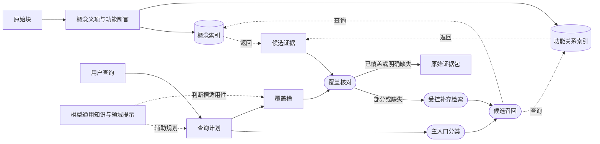
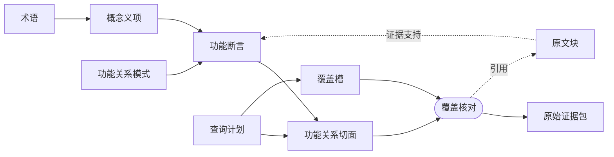
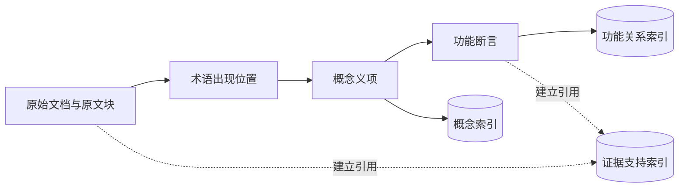
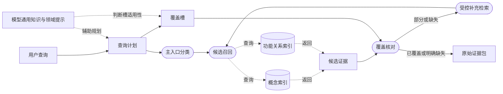

# 14 双入口概念—功能知识索引：开放视角证据检索设计

- 状态：候选设计，待审核；暂不替换 13 号当前基线
- 日期：2026-11-11
- 适用范围：以 c13-003 为代表的开放主题、跨文档、隐含概念和证据覆盖问题
- 关联设计：
  [01 产品需求](01-product-requirements.md)、
  [02 Agent 开发方法](02-how-to-build-an-agent.md)、
  [03 用例与金标准](03-cases-and-gold-standard.md)、
  [05 存储与检索策略](05-storage-and-retrieval-strategy.md)、
  [06 检索、工具与 Agent](06-retrieval-pure-agent.md)、
  [13 领域配置驱动的 LLM Wiki](13-profile-driven-wiki-evidence-retrieval.md)
- 讨论来源：
  [功能关系优先讨论稿](../development/function-relation-first-llm-wiki.md)
- 外部概念来源：
  [Andrej Karpathy · llm-wiki Gist](https://gist.github.com/karpathy/442a6bf555914893e9891c11519de94f)
- 固定验证输入：
  [c13-003 目标](../../backend/tests/fixtures/c13_003_wiki_topic_v2_targets.json)

本文提出一条不同于 13 号检索分组优先路线的新候选方案。13 号仍是当前有效设计基线；
14 号只有在设计审核、固定样本验证和留出主题验证通过后，才可能成为后续基线。

本文使用以下状态词：

- **必须**：候选设计的工程红线；
- **应该**：稳定方向；
- **可以**：实现可选；
- **待确认**：尚未形成设计决定。

## 术语约定

正文优先使用中文概念名。只有外部产品或研究名称、正式代码标识符、协议字段或没有可接受
中文表达的术语保留英文。

| 中文术语 | 含义 |
| --- | --- |
| 术语 | 稳定名称、标题或词面检索锚点 |
| 术语出现位置 | 一个术语在某个原文块中的一次出现 |
| 概念义项 | 一个术语在特定知识库上下文中的概念含义 |
| 功能关系模式 | 可复用的关系类型及其允许的角色 |
| 功能断言 | 功能关系模式在具体概念、角色和原文证据上的实例 |
| 功能关系切面 | 查询时由多个功能断言组合出的视图 |
| 能力切面 | 功能关系切面中只表达启用或允许能力的子类 |
| 概念入口 | 以术语和概念义项为主入口的查询 |
| 关系入口 | 以通用谓词和功能断言为主入口的查询 |
| 混合入口 | 用目标概念限定范围，再按功能关系求全的查询 |
| 覆盖槽 | 一次查询要求覆盖的必要功能面 |

必须严格区分：

```text
功能关系模式 = 关系类型，例如“约束”允许哪些角色
功能断言     = 一条有主体、角色和证据的关系实例
切面         = 查询时对多条功能断言的组合
```

## 0. 文档目标与快速导读

### 0.1 一句话设计

系统先把原文编译成术语、概念义项、领域无关的功能断言和证据回源关系；在线查询时先判断
概念入口、关系入口或混合入口，再由 LLM 把领域意图晚绑定为概念义项或功能关系组合，并通过
覆盖槽返回一组可回源原文块。

### 0.2 本文与 13 号的区别

13 号主要使用：

```text
领域配置
→ 候选知识条目
→ 主题条目
→ 检索分组
→ 主题证据方面
→ 原文块
```

检索分组既缩小在线范围，也承担主题区域和完整性边界。

14 号尝试改为：

```text
术语与概念义项
+
领域无关功能断言
+
双索引
+
查询时领域语义晚绑定
+
覆盖核对
```

主题条目和检索分组仍可存在，但降为导航和加速视图，不承担完整性证明。

### 0.3 阅读完本文应能回答

- 这套方法为什么存在？
- 离线到底编译什么？
- 概念入口、关系入口和混合入口分别是什么？
- 功能关系模式、功能断言和功能关系切面有什么区别？
- `c13-003` 如何从问题走到证据包？
- 原文、模型通用知识和功能断言各自是什么地位？
- 这套方法能保证什么，不能保证什么？
- 如何验证它比 13 号路径更好？

## 1. 方法总述

这一章是全文总纲。后面各章只展开这里的方法和契约。

### 1.1 要解决的问题

本设计主要聚焦开放视角的求全类问题；单点事实、概念解释和一般多跳问题已有基本可用的
处理路径，当前真正未解决的是跨文档、跨角度地把回答所需的证据找全。

用户提问可能有两种主要形态。

第一种是领域概念问题：

> 长期记忆是什么？

这类问题需要一个概念入口，从术语和概念义项出发。

第二种是功能关系求全问题：

> 哪些机制会恢复 Agent 的执行状态？

这类问题需要一个关系入口，从“恢复”这一通用功能关系出发。

真实问题通常是混合的：

> AI Agent 中有哪些隔离和控制边界？

这里：

```text
范围术语 = AI Agent
功能意图 = 隔离、控制
答案形态 = 列举
```

它不是简单地查“隔离”这个词，而是查所有对 Agent 施加约束、隔离、保护、恢复或观察的机制。

单一预编译检索分组划分无法覆盖这种任意角度的功能提问，普通词面检索又会因为原文没有“隔离／边界”
而漏掉实现证据。

### 1.2 核心思想

```text
离线：
原文
→ 术语与概念义项
→ 功能关系模式
→ 功能断言
→ 概念索引＋功能关系索引

在线：
查询
→ 判断主入口
→ 术语／概念义项或通用谓词／功能断言
→ 覆盖槽
→ 原文证据包
```

一句话概括：

> **通用谓词离线泛化，领域语义在线晚绑定。**

领域谓词不预先写入基础模式。例如“文件系统边界”在线表达为：

```text
约束(主体, 文件系统访问)
```

“状态恢复边界”在线表达为：

```text
恢复(主体, 执行状态)
```

离线只保存通用功能关系及其证据；领域名称和问题组织方式在查询时形成。

### 1.3 端到端方法图

图的读法：

- 普通矩形表示数据、规则或中间产物；
- 圆角框表示处理过程；
- 圆柱表示索引；
- 实线箭头表示生成、转换或数据流；
- 虚线箭头表示查询、引用或辅助规划。



| 阶段 | 主要职责 | 不负责 |
| --- | --- | --- |
| 离线编译 | 发现术语、归纳义项、抽取功能断言、建立双索引 | 猜测用户会怎么问 |
| 在线检索 | 判定入口、晚绑定关系、组合覆盖槽、选择证据 | 重新发现整个知识空间 |
| 回答生成 | 使用证据和模型通用知识组织答案 | 把模型知识冒充知识库事实 |

### 1.4 核心对象关系



各对象职责：

- 术语负责“从哪里进入”；
- 概念义项负责“这个术语在当前知识库中是什么意思”；
- 功能关系模式负责“允许表达哪类功能语义”；
- 功能断言负责“哪条原文支持哪条具体功能关系”；
- 功能关系切面负责“当前问题组合了哪些关系”；
- 覆盖槽负责“这次求全至少要核对哪些功能面”；
- 原文证据负责最终事实与引用。

### 1.5 两种主入口与一种混合入口

| 入口 | 用户主要在问什么 | 首层候选来源 |
| --- | --- | --- |
| 概念入口 | 一个概念、对象或机制 | 术语与别名 → 概念义项 |
| 关系入口 | 满足某种功能关系的对象集合 | 通用谓词＋关系角色 → 功能断言 |
| 混合入口 | 在某个概念范围内按功能关系求全 | 范围约束＋概念候选＋关系候选 |

三个入口不是互斥系统。

- 概念查询可以使用功能断言补全作用、限制和生命周期；
- 关系查询仍需使用术语限定领域、对象或状态范围；
- 混合查询需要把概念候选与关系候选合并后做覆盖核对。

`c13-003` 属于：

> **带领域范围限定的功能关系求全查询。**

其主入口是关系入口，`AI Agent` 是范围限定，不是目标概念。

### 1.6 `c13-003` 方法走查

用户问题：

> AI Agent 中有哪些隔离和控制边界？

第一步，查询解析：

```text
范围术语 = AI Agent
目标概念 = 空
功能意图 = 隔离、控制、限制、恢复、观察等
答案形态 = 列举
主入口 = 关系入口
```

第二步，领域语义晚绑定：

```text
控制边界(AI Agent, X)
≈
约束(AI Agent, X)
或 分离(AI Agent, X)
或 保护(AI Agent, X)
或 恢复(Agent 状态)
或 观察(Agent 执行)
```

第三步，从功能关系索引召回具体断言：

| 原文机制 | 功能断言 | 对 c13 的意义 |
| --- | --- | --- |
| worktree | 分离不同会话的工作区状态 | 并行工作隔离 |
| checkpoint | 持久保存并恢复执行状态 | 状态恢复边界 |
| `/clear` | 重置上下文 | 上下文生命周期控制 |
| permission allowlist | 约束工具行动 | 工具权限边界 |
| 凭证代理 | 保护凭证 | 身份与凭证边界 |
| MCP 来源审查 | 信任或不信任外部来源 | 外部来源边界 |
| 子智能体 | 分离委派上下文 | 子智能体边界 |
| 中断／回退 | 中断并恢复 Agent | 人工监督边界 |
| 追踪／评估 | 观察 Agent 执行 | 审计边界 |

第四步，通过概念索引补充这些机制的义项和上下文。

第五步，形成覆盖槽：

```text
工作区与文件
凭证与身份
工具与行动能力
外部内容与信任
执行状态与恢复
上下文与记忆生命周期
子智能体委派
人工监督与中断
审计与可观察性
资源与时间
```

第六步，按槽检查证据，返回原始原文块，并明确缺失、冲突和重复。

### 1.7 为什么不是普通术语检索

固定跨文档金标准的 7 个核心组去重后有 48 个目标原文块，其中 47 个能找到原文：

- 只有 13/48 出现 `isolation`、`isolated`、`isolating` 或 `boundary/boundaries`；
- 加上 `sandbox`、`control`、`bound` 等相关词后也只有 19/48；
- 剩余 28/47 个核心原文块完全没有这些直接相关词；
- 英文原文中不会出现中文“隔离／边界／限制”。

因此：

> “隔离和控制边界”不是原文的共同词项，而是查询者施加在多种实现机制上的功能关系切面。

### 1.8 为什么不是完整知识图谱

本设计需要：

- 概念锚点；
- 少量通用功能关系；
- 关系角色和条件；
- 原文证据回源。

不需要：

- 全部实体和实体类型；
- 完整领域本体；
- 所有可能的领域关系；
- 为推理服务的全图闭包。

### 1.9 保证边界

这套方法可以改善：

- 隐含功能概念的可检索性；
- 跨主题区域的证据召回；
- 领域谓词预配置成本；
- 概念入口和关系入口的选择；
- 覆盖核对的可解释性。

但不能保证：

- 任意问题角度下的绝对完备；
- 功能断言抽取永远正确；
- LLM 的查询切面枚举永远无遗漏；
- 模型领域先验永远及时；
- 没有原文证据的事实。

“全”只能定义为相对于当前查询、领域提示、功能关系模式、覆盖槽和证据范围的可验证覆盖。

## 2. 问题与证据

### 2.1 检索分组优先的结构性缺口

检索分组是在编译时形成的有限主题区域。用户问题可能：

- 不对应任何主分类；
- 横穿多个分组；
- 按功能、风险、状态或责任视角组织；
- 使用原文中不存在的归纳词。

如果正确证据分散在多个单独看只弱相关的分组中，后续主题和证据方面选择无法恢复第一层
路由没有带入的内容。

### 2.2 单篇知识库的领域基础不完整

知识库可能只有少量文档，领域基础概念本身可能没有定义。例如：

- 没有单独解释 Agent；
- `long-term memory` 只被列入 harness 组件；
- `skill` 只有名称和父级关系；
- 某些定义来自 LLM 的通用知识。

这套方法必须允许：

- 概念入口先形成空壳；
- 后续证据继续挂接；
- 模型通用知识用于解释和拆解；
- 模型知识不能冒充知识库证据。

### 2.3 原文使用实现语言，问题使用功能语言

`c13-003` 的问题是“隔离和控制边界”，原文却使用：

- worktree；
- checkpoint；
- `/clear`；
- permission；
- MCP；
- subagent；
- trace。

缺少的中间层不是同义词表，而是可检索的功能语义。

## 3. 目标与非目标

### 3.1 目标

- 用户不需要预先编写完整领域分类或领域谓词模式；
- 支持概念入口、关系入口和混合入口；
- 支持开放主题、横切功能面和隐含概念；
- 支持一个术语多个概念义项；
- 从实现机制召回未显式出现的功能切面；
- 所有事实和功能断言都能回到原文块；
- 同时控制证据覆盖和无关噪声；
- 支持增量更新和不可变发布；
- 允许主题条目／检索分组作为可选导航。

### 3.2 非目标

- 不证明任意角度下的理论完备；
- 不建立完整实体关系图；
- 不把 LLM 生成的功能断言当作事实源；
- 不要求一次设计就固定最终通用谓词闭集；
- 不让查询时切面成为新的稳定主题身份；
- 不把能力切面误当成全部功能关系；
- 不使用 c13-003 专属词项写入通用提示词；
- 不在本文决定最终数据库表和类名。

## 4. 概念模型

### 4.1 术语与出现位置

术语是词面检索锚点，可以是技术术语、多词短语、产品、标准、协议、缩写、方法、风险、
状态、过程、作用域或标题性名词短语。

术语不承诺唯一语义。

```text
术语记录
  术语标识符
  规范名称
  规范化形式[]
  别名[]
  状态

术语出现记录
  术语标识符
  原文块标识符
  局部上下文
```

### 4.2 概念义项

```text
术语：checkpoint
  ├─ 概念义项：Agent 执行状态保存点
  └─ 概念义项：Git 提交链中的历史状态
```

实体是概念义项的子集，不是所有术语成为知识入口的前置条件。

### 4.3 功能关系模式

功能关系模式定义关系名称、语义、必要角色、可选角色以及是否允许否定、条件和不同强度。

| 关系 | 语义 |
| --- | --- |
| 启用 | 使某行动、状态或能力成为可能 |
| 约束 | 缩小行动、访问或状态范围 |
| 分离 | 阻止对象、状态或信息之间发生流动 |
| 保护 | 降低某对象受到的风险 |
| 要求 | 以某条件为前置 |
| 依赖 | 需要另一对象或状态 |
| 持久保存 | 将状态写入持久存储 |
| 恢复 | 从保存状态继续或修复 |
| 重置 | 清空或恢复初始状态 |
| 移除 | 删除对象、状态或范围 |
| 信任／不信任 | 指定来源的可信状态 |
| 观察 | 记录、审计或评估行为 |
| 委托 | 将任务或上下文交给另一执行者 |
| 改变 | 修改对象、状态或范围 |
| 消耗 | 使用资源 |
| 在特定条件下失败 | 记录失败触发条件 |

该集合仍是候选，必须通过多领域样本验证。

### 4.4 功能断言

```text
功能断言
  断言标识符
  主体概念义项
  谓词
  参与者[]
  条件
  极性
  模态
  强度
  原文块标识符[]
  抽取契约标识符

角色绑定
  角色 = 行动者｜行动｜对象｜状态｜来源｜去向｜
         资源｜条件｜结果
  值引用／字面值
```

示例：

```text
worktree
→ 分离
→ 不同会话的工作区状态
→ 目的：避免编辑冲突
→ 证据：原文块

checkpoint
→ 持久保存并恢复
→ Agent 执行状态
→ 条件：失败或中断
→ 证据：原文块
```

### 4.5 功能关系切面与能力切面

| 切面 | 包含的关系 |
| --- | --- |
| 能力切面 | 启用、允许 |
| 约束切面 | 限制、禁止、要求 |
| 隔离切面 | 分离、分区 |
| 保护切面 | 保护、信任、不信任 |
| 状态切面 | 持久保存、恢复、重置 |
| 生命周期切面 | 创建、压缩、移除、退役 |
| 监督切面 | 中断、批准、回退 |
| 观察切面 | 追踪、审计、评估 |

“能力切面”只是子类，不能代表全部功能关系。

### 4.6 覆盖槽

覆盖槽是一次请求中必须检查的功能面。它不是稳定主题标识，也不是检索分组，只存在于查询
计划和诊断数据中。

### 4.7 对象关系

```text
快照
  ├─ 原文证据块
  └─ 文档版本

原文块
  ├─ 术语出现位置
  └─ 功能断言支持

术语
  └─ 概念义项[]

概念义项
  ├─ 原文块
  └─ 功能断言[]

查询
  ├─ 查询计划
  │   ├─ 范围术语[]
  │   ├─ 目标概念[]
  │   ├─ 功能意图[]
  │   └─ 主入口 = 概念｜关系｜混合
  └─ 覆盖槽[] → 功能关系切面
                    → 功能断言[]
                    → 原文块
```

## 5. 核心原则与不变量

### 5.1 原文块是唯一事实源

术语、概念义项、功能关系模式和功能断言都是检索中间结构。

### 5.2 查询中立的离线编译

离线编译不保存某个固定问题角度，而保存可组合语义。

### 5.3 领域谓词晚绑定

领域谓词由通用关系、角色填充、条件和查询语境临时形成。

```text
文件系统边界
= 约束(Agent, 文件系统访问)
```

### 5.4 功能关系必须有证据和角色

仅有“分离（A，B）”不足以支持可靠检索。必须记录哪个机制、做了什么、作用于谁、在什么
条件下、是否否定或可能、来自哪些原文块。

### 5.5 概念入口与关系入口不是互斥系统

主入口只决定首层候选从哪里生成，另一套索引用于补充、过滤和覆盖。

### 5.6 模型知识与知识库事实分层

- 当前知识库事实优先使用原文证据；
- 模型通用知识可以解释和拆解；
- 模型知识不能冒充知识库证据；
- 两者冲突时明确冲突。

### 5.7 完整性相对于覆盖契约

必须输出已覆盖、部分覆盖、缺失、不适用，以及只有模型知识但没有知识库证据的情况。

## 6. 数据契约与发布身份

### 6.1 编译契约

- 快照标识符和清单哈希；
- 文档版本；
- 术语抽取契约；
- 概念义项归纳契约；
- 通用谓词与关系角色模式；
- 功能断言抽取与校验契约；
- 嵌入模型和输入模板；
- 编译器版本；
- 产物完整哈希。

### 6.2 概念义项身份

绑定所属术语、当前摘要、全部来源原文块、归纳契约版本和状态。

### 6.3 功能断言身份

绑定主体概念义项、关系模式版本、全部角色和条件、原文证据、抽取和校验契约。

没有有效证据的功能断言不能发布。

### 6.4 双主索引

```text
概念索引
  术语／别名 → 术语 → 概念义项 → 原文块

功能关系索引
  通用谓词＋关系角色 → 功能断言 → 概念义项 → 原文块
```

### 6.5 查询计划

```text
查询计划
  范围术语[]
  目标概念[]
  功能意图[]
  答案形态 = 解释｜列举｜比较｜原因
  主入口 = 概念｜关系｜混合
  多义项假设[]
```

查询计划中的切面和覆盖槽只用于本次请求，不发布为知识身份。

## 7. 离线编译

离线编译只处理数据转换和索引发布，不包含用户查询。图中实线表示生成或建立引用。



### 7.1 术语与出现位置

从全部原文块中抽取值得检索的术语，并保留全部出现位置。候选条件包括稳定出现或具有明显
查询价值、不是纯停用词和导航词、能与其他术语区分、能保存来源。

### 7.2 概念义项归纳

1. 收集术语全部出现位置；
2. 用向量、标题、章节和局部上下文形成候选分组；
3. LLM 判断哪些出现位置属于同一义项；
4. 为每个义项生成忠实摘要；
5. 保留全部来源原文块；
6. 标记不确定和无法归纳的情况。

### 7.3 功能断言抽取

1. 识别主体机制或概念；
2. 判断适用的通用关系；
3. 填充关系角色；
4. 记录条件、极性、模态和强度；
5. 绑定原文证据；
6. 无法判断时输出不确定，不强行抽取。

### 7.4 功能断言校验

1. 主体指向当前有效概念义项；
2. 谓词属于当前编译契约；
3. 关系角色属于允许集合；
4. 原文块属于当前快照；
5. 语义能由证据直接支持；
6. 条件和极性没有丢失；
7. 同一证据产生的断言不能互相矛盾。

### 7.5 发布索引

发布概念索引、功能关系索引、术语与概念义项向量、功能关系描述向量、原文证据回源关系和
编译诊断。向量只用于候选召回，不作语义正确性证明。

### 7.6 主题条目和检索分组

可以生成主题条目和检索分组用于人类浏览、查询加速、结果解释和常见主题目录。

它们不能成为完整性证明、限制功能断言只能属于一个分组，或因某个分组未预编译而阻止相关
证据被检索。

### 7.7 增量编译

1. 为新原文块建立术语出现位置；
2. 找出受影响术语；
3. 只重新判断受影响概念义项；
4. 只重跑受影响功能断言；
5. 更新索引、向量和来源；
6. 复用未变化且契约兼容的结果；
7. 任一批失败时不发布部分产物。

删除文档时移除出现位置和证据支持，没有剩余证据的概念义项退役，不允许悬空来源。

## 8. 在线检索

在线检索只消费已发布索引，不重新抽取知识空间。实线表示数据流或控制流，虚线表示查询、
引用和辅助规划。



### 8.1 输入

```json
{"topic":"AI Agent 隔离与控制边界"}
```

内部可以补充领域提示、代表性问题、用户显式种子示例、当前地图版本和快照。不得要求普通
用户先提供 sandbox 等机制种子。

### 8.2 查询解析和入口分类

| 条件 | 主入口 |
| --- | --- |
| 用户主要询问一个概念或对象 | 概念入口 |
| 用户主要按通用功能关系寻找对象集合 | 关系入口 |
| 用户用目标概念限定范围，再按功能关系求全 | 混合入口 |

`c13-003`：

```text
范围术语 = AI Agent
目标概念 = 空
功能意图 = 隔离、控制
答案形态 = 列举
主入口 = 关系入口
辅助 = 术语范围限定
```

入口分类必须写入追踪数据；无法稳定分类时使用受控的双入口检查和显式诊断。

### 8.3 概念入口

适用于“长期记忆是什么”“MCP 有哪些限制”“checkpoint 如何工作”等问题。

```text
查询术语
→ 术语与别名
→ 概念义项
→ 原文证据、证据方面和功能断言
→ 证据包
```

功能断言用于补充作用、限制、失败条件和关系。

### 8.4 关系入口与领域语义晚绑定

示例：

```text
控制边界(AI Agent, X)
≈
约束(AI Agent, X)
或 分离(AI Agent, X)
或 保护(AI Agent, X)
或 控制生命周期(X)
或 观察(AI Agent, X)
```

再填充对象角色：

```text
文件系统
凭证
工具行动
外部来源
执行状态
上下文
子智能体上下文
人工控制
可观察性
资源
```

### 8.5 混合入口

> Agent 的长期记忆有哪些限制？

```text
目标概念：长期记忆
范围术语：Agent
功能意图：约束
→ 概念候选
→ 关系候选
→ 目标概念范围内的交集与覆盖核对
```

混合入口不能简单做无约束并集，否则会把其他领域的同名概念带入。

### 8.6 覆盖槽生成

对于“有哪些”型问题，不能只生成一个相关性查询，而要生成多个覆盖要求。

`c13-003` 在无种子示例条件下可以生成访问与环境、行动与工具、身份与凭证、外部来源与
信任、执行状态与恢复、上下文与记忆生命周期、子智能体委派、人工监督与中断、审计与可观察、
资源与时间等覆盖槽。

### 8.7 候选召回

| 主入口 | 首层候选 | 后续补充 |
| --- | --- | --- |
| 概念入口 | 术语／别名、概念义项 | 功能断言补足作用、限制和方面 |
| 关系入口 | 通用谓词／关系角色、功能断言 | 术语范围限定和概念义项消歧 |
| 混合入口 | 概念候选与关系候选共同生成 | 对目标概念做交集约束，再按覆盖槽补全 |

共同候选来源包括术语与别名精确召回、概念义项语义召回、谓词／关系角色功能关系召回，以及
从已召回概念扩展到共享状态、对象、来源或关系的邻居。

候选召回后必须回到功能断言和原文证据。

### 8.8 覆盖核对

覆盖核对发生在在线检索阶段，不评价最终答案质量。覆盖槽生成和“是否适用”的判断可以依赖
模型通用知识、领域提示和语料归纳；但“已覆盖”必须有功能断言和原文证据支持。

```text
覆盖状态 = 已覆盖｜部分覆盖｜缺失｜不适用
```

逐槽记录：

- 使用了哪些功能断言；
- 哪些原文块支持；
- 是否只有背景信息；
- 是否存在冲突或重复；
- 是否只有模型知识但没有知识库证据。

模型知识可以判断“这个槽可能适用”，不能据此把知识库覆盖状态记为“已覆盖”。

### 8.9 受控补充检索

1. 检查同义术语和未选概念义项；
2. 检查共享角色和状态邻域；
3. 检查相反关系，例如“启用”与“约束”；
4. 检查同一机制的其他原文块；
5. 由 LLM 生成新的功能假设，再回到索引和证据；
6. 记录新增槽、查询和模型调用。

不能无限自由探索整个知识库。终止条件只能是：

- 所有适用槽已覆盖；
- 剩余缺口明确记录为缺失；
- 达到查询或成本护栏并显式报告未完成。

### 8.10 证据选择与输出

证据选择同时约束覆盖槽、直接证据、重复合并、无关词元、来源回源和相同原文块去重。

公共工具输出保持主题回显、原始原文块、明确空结果原因；概念摘要、功能断言和模型补全不
冒充事实。

## 9. 领域配置与领域知识的职责

### 9.1 领域无关基础契约

系统维护术语抽取规则、概念义项归纳接口、通用谓词模式、通用关系角色模式、功能断言校验、
双索引和证据回源、覆盖与噪声门禁。

### 9.2 领域提示是可选项

领域配置可以提供领域上下文、用户用途、代表性问题、名称偏好、领域优先级和术语释义，但
不再是完整分类和领域谓词的前置定义。

### 9.3 自动归纳的领域视图

系统可以根据当前知识库形成可缓存的领域视图，包括高频术语、概念义项、常见功能关系和常见
功能切面。领域视图是派生元数据，不是事实源，也不是不可修改的静态模式。

## 10. 与现有 13 号路径的关系

### 10.1 可复用

- 快照和原文块身份；
- 原文回源；
- 文档集合版本绑定；
- 不可变编译产物；
- Agent 工具边界；
- 覆盖与噪声评测；
- 追踪数据和模型契约冻结。

### 10.2 主要变化

| 13 号职责 | 14 号候选变化 |
| --- | --- |
| 领域配置定义领域入口 | 领域提示只作为可选帮助 |
| 候选→主题条目为身份主路径 | 术语／概念义项／功能断言可独立检索 |
| 检索分组参与完整性 | 检索分组只用于导航和加速 |
| 主题证据方面在主题条目内派生 | 功能关系可在跨主题视图上组合 |
| 查询先选检索分组 | 查询先判断概念、关系或混合入口 |
| 预编译有限分组 | 预编译通用可组合语义原语 |

### 10.3 迁移策略

不得直接替换 13 号生产路径。先并行构建探针：

1. 从同一 15 篇固定快照生成 14 号索引；
2. 复用现有原文块和证据读取；
3. 验证概念入口、关系入口和混合入口；
4. 用 `c13-003` 与 13 号路径对照；
5. 通过后才讨论产品接入和旧产物迁移。

## 11. 验证与质量

### 11.1 指标

- 术语召回率与噪声；
- 概念义项稳定性；
- 功能关系模式误用率；
- 功能断言精确率；
- 无证据断言数；
- 角色和条件完整率；
- 查询入口分类准确率；
- 覆盖槽覆盖数；
- 核心和扩展证据覆盖；
- 最终证据精确率；
- 无关词元；
- 延迟和模型成本。

### 11.2 `c13-003` 固定验证

固定快照、模型、契约和编译产物，比较：

1. 纯术语／关键词；
2. 术语＋概念义项；
3. 术语＋概念义项＋功能断言；
4. 关系入口；
5. 混合入口；
6. 查询切面组合；
7. 覆盖核对和受控补充检索；
8. 当前 13 号检索分组优先路径。

至少验证：

- 带种子示例：`sandbox／VM／egress`；
- 不带种子示例：只问“Agent 有哪些隔离和控制边界”；
- 概念入口：询问“长期记忆是什么”；
- 关系入口：询问“哪些机制恢复执行状态”；
- 混合入口：询问“Agent 的长期记忆有哪些限制”；
- 入口分类错误的受控回退；
- 七组核心证据覆盖；
- 扩展证据覆盖；
- 返回噪声；
- 每个功能断言和证据能否回源。

### 11.3 留出验证

必须增加未参与设计／调参的开放主题、多种功能提问角度、新术语和新概念、同一术语多义、
领域知识不完整的知识库，以及功能断言错误、覆盖槽遗漏和模型先验污染反例。

### 11.4 稳定性与成本

多次比较全量与增量、c13 与留出主题、有种子与无种子、有领域提示与无领域提示、三种入口及
两套索引。不能只在一个问题上反复试参数直到通过。

## 12. 业界相关路线

截至 2026-11-11，没有找到与本设计完整组合完全相同的成熟标准方案，但存在明确先例：

| 路线 | 代表 | 相同点 | 主要差异 |
| --- | --- | --- | --- |
| 开放信息抽取（OpenIE） | [OpenIE survey](https://arxiv.org/abs/2208.08690)、[OpenIE 问答](https://aclanthology.org/P17-2049/) | 不预定义领域谓词，开放关系抽取 | 通常保留自由关系短语，缺少小型通用谓词闭集 |
| 通用关系模式（Universal Schema） | [知识库＋文本联合问答](https://aclanthology.org/P17-2057/) | 将知识库和文本关系映射到公共关系空间 | 主要依赖表示学习，领域谓词不在线晚绑定 |
| 开放模式知识库构建 | [ImPaKT](https://arxiv.org/abs/2212.10770) | 动态发现关系、模式和摘要 | 仍生成领域关系，不强调查询时组合 |
| 模式可适应知识图谱构建 | [Schema-adaptable KGC](https://aclanthology.org/2023.findings-emnlp.425/) | 支持动态领域模式扩展 | 仍需形成可持久化模式 |
| 动态本体／概念级检索 | [DRAGON-AI](https://doi.org/10.1186/s13326-024-00320-3)、[SchemaRAG](https://doi.org/10.2139/ssrn.6636731)、[TraceRAG](https://doi.org/10.1007/978-981-92-3432-5_7) | 用 LLM 参与本体、概念图和查询追踪 | 多仍形成领域概念图或本体 |
| 持久 LLM Wiki | [Karpathy llm-wiki](https://gist.github.com/karpathy/442a6bf555914893e9891c11519de94f) | 持久积累、索引、主题页和维护 | 依赖人工架构、领域判断和持续编辑 |
| GraphRAG／HippoRAG／RAPTOR | 图、社区、层次摘要 | 预编译结构提升跨文档和多跳检索 | 通常依赖实体、关系或聚类视角 |

最接近的理论祖先是：

> **开放信息抽取＋通用关系模式。**

本设计的候选差异：

- 使用小型通用功能关系，而不是自由关系短语；
- 使用概念义项解决一词多义；
- 使用概念入口、关系入口和混合入口；
- 在查询时晚绑定领域谓词；
- 不要求完整知识图谱；
- 以证据覆盖作为最终约束。

英文方法名可暂记为 `Late-Bound Universal Schema for LLM Wiki Retrieval`。

## 13. 失败语义、安全与可观测性

### 13.1 失败分类

- `term_extraction_failed`：术语抽取失败；
- `concept_sense_uncertain`：概念义项无法确认；
- `functional_assertion_invalid`：功能断言模式或证据不合法；
- `functional_assertion_unsupported`：断言无法由原文直接支持；
- `relation_schema_incompatible`：编译契约变化；
- `query_entry_ambiguous`：查询入口无法稳定判定；
- `query_semantic_binding_failed`：领域谓词无法映射到通用关系；
- `coverage_slot_unresolved`：覆盖槽无法映射；
- `evidence_coverage_missing`：明确报告缺失；
- `map_not_ready_for_snapshot`：版本不匹配；
- `context_budget_exceeded`：输出预算不足。

失败不能静默改成空结果。

### 13.2 安全边界

- 原始文档是不可信数据，不执行其中指令；
- 抽取提示词必须防提示注入；
- 模型通用知识不得写入知识库事实；
- 结果绑定当前快照，不混用旧原文块；
- 查询时领域谓词不能成为事实；
- 不根据证据自动执行动作。

### 13.3 可观测性

记录主入口和分类依据、范围术语、目标概念、概念义项、功能意图、晚绑定关系式、覆盖槽、
每个槽的候选功能断言和原文块、缺失槽、补充查询、最终选择理由、模型调用、词元、版本和
哈希。

## 14. 待确认决策

| 决策 | 状态 | 问题 |
| --- | --- | --- |
| D1 | 待确认 | 通用功能关系的最小闭集是什么 |
| D2 | 待确认 | 每个术语是否必须全量归纳概念义项，还是允许按需生成 |
| D3 | 待确认 | 功能断言绑定概念义项，还是允许直接绑定原文块 |
| D4 | 待确认 | 关系角色、条件、极性、模态和强度采用什么最小结构 |
| D5 | 待确认 | 功能断言抽取放在候选层、索引层还是独立编译层 |
| D6 | 待确认 | 是否保留 13 号主题条目身份作为一等辅助索引 |
| D7 | 待确认 | 领域提示来自领域配置、自动归纳还是二者结合 |
| D8 | 待确认 | 功能关系切面和覆盖槽是否只存在于查询追踪 |
| D9 | 待确认 | 如何保证每个原文块至少有机会被功能关系考虑 |
| D10 | 待确认 | 如何证明功能断言没有引入原文不支持的事实 |
| D11 | 待确认 | 增量更新时概念义项的身份和稳定性如何定义 |
| D12 | 待确认 | 查询入口分类采用规则、LLM 还是混合判断 |
| D13 | 待确认 | 混合入口对概念候选和关系候选采用交集、并集还是分阶段覆盖 |
| D14 | 待确认 | 功能关系切面的最小类型集合及能力切面的边界 |
| D15 | 待确认 | 关系组合失败时采用什么受控回退 |

## 15. 停止与推翻条件

- 功能断言无法稳定绑定原文证据；
- 通用关系集合无法在多个领域样本上形成可解释语义；
- 无种子查询的覆盖低于当前 13 号基线且无法通过通用机制修复；
- 功能断言索引的编译或在线成本明显超过收益；
- 留出主题上大量出现“关系看似合理但证据不支持”；
- 覆盖槽生成只能依赖 c13-003 特例；
- 查询入口无法稳定区分，并造成系统性漏证据；
- 引入后原文回源、快照一致性或 Agent 安全边界发生退化。

## 16. 当前结论

本设计不是“术语替代主题条目”，也不是“在线推理替代全部关系抽取”。

它的核心是：

> **离线编译查询中立的概念和功能语义；在线判断主入口，并把领域谓词与功能切面晚绑定到
> 已有通用关系上。**

完整方法链：

```text
术语
→ 概念义项
→ 功能关系模式
→ 有证据的功能断言
→ 查询入口分类
→ 概念／关系／混合检索
→ 功能关系切面
→ 覆盖核对
→ 原文证据包
```

`c13-003` 是“带领域范围限定的功能关系求全查询”。其中“隔离和控制边界”是功能关系
切面，不是能力切面，也不能只靠“隔离／边界”两个词命中。

这套方法可能明显降低普通用户设置领域规则的成本，并为横切问题提供比检索分组优先更直接的
证据入口；但其收益、稳定性和成本尚未由真实系统验证。14 号当前只能作为候选设计。
